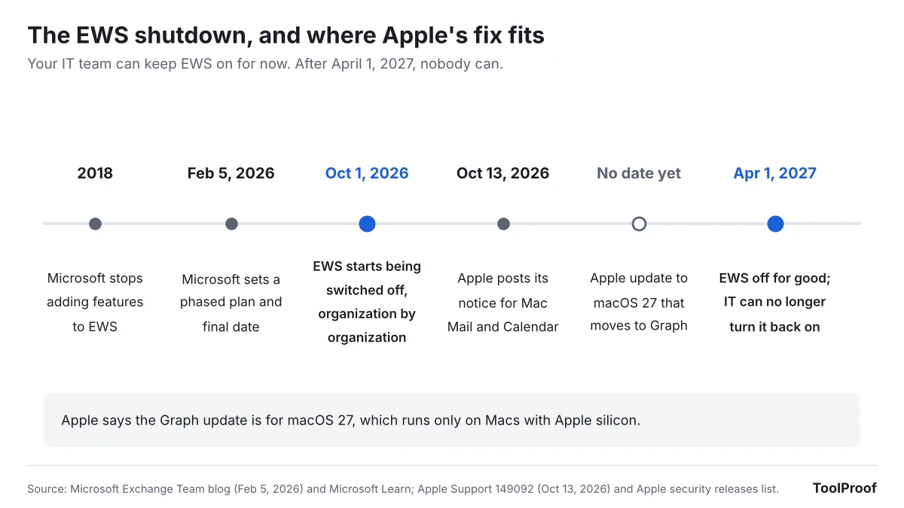
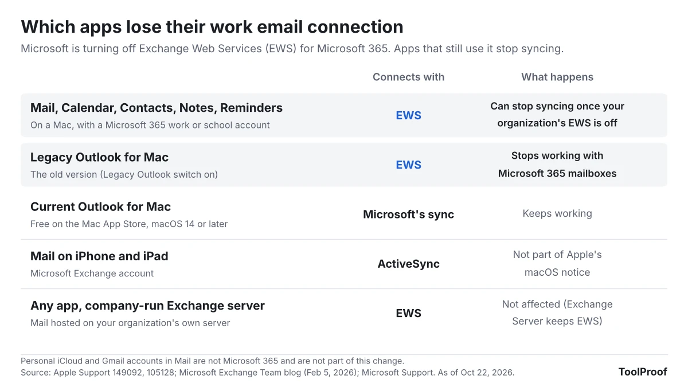
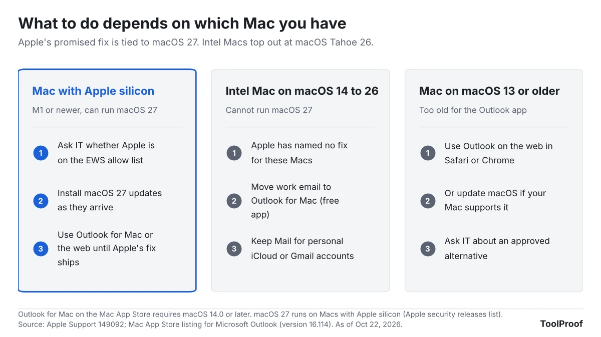

If you read your work or school email in Apple's Mail app on a Mac, it can stop syncing at any point between now and April 1, 2027. Microsoft started switching off Exchange Web Services (EWS), the old connection Mac Mail and Calendar use to talk to Microsoft 365, on October 1, 2026, one organization at a time. Apple says a fix is coming "in a future update to macOS 27," with no date, and macOS 27 only runs on Macs with Apple silicon.

Your iPhone and iPad are not part of Apple's notice, and personal iCloud or Gmail accounts in Mail are not affected. The quickest way to keep work email flowing on a Mac today is Microsoft's free Outlook for Mac app, which uses a newer connection. If your Mac is an Intel model, we think you should switch now rather than wait for a fix Apple has not promised for your computer.

As of October 22, 2026, we read Apple's support notice, Microsoft's Exchange team announcement and its legacy Outlook for Mac notice, Apple's list of macOS 27 compatible Macs, and the Mac App Store listing for Outlook. We could not test with a real Microsoft 365 work account, so the steps below come from Apple's and Microsoft's own documents.

## What happened

Exchange Web Services is a nearly 20-year-old way for apps to read and send Microsoft 365 email, calendars and contacts. In a [February 5, 2026 post](https://techcommunity.microsoft.com/blog/exchange/exchange-online-ews-your-time-is-almost-up/4492361), Microsoft's Exchange team said it would switch EWS off "tenant-by-tenant" (one organization at a time) starting October 1, 2026, unless an organization's IT team keeps it on with a list of approved apps. On April 1, 2027, EWS goes away for good and IT teams lose the ability to turn it back on. Microsoft says the change applies only to Microsoft 365 and Exchange Online; [Exchange servers that companies run themselves keep EWS](https://learn.microsoft.com/en-us/exchange/clients-and-mobile-in-exchange-online/deprecation-of-ews-exchange-online).

Apple published [its own notice](https://support.apple.com/en-us/149092) on October 13, 2026. It says that beginning in October 2026, if Mail, Calendar, Contacts, Notes or Reminders on macOS "can no longer sync with Microsoft Exchange or you can no longer sign in," you should contact your Exchange administrator. It gives IT teams the ID they need to add Apple's apps to Microsoft's approved list, and says Apple "is actively working with Microsoft" to move those apps to Microsoft Graph, the newer connection, "in a future update to macOS 27."

Microsoft's [legacy Outlook for Mac notice](https://support.microsoft.com/en-us/outlook/end-of-support-for-legacy-outlook-for-mac) says the same EWS cutoff ends that older Outlook too: "Starting October 2026, the legacy Outlook for Mac client will stop working against Exchange Online mailboxes."

## Who is affected

The apps at risk are the ones that still connect through EWS. Everything else keeps working.

| You use | Account | Affected? |
| --- | --- | --- |
| Mail, Calendar, Contacts, Notes or Reminders on a Mac | Microsoft 365 work or school account (added as Microsoft Exchange) | Yes, once your organization's EWS is switched off |
| Legacy Outlook for Mac (the old version) | Microsoft 365 work or school account | Yes, Microsoft says it stops working |
| Current Outlook for Mac | Any | No, it uses Microsoft's newer sync |
| Mail on iPhone or iPad | Microsoft Exchange account | Not in Apple's notice (iPhone and iPad use [Exchange ActiveSync](https://support.apple.com/en-us/105128)) |
| Any app | Mail on your company's own Exchange server | No, Exchange Server keeps EWS |
| Mail on a Mac | iCloud, Gmail, Yahoo or other personal accounts | No, these are not Microsoft 365 |

Whether it happens to you now, later or not until April depends on your IT team, not on you. Microsoft says it will pre-fill each organization's approved app list based on the apps that organization actually uses, and an IT team can switch EWS back on after a block. That means two coworkers at different companies, both on Mac Mail, can see different results this month.

## What changes for you

When EWS is off for your organization, Apple says Mail and the other apps either stop syncing with your work account or will not let you sign in. New messages and meeting invites stop arriving on your Mac, while the same mailbox still works on your phone, in Outlook and on the web, because the email itself is still on Microsoft's servers.

The bigger difference is which Mac you own. Apple's fix is tied to macOS 27, and [Apple's list of compatible Macs](https://support.apple.com/en-us/100100) for macOS 27 includes only Macs with Apple silicon (M1 or newer, plus the MacBook Neo). Intel Macs cannot install macOS 27, so the newest they can run is macOS Tahoe 26, and Apple's notice names no fix for that version. Outlook for Mac also has a floor: the [Mac App Store listing](https://apps.apple.com/us/app/microsoft-outlook/id985367838) requires macOS 14.0 or later.

## What to do now

1. **Check what kind of Mac you have.** Choose **Apple menu > About This Mac**. Apple says a Mac with Apple silicon shows **Chip**, and an Intel Mac shows **Processor** ([Apple Support](https://support.apple.com/en-us/116943)).
2. **Check whether your work account is in Mail.** Choose **Apple menu > System Settings > Internet Accounts** and look for your work or school address. If it is there and Mail is turned on for it, you are in the affected group.
3. **Ask your IT help desk one question:** "Is Apple Internet Accounts on our EWS allow list, and until when?" Apple's notice includes the ID they need. If the answer is yes, Mail can keep working until April 1, 2027.
4. **If you use the old Outlook for Mac,** open it and turn off the **Legacy Outlook** switch, as Microsoft's notice describes. If you do not see the switch, update the app with **Help > Check for Updates** or from the App Store.
5. **Set up a backup now, before anything breaks.** Install [Microsoft Outlook](https://apps.apple.com/us/app/microsoft-outlook/id985367838) from the Mac App Store and sign in with your work account. The listing says the app is free with personal accounts; for a work or school account, your organization's Microsoft 365 plan decides access, so ask IT if sign-in fails. On macOS 13 or older, use Outlook on the web in Safari or Chrome instead.
6. **Before you remove a work account from Mail,** move anything in the **On My Mac** section that you want to keep. Apple's [Mail guide](https://support.apple.com/guide/mail/add-email-accounts-mail35803/mac) says removing an account deletes its messages from your Mac, while copies stay on the mail server.

You can keep personal iCloud or Gmail accounts in Mail and use Outlook only for work.

## Our take

**If you have an Intel Mac, move your work email to Outlook for Mac now. If you have an Apple silicon Mac, set Outlook up as a backup and keep watching for Apple's update.**

The facts point one way. Microsoft has said since 2023 that EWS would be disabled in October 2026, and set the final April 1, 2027 date in February. Apple's notice arrived on October 13, almost two weeks after blocking began, and the fix it describes has no date and targets a version of macOS that Intel Macs cannot install. Apple's own list makes that explicit. Waiting is reasonable only if your IT team has added Apple to the allow list, and even then it only buys time until April 1.

For Apple silicon owners the risk is lower. Apple says it is working with Microsoft, and there are more than five months before the final cutoff. Still, an update that is coming is not one you can install, and signing in to Outlook takes a few minutes.

The other side: many people will notice nothing for months. Microsoft says it pre-fills each organization's allow list based on real usage, which likely includes Apple's apps at companies where Mac Mail is common, and IT teams can re-enable EWS after a block. If your help desk confirms Apple is on the list, staying in Mail until Apple ships its update is a fair choice.

Related: [Office 2021 reaching end of support](/posts/office-2021-end-of-support) covers which Outlook and Office versions still get fixes, and [Microsoft 365 Family's shared 2TB storage](/posts/microsoft-365-family-storage-2tb) covers another Microsoft 365 change.

## What to watch next

- **macOS 27 updates:** Apple's release notes for each macOS 27 update. The fix should mention Microsoft Graph or Exchange.
- **A fix for macOS Tahoe 26:** Apple's notice names only macOS 27. Any update for Intel Macs would change our advice above.
- **Microsoft test shutoffs:** Microsoft says it may run temporary "scream tests" that turn EWS off and back on to find apps that still depend on it.
- **April 1, 2027:** EWS is permanently disabled. After this date, Mail on a Mac without Apple's update cannot sync Microsoft 365 email, and no allow list helps.

We will update this article when Apple ships its Graph update or changes its notice.
