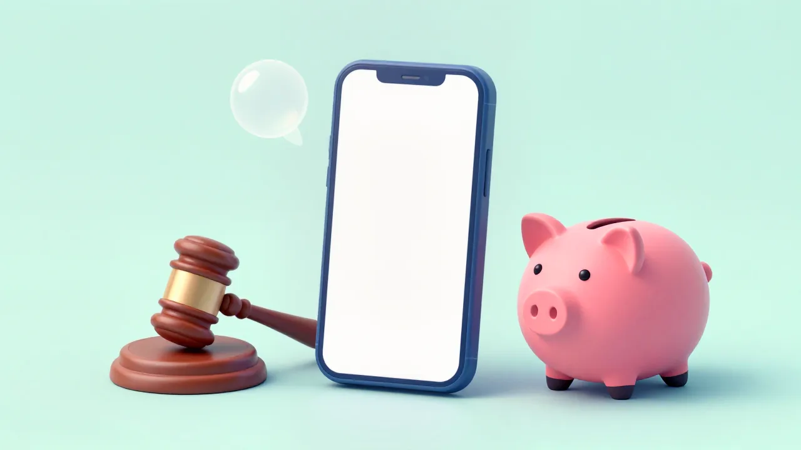

If you bought an iPhone 15 Pro, iPhone 15 Pro Max or any iPhone 16 model in the U.S. between June 10, 2024, and March 29, 2025, you can claim part of Apple's $250 million settlement over the Siri features it advertised but didn't ship. The claim deadline is December 21, 2026. It takes a few minutes and needs one thing most people can find in their Settings app: the phone's serial number.

The settlement papers call $25 per phone the "presumptive" payment, but that's not a fixed amount. Whatever is left after fees is split among everyone who files, up to $95 per phone. Using the numbers in the court filings, we worked out that the $25 figure assumes roughly one in five eligible iPhones gets claimed. In the past Apple and phone settlements the lawyers themselves cite, only 2.6% to 3.6% were. That's why we think filing is worth it even if $25 sounds small.

We read the settlement agreement, the judge's preliminary approval order and the scheduling order in *Landsheft v. Apple* (U.S. District Court, Northern District of California, case 5:25-cv-02668) on October 19, 2026. The official claim site, SmartphoneAISettlement.com, blocked our automated browser, so the December 21 date comes from class counsel's page and the claim form details from the version filed with the court.

## What happened

Apple agreed in May 2026 to pay $250 million to settle lawsuits claiming it sold iPhones by promising Siri features powered by Apple Intelligence that weren't available. The settlement agreement says Apple denies wrongdoing and notes it has "delivered more than 20 Apple Intelligence features" and expects to add more Siri features "at no additional cost."

Judge Noël Wise granted preliminary approval on July 17, 2026, and named Verita Global as the settlement administrator. Claims opened in September, and [class counsel's page](https://clarksonlawfirm.com/lp/apple-intelligence-false-advertising/) says eligible buyers can submit a claim at SmartphoneAISettlement.com "before December 21, 2026." The final approval hearing is set for February 24, 2027, after the judge [moved it up](https://storage.courtlistener.com/recap/gov.uscourts.cand.446692/gov.uscourts.cand.446692.97.0.pdf) from September 2027.

## Who is affected

The [preliminary approval order](https://storage.courtlistener.com/recap/gov.uscourts.cand.446692/gov.uscourts.cand.446692.94.0.pdf) defines the class as U.S. residents who bought an eligible iPhone in the U.S., for any reason other than resale, during the class period.

| If you... | Can you claim? |
| --- | --- |
| Bought an iPhone 15 Pro or 15 Pro Max in the U.S. between June 10, 2024, and March 29, 2025 | Yes |
| Bought any iPhone 16, 16 Plus, 16 Pro, 16 Pro Max or 16e in the U.S. in that window | Yes |
| Bought one of those phones before June 10, 2024, or after March 29, 2025 | No, the purchase date is outside the class period |
| Bought a regular iPhone 15 or 15 Plus | No, those models aren't covered |
| Got the phone as a gift or secondhand | The claim form asks you to certify that you purchased it, so the buyer is the one who claims |
| Bought several eligible phones | Yes, one payment per phone. The claim forms filed with the court ask for each phone's serial number or account details |
| Bought it to resell, or live outside the U.S. (including Canada) | No |
| Already sold, traded in or lost the phone | Yes, if you bought it in the window. You'll need its serial number or the Apple Account and phone number you used with it |

The iPhone 15 Pro, 15 Pro Max and iPhone 16 models in this class are also the iPhones that can run Siri AI in iOS 27, which saves your Siri conversations in a new Siri app. Our guide to [seeing and deleting Siri history on iPhone](/posts/siri-history-on-iphone) covers what that app keeps and what Apple stores on its servers.

## What changes for you

Filing gets you a share of what's left of $250 million after costs. Not filing gets you nothing, and you still give up the right to sue Apple over these claims on your own, because everyone in the class is bound by the settlement unless they opt out.

The amount per phone depends on how many people file. The settlement agreement starts at $25 per device, then lowers it if valid claims exceed the money available and raises it, up to $95, if they don't. If money is still left after everyone reaches the $95 cap, the two sides decide how to distribute it, and if paying class members more isn't practical, it goes to a recipient the court approves. None goes back to Apple.

Here's how we estimated it, using only figures from the court filings:

| Item | Amount | Source |
| --- | --- | --- |
| Settlement fund | $250,000,000 | Settlement agreement |
| Attorneys' fees and expenses, maximum class counsel said it would request | up to $70,000,000 (28%) | Motion for preliminary approval |
| Notice and administration, administrator's cap | up to $5,444,056 | Verita's declaration |
| Awards for the 65 named plaintiffs | up to $130,000 ($2,000 each) | Motion for preliminary approval |
| Left for people who claim | about $174.4 million | Our calculation |
| Eligible iPhones | about 37 million | Motion for preliminary approval |

Divide $174.4 million by the number of claimed phones and you get the payment per phone. At $25 each, it covers about 7 million phones, or roughly 19% of eligible devices. If fewer than about 5% are claimed, everyone hits the $95 cap. The judge [wrote](https://storage.courtlistener.com/recap/gov.uscourts.cand.446692/gov.uscourts.cand.446692.94.0.pdf) that the parties expect a "low probability" of reaching the cap because the notice campaign is designed to drive more claims, so treat $95 as a ceiling, not a forecast. Fees are set by the judge at final approval and could be lower than the maximum, which would leave more for claimants.

Payments won't arrive soon either way. The settlement says claims are paid within 60 days after the "Effective Date," which comes only after final approval and after any appeals run out. With a February 24, 2027, hearing, that points to spring 2027 at the earliest.

## What to do now

1. **Check the model and the date.** Find your receipt or order email and confirm which model you bought and that you bought it between June 10, 2024, and March 29, 2025.
2. **Copy the serial number.** On the iPhone, open **Settings > General > About** and touch and hold the serial number to copy it. Apple's [guide](https://support.apple.com/en-us/108037) also lists the original box and, if you no longer have the phone, the **Devices** section at account.apple.com, which shows devices signed in to your Apple Account.
3. **If you can't find the serial number,** the claim form filed with the court lets you give the Apple Account email address and phone number you used with that iPhone instead.
4. **Go to the official site yourself.** Type SmartphoneAISettlement.com into your browser rather than tapping a link in a text message. Look for the case name, *Landsheft v. Apple*, on the site.
5. **Fill in the claim and pick how you're paid.** The filed claim form offers a digital payment if you file online, or a paper check by mail. Class counsel's court filing names Venmo and PayPal as examples of digital payment.
6. **File well before December 21.** Keep the confirmation. If you get a check later, cash it within 120 days, because the settlement voids checks after that.

If you'd rather sue Apple on your own, you have to opt out in writing by the same deadline. You can't both opt out and get paid. Objections go to the court by that date too.

## Our take

File the claim. It costs a few minutes and nothing else, and the payout is likely to be closer to $95 than $25 per phone if past settlements are any guide.

The facts behind that view: after the maximum fees and costs, about $174 million is left to split among claimants, capped at $95 per phone. The $25 starting figure only holds if about 19% of roughly 37 million eligible iPhones are claimed. The lawyers' own comparison chart shows Apple's earlier Siri privacy settlement (*Lopez v. Apple*) drew claims for 2.57% of its class, the iPhone slowdown settlement 3.6%, and an Apple Watch screen case 3.35%. At those rates, everyone would hit the $95 cap. And if you don't file, you're bound by the settlement anyway.

The case against reading too much into that: this settlement sends notice directly by email or mail, and class counsel's declaration says Apple has contact details for as many as 99% of registered users of these phones, so claims could run far higher than in older cases. The one comparison with a high rate, the Nexus 6P settlement at 18%, would put payments near $26. Either way, the outcome only changes how much you get, not whether filing is worth it.

## What to watch next

- **December 21, 2026:** last day to file a claim, opt out or object
- **January 2027:** class counsel's final approval motion, due 35 days before the hearing, should report how many claims came in, which is the first real hint of the per-phone amount
- **February 24, 2027:** final approval hearing, where the judge also decides attorneys' fees
- **Payments:** 60 days after approval becomes final, later if anyone appeals

If you're [deciding how to pay for an iPhone Duo](/posts/iphone-duo-sold-out) and plan to trade in an eligible iPhone, copy its serial number before you hand it over. And if you're comparing carrier costs for a second iPhone, see [what iPhone Handoff costs on Verizon and T-Mobile](/posts/iphone-handoff-verizon-cost). If you already have an iPhone Duo, our look at [cracked iPhone Duo inner screens](/posts/iphone-duo-cracked-screen) covers what Apple replaces and what a repair costs.
