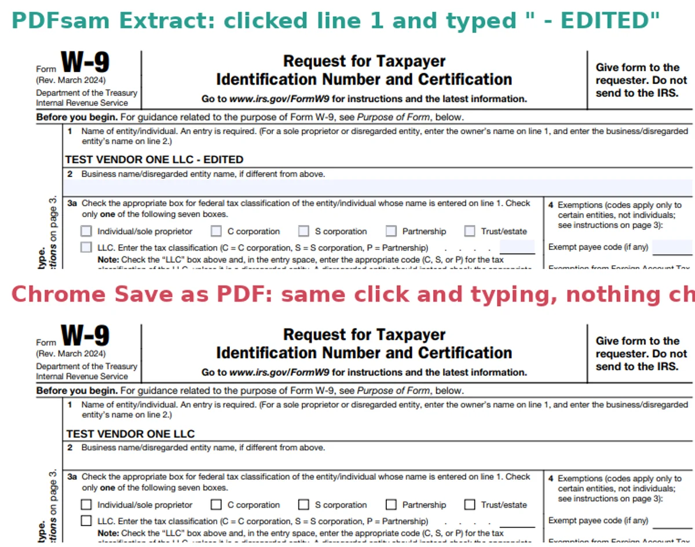
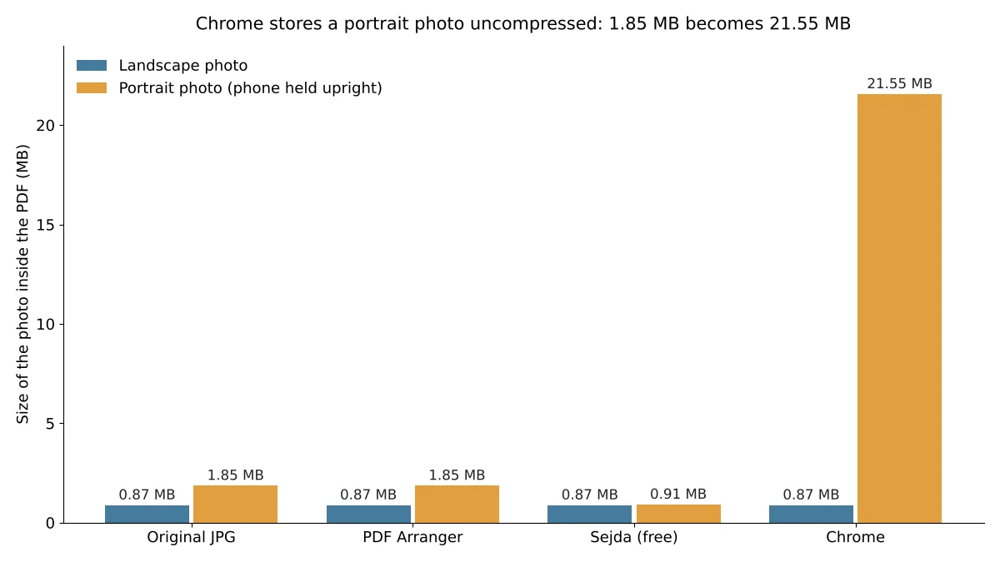

The best free PDF tools for most people are three: **PDFsam Basic** for splitting and merging, **iLovePDF** for converting PDF to Word and compressing, and **PDF Arranger** or **Sejda PDF Desktop** for turning photos into a PDF and pages into JPG images. Between them they covered all six everyday PDF jobs we tested, and only iLovePDF needs you to upload your file. All eight tools we tested did these jobs for free without an account, but two of them have limits that are easy to hit.

This page collects six separate tests we ran from October 17 to 20, 2026. In each one we gave three free tools the same files, clicked through each tool's own screens with its default settings, and then checked the results the same way: whether bookmarks, links and fillable forms still worked, whether photos lost quality, whether text stayed readable and editable, and how big the files came out. Each section below gives the result in short and links to the full test with step-by-step instructions.

## Best free PDF tools at a glance

| Job | Our pick | Works on | Why it won | Full test |
| --- | --- | --- | --- | --- |
| Split a PDF | **PDFsam Basic** (app) | Windows, Mac, Linux | Kept 4 of 4 bookmarks, 3 of 3 links and a fillable form | [Split a PDF for free](/posts/split-pdf-free) |
| Merge PDFs | **PDFsam Basic** (app) | Windows, Mac, Linux | Kept bookmarks and links in any file order, no limits | [Merge PDF files for free](/posts/merge-pdf-files-free) |
| JPG to PDF | **PDF Arranger** (app) | Windows, Linux | Kept all 10 photos exactly as they were, no limits | [Convert JPG to PDF for free](/posts/jpg-to-pdf-free) |
| PDF to JPG | **Sejda PDF Desktop** (app) | Windows, Mac, Linux | Only tool that saved every page by default | [Convert PDF to JPG for free](/posts/pdf-to-jpg-free) |
| PDF to Word | **iLovePDF** (website) | Any browser | Only tool that rebuilt tables (4 of 5) and kept columns | [Convert PDF to Word for free](/posts/pdf-to-word-free) |
| Compress a PDF | **iLovePDF** (website) | Any browser | Smallest files at its default setting: 39.6 MB to 0.80 MB | [Compress a PDF for free](/posts/compress-pdf-free) |

"App" means a program you install and run on your own computer, so your file never leaves it. The two website picks upload your file to the company's servers.

## How we tested

We tested eight free tools, three per job: [PDFsam Basic](https://pdfsam.org/download-pdfsam-basic/) 6.0.6, [PDF Arranger](https://github.com/pdfarranger/pdfarranger) 1.14.0, [Sejda PDF Desktop](https://www.sejda.com/desktop) 7.9.10 (free version), [GIMP](https://www.gimp.org/downloads/) 3.2.6, [LibreOffice](https://www.libreoffice.org/download/download-libreoffice/) 26.8.1, Chromium 141 (the open-source browser Chrome is built on), and the iLovePDF and PDF24 Tools websites without signing in. As of October 20, 2026, the download pages of PDFsam Basic, GIMP and LibreOffice still list these versions as current, and Flathub lists PDF Arranger 1.14.0.

We ran the apps on a Linux computer, using their own windows and buttons the way you would on Windows or a Mac. The test files were built so we knew exactly what should come out: a report with bookmarks and a clickable table of contents, the IRS Form W-9 with a field filled in, phone-size photos, the IRS Form 1040, a scanned letter, a screenshot slide deck and 11 documents with tables and columns. We couldn't run Windows or macOS, so built-in options such as Mac's Preview are covered from Apple's documentation in each full test, not measured.

We picked one tool per job by asking what most people need from that job: forms and links that still work after splitting or merging, photos that don't lose quality, every page saved, text you can edit, and the smallest file that still reads well. Every full test also has picks for other situations, such as files you don't want to upload.

## Best free tool to split a PDF: PDFsam Basic

PDFsam Basic is the best free way to split a PDF because it kept everything that makes a PDF clickable. In our test on a 12-page file, it kept all 4 bookmarks, all 3 table-of-contents links and a fillable W-9 form, and it added nothing extra. PDF Arranger kept those too, but its form-only file carried 4 leftover bookmarks that led nowhere.

Chrome's **Print > Save as PDF** works on any computer without installing anything, but it flattens the file like a printout: the W-9 it saved could no longer be filled in, and the bookmarks and links were gone. Use it only for pages that will just be read or printed.

Steps for all three, plus splitting by file size for email limits, are in our [test of free ways to split a PDF](/posts/split-pdf-free).

## Best free tool to merge PDFs: PDFsam Basic

PDFsam Basic is also the best free way to merge PDFs: no page or daily limits, and it kept every bookmark, link and form field whichever file came first. PDF Arranger did just as well when the file with bookmarks was first, but dropped all 4 bookmarks when it wasn't, because of a setting that is on by default. Sejda PDF Desktop merged cleanly too, but its free version stopped us at 50 pages per merge.

One trap applies to any tool: two filled-in copies of the same form use the same field names. PDFsam Basic and Sejda rename the fields by default so the copies stay separate. The settings and steps are in our [test of free ways to merge PDF files](/posts/merge-pdf-files-free).

## Best free tool to convert JPG to PDF: PDF Arranger

PDF Arranger is the best free way to turn several photos into one PDF on Windows. It kept all 10 of our phone-size photos as the original image data, turned both portrait shots upright and has no limits. Set the page size to US Letter before saving, because its default page is the photo's own size, about 56 by 42 inches.

On a Mac, Sejda PDF Desktop does the same job, but it re-saved the two portrait photos (a difference of about 0.5% we wouldn't expect anyone to notice) and allows 3 tasks a day. Chrome can make a PDF from only one photo at a time, and it turned a 1.85 MB portrait photo into a 21.6 MB PDF.

Full steps are in our [test of free ways to convert JPG to PDF](/posts/jpg-to-pdf-free).

## Best free tool to convert PDF to JPG: Sejda PDF Desktop

Sejda PDF Desktop is the easiest free way to turn every page of a PDF into JPG images: choose **PDF to JPG**, pick **Large (220 dpi)** and you get one sharp image per page. It was the only tool in our test that saved both pages of a 2-page tax form at its default setting.

If you need sharper pages or more than 3 conversions a day, use GIMP: with **Open pages as** set to **Images**, it exports each page at 300 pixels per inch by default, and you can type in any resolution. Watch the defaults in the other two apps: GIMP saved only the last page of the form until we changed that setting, and LibreOffice Draw saved only the page on screen at a blurry 816 by 1056 pixels. Our [test of free ways to convert PDF to JPG](/posts/pdf-to-jpg-free) shows the settings that fix both.

## Best free tool to convert PDF to Word: iLovePDF

iLovePDF is the best free way to convert a PDF to an editable Word file. In our test of 11 PDFs, it was the only tool that rebuilt tables as real Word tables (4 of 5) and kept a two-column newsletter in two columns. Its weak spot: about 1 in 5 paragraphs came out split in two where a line ended in the PDF.

If you can't upload the file, Sejda PDF Desktop converts on your computer and gives clean paragraphs, but tables turn into plain lines of text and the free version handles one file per task. LibreOffice Writer's copy looks identical to the PDF, but every line is a separate text box, so adding a sentence pushes nothing down.

The editing test and steps for each tool are in our [test of free PDF to Word converters](/posts/pdf-to-word-free).

## Best free tool to compress a PDF: iLovePDF

iLovePDF is the best free way to compress a PDF: at its default **Recommended compression**, it shrank our 39.6 MB photo brochure to 0.80 MB, the smallest of the three tools at default settings, and the pages stayed easy to read. If you need to get under a specific size limit, PDF24 Tools lets you type in a lower picture resolution and quality; at 100 DPI and quality 60 it took our scanned letter from 7.1 MB to 0.75 MB with every word still readable.

To keep the file off the internet, Sejda PDF Desktop compresses on your computer and came within 0.14 MB of iLovePDF on the photo brochure. PDFs made of screenshots barely shrink in any tool, so don't expect much there.

Our [test of free ways to compress a PDF](/posts/compress-pdf-free) compares all three of iLovePDF's levels and shows how small you can go before small text blurs.

## Default settings that caught us out

Most of the problems we found came from settings left at their defaults, not from the tools being bad. These are the ones worth checking before you send a file:

| Tool | Job | What the default did | What to do instead |
| --- | --- | --- | --- |
| Chrome | Split, JPG to PDF | Flattened fillable forms; turned a 1.85 MB portrait photo into a 21.6 MB PDF | Use it only for read-only pages and landscape photos |
| PDF Arranger | Merge | Dropped all bookmarks when the bookmarked file wasn't first | Open the bookmarked file first |
| PDF Arranger | JPG to PDF | Made pages the size of the photo, about 56 by 42 inches | Set **Page Size** to US Letter |
| GIMP | PDF to JPG | Saved only the last page of a 2-page PDF | Set **Open pages as** to **Images** |
| LibreOffice Draw | PDF to JPG | Saved one page at 96 pixels per inch | Set 300 pixels/inch, then set the width back to 8.5 inches |
| LibreOffice | PDF to Word | Opened the PDF in Draw, which can't save as Word | Choose the Writer file type in the Open window |
| Sejda PDF Desktop | PDF to Word | Shrank 11-point text to 9 points in one column | Use it for the text, not the layout |

## Free-version limits and privacy

The free apps without limits are PDFsam Basic, PDF Arranger, GIMP and LibreOffice: no page caps, no daily counts and no uploads. The other tools are free with conditions, as of October 20, 2026:

| Tool | Free-version limit | Is your file uploaded? |
| --- | --- | --- |
| **Sejda PDF Desktop** | 3 tasks per day for the whole app, documents up to 50 MB and 200 pages, merges up to 30 files and 50 pages, compression up to 100 MB, one file per conversion ([Sejda](https://www.sejda.com/desktop)) | No |
| **iLovePDF** | File size per task: 15 MB for PDF to Word, 25 MB for PDF to JPG, 100 MB for merge and split, 200 MB for compress. Premium costs $5 a month billed yearly ([iLovePDF pricing](https://www.ilovepdf.com/pricing)) | Yes |
| **PDF24 Tools** | "No artificial limits," paid for by ads ([PDF24](https://tools.pdf24.org/en/)) | Yes, deleted after one hour according to its [compress page](https://tools.pdf24.org/en/compress-pdf) |

Sejda PDF Desktop came up in five of our six tests, more than any other tool, which makes it tempting as a single all-in-one PDF app. The catch is that its 3 tasks a day are shared across everything it does: a merge and two conversions use up the day. In our merge test, the fourth task was refused with a countdown of about 24 hours. If you work with PDFs more than a few times a day, the unlimited apps above are a better base.

## Which free PDF tools should you install?

- **Most people on Windows:** install PDFsam Basic and PDF Arranger, and bookmark iLovePDF for PDF to Word and compressing. That covers all six jobs, and only those two jobs involve an upload.
- **Mac users:** install PDFsam Basic, and use Sejda PDF Desktop for photos to PDF and PDF to JPG within its 3 tasks a day. Preview, built into every Mac, can also merge, split and reduce file size, according to Apple's guides linked in each full test.
- **Private documents such as tax forms or medical records:** stick to the apps, which never upload anything. For PDF to Word, Sejda PDF Desktop keeps the text but not the tables.
- **You can't install anything:** iLovePDF or PDF24 Tools in the browser, and Chrome's **Save as PDF** for pulling out pages that will only be read or printed.

If your PDF is a scan and you need to copy text out of it, our guide to [copying text from images and scans for free](/posts/image-to-text-offline-free) covers the text-recognition tools built into Windows, Mac and iPhone.
