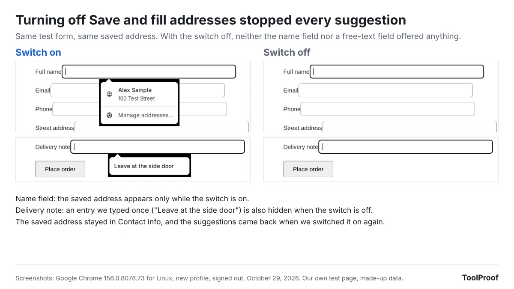

Chrome autofill settings are in **Settings > Autofill and passwords**, or you can type chrome://settings/autofill in the address bar. Each kind of saved info, from addresses and cards to passports, has its own **Save and fill** switch. Turning a switch off stops Chrome from suggesting and saving that info, but it doesn't delete what you already saved. To remove it, use **Delete browsing data** with **Autofill form data** ticked, or delete items one at a time.

We ran Google Chrome 156.0.8078.73, the current stable version, on October 29, 2026, with a new profile and no Google account, and filled in a test shipping form and a test payment form we made for this check. With **Save and fill addresses** off, Chrome offered nothing in the name field or in a free-text delivery note field, and our saved address was still listed in settings. When we saved a card, Chrome's prompt said it would save "your card and encrypted security code," and the **Save security codes** switch behind that was already on in a new profile.

## Chrome autofill settings at a glance

These are the Chrome 156 switches that decide what autofill saves and fills. The third column is what our signed-out copy showed. Google's help page says the Save and fill switches are on by default for every type, but three switches were off and greyed out in our signed-out copy.

| Setting | Where in Chrome | In our signed-out copy | Turn it off to |
| --- | --- | --- | --- |
| Save and fill addresses | Contact info | On | Stop address, phone and email suggestions and save prompts |
| Save and fill payment methods | Payments | On | Stop Chrome filling saved cards |
| Save security codes | Payments | On | Stop Chrome saving card security codes (CVCs) |
| Save and fill identity docs | Identity docs | Off, greyed out | Stop filling passports and driver's licenses |
| Save and fill travel info | Travel | Off, greyed out | Stop filling flight and vehicle info |
| Smarter form understanding | Autofill settings | Off, greyed out | Stop sending the page's URL and content to Google |
| Offer to save passwords and passkeys | Google Password Manager > Settings | On | Stop the save-password prompt |
| Sign in automatically | Google Password Manager > Settings | On | Get asked before Chrome signs you in |

## Where are Chrome's autofill settings?

Chrome's autofill settings are on the **Autofill and passwords** page of Chrome's settings, which splits your saved info into five groups. On a computer:

1. Open Chrome and click **More** (the three dots) at the top right.
2. Select **Settings**.
3. On the left, click **Autofill and passwords**.

Click a group to open its page. **Payments**, **Contact info**, **Identity docs** and **Travel** each open a page with a **Save and fill** switch at the top and a list of what you saved below it. **Google Password Manager** opens in its own tab, where passwords and passkeys have separate settings. Further down, an **Autofill settings** section holds **Smarter form understanding**, and **Related Google services** links out to Google Password Manager, Google Wallet and your Google Account.

## What each Save and fill switch does

Each Save and fill switch controls one kind of info, and the description under it says what that includes. These are the descriptions in Chrome 156:

- **Save and fill addresses** (Contact info): "Includes information like phone numbers, email addresses, and shipping addresses." Your email address and phone number are part of this switch, not separate settings.
- **Save and fill payment methods** (Payments): "Fills in payment forms with your saved payment methods." The same page has **Save security codes** ("Check out faster when your CVCs are saved"), **Card benefits** ("Show available card benefits and rewards at checkout. Issuer terms apply.") and **Allow sites to check if you have payment methods saved**. All four were on in our copy.
- **Save and fill identity docs** (Identity docs): "Includes information such as passports and driver's licenses."
- **Save and fill travel info** (Travel): "Includes information such as flight bookings and vehicle info."

Passwords work differently. In **Google Password Manager > Settings**, **Offer to save passwords and passkeys**, **Automatically create a passkey to sign in faster** and **Sign in automatically** were all on. Chrome describes the last one this way: "When off, you'll be asked for confirmation every time."

If you're signed in, Google's [help page on Chrome autofill](https://support.google.com/chrome/answer/142893?hl=en) says addresses are saved in your Google Account and other info, like ID and vehicle details, in Google Wallet. Chrome can also fill the name and email from your Google Account, which you manage on the Google Account **Personal info** page, the same page our guide to [removing a phone number from your Google account](/posts/remove-phone-number-from-google-account) walks through.

## What happens when you turn off Save and fill addresses?

Turning off Save and fill addresses stops Chrome from suggesting or saving addresses, and in our test it also hid entries we had typed into ordinary text boxes, but it deleted nothing. We saved one address, then switched it off and on again on the same test form.

- **Switch on:** clicking the name field showed our saved address. Clicking it filled seven fields at once, from name to ZIP code. A plain text box with no address meaning, our "Delivery note" field, suggested the note we had typed once before.
- **Switch off:** neither field showed anything. When we submitted a new address, Chrome didn't offer to save it.
- **Saved info:** the address stayed on the **Contact info** page, and only the **Add** button turned grey.
- **Switch back on:** the old delivery note came back. A note we typed while the switch was off was never stored.

So the switch is a pause button. If you want Chrome to forget an address, delete it as described below.

## What does Chrome save when you submit a form?

Chrome offers to save an address or a card after you submit a form that contains one, even when you aren't signed in to Chrome. In our test, both prompts appeared right after we clicked the form's submit button.

- **Save address?** listed the name, street, city, state and ZIP code we typed, plus "United States," which we hadn't entered, and the phone number in a different format. After we clicked **Save**, Chrome said "Address saved to this device" and that it would be saved in our Google Account once we signed in.
- **Save card?** said: "To pay faster next time, save your card and encrypted security code to your device." After saving, the **Payments** page listed the card with "CVC saved," and a **Delete saved security codes** link appeared next to the Save security codes switch.

Our payment form was on a page without a secure (HTTPS) connection, and Chrome refused to fill cards there with this message: "Automatic payment methods filling is disabled because this form does not use a secure connection." It still offered to save the card we typed.

## What does smarter form understanding send to Google?

Smarter form understanding lets Chrome fill fields that standard autofill might miss, and to do that, Chrome 156 says "the page's URL and content are shared with Google." That is the sentence shown under **Things to consider** when you open **Autofill and passwords > Autofill settings**.

Google's help page says the setting "is on unless you choose to turn it off" and needs you to be signed in to Chrome. In our signed-out copy it was off and greyed out, so we couldn't test what it changes on a form.

Chrome 156's English text file contains two other descriptions of the same feature that we didn't see on screen: "The content and URLs of the pages you visit can be processed in a private space in the cloud," and "Help Chrome better understand and fill complex forms by securely processing data on Google's servers. Your info remains private and isn't reviewed by anyone." We saw only the first wording on screen.

Smarter form understanding is separate from **Enhanced autofill**, the Gemini feature that can fill forms with order and flight details from Gmail for some US users. Our look at [Chrome enhanced autofill pulling details from Gmail](/posts/chrome-enhanced-autofill-gmail) covers who gets it and the **Find and fill with Gemini** switch. That feature also needs Gemini's Keep Activity on, which our guide to [turning off Gemini Apps Activity](/posts/turn-off-gemini-apps-activity) explains. For Chrome's other AI tools, see our guide to [turning off AI features in Chrome](/posts/turn-off-ai-in-chrome).

## How do you delete saved autofill info in Chrome?

You can delete one suggestion, one saved address or card, or everything Chrome autofill saved at once, and each takes a different route.

**One suggestion.** Click the field so the suggestion list opens, move to the entry with the arrow keys or the mouse, and press **Shift+Delete**. In our test on Chrome for Linux, that removed our saved delivery note, and it didn't come back when we reopened the form. We couldn't check the key on a Mac.

**One saved address or card.** Open **Settings > Autofill and passwords > Contact info** (or **Payments**), click **More** (the three dots) next to the item, and choose **Delete**. If a card is saved in Google Wallet, Google's help page says you have to delete it there.

**Everything at once:**

1. Click **More** (the three dots) > **Delete browsing data**. You can also find it under **Settings > Privacy and security**.
2. Choose a time range. Pick **All time** (under **More** in the time options) to cover everything you saved.
3. Click **Show more** and tick **Autofill form data**. It isn't ticked by default.
4. Untick the other boxes if you want to keep your history and cookies.
5. Click **Delete from this device**.

Before we deleted, the dialog counted "1 payment method, 1 address, 9 others" under Autofill form data. Afterward, the Autofill and passwords page showed zero cards and zero addresses, and our test form offered no suggestions. Saved passwords aren't part of it: the dialog says "Passwords can be deleted in their management settings," which means Google Password Manager. Google's help page adds that this doesn't delete payment info or addresses stored in Google Pay or Google Wallet.

## Why are Chrome autofill settings greyed out?

A Chrome autofill switch is greyed out either because you aren't signed in to Chrome or because an organization manages your browser. A building icon next to the switch tells you it's the second one.

- **Not signed in:** in our signed-out copy, **Save and fill identity docs**, **Save and fill travel info** and **Smarter form understanding** were off and couldn't be clicked, with no explanation on the page. Google's help page says autofill and smarter form understanding need you to be signed in to your Google Account in Chrome. Signing in is the fix.
- **Managed by an organization:** we set the address autofill policy to off, the way a company or school can, and **Save and fill addresses** went grey with a building icon and the text "This setting is managed by your administrator." Turning off the card policy greyed out **Save and fill payment methods**, **Save security codes** and **Card benefits** together. Only the organization's administrator can change these. To see which policies apply, type chrome://policy in the address bar.
- **Only the Add button is grey:** that happens when you turned the Save and fill switch off yourself. Turn it back on.

## Chrome autofill settings on Android and iPhone

Chrome on Android and iPhone keeps the same groups under **More > Settings > Autofill and passwords**, according to Google's help page. We didn't test the phone apps, so the steps below come from that page.

- **Android:** each group has its own Save and fill switch. **Autofill settings** holds **Smarter form understanding** and **Verify it's you when filling sensitive info**, which asks for your screen lock or fingerprint before Chrome fills sensitive info. It also lets you choose **Autofill with Google** or **Autofill using another service**, for people who use a different password manager; Chrome restarts to apply the change. Google's Android steps use more than one name for the same pages, including "Passwords and autofill" and "Addresses and more," so look for whichever your version shows.
- **iPhone and iPad:** **Smarter form understanding** and **Verify it's you when filling sensitive info** are inside **Contact info** instead of a separate Autofill settings page. To delete an address, swipe left on it and tap **Delete**, or tap **Edit** to remove several.
- **Deleting everything:** on Android, go to **Settings > Privacy and security > Delete browsing data**; on iPhone, tap **More > Delete Browsing Data**. On both, choose a time range and select **Autofill form data** under **Advanced**.

## Which Chrome autofill settings should you change?

Most people can leave autofill on and change one or two switches for their situation. Our picks, based on what we saw in Chrome 156:

- **You share the computer:** turn off **Save and fill addresses** and **Save and fill payment methods**, then delete **Autofill form data** for **All time**. Turning the switches off alone leaves your saved info in place.
- **You don't want card security codes stored:** turn off **Save security codes** and click **Delete saved security codes** if the link appears.
- **You'd rather not send page details to Google:** if you're signed in, turn off **Smarter form understanding** under **Autofill settings**. Chrome may then miss some fields on complex forms.
- **You use another password manager:** turn off **Offer to save passwords and passkeys** in Google Password Manager. On Android, also pick **Autofill using another service**.
- **A switch is grey with a building icon:** ask whoever manages the device, because the setting can't be changed from your side.

For the AI switches in Chrome and in other apps you use, our guide to [turning off AI in Chrome, Gmail, Word and more](/posts/turn-off-ai-features) lists where each one is.

## FAQ

### Where are the email autofill settings in Chrome?

Email addresses are part of **Contact info**, controlled by **Save and fill addresses**, whose description lists "phone numbers, email addresses, and shipping addresses." The same page has a **Verified email** section with an **Automatically verify your email** switch, which was on in our copy. If Chrome fills an old email from your Google Account, change it on your Google Account's Personal info page.

### Why won't Chrome autofill my credit card?

Chrome won't fill cards on pages without a secure connection, which is the message we got on our HTTP test page. Also check that **Save and fill payment methods** is on and that the card is listed under **Payments**. Google's help page adds that for Chrome to use info from Google Wallet, **Use passes across Google** has to be on in Wallet's settings.

## How we tested

- **Chrome:** on October 29, 2026, we ran Google Chrome 156.0.8078.73 for Linux, the current stable version, with new profiles and no Google account. We recorded every switch's state on the Autofill and passwords pages and read the feature descriptions in Chrome's English language file. Our test environment's network settings make Chrome show a "managed by your organization" note, which we cropped out; no autofill policies were set except in the greyed-out test.
- **Forms:** we made a shipping form with standard address fields plus a free-text delivery note, and a payment form, and served them from our own computer without HTTPS. All names, addresses, phone numbers and emails were made up, and the card was the standard test number 4111 1111 1111 1111. We saved one address and one card through Chrome's prompts, then checked suggestions before and after turning off **Save and fill addresses**, removing one entry with Shift+Delete and deleting **Autofill form data**.
- **Greyed-out test:** we turned off the AutofillAddressEnabled and AutofillCreditCardEnabled policies, which Chrome's policy page marks as deprecated but still applied, then removed them.
- **Phones:** Android and iPhone steps are from Google's [Chrome autofill help page](https://support.google.com/chrome/answer/142893?hl=en), read October 29, 2026. Password settings are from Google's [help page on managing passwords in Chrome](https://support.google.com/chrome/answer/95606?hl=en).
- **Next check:** Chrome 157 reaches the stable channel on November 3, 2026, and we'll recheck these pages then.
