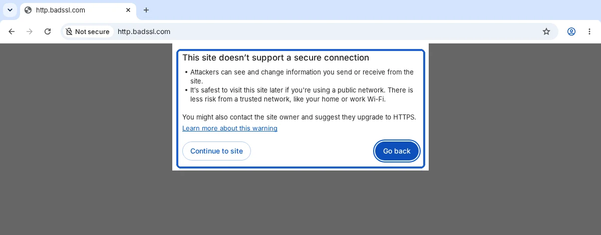
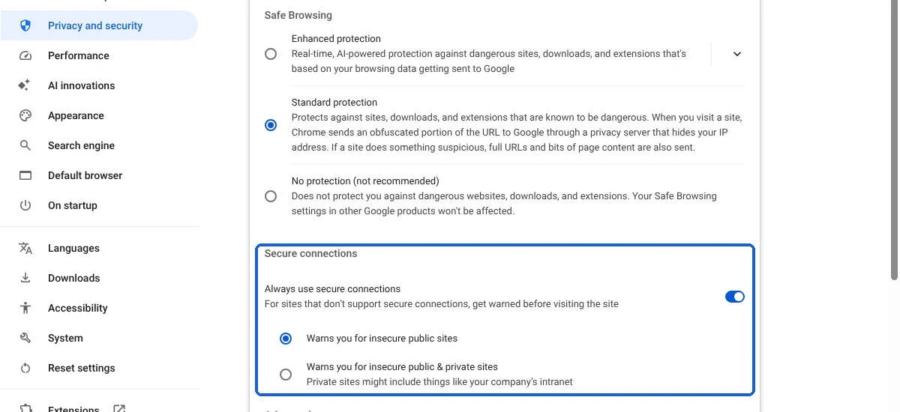
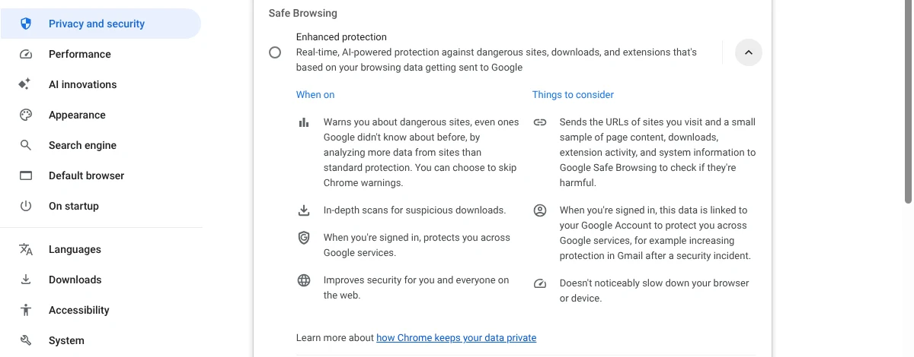

Google Chrome now asks for your permission before it opens a website that doesn't use a secure HTTPS connection. Google announced on October 21, 2026 that the setting behind this, **Always use secure connections**, is now on by default for all Chrome users, not just people who opted in. For most people this means an occasional pop-up with two buttons, **Continue to site** and **Go back**, and nothing else to do.

The bigger gap is elsewhere. A day earlier, Google described a new round of scam protections for Chrome: "suspicious site" warnings, a Gemini check of scam-like pages, and a warning when you copy a fake "fix" command. All three work only if you have switched Safe Browsing to **Enhanced protection**, which Chrome doesn't turn on by default.

We installed Chrome 156 (the current stable version) on Linux on October 21, 2026, opened HTTP-only test sites, and photographed the warning and the settings. The screens below are ours. The scam features can't be triggered on demand, so that part is based on Google's announcement.

## What happened

On October 21, 2026, Chrome's security team published [Chrome Now Warns Before Insecure HTTP Connections](https://blog.google/security/chrome-now-warns-before-insecure-http-connections/). It says Chrome now "explicitly asks users for permission before making an insecure HTTP connection," a protection first given to Enhanced protection users "earlier this year" and now extended "to all users by default."

Google had announced the plan a year earlier in [HTTPS by default](https://blog.google/security/https-by-defau/) (October 28, 2025), naming Chrome 154. According to [Chromium Dash](https://chromiumdash.appspot.com/schedule), Chrome 154 reached the stable channel on September 22, 2026, and Chrome 156 on October 20. The October 21 post doesn't name a version.

On October 20, Google's [Our latest defenses against evolving web scams](https://blog.google/security/our-latest-defenses-against-evolving-web-scams/) added three protections for users "when Enhanced Protection mode is enabled": a new lower-confidence "suspicious site" warning, a server-side Gemini model that checks pages showing scam signs, and a warning when you copy a suspicious command that a scam page tells you to paste and run.

## Who is affected

| If you... | What changes |
| --- | --- |
| Use Chrome on a computer or Android phone | A warning before the first visit to a public site without HTTPS. Choice remembered per site |
| Use Chrome on iPhone or iPad | Same setting exists, per Google's [iPhone help page](https://support.google.com/chrome/answer/10468685?hl=en&co=GENIE.Platform%3DiOS), without the public/private choice |
| Open your router, printer or other home device by its address (like 192.168.0.1) | No warning by default. Google excludes private addresses and names like "intranet" |
| Already used Enhanced protection | No change to HTTP warnings (you had them since earlier this year), plus the new scam warnings |
| Use Standard protection, Chrome's default | HTTP warnings yes, new scam warnings no |
| Use a work or school computer | Your organization can change these settings, so they may differ |

## What changes for you

When you open a site that only works over plain HTTP, Chrome first tries a secure version of the address. If none exists, it stops and shows the box above: "This site doesn't support a secure connection." It says attackers "can see and change information you send or receive from the site," and that it is safest to visit later "if you're using a public network."

Here is what we saw in Chrome 156:

- **Go back** is the highlighted button. **Continue to site** loads the page, with **Not secure** still showing in the address bar.
- After we clicked **Continue to site** on http.badssl.com, left and opened it again, Chrome loaded it with no warning. Google says it won't warn again for that site until you haven't visited it for at least two weeks.
- A different HTTP site gets its own warning the first time. NeverSSL, a test site that sends you to a new random address on each visit, triggered the warning every time for that reason.
- In a brand-new Chrome profile, the switch was off the first time we opened Chrome. When we closed and reopened it after it had been online, the switch was on with **Warns you for insecure public sites** selected. We didn't change anything in between.

How often will you see this? Google's October 21 post says early rollout data shows "nearly 95% of Chrome users on Desktop don't see any HTTP warnings in a given week," with under 1% seeing three or more, and fewer on mobile.

The warning doesn't judge whether a site is a scam. A trustworthy old site with no HTTPS gets the same box as a shady one, and a scam site with HTTPS gets no box at all. That second job belongs to Safe Browsing.

## What to do now

1. **Leave the HTTP warning on.** To check it on a computer, open Chrome, select the three-dot menu, then **Settings > Privacy and security > Security**. Under **Secure connections**, **Always use secure connections** should be on. If it's off right after an update, restart Chrome once, or turn it on yourself.
2. **Keep the public sites option** unless you want warnings for local devices too. **Warns you for insecure public & private sites** also warns for your router's address and office intranet sites.
3. **On Android,** the same switch is under **More > Settings > Privacy and security**, per [Google's Android help page](https://support.google.com/chrome/answer/10468685?hl=en&co=GENIE.Platform%3DAndroid).
4. **When the box appears,** select **Go back** if you're on public Wi-Fi or about to type a password or card number. On a site you know, at home, **Continue to site** is reasonable. Don't enter passwords or payment details on a page marked **Not secure**.
5. **Decide on Enhanced protection.** It's on the same Security page, under **Safe Browsing**. It's the only way to get the new scam warnings. The trade-off is below.

## Standard vs. Enhanced protection: what you give and get

Chrome's own settings page spells out the trade. **Standard protection** sends "an obfuscated portion of the URL to Google through a privacy server that hides your IP address," and sends full URLs and bits of page content only "if a site does something suspicious." **Enhanced protection** "sends the URLs of sites you visit and a small sample of page content, downloads, extension activity, and system information to Google Safe Browsing." If you're signed in, that data is linked to your Google Account.

Google's [Safe Browsing help page](https://support.google.com/chrome/answer/9890866?hl=en) says this information "is only used for security purposes." For the new Gemini check, Google's October 20 post says Chrome sends page text only "when a site exhibits high-confidence scam indicators," and that the text "is never logged, retained or used to train models." Google also says Enhanced users are "ten times safer" from phishing and scams than Standard users. That figure is Google's own, and the post doesn't publish the data behind it.

## Our take

Turning the HTTP warning on for everyone is the right call, and it costs most people almost nothing. By Google's numbers, 95% of desktop users won't see it in a typical week, and approved sites stay approved. Our test matched the design: one box per new site, gone after one click. The people it inconveniences most are those who open old, unencrypted sites regularly, and they're also the ones whose logins and form entries were most exposed. Chrome previously showed "Not secure" only after the page had loaded.

The weaker part of this week's news is that Chrome's newest scam protections sit behind a setting most people never open. The ClickFix warning targets a trick where a fake "verify you're human" or "fix this error" page tells you to paste a command into your computer. The trick works on people who don't know what the command does, and they are likely the same people who never open Chrome's security settings. If you set up Chrome for a parent or anyone who struggles with scams, we'd switch them to Enhanced protection. We'd like Google to make Standard protection catch more of these scams, with the same privacy limits as today.

The other side is privacy. Enhanced protection means Google sees full addresses of the sites you visit, linked to your account if you're signed in. Google says this data is used only for security, but that is still a promise rather than something you can check. If you're careful about links and prefer not to share your browsing with Google, Standard protection plus the new HTTP warning is a reasonable place to stop.

## What to watch next

- **Other browsers.** Google's post says Chrome is "the first browser to make this change" and that it hopes other browsers will follow. We'll note it here if Edge, Safari or Firefox makes the same switch.
- **Chrome 157 on November 3, 2026.** We'll check whether the warning or Safe Browsing settings change, as we do for [our guide to turning off AI in Chrome](/posts/turn-off-ai-in-chrome). That guide covers the on-device model Chrome used for scam detection, which this week's post says has now moved to a server-side Gemini model for Enhanced protection.
- **Your own sites.** If you run a small website and visitors report this warning, ask your web host how to turn on HTTPS for it.

If you're also keeping an older Windows PC secure, our [Windows 10 extended security updates guide](/posts/windows-10-esu-extended) covers the dates and how to enroll. And if you still browse with Arc, which runs on the same Chromium engine, its security updates stop when [Arc shuts down on December 22](/posts/arc-browser-shutting-down).
