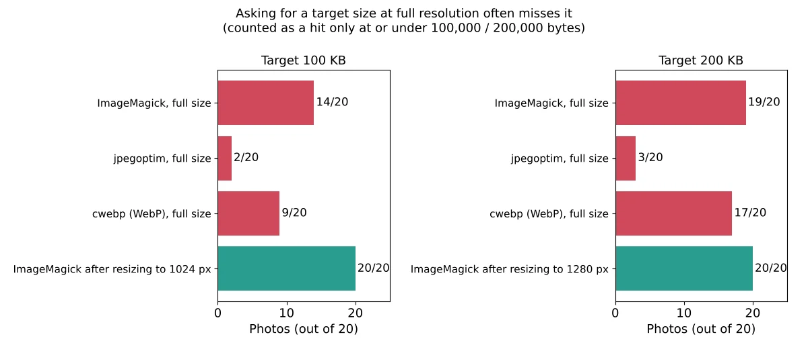
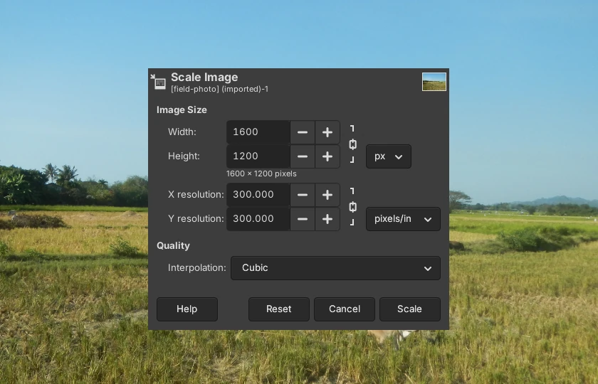
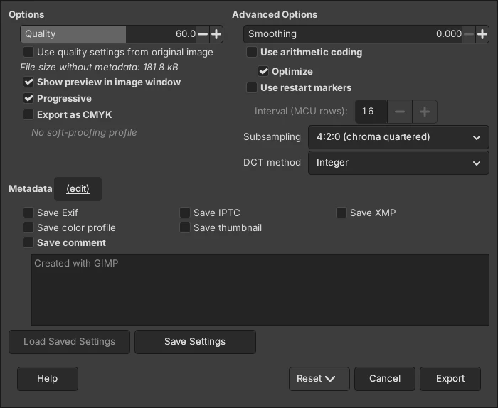

To compress a photo to 100KB, make it smaller in pixels first, then lower the JPEG quality. In our test, resizing a 12-megapixel photo to 1024 pixels on its long side and then compressing it to 100 KB got every one of 20 photos under the limit with a medium-quality result. Asking for 100 KB at the original 4032 x 3024 size did the opposite: the JPEG quality dropped as low as 2, 6 of 20 photos still missed the limit, and most of the rest turned into blocks of color.

We tested this on October 16, 2026, by compressing the same 20 public-domain photos to five common upload limits: 1 MB, 500 KB, 200 KB, 100 KB and 50 KB. We tried nine sizes for every limit, from the original 4032 pixels down to 640, and scored each result against the original with [SSIMULACRA2](https://github.com/cloudinary/ssimulacra2), an image quality score where 90 means you can't see a difference, 70 is high quality and 50 is medium. The step-by-step screenshots come from GIMP 3.2.6, a free photo editor.

## What size to resize to for each file size limit

| File size limit | Resize the long side to | JPEG quality that fit (median, range) | Quality score (median) | Same limit at full size |
| --- | --- | --- | --- | --- |
| **1 MB** | 1600-2560 px | 97 (90-100) at 1600 px | 89.7, visually near lossless | 88.0, but 69.4 for the worst 10% |
| **500 KB** | 1600-1920 px | 89 (64-97) at 1600 px | 83.4 | 75.1 |
| **200 KB** | 1280 px | 78 (33-94) | 69.1, high | 15.3 |
| **100 KB** | 1024 px | 67 (23-92) | 52.8, medium | -49.9, 6 of 20 over the limit |
| **50 KB** | 800 px | 51 (17-90) | 32.9, low | -50.6, every photo over the limit |

The quality scores are medians across the 20 photos, viewed at 1600 x 1200 pixels, a typical size for looking at a photo on a laptop screen. Busy photos with lots of fine detail, like a snowy forest or a pebble beach, scored below the median at every limit, and far below it at 100 KB (14.0 and 28.1). The wide quality ranges show why there is no single "right" JPEG quality number: a simple photo of a sunset fit 100 KB at quality 91, while a busy park scene needed quality 23 at the same size.

## How we tested

We used 20 public-domain (CC0) photos from the [PD12M dataset](https://huggingface.co/datasets/Spawning/PD12M), the same set we used in our [HEIC to JPG test](/posts/convert-heic-to-jpg-free). They include sunsets, food, pets, a church interior, city views, a snowy forest and a pebble beach. We cropped each one to 4032 x 3024 pixels (12 megapixels) and saved it as a JPEG at quality 92, like a photo straight from a phone. The files averaged 2.7 MB, from 0.8 to 5.3 MB.

For each limit, we kept each photo at its original size and also resized it to 3200, 2560, 1920, 1600, 1280, 1024, 800 and 640 pixels on the long side. At each size, our test script found the highest JPEG quality that fit the limit, using ImageMagick 7.1.2-34. We also made WebP files at the same sizes to compare the two formats.

We counted a file as under the limit only if it was at or under the round number in bytes (100,000 bytes for 100 KB), since upload forms rarely say whether they mean 100,000 or 102,400 bytes. The quality score compares each result with the original after both are scaled to 1600 x 1200 pixels, so a file that was shrunk to 800 pixels loses points for being blurry when shown larger. That's the trade-off you see on screen. If you only show the photo as a small profile picture, a smaller size costs you less than our scores suggest.

All tests ran on a 4-core 2.8 GHz Intel Xeon with 16 GB of RAM under Linux. The scripts and all results are in our test notes.

## Why compressing at full size fails

A 12-megapixel photo has too many pixels to describe in 100 KB. To reach the size, a tool has to throw away almost everything, so the picture turns into flat blocks of color. Shrinking the photo first gives the same 100 KB to a quarter of the pixels or fewer, so each one keeps more detail.

Two things in our results are worth knowing whichever app you use:

- **Hitting the size isn't guaranteed.** At full size, 6 of 20 photos stayed over 100 KB even at JPEG quality 2. Our busy park photo came out at 200,512 bytes, twice the target.
- **Resizing made the size reliable.** After resizing to the sizes in the table above, all 20 photos fit under every limit.

Always check the final file size before you upload. On Windows, right-click the file and choose **Properties**; on a Mac, select it in Finder and press **Command-I**.

## How to compress an image to 100KB with GIMP (Windows, Mac, Linux)

GIMP is free and runs on Windows, Mac and Linux; version 3.2.6 is the current release on the [GIMP downloads page](https://www.gimp.org/downloads/). Its JPEG export window shows the file size before you save, so you can adjust the quality until it fits:

1. Open your photo in GIMP.
2. Choose **Image > Scale Image**. Make sure the chain icon next to **Width** and **Height** is linked, then type the long side from the table above into the larger of the two boxes (1024 for 100 KB, 1280 for 200 KB). Click **Scale**.
3. Choose **File > Export As**, type a file name ending in **.jpg**, and click **Export**.
4. In the JPEG window, tick **Show preview in image window**. The line under the quality slider now shows **File size without metadata**.
5. Lower **Quality** until that number is under your limit. Setting **Subsampling** to **4:2:0 (chroma quartered)** also helps: in our test it shrank the same 1600-pixel photo at quality 60 from 213.5 kB to 181.8 kB.
6. Click **Export**.

The saved file was 181,788 bytes, matching the 181.8 kB GIMP showed, because GIMP counts a kB as 1,000 bytes.

## Other ways on Windows and Mac

**Mac (Preview):** According to [Apple's Preview guide](https://support.apple.com/guide/preview/prvw2015/mac), choose **Tools > Adjust Size**, select **Resample image**, and enter a smaller size; the new size is shown at the bottom of the window. Then use **File > Export**, choose **JPEG**, and lower the quality slider, which [Apple's export guide](https://support.apple.com/guide/preview/prvw1012/mac) says appears when you pick JPEG. To shrink several photos at once, open them in one window and select them all in the sidebar first.

**Windows (PowerToys Image Resizer):** Microsoft's free [PowerToys](https://learn.microsoft.com/en-us/windows/powertoys/) adds **Resize with Image Resizer** to the right-click menu in File Explorer, according to [Microsoft's Image Resizer page](https://learn.microsoft.com/en-us/windows/powertoys/image-resizer). Choose a custom size with the long side from our table and the **Fit** option, which keeps the proportions without cropping. Image Resizer doesn't aim at a file size, so check the result and, if it's still too big, lower the quality in another tool. We didn't run PowerToys ourselves, since our test computer wasn't running Windows.

## Is WebP better than JPEG at 100KB?

Only slightly. At the same size, WebP scored about the same as JPEG: 54.4 versus 52.8 at 1024 pixels for 100 KB, and 71.6 versus 68.8 at 1600 pixels for 200 KB. If a form asks for a JPG, stick with JPEG; use WebP only where you know it's accepted, such as your own website.

## FAQ

### Is 100 KB the same as 0.1 MB?

Roughly. Most upload forms don't say whether they count 1 KB as 1,000 or 1,024 bytes, so 100 KB can mean 100,000 or 102,400 bytes. Aim a little under, at 95 to 97 KB, so the file fits either way. Our resized 100 KB files had a median size of 96.5 KB.

### Can I compress an image without losing quality?

Not to a fixed size like 100 KB. Tools that shrink a file without any loss keep every pixel the same, so they can't promise a size. To get a 3 MB phone photo down to 100 KB, you have to give up pixels, detail or both. The way to lose the least is to resize to the size in our table first, so the compression doesn't have to do all the work.

### What about compressing an image on iPhone?

To hit an exact size, the simplest route is to move the photo to a computer and use one of the methods above. If your iPhone saves photos as HEIC, Apple's guide to [camera formats](https://support.apple.com/en-us/116944) explains how to switch new photos to JPEG (**Settings > Camera > Formats > Most Compatible**), and our [HEIC to JPG test](/posts/convert-heic-to-jpg-free) covers converting the ones you already have.

## Which method should you use?

- **You need one photo under 100 KB or 200 KB for a form:** GIMP, resized to 1024 or 1280 pixels, with the export window's file size check. It's the easiest way to see the size before you save.
- **You're on a Mac and want nothing to install:** Preview's **Adjust Size**, then **Export** as JPEG and check the size. Preview can resize several photos at once.
- **The limit is 1 MB:** most phone photos fit at 1600 to 2560 pixels with almost no visible change.

Need to shrink a video for an upload limit too? We've tested how to [compress a video for Discord and email](/posts/compress-video-for-discord-email). For more free tools that work without uploading your files, see our [guide to free offline AI tools](/posts/free-offline-ai-tools) and our [image to text (OCR) comparison](/posts/image-to-text-offline-free).
