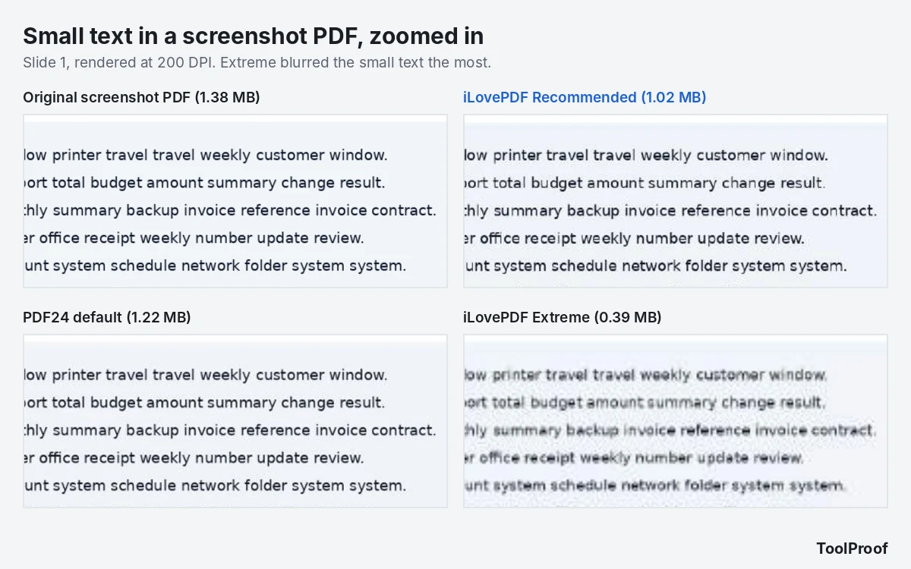
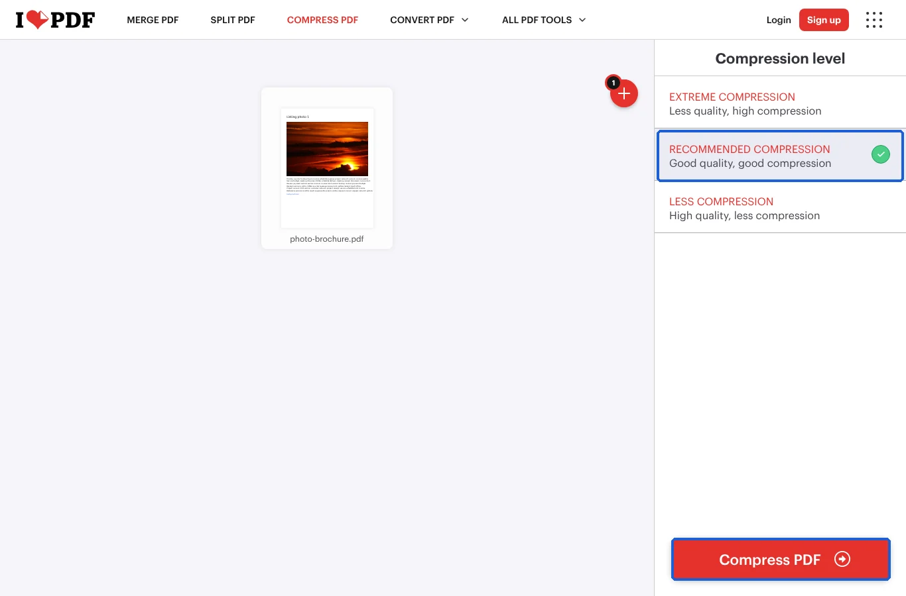
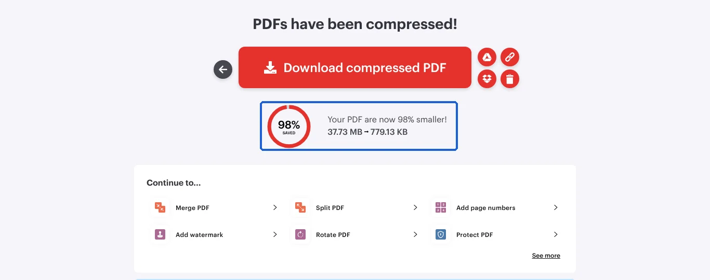
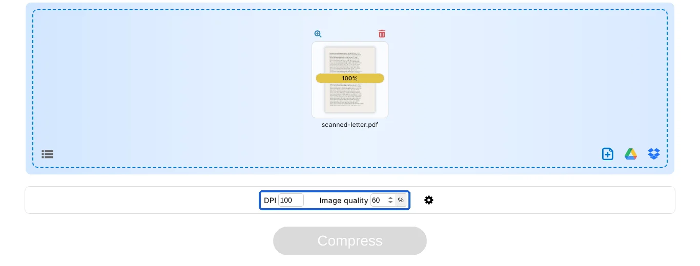
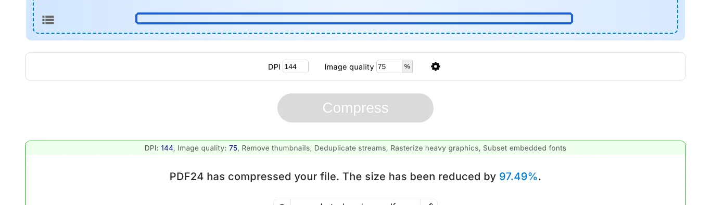
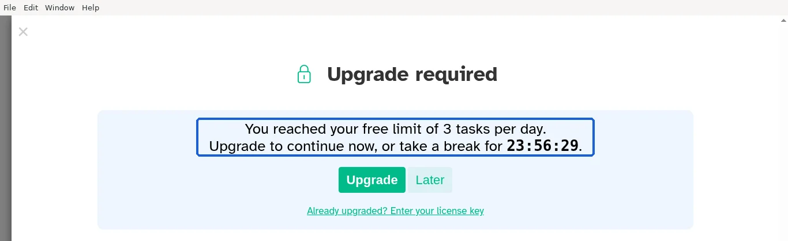

To compress a PDF for free, upload it to iLovePDF's **Compress PDF** page, keep **Recommended compression**, click **Compress PDF** and download the result: in our test it made the smallest files of any tool at its default setting, and every page stayed easy to read. If you need the file even smaller, PDF24 Tools lets you type in a lower DPI and image quality. If you'd rather not upload the file at all, the free Sejda PDF Desktop app compresses on your own computer, but only one file per task and 3 tasks a day.

We tested this on October 20, 2026, with the same three PDFs in every tool: an 8-page photo brochure (39.6 MB, straight from a camera), a 6-page scanned letter (7.1 MB) and a 12-page deck of screenshots with small text (1.4 MB). All three tools cut the photo brochure by more than 97%, to under 1 MB. The scan and the screenshots are where they differed: one tool barely touched the screenshots, and the strongest setting blurred their small text.

## Free ways to compress a PDF at a glance

| Tool | Works on | Best for | Photo PDF (39.6 MB) | Scan (7.1 MB) | Free-version limit |
| --- | --- | --- | --- | --- | --- |
| **iLovePDF** Recommended (website) | Any browser | Smallest file at default | 0.80 MB | 1.23 MB | 2 files per task, 200 MB, file is uploaded |
| **PDF24 Tools** (website) | Any browser | Hitting a size limit | 0.99 MB | 1.41 MB (0.75 MB at 100 DPI) | No stated limit, file is uploaded |
| **Sejda PDF Desktop** (free app) | Windows, Mac, Linux | Keeping files off the internet | 0.94 MB | 1.43 MB | 1 file per task, 3 tasks a day, 100 MB |
| **Preview** (built into Mac) | Mac | Already on your Mac | Not tested | Not tested | None |

The first three rows are what we measured. The Preview row comes from Apple's help page, because we couldn't run macOS in our test setup.

## How we tested

We reused the four test PDFs from our earlier PDF compression measurements, so the results can be compared with that test. We made them ourselves, so we knew every word on every page:

- **Photo brochure**: 8 pages, each with a full-resolution camera photo (12 to 20 megapixels, public-domain pictures), a caption and a web link. 39.6 MB.
- **Scanned letter**: 6 pages of typed text saved as 300 ppi color images, slightly tilted with paper tint, like a real scan. No selectable text. 7.1 MB.
- **Screenshot slides**: 12 slides saved as full-HD screenshots, with small text and bar charts. 1.4 MB.
- **Text report**: 20 pages of normal text with charts and links. 86 KB.

We ran them through the [iLovePDF Compress PDF](https://www.ilovepdf.com/compress_pdf) page (all three levels), the [PDF24 Compress PDF](https://tools.pdf24.org/en/compress-pdf) page (its default, plus one lower setting) and [Sejda PDF Desktop](https://www.sejda.com/desktop) 7.9.10 (its default). We used the websites without signing in, clicked through each tool's own screens on a Linux computer, and saved every result. Then we checked:

- **File size** compared with the original
- **Picture resolution**: how many pixels the photos and scans kept (ppi means pixels per inch of paper; 300 is print quality, 150 is fine on screen, 72 is low)
- **Readability**: we had a text-recognition program (OCR, software that reads words from an image) read the scan and the slides, and counted how many of the real words it still got right
- **Links and selectable text**: whether the web links still worked and the text could still be selected and searched

Sejda's free version allows 3 tasks a day, so it compressed the photo brochure, the scan and the slides, but not the text report.

## Results: photos shrink a lot in every tool, screenshots don't

| Setting | Photo brochure | Scanned letter | Screenshot slides | Text report |
| --- | --- | --- | --- | --- |
| Original | 39.6 MB | 7.07 MB | 1.38 MB | 86 KB |
| iLovePDF Recommended | 0.80 MB (2.0%) | 1.23 MB (17%) | 1.02 MB (74%) | 60 KB (70%) |
| iLovePDF Extreme | 0.26 MB (0.7%) | 0.44 MB (6%) | 0.39 MB (29%) | 60 KB (70%) |
| iLovePDF Less | 2.05 MB (5.2%) | 4.30 MB (61%) | 1.37 MB (100%) | 56 KB (66%) |
| PDF24 default (144 DPI, quality 75) | 0.99 MB (2.5%) | 1.41 MB (20%) | 1.22 MB (89%) | 51 KB (60%) |
| PDF24 at 100 DPI, quality 60 | Not run | 0.75 MB (11%) | 0.62 MB (45%) | Not run |
| Sejda Desktop default (Medium, 144 ppi) | 0.94 MB (2.4%) | 1.43 MB (20%) | 1.37 MB (99%) | Not run (daily limit) |

Percentages are the share of the original size that was left. Smaller is better, as long as the pages still look right.

What the numbers mean in practice:

- **Photo PDFs are the easy case.** Every tool made the 39.6 MB brochure smaller than 1 MB at its default setting, mainly by shrinking each 12 to 20 megapixel photo to about 150 ppi, which still fills the page sharply on screen. iLovePDF Recommended kept the photos at 1,125 pixels wide, PDF24 and Sejda at 1,080.
- **Scans drop to about a fifth of their size by default.** iLovePDF Recommended saved the scan at 150 ppi (1.23 MB); PDF24 and Sejda used 144 ppi (about 1.4 MB). OCR still read 100% of the words in all three.
- **Screenshot PDFs barely shrink.** Sejda left the slides almost untouched and said **"Your PDF file is already very well compressed"**. PDF24's default saved 11% and iLovePDF Recommended 26%. Screenshots with sharp edges and flat colors are already stored efficiently, so most of the size can only come from blurring them.
- **Text-only PDFs are already small.** The 86 KB report shrank to 51 to 60 KB. If a PDF of text and charts is large, the size is usually coming from images or embedded fonts, not the text.
- **Nothing broke.** Every web link in the brochure and report was still there in every result, and both kept their selectable, searchable text.

## How small can you go before it looks bad?

iLovePDF's **Extreme compression** made the smallest files by far, but it gets there by cutting pictures to 72 ppi. On the scan, the text stayed readable (OCR read 99.1% of the words) but looked noticeably softer. On the screenshot slides, the small text turned blurry and OCR misread about 7% of the words.

If you have a size limit to hit, such as an upload form that only accepts files under 1 MB, a middle setting is a better trade than Extreme. PDF24 at **100 DPI** and **quality 60** brought the scan to 0.75 MB with every word still readable to OCR, and the slides to 0.62 MB with 98.7% of words read correctly.

## How to compress a PDF with iLovePDF

iLovePDF made the smallest files at its default setting in our test. The free version compresses up to 2 files per task and files up to 200 MB, according to its [pricing page](https://www.ilovepdf.com/pricing) (as of October 2026).

1. Open [ilovepdf.com/compress_pdf](https://www.ilovepdf.com/compress_pdf) and click **Select PDF files**.
2. Under **Compression level**, keep **Recommended compression**. Choose **Extreme compression** only if you must hit a strict size limit, and check the result.
3. Click **Compress PDF**.
4. Click **Download compressed PDF**. The page shows how much smaller the file got.

The result page counts in binary megabytes, so our 39.6 MB brochure shows up as 37.73 MB there. Avoid **Less compression** unless you only need a small cut: it kept the scan at full resolution, but still left it at 61% of its size and stored the pictures in JPEG 2000, an image format some older PDF viewers handle slowly. iLovePDF says it deletes uploaded files after 2 hours.

## How to compress a PDF to a specific size with PDF24

PDF24 Tools is the one to use when the default result is still too big, because you can type the picture resolution (DPI) and image quality yourself. Its page says it is free with no limits and that files are deleted from its servers after one hour.

1. Open [tools.pdf24.org/en/compress-pdf](https://tools.pdf24.org/en/compress-pdf) and click **Choose files**.
2. Leave **DPI** at **144** and **Image quality** at **75** for the default result. To go smaller, lower DPI first (100 is still readable on screen), then quality (60).
3. Click **Compress** and wait for the upload to finish.
4. Click **Download**. If the file is still too big, click **Restart** and try a lower DPI.

PDF24's default settings include **Rasterize heavy graphics**, which turns very complex drawings into pictures. In our test it didn't touch the charts in the text report, and all text stayed selectable. If you use Windows and don't want to upload files, PDF24 also offers a free desktop program, PDF24 Creator, that its [download page](https://tools.pdf24.org/en/creator) says works offline (we didn't test it).

## How to compress a PDF without uploading it: Sejda PDF Desktop

Sejda PDF Desktop is a free app for Windows, Mac and Linux that compresses files on your computer, so nothing is uploaded. Its results were close to PDF24's default. The catch is the free version: Sejda's [desktop page](https://www.sejda.com/desktop) lists 3 tasks per day and compressing files up to 100 MB, and when we selected four files at once, the app said **"Free users are limited to a single file per task."**

1. Download and install [Sejda PDF Desktop](https://www.sejda.com/desktop), open it and click **Compress** at the top.
2. Click **Choose PDF files** and pick one PDF.
3. Keep **Image quality** at **Medium**. Click **More options** if you want to see or change the **Image resolution (ppi)**, which is 144 by default.
4. Click **Compress PDF** and choose where to save the new file.

Hovering over the options shows what they do: **Medium** uses JPEG quality 65%, **Good** 80% and **Best** 100%. We only tested Medium. After our third task of the day, Sejda showed **"You reached your free limit of 3 tasks per day"** with a countdown of nearly 24 hours.

## How to compress a PDF on a Mac with Preview

According to [Apple's Preview guide](https://support.apple.com/guide/preview/reduce-the-size-of-a-pdf-prvw1509/mac), you can shrink a PDF without installing anything:

1. Open the PDF in **Preview**.
2. Choose **File > Export**.
3. In the **Quartz Filter** menu, choose **Reduce File Size**.
4. Click **Save**. To keep the original, enter a new name in the **Export As** field first.

Apple notes that the result may have lower quality than the original. We couldn't test Preview, so we can't say how its file sizes or picture quality compare with the tools above. If the result looks too blurry, use one of the tools above instead.

## Which one should you use?

- **Most PDFs, especially ones with photos**: iLovePDF with **Recommended compression**. It made the smallest files at its default setting in our test, and the pages stayed easy to read.
- **You need to get under a size limit**: PDF24 Tools. Lower the DPI to 100 and the quality to 60 before reaching for an "extreme" setting.
- **Private documents you don't want to upload**: Sejda PDF Desktop, one file at a time and 3 a day. Mac users can try Preview's **Reduce File Size** first.
- **The PDF is mostly text, or made of screenshots**: expect small savings from any tool. If you need to send a large screenshot PDF, check whether it can be split into smaller files with our [free PDF splitting guide](/posts/split-pdf-free).

Working with PDFs in other ways? See our tests of [free ways to merge PDF files](/posts/merge-pdf-files-free), [converting PDF to Word](/posts/pdf-to-word-free) and [turning PDF pages into JPG images](/posts/pdf-to-jpg-free). If it's a single photo you need to shrink, our guide to [compressing an image to 100 KB](/posts/compress-image-to-100kb) shows which sizes and quality settings work.

For one pick per job across all six of our PDF tests, see our [roundup of the best free PDF tools](/posts/best-free-pdf-tools).

## FAQ

### Can you compress a PDF without losing quality?

Only a little. The big savings in our test all came from lowering the resolution or quality of pictures. Settings that kept picture quality close to the original saved less: iLovePDF **Less compression** still left the scan at 61% of its size, and the text-only report shrank by only about 30 to 40% in every tool we ran it through. Choose a setting that keeps pictures at about 150 ppi, which looked sharp on screen in our test.

### Is it safe to compress a PDF online?

The website tools upload your file to their servers. iLovePDF says it deletes files after 2 hours and PDF24 after one hour. For tax forms, contracts or medical records, use a tool that works on your computer, such as Sejda PDF Desktop or Preview on a Mac.

### Why didn't my PDF get smaller?

It probably has no large photos. In our test, a PDF made of screenshots shrank by 0 to 26% at default settings, and Sejda reported it was "already very well compressed." Text-only PDFs are usually small already.
