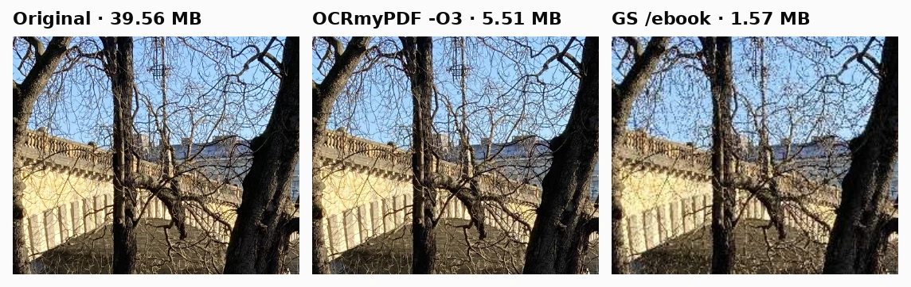
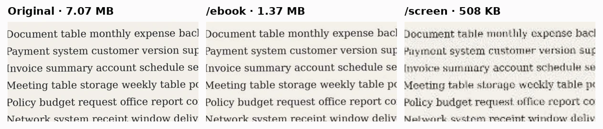
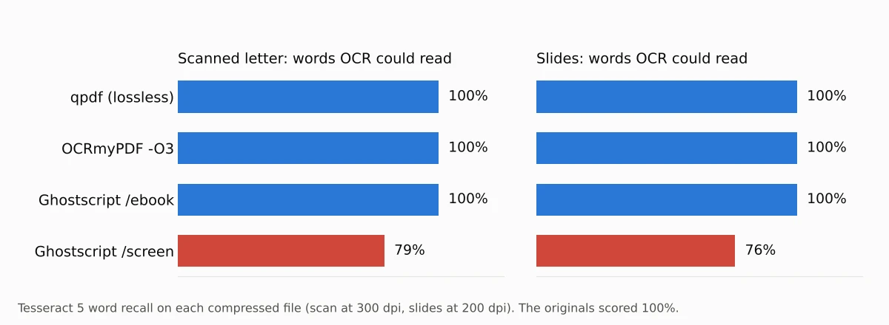
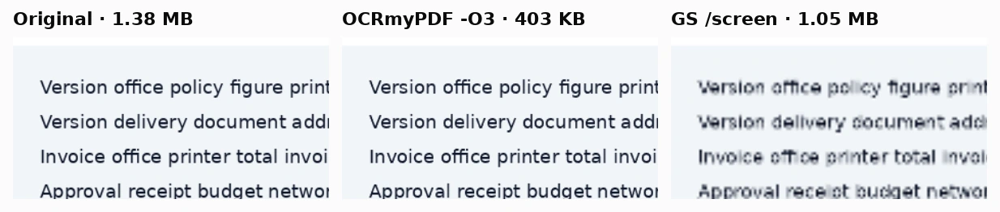
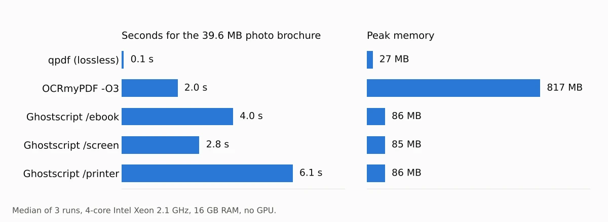

To compress a PDF for free without uploading it, use **OCRmyPDF with `-O 3`** if you want the safest big reduction, or **Ghostscript's `/ebook` preset** if your PDF is mostly photos and you need the smallest file. In our test of 4 PDFs, OCRmyPDF shrank the set to 17% of its original size with no loss we could measure in readable text, and Ghostscript `/ebook` got photo-heavy files down to 4%. Ghostscript also made two of our files bigger, and its `/screen` preset blurred text enough that OCR missed about 1 in 5 words.

We ran three free, open-source tools fully offline on October 16, 2026: Ghostscript 10.08.0, OCRmyPDF 17.13.0 and qpdf 12.4.2, using 10 settings in total. Each setting compressed the same four PDFs we made ourselves: a 39.6 MB photo brochure straight from camera JPEGs, a 7.1 MB scanned letter, a 1.4 MB slide deck made of screenshots, and an 86 KB text report. For every result we measured the file size, how close each page looks to the original, whether the text could still be read, and whether links survived. All 10 settings kept every link, and the text in the files that had a text layer came out exactly the same.


## Free offline PDF compressors at a glance

| Tool and setting | Best for | All 4 files (48.1 MB) | Photo brochure | Scanned letter | Text still readable |
| --- | --- | --- | --- | --- | --- |
| **OCRmyPDF `-O 3`** | Any PDF, when quality matters | **8.3 MB (17%)** | 5.5 MB | 2.3 MB | Yes, all files |
| **Ghostscript `/ebook`** | Photo-heavy PDFs and scans | 4.6 MB (10%) | **1.6 MB** | **1.4 MB** | Yes, all files |
| **Ghostscript `/screen`** | Only when size beats quality | 2.2 MB (4.5%) | 0.5 MB | 0.5 MB | No: 79% of scan words, 76% of slide words |
| **qpdf (lossless)** | Text-only PDFs, zero risk | 47.9 MB (99.6%) | 39.6 MB | 7.1 MB | Yes, unchanged |

"Text still readable" means Tesseract OCR could still read the words in the scanned letter and the slides after compression. The originals scored 100%. Ghostscript `/printer` and `/prepress` sat between `/ebook` and no compression, and Ghostscript with no preset barely changed anything; all three are in the [full results](#full-results). All three tools are free, need no account and never send your file anywhere.

## How we tested

We built the four test PDFs ourselves so we'd know exactly what every page should say. The photos are eight public-domain (CC0) camera photos, embedded as the original JPEG files, between 12 and 20 megapixels. The "scan" is six letter pages drawn as 300 dpi color images with a slight tilt, paper tint and noise, like a phone scanning app makes, with no text layer. The slides are 12 pages of 1920×1080 PNG images laid out like app screenshots, with small 18-pixel text and flat-color charts. The report is 20 pages of real text with embedded fonts, vector charts and a link on every page.

We judged each setting on four things:

- **Size:** the compressed file as a percentage of the original
- **Looks:** how similar each page is to the original when rendered at 100 dpi (SSIM, where 1.000 means identical)
- **Readable text:** for the scan and slides, the share of words Tesseract 5.3.4 could read from the compressed file; for files with a text layer, whether every word was still there
- **Links:** whether clickable links still worked

Each setting ran three times per file on a 4-core Intel Xeon (2.1 GHz) with 16 GB of RAM and no graphics card, running Ubuntu 24.04. Times and memory are medians. Ghostscript was built from the official 10.08.0 source, the newest release listed in the [Ghostscript news page](https://ghostscript.readthedocs.io/en/latest/News.html) (September 8, 2026). OCRmyPDF used that same Ghostscript and had pngquant 2.18 installed; it did not have jbig2enc, which can shrink black-and-white scans further.

## Which PDF compressor should you use?

### OCRmyPDF -O 3: best for most PDFs

OCRmyPDF shrank every one of our files without making any of them worse. The photo brochure went from 39.6 MB to 5.5 MB, the scan from 7.1 MB to 2.3 MB, and the slides from 1.4 MB to 403 KB. Even the small text report got 11% smaller. Pages stayed nearly identical to the originals (SSIM 0.997 or higher on the scan and slides, at least 0.988 on every photo page), and OCR read 100% of the words in the scan and slides.

It works differently from Ghostscript. It keeps every image at its full resolution and re-saves photos at a lower JPEG quality, so you can still zoom in or print. The photo brochure's first picture is still 5456×3632 pixels after compression. For the slides, it reduced the screenshots to 16 colors with pngquant, which looked the same here because our slides use flat colors.



The downsides: it's a command-line tool, it used the most memory of the three (817 MB for the photo brochure), and it doesn't shrink as far as Ghostscript's lower presets. The command we used is:

```bash
ocrmypdf --ocr-engine none --skip-text --output-type pdf -O 3 input.pdf output.pdf
```

`--ocr-engine none` skips text recognition so it only compresses; the [OCRmyPDF cookbook](https://ocrmypdf.readthedocs.io/en/latest/cookbook.html) gives this combination for optimizing images without OCR. `--output-type pdf` keeps a normal PDF instead of converting it to the archival PDF/A format. If your scan also needs to become searchable, leave out `--ocr-engine none` and it will add a text layer at the same time; we compared OCR engines in our [test of free offline image-to-text tools](/posts/image-to-text-offline-free).

### Ghostscript /ebook: smallest file that's still readable

Ghostscript's `/ebook` preset made the smallest files that still passed our readability test: 1.6 MB for the photo brochure (4% of the original) and 1.4 MB for the scan (19%). It does this by downsampling images to about 150 dpi, as listed in the [Ghostscript documentation](https://ghostscript.readthedocs.io/en/latest/VectorDevices.html). That's sharp enough on screen, and OCR still read 100% of the scanned letter.



There are two catches. Fine detail in photos goes soft: one photo page of bare tree branches dropped to an SSIM of 0.798, the lowest single-page score in our whole test. And Ghostscript rewrites the whole file, so documents without big images can get bigger. Our slides went from 1.4 MB to 1.6 MB (+15%) and the text report from 86 KB to 114 KB (+33%) with `/ebook`. Every Ghostscript preset made the text report bigger, and every preset except `/screen` made the slides bigger; `/screen` shrank them only by blurring them.

```bash
gs -sDEVICE=pdfwrite -dPDFSETTINGS=/ebook -dNOPAUSE -dBATCH -o output.pdf input.pdf
```

On Windows, the command-line program is `gswin64c` instead of `gs`, according to the [Ghostscript install guide](https://ghostscript.readthedocs.io/en/latest/Install.html). Ghostscript is free under the AGPL license.

### Ghostscript /screen: only when size is all that matters

`/screen` made the smallest files: the whole set dropped from 48.1 MB to 2.2 MB. It downsamples images to 72 dpi, and you can see it. OCR read only 79% of the words in the compressed scan and 76% in the slides, and small text in screenshots turned fuzzy.





Use it only when you have to get under a hard size limit and nobody needs to read fine print, then check the result before you send it.

### qpdf: safe but small savings

qpdf only reorganizes and recompresses the file's internal data without touching image quality, which the [qpdf manual](https://qpdf.readthedocs.io/en/stable/cli.html) describes as changing a file's structure "without changing its content". Every page stayed pixel-identical. It cut the text report by 13% and the slides by 12%, but saved almost nothing on the photo brochure and the scan, because their size is all in JPEG images. Its `--optimize-images` option made no difference on any of our files. It's the fastest tool here (0.1 seconds for the 39.6 MB file) and a good first step for text-only PDFs.

## How to compress a PDF on Windows, Mac and Linux

You don't need a command line on every computer. These are the free offline options we found for each system.

### Windows

- **PDF24 Creator:** a free Windows app with a built-in compression tool. According to [PDF24](https://tools.pdf24.org/en/creator), it "works offline" and files "are NOT uploaded to the Internet". We couldn't run it in our Linux test lab, so we didn't measure it.
- **Ghostscript:** install the 64-bit AGPL release from the [Ghostscript downloads page](https://www.ghostscript.com/releases/gsdnld.html), then run the `/ebook` command above with `gswin64c`.
- **OCRmyPDF:** the [installation guide](https://ocrmypdf.readthedocs.io/en/latest/installation.html) installs Tesseract and uv with winget (`winget install -e --id tesseract-ocr.tesseract` and `winget install -e --id astral-sh.uv`), then OCRmyPDF with `uv tool install ocrmypdf`. Ghostscript has to be installed separately because it isn't on winget. pngquant is optional on Windows; without it, you'd likely see smaller savings on screenshots than ours.

### Mac

Preview can compress a PDF without extra software. According to [Apple's Preview guide](https://support.apple.com/guide/preview/compress-a-pdf-prvw1509/mac):

1. Open the PDF in Preview.
2. Choose **File > Export**.
3. In the **Quartz Filter** pop-up menu, choose **Reduce File Size**.
4. Click **Save**. To keep the original, enter a new name in **Export As** before saving.

Apple notes the compressed PDF "may be of lower quality than the original". We didn't test Preview, so check the result. For more control, `brew install ocrmypdf` installs OCRmyPDF along with Tesseract, Ghostscript, pngquant and jbig2enc, per the OCRmyPDF guide.

### Linux

`sudo apt install ocrmypdf` on Ubuntu or Debian installs OCRmyPDF and Ghostscript. Ubuntu 24.04's packages are older than the versions we tested (its Ghostscript is 10.02.1), but the same commands work.

## Full results

| Setting | Photo brochure | Scanned letter | Slides | Text report | All 4 files | Lowest page SSIM | Scan / slide words read |
| --- | --- | --- | --- | --- | --- | --- | --- |
| Original | 39.6 MB | 7.1 MB | 1.4 MB | 86 KB | 48.1 MB | - | 100% / 100% |
| qpdf | 100% | 100% | 88% | 87% | 99.6% | 1.000 | 100% / 100% |
| qpdf `--optimize-images` | 100% | 100% | 88% | 87% | 99.6% | 1.000 | 100% / 100% |
| OCRmyPDF `-O 1` | 92% | 98% | 100% | 89% | 93% | 1.000 | 100% / 100% |
| OCRmyPDF `-O 2` | 27% | 51% | 30% | 89% | 30% | 0.992 | 100% / 100% |
| **OCRmyPDF `-O 3`** | 14% | 33% | 29% | 89% | **17%** | 0.988 | 100% / 100% |
| Ghostscript, no preset | 92% | 100% | 115% | 133% | 94% | 0.982 | 100% / 100% |
| Ghostscript `/prepress` | 21% | 100% | 115% | 133% | 35% | 0.985 | 100% / 100% |
| Ghostscript `/printer` | 13% | 100% | 115% | 140% | 29% | 0.966 | 100% / 100% |
| **Ghostscript `/ebook`** | 4% | 19% | 115% | 133% | **10%** | 0.798 | 100% / 100% |
| Ghostscript `/screen` | 1% | 7% | 76% | 133% | 4.5% | 0.853 | **79% / 76%** |

Percentages are the compressed size divided by the original. "Lowest page SSIM" is the least similar single page across all four files, rendered at 100 dpi in grayscale. Every setting kept all 28 links, and the extracted text of the photo brochure and the text report matched the originals exactly.



Speed wasn't a problem for any tool: the biggest file took at most 6.1 seconds. OCRmyPDF took up to 5.1 seconds on the scan and used 817 MB of memory on the photo brochure, so on an older laptop with little free RAM, Ghostscript is the lighter choice.

## Why compress a PDF in the first place?

The most common reason is an attachment limit. A personal Gmail account can send up to 25 MB, according to [Google's Gmail help](https://support.google.com/mail/answer/6584), and Gmail turns anything bigger into a Google Drive link. Our 39.6 MB photo brochure was over that limit; after OCRmyPDF `-O 3` it was 5.5 MB, and after Ghostscript `/ebook` 1.6 MB. Doing it offline also means a contract, tax form or medical record never leaves your computer, which is the same reason we tested [offline PDF to Word converters](/posts/convert-pdf-to-word-offline-free).

## Other tools we looked at

- **Online compressors such as iLovePDF and Smallpdf:** they work in a browser, but you upload the file. We only tested tools that run offline.
- **macOS Preview:** covered above from Apple's guide; we couldn't run it in our Linux test lab.
- **LibreOffice:** it opens a PDF as a drawing and can export it again, but in our [PDF to Word test](/posts/convert-pdf-to-word-offline-free) it rebuilt every line as a separate text box, so we didn't use it to compress.

## Which one should you use?

- **You want a smaller file and can't afford any visible quality loss:** OCRmyPDF `-O 3`. It's the only setting that shrank all four of our files.
- **Your PDF is mostly photos or scans and has to be as small as possible:** Ghostscript `/ebook`, then zoom in to check fine detail.
- **Your PDF is mostly text:** qpdf, or OCRmyPDF `-O 1`. Don't use Ghostscript on it; it made our text report a third bigger.
- **You're on a Mac and just need something quick:** Preview's **Reduce File Size**, then check the result.

If your PDF came from photos taken on an iPhone, converting them to JPG first can help too; we compared tools for that in our [HEIC to JPG test](/posts/convert-heic-to-jpg-free). For more tools that work without an internet connection, see our [guide to free offline AI tools](/posts/free-offline-ai-tools).
