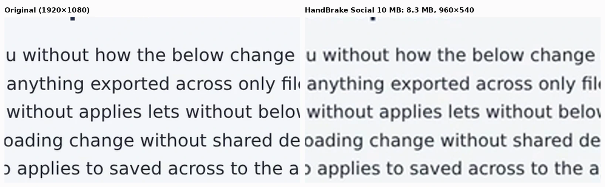
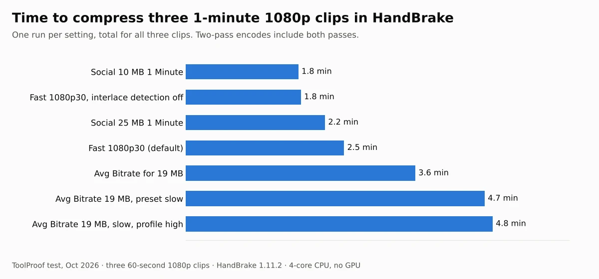

To compress a video for Discord, aim for 19 MB and set the bitrate yourself instead of picking a preset. As of October 2026, free Discord accounts can upload files up to 20 MB. HandBrake's built-in "Social" presets were made for 10 MB and 25 MB: the 10 MB one shrank our 1-minute clips to 540p and lost the most quality, and the 25 MB one made files of 20.2 to 23.9 MB, too big for Discord. Setting an average bitrate for 19 MB landed every clip at 17 to 19 MB at full resolution.

We tested 14 settings in two free, offline tools on October 16, 2026: HandBrake 1.11.2 and FFmpeg 9.0.2. Each one compressed the same three 60-second 1080p clips: a scene from an animated film, a live-action scene with faces, and a screen recording of a settings page with small text. We measured the file size, the quality against the original with [VMAF](https://github.com/Netflix/vmaf), a perceptual video quality score developed by Netflix (higher is better, up to 100), and the time each encode took. Both tools run on your own computer, so your video is never uploaded.


## Video size limits and what fits

| Where you send it | Size limit (as of October 2026) | Setting that fit in our test | Quality (VMAF) |
| --- | --- | --- | --- |
| **Discord (free)** | 20 MB per file | Bitrate set for 19 MB, 1080p | 90.4-99.6 (HandBrake), 93.2-99.6 (FFmpeg) |
| Discord Nitro Basic / Nitro | 50 MB / up to 1 GB | HandBrake **Fast 1080p30** for most 1-minute clips | 91.6-99.6 |
| **Gmail (personal)** | 25 MB of attachments | HandBrake **Social 25 MB** or a bitrate set for 24 MB | 90.1-96.3 / 95.3-99.6 |
| Older or stricter 10 MB limits | 10 MB | Bitrate set for 9.5 MB at 1280 pixels wide | 84.9-96.2 |

The limits come from Discord's [File Attachments FAQ](https://support.discord.com/hc/en-us/articles/25444343291031-File-Attachments-FAQ) and Google's [Gmail attachment help page](https://support.google.com/mail/answer/6584?hl=en). Discord says the free limit went from 10 MB to 20 MB in August 2026, and that Nitro Basic offers 50 MB and Nitro up to 1 GB. Gmail turns attachments over 25 MB into a Google Drive link instead of attaching the file. The quality ranges cover our three clips; the screen recording always scored highest.

## How we tested

We cut three 60-second clips and saved each one in high quality (H.264 at CRF 14, about 7 to 12 Mbit/s for the two film clips), like a fresh recording from a phone or screen recorder:

- **Animation:** 1:30 to 2:30 of [Big Buck Bunny](https://peach.blender.org/about/) ((c) copyright 2008, Blender Foundation / www.bigbuckbunny.org, CC BY 3.0), scaled from 4K to 1920 x 1080, with stereo sound
- **Live action:** 3:00 to 4:00 of [Tears of Steel](https://mango.blender.org/sharing/) ((CC) Blender Foundation, mango.blender.org, CC BY 3.0), 1920 x 800 widescreen, with stereo sound
- **Screen recording:** a settings page with 16-pixel text, scrolling up and down, that we built and recorded ourselves at 1920 x 1080 with no sound

We judged each setting on three things:

- **Size:** does the file fit under the limit, and how much of the limit does it use? We aimed at 19,000,000 bytes for Discord because its help page doesn't say whether "20MB" means 20,000,000 bytes or 20 x 1,024 x 1,024
- **Quality:** VMAF between the compressed video and the original, on every third frame, with smaller videos scaled back up to the original size first. We report the average and the worst 5% of frames, where blockiness shows up during fast motion
- **Speed:** time for one run of each setting on a 4-core 2.8 GHz Intel Xeon with 16 GB of RAM and no GPU, including both passes when a setting uses two

HandBrake's official presets are fixed recipes, so we read their settings from HandBrake itself. **Social 10 MB 1 Minute 540p60** encodes H.264 at an average of 1,125 kbit/s in two passes and caps the picture at 960 x 540. **Social 25 MB 1 Minute 720p60** uses 3,000 kbit/s at up to 1280 x 720. Both add 160 kbit/s AAC audio.

## How to compress a video for Discord in HandBrake

HandBrake is the easiest free choice: it has a normal window, runs on Windows, Mac and Linux, and is free and open source according to the [HandBrake website](https://handbrake.fr/). On Windows it needs Microsoft's .NET Desktop Runtime 10.0, according to its [system requirements](https://handbrake.fr/docs/en/latest/technical/system-requirements.html). Instead of a Social preset, keep the default **Fast 1080p30** preset and set the bitrate:

1. Open your video in HandBrake. The default preset is **Fast 1080p30**.
2. Go to the **Video** tab and switch from **Constant Quality** to the average bitrate option (labeled **Bitrate (kbps)** in the Linux version we checked).
3. Enter the number for your video's length from the table below.
4. Turn on **Multi-Pass Encoding** and **Turbo Analysis Pass**.
5. On the **Audio** tab, set the AAC bitrate to 128.
6. Click **Start Encode**, then check the file size before you upload.

| Video length | Discord (aim for 19 MB) | Gmail (aim for 24 MB) |
| --- | --- | --- |
| 30 seconds | 4,880 kbps | 6,200 kbps |
| 1 minute | 2,380 kbps | 3,040 kbps |
| 2 minutes | 1,120 kbps | 1,450 kbps |
| 3 minutes | 700 kbps | 920 kbps |

These numbers assume 128 kbit/s audio and leave 1% for the file's container. To work it out for another length: video kbps = target MB x 8,000 / seconds x 0.99 - 128. With 2,380 kbps, our three 1-minute clips came out at 19.0, 19.0 and 17.0 MB. The screen recording stayed under because there was so little movement to encode.

HandBrake's own [guide to constant quality and average bitrate](https://handbrake.fr/docs/en/latest/technical/video-cq-vs-abr.html) recommends constant quality "unless you really need to aim for a target filesize", and says multi-pass encoding "will provide better quality and better bit-rate distribution". A size limit is that case.

### Why not the Social presets?

HandBrake's [official presets page](https://handbrake.fr/docs/en/latest/technical/official-presets.html) says the Social presets "are designed to guarantee video up to a certain duration will produce a file smaller than a specific size". They did: every Social 10 MB file was 8.3 to 9.7 MB, and every Social 25 MB file was under 25 MB. But neither size matches Discord's current limit:

- **Social 10 MB 1 Minute** uses only half of the 20 MB you're allowed and drops the picture to 960 x 540. It had the lowest scores in our test, 82.2 to 84.0, and small text on the screen recording turned soft
- **Social 25 MB 1 Minute** made files of 23.8 to 23.9 MB with sound and 20.2 MB without, all over 20,000,000 bytes. It's a good fit for Gmail



### What the default HandBrake preset does

**Fast 1080p30** keeps the quality steady and lets the size follow the video. Our 1-minute clips came out at 20.5 MB for the animation, 32.9 MB for the live-action scene and 4.8 MB for the screen recording. So it might fit Discord, or it might not: it depends on how much is moving on screen. HandBrake's [quality guide](https://handbrake.fr/docs/en/latest/workflow/adjust-quality.html) recommends RF 20 to 24 for 1080p with the x264 and x265 encoders; Fast 1080p30 uses RF 22.

One caveat about our HandBrake numbers. On the animation and live-action clips, HandBrake's files differed slightly from the original even at near-lossless quality (RF 5 scored 40.8 dB PSNR, against 60.9 dB for FFmpeg at CRF 5), which pulled its VMAF scores down by about 3 to 5 points against FFmpeg at the same size. Changing **Encoder Preset** to slow and the H.264 profile to high narrowed the gap on the live-action clip (90.4 to 92.7, against 93.2 for FFmpeg) but barely on the animation (91.2 to 92.2, against 95.8). On the screen recording, HandBrake and FFmpeg scored the same 99.6. We couldn't find the cause, so the HandBrake-versus-FFmpeg gap may be specific to our clips. The faces below look close either way.

## How to compress a video with FFmpeg (best quality per MB)

FFmpeg gave the best quality at every size we tried. It's a command-line tool, free from [ffmpeg.org](https://ffmpeg.org/download.html), and you can install it with `winget install ffmpeg` on Windows ([gyan.dev builds](https://www.gyan.dev/ffmpeg/builds/)) or `brew install ffmpeg` on a Mac ([Homebrew](https://formulae.brew.sh/formula/ffmpeg) lists 9.0.2).

For Discord, run two passes with the bitrate from the table above (2,380 kbps for 1 minute):

```bash
ffmpeg -y -i input.mp4 -c:v libx264 -preset slow -b:v 2380k -pass 1 -an -f null /dev/null
ffmpeg -i input.mp4 -c:v libx264 -preset slow -b:v 2380k -pass 2 -c:a aac -b:a 128k -movflags +faststart output.mp4
```

On Windows, replace `/dev/null` with `NUL`. The first command only analyzes the video; the second writes `output.mp4`. Our files came out at 18.95 to 19.00 MB for the clips with sound and 14.6 MB for the screen recording.


### H.264, H.265 or AV1?

At the same 19 MB budget, H.265 and AV1 scored higher than H.264 on both film clips, but the gain was small: 96.1 and 96.3 against 95.8 on the animation, and 94.8 for both against 93.2 on the live-action scene. Discord's help page lists MP4 files with H.264, HEVC (H.265) or AV1 video among the common upload types.


- **H.265** (`-c:v libx265 -preset medium -b:v 2380k -tag:v hvc1`, two passes with `-x265-params pass=1` and `pass=2`) took about twice as long as H.264: 6.8 minutes for our three clips against 3.3
- **AV1** (`-c:v libsvtav1 -preset 6 -b:v 2380k -svtav1-params rc=1`, one pass) undershot the target, making 12.7 to 17.4 MB files, so you get less than you paid for. Its worst 5% of frames on the live-action clip scored 83.5, the lowest of any 19 MB file
- **H.264** is the safest choice if you don't know what your recipient will play the video on. We didn't test playback on phones or in Discord's player

### Should you lower the resolution?

Not for Discord's 20 MB at 1 minute. Scaling to 1280 pixels wide at the same 19 MB scored lower than staying at full width: 93.3 against 95.8 on the animation and 92.8 against 93.2 on the live-action scene. Smaller pictures help when the budget is tight. At 9.5 MB, FFmpeg at 1280 x 720 scored 90.0 on the animation and 96.2 on the screen recording, against 83.7 and 82.2 for HandBrake's 540p Social 10 MB preset at the same size.

### FFmpeg's default command

`ffmpeg -i input.mp4 output.mp4` uses H.264 at CRF 23 (we confirmed `crf=23.0` in the settings string the encoder writes into the file). It kept high quality, 95.3 to 99.6, but doesn't aim at a size: our clips came out at 18.3, 27.8 and 4.6 MB.

## How long does it take?

On our 4-core CPU, every setting finished three 1-minute clips in under 7 minutes. Two-pass H.264 took 3.3 minutes in FFmpeg and 3.6 minutes in HandBrake. A computer with a newer or faster processor will be quicker.



## What about Discord's own compression on your phone?

Discord's mobile app compresses videos when you upload them, according to its [Video Upload Quality Settings on Mobile FAQ](https://support.discord.com/hc/en-us/articles/9665451164951-Video-Upload-Quality-Settings-on-Mobile-FAQ). For accounts without Nitro, **Best Quality** uploads at up to 720p and the default **Standard** at 480p. You'll find the setting under **User Settings > App Settings > Text & Media > Video Uploads**. Discord also says it now checks the file size before compression, so a phone video counts against the 20 MB limit at its original size. Compressing it yourself first avoids that and lets you keep 1080p.

## Full results

| Setting | Animation | Live action | Screen recording | Time for 3 clips |
| --- | --- | --- | --- | --- |
| HandBrake Fast 1080p30 (default) | 20.5 MB · 91.6 | 32.9 MB · 95.4 | 4.8 MB · 99.6 | 2.5 min |
| HandBrake Fast 1080p30, interlace detection off | 20.5 MB · 91.5 | 32.6 MB · 95.4 | 4.8 MB · 99.6 | 1.8 min |
| HandBrake Social 10 MB 1 Minute 540p60 | 9.7 MB · 83.7 | 9.7 MB · 84.0 | 8.3 MB · 82.2 | 1.8 min |
| HandBrake Social 25 MB 1 Minute 720p60 | 23.9 MB · 90.1 | 23.8 MB · 93.9 | 20.2 MB · 96.3 | 2.2 min |
| HandBrake bitrate for 19 MB | 19.0 MB · 91.2 | 19.0 MB · 90.4 | 17.0 MB · 99.6 | 3.6 min |
| HandBrake bitrate for 19 MB, preset slow | 19.0 MB · 91.7 | 19.0 MB · 91.4 | 16.5 MB · 99.6 | 4.7 min |
| HandBrake bitrate for 19 MB, preset slow, profile high | 19.0 MB · 92.2 | 19.0 MB · 92.7 | 16.5 MB · 99.6 | 4.8 min |
| FFmpeg default (x264 CRF 23) | 18.3 MB · 95.3 | 27.8 MB · 96.2 | 4.6 MB · 99.6 | 2.0 min |
| FFmpeg x264 two-pass, 19 MB | 19.0 MB · 95.8 | 19.0 MB · 93.2 | 14.6 MB · 99.6 | 3.3 min |
| FFmpeg x264 two-pass, 19 MB, 1280 wide | 18.9 MB · 93.3 | 19.0 MB · 92.8 | 17.1 MB · 97.1 | 2.3 min |
| FFmpeg x265 two-pass, 19 MB | 18.9 MB · 96.1 | 18.9 MB · 94.8 | 18.9 MB · 99.6 | 6.8 min |
| FFmpeg SVT-AV1, 19 MB | 17.4 MB · 96.3 | 15.5 MB · 94.8 | 12.7 MB · 99.6 | 4.2 min |
| FFmpeg x264 two-pass, 24 MB | 23.9 MB · 96.6 | 24.0 MB · 95.3 | 17.2 MB · 99.6 | 3.6 min |
| FFmpeg x264 two-pass, 9.5 MB, 1280 wide | 9.5 MB · 90.0 | 9.5 MB · 84.9 | 9.0 MB · 96.2 | 1.9 min |

Each cell is file size and average VMAF. Sizes are in millions of bytes. All clips are 60 seconds; the animation and live-action files include stereo AAC audio (160 kbit/s in HandBrake's presets, 128 kbit/s in the others). Times are one run each, and some runs overlapped with other work on the test machine, so treat time differences under about 30% as noise. Turning off HandBrake's interlace detection didn't change quality, so it wasn't the cause of the HandBrake gap.

## Other tools we looked at

- **Online compressors:** they ask you to upload the video, which these offline tools don't need. We didn't test them
- **Discord's mobile app compression:** limited to 720p without Nitro, and the 20 MB check happens before it compresses (see above)
- **HandBrake's hardware encoders (NVENC, Quick Sync, VideoToolbox):** faster on computers that have them, but our test machine had no GPU, so we couldn't measure them

If you'd rather send a short loop than a video file, our [test of video to GIF converters](/posts/video-to-gif-high-quality-free) covers that. For other files that are too big to send, see our [PDF compression test](/posts/compress-pdf-offline-free) and our [HEIC to JPG converter test](/posts/convert-heic-to-jpg-free). Our [list of free offline AI tools](/posts/free-offline-ai-tools) covers transcription, voices and background removal that also run without uploading anything.

## Which one should you use?

- **You want the easy way for Discord:** HandBrake with **Fast 1080p30** and the bitrate from the table. Every clip fit in 17 to 19 MB at full resolution
- **You want the best quality in 20 MB:** FFmpeg two-pass H.264 at `-preset slow`, or H.265 if you can wait twice as long
- **You're emailing it from Gmail:** HandBrake **Social 25 MB 1 Minute** for clips up to a minute, or a bitrate set for 24 MB
- **Your limit is 10 MB:** set a bitrate for 9.5 MB and scale to 1280 pixels wide rather than using HandBrake's 540p Social 10 MB preset, especially if the video has text
