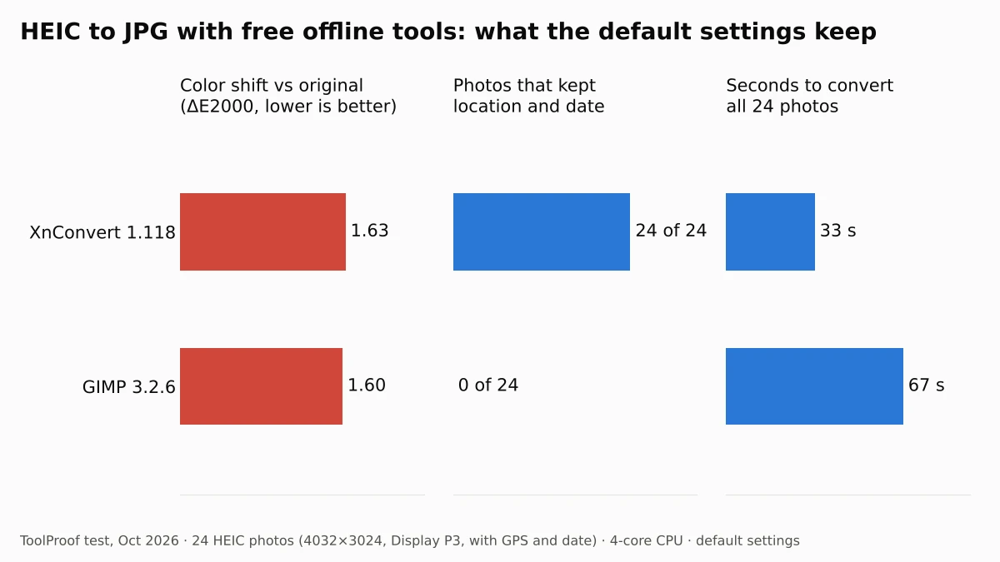
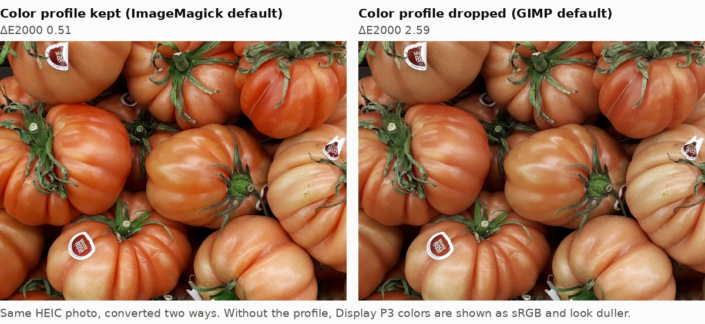
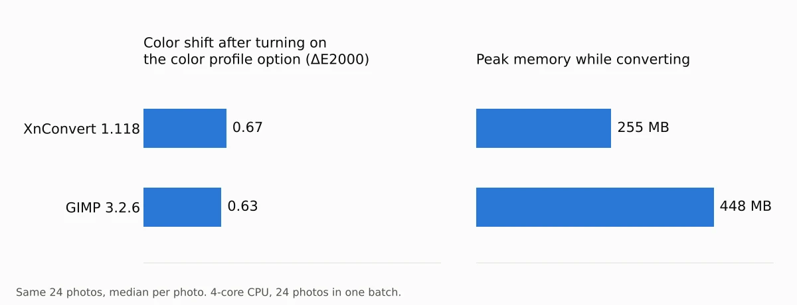
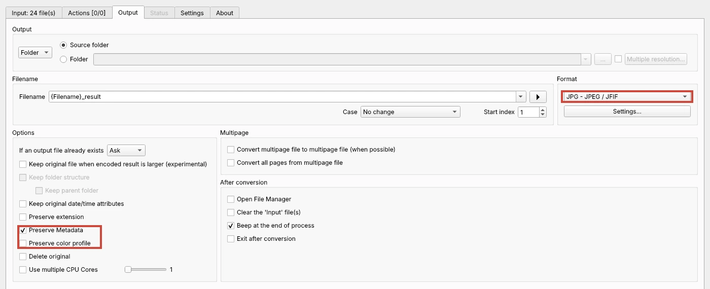
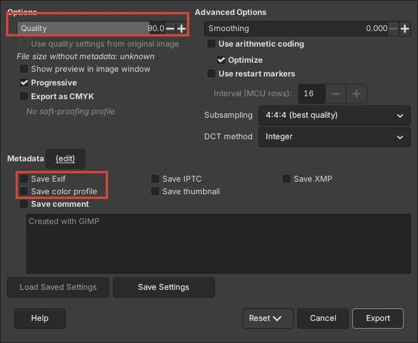

To convert HEIC photos to JPG for free without uploading them, use **XnConvert** on Windows, Mac or Linux and turn on its **Preserve color profile** option. On a Mac you don't need anything extra: Preview and Finder can export HEIC as JPEG. In our test of 24 HEIC photos, both free converters we ran got every photo's rotation right, but both changed how the colors looked unless we changed a setting first.

We ran XnConvert 1.118 and GIMP 3.2.6 offline on October 15, 2026, each with its default settings and then with the setting that fixes what it got wrong. Each tool converted the same 24 HEIC photos, which carried a wide-gamut color profile, the date taken and GPS coordinates. We compared every JPG with the original photo for color accuracy, checked whether the location and date survived, and timed the whole batch. The results matter for two reasons: dropped color profiles make photos look duller, and kept GPS data reveals where a photo was taken when you share the JPG.

## Free ways to convert HEIC to JPG at a glance

| Method | Works on | Converts many at once | What to watch (default settings) |
| --- | --- | --- | --- |
| XnConvert (tested) | Windows, Mac, Linux | Yes | Drops the color profile until you tick **Preserve color profile**. Keeps GPS location |
| GIMP (tested) | Windows, Mac, Linux | No (one photo at a time) | **Save Exif** and **Save color profile** were off: no date, no location, duller colors |
| Preview or Finder (not tested) | Mac | Yes (Preview) | Built in. Apple documents the steps |
| iPhone **Most Compatible** setting (not tested) | iPhone, iPad | New photos only | Future photos are saved as JPEG instead of HEIF |

Both tested tools are free for personal use. XnConvert is freeware for private and educational use, and companies must buy a license, according to its [license agreement](https://www.xnview.com/en/xnconvert/). GIMP is free for any use.

## How we tested

We judged each converter on four things you notice after converting: whether the colors still match, whether the photo still has its date and location (useful for your albums, risky when you share), whether portrait photos come out upright, and how long a batch takes.

- **Test photos:** 24 HEIC files we made ourselves from 20 public domain (CC0) photos in the [PD12M dataset](https://huggingface.co/datasets/Spawning/PD12M): landscapes, food, flowers, interiors, night scenes and snow. Each is 12 megapixels (4032×3024) with a Display P3 color profile, a "date taken" and GPS coordinates. Four are portrait photos stored sideways with a rotation instruction, plus an EXIF orientation tag, so a converter has to rotate them correctly. Together the 24 files were 69.4 MB.
- **How the files were made:** We encoded them with libheif 1.17.6 and the x265 encoder at quality 70. They are standard HEIC files, but they did not come straight from a phone camera, so phone files with extra parts (for example depth or HDR data) could behave differently.
- **What we measured:** We opened each JPG the way a browser shows it (applying the embedded color profile, or treating the file as standard sRGB if it had none) and compared it with the original photo. Color shift is the average ΔE2000 color difference per photo. We also read the metadata with ExifTool 12.76 and timed the full batch of 24 three times (median).
- **Computer:** Ubuntu 24.04, Intel Xeon 2.8 GHz 4-core CPU, 16 GB RAM, no GPU. XnConvert ran with its normal window; GIMP ran its usual JPEG export with default settings from a script.

## Results: what each converter keeps and drops

### Colors: both tools drop the color profile by default

XnConvert and GIMP saved JPGs without the photo's color profile by default, so the colors shifted. The median color shift was 1.63 for XnConvert and 1.60 for GIMP. On our most colorful photos (tomatoes, a sunset, a purple flower) the shift reached about 2.5 to 2.8.

A color profile tells apps how to read the color numbers in a photo. Our test photos used Display P3, which covers more saturated colors than standard sRGB. When a converter throws the profile away, apps read the same numbers as sRGB, and reds, oranges and greens come out flatter.

Both tools have a setting that fixes it. With **Preserve color profile** ticked in XnConvert, the median shift fell to 0.67. With **Save color profile** ticked in GIMP, it fell to 0.63. What remains is the normal loss from saving as JPEG.

### Location and date: GIMP removes them, XnConvert keeps them

XnConvert kept the GPS location and the date taken in all 24 JPGs. GIMP's default export kept neither in any of the 24, because **Save Exif** was unticked.

Which result you want depends on what you do next. If the JPGs go into your photo library, you want the date and location kept, so the photos sort correctly and show up on a map. If you are about to post or send them, kept GPS coordinates let anyone who downloads the file see where the photo was taken. Apple's [personal safety guide](https://support.apple.com/guide/personal-safety/manage-location-metadata-in-photos-ips0d7a5df82/web) warns about the same thing for photos shared from an iPhone. To strip the location and other hidden details from JPGs you already have, see our [test of six free photo metadata removers](/posts/remove-metadata-from-photos).

To remove the location in XnConvert, untick **Preserve Metadata** and tick **Preserve color profile**. In our test this removed the GPS location and date from all 24 photos and still kept the colors accurate (median shift 0.67).

### Rotation: both got portraits right

Both tools turned the four portrait photos upright and saved them as 3024×4032 JPGs. XnConvert and GIMP (with Exif saved) also reset the orientation tag to normal, so no viewer rotated the photos a second time.

### Speed, memory and file size

XnConvert was faster: 33 seconds for all 24 photos, about 1.4 seconds per photo, using one CPU core (its default). GIMP took 67 seconds and used more memory, 448 MB against 255 MB. File sizes follow each tool's default JPEG quality: XnConvert (quality 85) averaged 2.0 MB per photo and GIMP (90) 2.5 MB. Our HEIC files averaged 2.89 MB.

## How to convert HEIC to JPG on Windows with XnConvert

XnConvert is the easiest free way to convert a whole folder of HEIC photos on Windows, and it works the same on Mac and Linux. Download it from the [official XnConvert page](https://www.xnview.com/en/xnconvert/).

1. Open XnConvert and drag your HEIC photos (or a whole folder) into the **Input** tab.
2. Open the **Output** tab. Under **Format**, choose **JPG - JPEG / JFIF**.
3. Under **Options**, tick **Preserve color profile**. Leave **Preserve Metadata** ticked to keep the date and location, or untick it to remove them before sharing.
4. Choose where to save under **Output** (the default is the same folder, with `_result` added to each name), then click **Convert**.

**Settings...** under the format lets you change the JPEG quality (85 by default). XnConvert remembered our format and options the next time we opened it.

### Opening HEIC in the Windows Photos app

Windows needs two Microsoft Store extensions to open HEIC files. The [HEIF Image Extension](https://apps.microsoft.com/detail/9pmmsr1cgpwg) is free, and its listing says the [HEVC Video Extensions](https://apps.microsoft.com/detail/9nmzlz57r3t7) package must also be installed to view .heic files. HEVC Video Extensions was listed at $0.99 in the US Store as of October 2026. We could not run Windows apps in our test, so we didn't measure what the Photos app or Paint keep when they save a copy as JPG. Microsoft said on October 15, 2026 that a [redesigned Photos app](https://blogs.windows.com/windowsexperience/2026/10/15/meet-the-new-photos-app-on-windows-11/) with HEIC editing is rolling out to Windows Insiders first.

## How to convert one HEIC photo with GIMP

GIMP is worth using if you want to crop or touch up the photo before saving it, but tick two boxes when you export.

1. Open the HEIC file. If GIMP asks whether to keep the image's color profile, choose **Keep**.
2. Choose **File > Export As**, type a name ending in `.jpg` and click **Export**.
3. In the JPEG options, tick **Save Exif** (date and location) and **Save color profile**, then click **Export**.

Both boxes were unticked on our fresh GIMP 3.2.6 install. GIMP converts one image at a time; for a folder of photos, XnConvert is quicker.

## How to convert HEIC to JPG on a Mac

macOS can do it without extra apps. We didn't run these on a Mac; the steps come from Apple's guides.

- **Finder:** Control-click the photo, choose **Quick Actions**, click **More**, choose **Convert Image**, then pick JPEG and a size. Apple's [Finder guide](https://support.apple.com/guide/mac-help/perform-quick-actions-in-the-finder-mchl97ff9142/mac) uses converting an iPhone .heic photo to .jpeg as its example.
- **Preview:** open the photo, choose **File > Export**, pick **JPEG** from the **Format** menu and set the quality. To convert several, open them in one Preview window, select them in the sidebar and export, per [Apple's Preview guide](https://support.apple.com/guide/preview/prvw1012/mac).

## How to stop your iPhone from saving HEIC

If you'd rather not convert at all, your iPhone can save new photos as JPEG. Open **Settings > Camera > Formats** and tap **Most Compatible**. Apple says all new photos and videos then use JPEG and H.264, while photos you've already taken stay HEIC ([Apple Support](https://support.apple.com/en-us/116944)). The trade-off is space: Apple says HEIF uses less storage than JPEG for the same visual quality.

You may not need to change anything for sharing. According to Apple, when you send photos with AirDrop, Messages or email to a device that doesn't support HEIF, they might be sent as JPEG automatically. To remove a photo's location on an iPhone, open it in **Photos**, tap the info button, then **Adjust Info > Adjust Location > No Location**, according to Apple's [personal safety guide](https://support.apple.com/guide/personal-safety/manage-location-metadata-in-photos-ips0d7a5df82/web).

## Which one should you use?

- **A folder of HEIC photos on Windows:** XnConvert, with **Preserve color profile** ticked. It was the faster of the two in our test.
- **You're about to share the photos:** XnConvert with **Preserve Metadata** unticked and **Preserve color profile** ticked removed the location and kept accurate colors.
- **One photo you also want to edit:** GIMP, with **Save Exif** and **Save color profile** ticked.
- **On a Mac:** Finder's **Convert Image** quick action or Preview, no download needed.

To shrink the JPGs for an upload form, see our [test of compressing an image to 100 KB](/posts/compress-image-to-100kb). For more free tools that work without uploading your files, see our [guide to free offline AI tools](/posts/free-offline-ai-tools) and our [image to text (OCR) comparison](/posts/image-to-text-offline-free). If you need to check where an image came from, our guide on [how to check if an image is AI-generated](/posts/check-if-image-is-ai-generated) covers the metadata that survives, or doesn't, when files are converted.

If you want to cut the subject out of a converted photo, see our [test of free remove.bg alternatives](/posts/remove-bg-alternative-free).

Got a WebP file instead of a HEIC? Our [WebP to JPG test of 5 free tools](/posts/convert-webp-to-jpg-free) shows which ones keep transparent backgrounds and animations intact.
