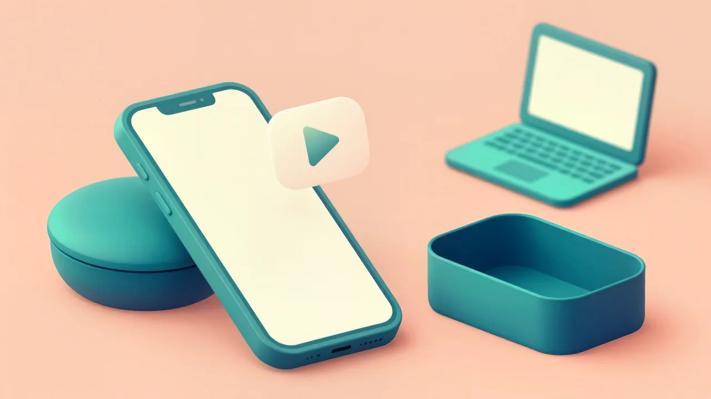
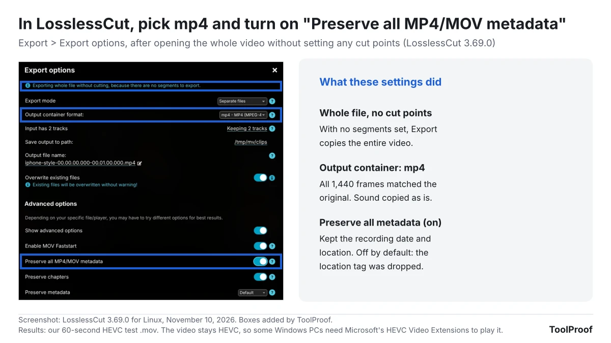
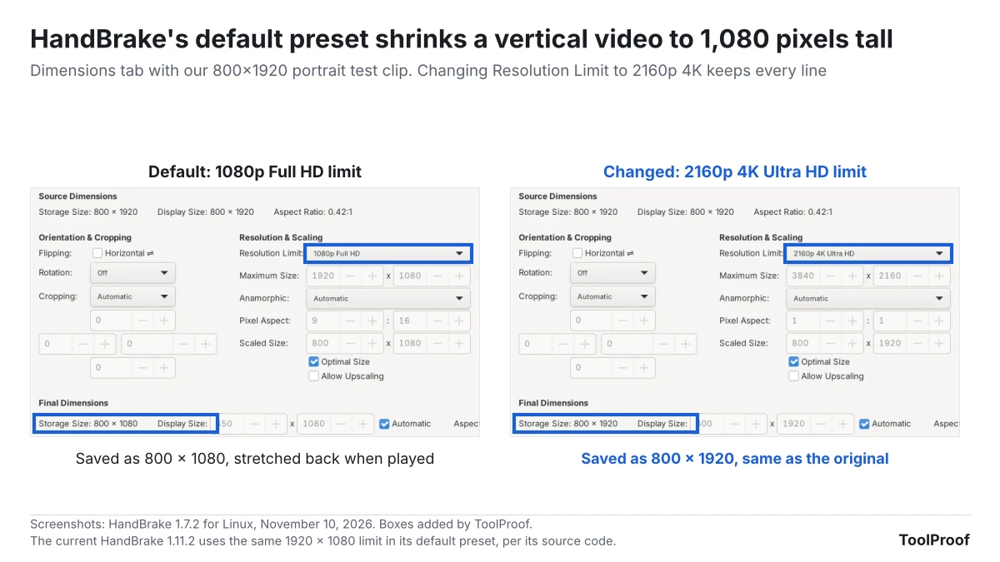
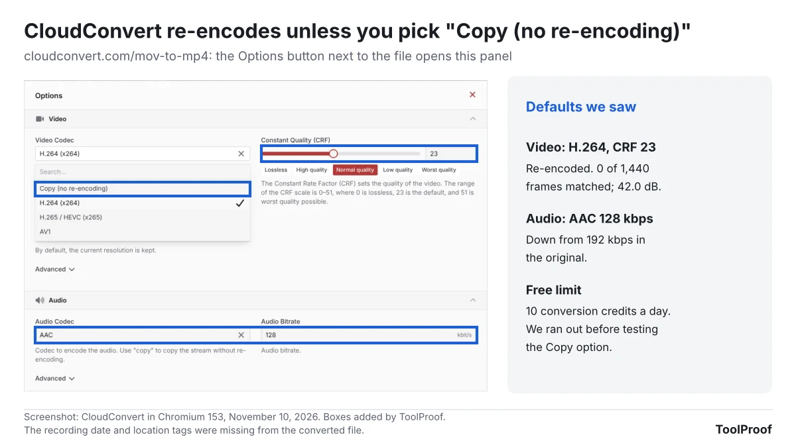
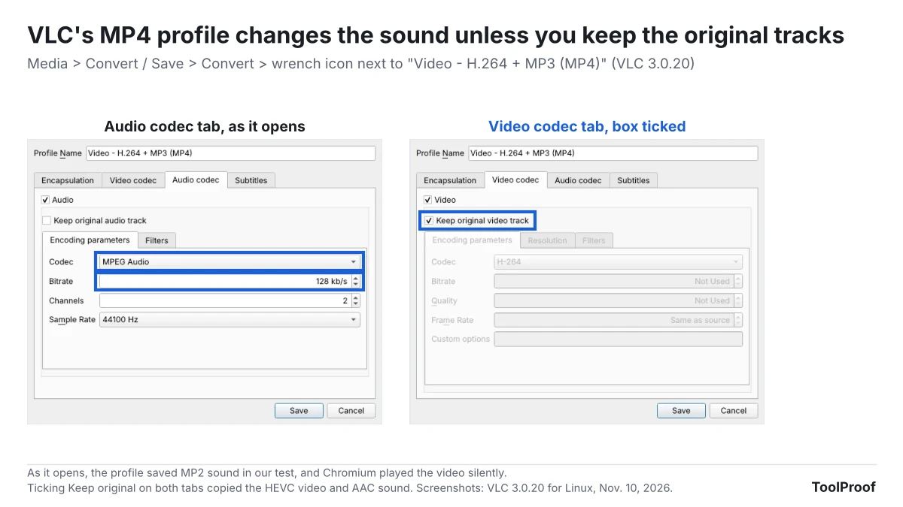
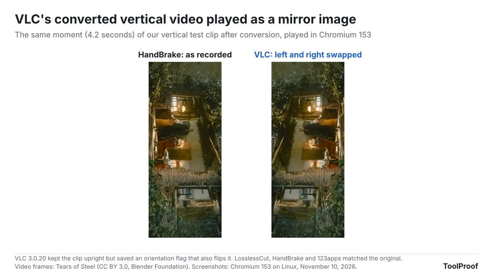

To convert iPhone video to MP4 without losing any quality, use an app that copies the video into an MP4 file instead of re-encoding it. In our test, the free desktop app LosslessCut did that with its default settings: all 1,440 frames of our test video came out identical to the original, the recording date stayed, and one extra switch kept the location too. The catch is that the video inside is still HEVC, the format iPhone records by default, so a PC without HEVC support still can't play it. If you need an MP4 that plays almost anywhere, re-encode it to H.264 with HandBrake, and check two settings first.

We tested five free converters on November 10, 2026: LosslessCut, HandBrake and VLC on the desktop, and CloudConvert and 123apps online. Each converted the same 60-second HEVC .mov, made in iPhone's default format with a recording date and location tag, plus a second clip flagged as a vertical video. We then compared every frame, the sound, the frame count, the orientation and the tags with the original. Four of the seven tool settings re-encoded the video, and three of those changed something you might not expect: the sound, the frame rate, or how a vertical video looks.

| Method | Every frame kept? | Video inside the MP4 | Best for |
| --- | --- | --- | --- |
| LosslessCut, mp4 export | Yes, 1,440 of 1,440 | HEVC, as recorded | Keeping the original quality and size |
| HandBrake, default preset | No, re-encoded | H.264 | Older PCs, editing apps and sites that won't take HEVC |
| CloudConvert or 123apps online | No, re-encoded by default | H.264 | One file, no install |
| VLC Convert / Save | No by default, and the sound broke | H.264 with MP2 sound | Not recommended as it opens |
| iPhone **Most Compatible** setting (not tested) | Not a converter | H.264 for new videos | Avoiding the problem in future recordings |

## What's inside an iPhone video

An iPhone video is usually HEVC video, also called H.265, and a file ending in .mov is a QuickTime movie. iPhone 7 and later record HEVC unless you change the camera format, according to [Apple's HEIF and HEVC support page](https://support.apple.com/en-us/116944). Apple says HEVC uses less storage than the older H.264 at the same visual quality, while the older formats are "more broadly compatible with other devices and operating systems."

That difference matters more than the file extension. MOV and MP4 are both containers, a wrapper that holds the video and sound. Moving an HEVC video from a .mov into an .mp4 changes the wrapper, not the video, so an app that can't decode HEVC still can't play it. On Windows, Microsoft sells [HEVC Video Extensions](https://apps.microsoft.com/detail/9nmzlz57r3t7) for $0.99 in the US Microsoft Store as of November 2026 to "play High Efficiency Video Coding (HEVC) videos in any video app." Turning HEVC into H.264 means re-encoding, which always changes the picture a little.

So there are two kinds of "convert to MP4":

- **Copy (remux):** the same video in an MP4 wrapper. No quality loss, almost the same file size, and it takes seconds.
- **Re-encode:** a new H.264 video. Plays on more devices, but the picture is recompressed and the converter's settings decide the quality, frame rate and size.

## Which converter keeps your iPhone video as it was?

Only the copy modes kept the original frames: LosslessCut kept all 1,440, and VLC's "Keep original" setting kept 1,437 of them. Every re-encoding setting changed every frame, though the picture stayed close to the original at about 42 to 43 dB, a measure of how far each frame drifted from the original (higher is closer).

The differences that matter most beyond the picture:

- **Sound:** VLC's "Video - H.264 + MP3 (MP4)" profile saved the sound as MP2, an older format, even though its name says MP3. In Chromium 153, the browser engine behind Chrome, the video played with no sound. The other re-encoders used AAC, at 128 kbps (CloudConvert, 123apps) or 160 kbps (HandBrake), down from 192 kbps in the original.
- **Frame rate:** 123apps turned our 24-frames-per-second video into 25 fps by showing one frame twice every second, for 1,500 frames instead of 1,440.
- **Recording date and location:** CloudConvert and 123apps removed both. VLC and HandBrake replaced the recording date with the time of the conversion and dropped the location. LosslessCut kept the date by default and kept the location only with **Preserve all MP4/MOV metadata** switched on.
- **Vertical video:** all five kept our vertical clip upright, but VLC's version played as a mirror image, with left and right swapped, and HandBrake's default preset saved it at 1,080 pixels tall instead of 1,920 (see below).
- **File size:** the copies stayed at 40.8 MB. The H.264 files were 26.0 MB (VLC), 26.9 MB (CloudConvert), 30.6 MB (HandBrake) and 40.0 MB (123apps).

## How to convert iPhone video to MP4 with every frame intact

Use LosslessCut's export with the output format set to mp4 and no cut points. In our test with LosslessCut 3.69.0, every frame came out identical to the original and the sound was copied as it was. LosslessCut is free from [its website](https://losslesscut.app/) and GitHub for Windows, Mac and Linux, and the developer also sells it in the Mac App Store and Microsoft Store to support the project. We ran the Linux version, which uses the same interface.

1. Open LosslessCut and choose **File > Open**, then pick your .mov file. With an HEVC video, it may say "File is not natively supported. Preview playback may be slow and of low quality, but the final export will be lossless." That only affects the preview.
2. Don't set any cut points.
3. In the format menu at the top right, which shows **mov** for a .mov video, choose **mp4**.
4. Click **Export**. The Export options window says "Exporting whole file without cutting, because there are no segments to export."
5. To keep the location tag, switch on **Show advanced options**, then **Preserve all MP4/MOV metadata**. Click **Export** again.

The MP4 lands in the same folder as the original, with the start and end times in its name. For our 60-second, 40.8 MB video, LosslessCut's log shows the export took less than a second.

The default export kept the recording time but dropped Apple's own date tag and the location. With **Preserve all MP4/MOV metadata** on, all three tags were still there. The same app also cuts videos without re-encoding, which we covered in our [frame-by-frame trimming test](/posts/trim-video-without-losing-quality).

## When you need an H.264 MP4 instead

Re-encode to H.264 when the MP4 has to play on a PC without HEVC support, open in an older editing app, or go to a site that rejects HEVC. HandBrake is the free app for this on Windows, Mac and Linux. With its default preset, **Fast 1080p30**, our test video came out as H.264 with AAC sound at 160 kbps, all 1,440 frames at the original 24 fps, and a picture that measured 42.0 dB against the original.

1. Open HandBrake and click **Open Source**, then pick your video.
2. Leave **Preset** on **Official > General > Fast 1080p30**, which HandBrake's [documentation](https://handbrake.fr/docs/en/latest/technical/official-presets.html) calls the default.
3. If the video was recorded vertically or in 4K, open the **Dimensions** tab and change **Resolution Limit** to **2160p 4K Ultra HD**.
4. If it was recorded at 60 frames per second, open the **Video** tab and change **Framerate** from **30** to **Same as source**.
5. Choose a name next to **Save As** and a folder next to **To**, then click **Start**.

Steps 3 and 4 matter because the presets limit size and speed. HandBrake's documentation says that with these presets, "higher resolution video will be downscaled to a maximum resolution, and higher frame rates will be peak limited to a maximum frame rate." The limit is 1920 × 1080 regardless of which way the video faces, so our 800 × 1920 vertical clip was saved at 800 × 1080 and stretched back to shape when played. It stays upright, but loses 44% of its lines of detail.

We tested HandBrake 1.7.2, the version in Ubuntu's software repository. The current version on [handbrake.fr](https://handbrake.fr/) is 1.11.2, and its source code applies the same 1920 × 1080 limit in the same way, so we expect the same result there, but we didn't run 1.11.2. HandBrake also replaced the recording date with the conversion time, even with **Passthru Common Metadata** ticked on the Summary tab. For more HandBrake settings, see our [HandBrake test for Discord and email size limits](/posts/compress-video-for-discord-email).

## Convert iPhone video to MP4 online

Both online converters we tried re-encoded the video by default and removed the recording date and location. Online tools are the quickest way for a single file, but you upload the video to someone else's server.

- **CloudConvert** ([cloudconvert.com/mov-to-mp4](https://cloudconvert.com/mov-to-mp4)): its default options were H.264 at a constant quality (CRF) of 23 and AAC sound at 128 kbps. The **Options** panel also lists **Copy (no re-encoding)** for the video and sound, but we used up the free daily allowance before we could test it. CloudConvert's [pricing page](https://cloudconvert.com/pricing) lists 10 conversion credits a day on the free plan.
- **123apps Video Converter** ([video-converter.com](https://video-converter.com/)): free with no account and files up to 4 GB, and it says uploads are deleted "a few hours" after you finish. Its **Settings** offer H.264, MPEG-4 or H.265 with no copy option, and it changed our video to 25 fps.

For both, the vertical clip stayed upright. 123apps turned the frames themselves upright (800 × 1920) instead of keeping the rotation flag that iPhone uses.

## What VLC's Convert / Save does to an iPhone video

VLC can convert video, but its MP4 profile, as it opened for us, gave our test video MP2 sound that Chromium didn't play, and it mirrored our vertical clip. In VLC, **Media > Convert / Save**, then **Convert / Save** again, opens a window with the profile **Video - H.264 + MP3 (MP4)**. Its wrench icon shows the audio codec as **MPEG Audio** at 128 kb/s, which in our test produced MP2, not MP3.

Ticking **Keep original video track** and **Keep original audio track** in that profile turns VLC into a copier. The frames it saved matched the original, but it left out 3 of the 1,440: the second frame and two near the end. It also replaced the recording date with the conversion time. Both of VLC's results also played a fraction of a second shorter than the original.

The vertical clip came out upright, but VLC saved an orientation flag that also mirrors the picture, so it played with left and right swapped in Chromium. LosslessCut, HandBrake and 123apps all kept the clip as recorded.

We tested VLC 3.0.20 for Linux. The current version on [videolan.org](https://www.videolan.org/vlc/) is 3.0.24, and the Windows and Mac versions may behave differently, so check that a converted file plays with sound before you delete the original.

## Convert with what's already on your iPhone, Mac or PC

Your iPhone, Mac and Windows PC can make H.264 copies without a separate converter, though QuickTime on a Mac saves them as .mov files. We didn't test these because we had no iPhone, Mac or Windows PC, so this section follows Apple's and Microsoft's support pages.

- **For future videos:** open **Settings > Camera > Formats** and tap **Most Compatible**. Apple says new photos and videos then use JPEG or H.264 ([Apple Support](https://support.apple.com/en-us/116944)). Videos you already recorded don't change.
- **When you share:** Apple says AirDrop, Messages and email might send a video as H.264 automatically if the receiving device doesn't support HEVC.
- **When you import to a PC with a cable:** Apple says the media might be converted to H.264. To get the original files instead, open **Settings > Apps > Photos**, scroll down and tap **Keep Originals**. Apple's [transfer guide](https://support.apple.com/en-us/120267) recommends the Most Compatible setting for Windows.
- **On a Mac:** in QuickTime Player, choose **File > Export As**, pick a resolution, then **Greater Compatibility** for H.264. Apple's [QuickTime Player guide](https://support.apple.com/guide/quicktime-player/export-movies-qtp20e395859/mac) says the result is a .mov file and that "QuickTime Player doesn't export movies as MP4 videos."
- **On Windows:** Microsoft's Clipchamp editor, which has a free plan, accepts MOV files and exports MP4 at a frame rate of 30 fps, according to Microsoft's [Clipchamp export guide](https://support.microsoft.com/en-us/clipchamp/exporting-and-saving-a-video-in-clipchamp). That is a re-encode.

The same High Efficiency setting also makes iPhone photos HEIC files. Our [HEIC to JPG test](/posts/convert-heic-to-jpg-free) covers photos the same way this article covers videos.

## How we tested

We judged each converter on four things a reader would notice: whether the picture stays identical or close, whether the sound still plays, whether the motion and length stay the same, and whether the video keeps its date, place and orientation.

- **Test files:** a 60-second clip from the open movie Tears of Steel (CC BY 3.0, Blender Foundation), saved as HEVC at 1920 × 800 and 24 fps with 192 kbps AAC sound in a .mov file, the same clip as in our trimming test. We added a recording date and a location tag the way iPhone stores them, and made a 20-second copy flagged to play vertically (800 × 1920). These files copy iPhone's default format, but they are not iPhone recordings: we didn't test HDR (Dolby Vision), 4K, 60 fps or variable frame rates.
- **Tools:** CloudConvert and 123apps Video Converter in Chromium 153 on Linux, with default settings. LosslessCut 3.69.0, VLC 3.0.20 and HandBrake 1.7.2 for Linux, run through their normal windows and menus, with default settings and then the one change described above.
- **Measurements:** we decoded every frame of each result and checked whether it was bit-for-bit identical to a frame of the original. For re-encoded files, we matched each frame to its original and measured the difference in brightness as PSNR, in decibels. We also checked the video and sound formats, frame count, orientation flag and tags with ffprobe, a free measuring tool, and played each H.264 result in Chromium to see whether video and sound decoded.
- **Not compared:** conversion speed, because an image generator was using the same processor during our tests. CloudConvert's Copy option, because we hit the free limit. Windows and Mac versions of the desktop apps.

## Which method should you use?

- **To keep the original quality, date and location:** LosslessCut, mp4 format, **Preserve all MP4/MOV metadata** on. It's the only way we tested that kept every frame.
- **To send a video to an older Windows PC or an app that rejects HEVC:** HandBrake's **Fast 1080p30**, with **Resolution Limit** at 2160p 4K for vertical or 4K videos. Expect a slightly softer picture and a new date.
- **To convert one short clip without installing anything:** CloudConvert. Its default picture measured the same as HandBrake's, and it kept the original frame rate, unlike 123apps.
- **To stop converting in the future:** set your iPhone to **Most Compatible**, or turn on **Keep Originals** only if your PC can play HEVC.

If photos are part of the same batch, our [free photo tools roundup](/posts/free-image-converter-photo-tools) covers HEIC conversion, compression and removing location data from pictures.

## FAQ

### Can I just rename .MOV to .MP4?

Renaming changes only the name. When we renamed our test .mov to .mp4, the file still identified itself as a QuickTime movie inside, and the video was still HEVC. Some players may open it anyway, but nothing about the file has changed. LosslessCut's copy gives you a real MP4 file with the same video in seconds.

### Is MOV or MP4 better quality?

Neither container changes the quality, because both hold the same kinds of video. When LosslessCut moved our HEVC video from .mov to .mp4, every frame was identical and the file was 608 bytes smaller out of 40.8 MB. Quality only changes when an app re-encodes the video, as HandBrake, CloudConvert, 123apps and VLC's default profile did.
