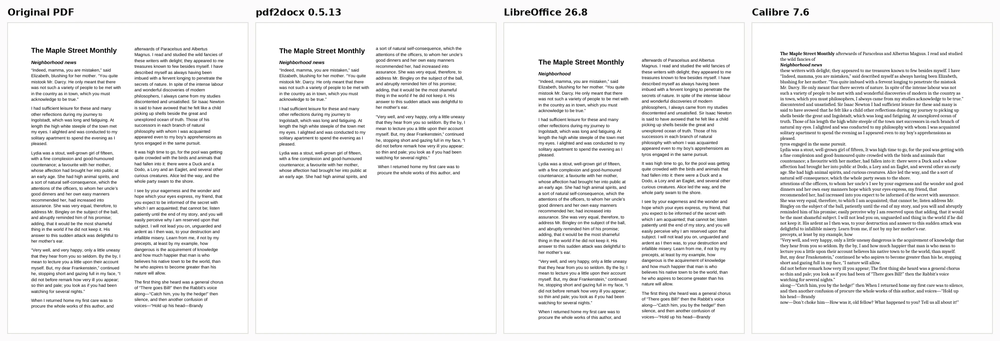
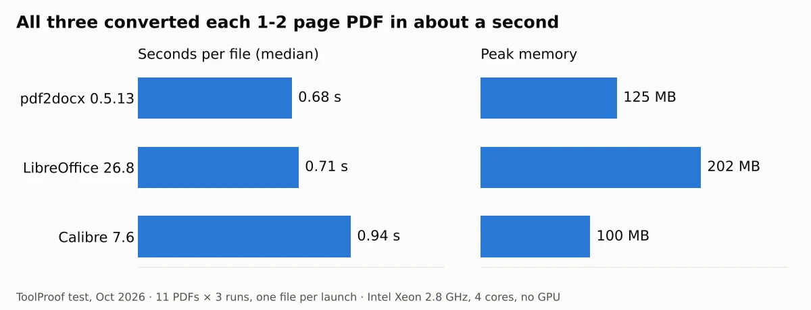

To convert a PDF to an editable Word document for free without uploading it, use **pdf2docx** if you can run one command, or **LibreOffice** if you want an app with menus. In our test of 11 PDFs, pdf2docx kept 96% of paragraphs as normal, editable paragraphs and rebuilt all 4 gridded tables as real Word tables. LibreOffice produced the closest-looking copy, but it put every line of text in its own text box, so the file looks right and is awkward to edit.

We ran three free tools fully offline on October 15, 2026: LibreOffice 26.8.1, pdf2docx 0.5.13 and Calibre 7.6. Each converted the same 10 text-based PDFs (a letter, a report, an invoice, a schedule with two tables, a two-column newsletter, a résumé, a document with charts, a policy with headers and page numbers, and two files exported from a word processor) plus one scanned page. We knew exactly what each PDF contained, so we could check every converted .docx file for missing words, broken paragraphs, lost tables and missing images. All three tools kept every word from the text-based PDFs and every image. The differences were in how easy the result is to edit.

## Free offline PDF to Word converters at a glance

| Tool | Best for | Paragraphs kept whole | Tables rebuilt (of 4) | Text in text boxes | Time per file | Peak RAM |
| --- | --- | --- | --- | --- | --- | --- |
| **pdf2docx 0.5.13** | Editing the text and tables | **96%** | **4** | 0% | 0.68 s | 125 MB |
| **LibreOffice 26.8** | Small fixes that keep the exact look | 0% | 0 | 100% | 0.71 s | 202 MB |
| **Calibre 7.6** | Getting plain text out for reuse | 84% | 0 | 0% | 0.94 s | 100 MB |

"Paragraphs kept whole" means the paragraph came out as one Word paragraph you can type into, and the rest of it moves down as you add text. A paragraph split by a page or column break counts as broken, which is why pdf2docx isn't at 100%. All three tools are free and open source, and none of them needs an internet connection once installed.

## How we tested

We made the 11 test PDFs ourselves so we'd know the right answer for every file. The body text comes from public-domain books on Project Gutenberg, and the tables, invoice items and résumé details are made up. Eight PDFs were built with the ReportLab library, two were written as Word (.docx) files and exported to PDF with a word processor, and one is a 200 dpi image of the letter, slightly tilted, to stand in for a scan. Together the text-based files have 15 pages.

We judged each tool on four things that decide whether a converted file saves you time:

- **Words kept:** did any text go missing?
- **Editable paragraphs:** does each paragraph come out as one block of text, or as separate lines and boxes?
- **Tables:** does a table in the PDF become a real Word table with the right text in each cell?
- **Layout:** do images survive, does the page count stay the same, and does the reading order stay right?

Each tool converted one file per launch, three times, on a 4-core Intel Xeon (2.8 GHz) with 16 GB of RAM and no graphics card, with default settings. Times are medians. To see the results the way you would, we opened every .docx in LibreOffice Writer 24.2 and saved it as a PDF for the screenshots below; Microsoft Word may lay out some pages a little differently.

## Results: what each converter does to your document

### Tables

pdf2docx was the only tool that turned tables back into tables. All four gridded tables came out with every cell in the right place, including the header shading. LibreOffice drew a table that looks almost identical, but it's made of separate text boxes and lines, and in our invoice the header row's text was hidden behind its shaded background. Calibre listed the cell contents one after another as plain lines, so the invoice became a long column of names and prices.

The résumé had a borderless two-column block (Email, Phone, City). pdf2docx turned it into aligned lines of text rather than a table, which looks the same on the page and is easy to edit.

### Editing the converted file

To see what happens when you actually edit, we typed a new sentence into the first paragraph of the converted letter from each tool. In the pdf2docx and Calibre files, the paragraph grew and the text below moved down, as you'd expect in Word. In the LibreOffice file, each line is a fixed-size text box, so only the first few added words showed; the rest of the sentence was hidden and the next line stayed where it was.

This is the main trade-off. LibreOffice's result is the closest visual copy of the PDF: same line breaks, same positions, same page count for all 10 files. That's useful for fixing a typo or a date. For rewriting paragraphs, its version of our letter, 26 separate one-line text boxes, is much harder to work with than pdf2docx's 10 normal paragraphs.

Calibre gave editable paragraphs, but it changed the look: a different font, no spacing between paragraphs, and the headings it found turned into a table of contents page at the start of one file, which doubled that file from 2 pages to 4.

### Two columns, lists and page headers

- **Two-column newsletter:** pdf2docx kept both columns in the right order, although the result ran to 3 pages instead of 2. LibreOffice kept the exact look, but the file stores its one-line text boxes alternating between the two columns, so text you pull out of it comes out jumbled. Calibre merged the two columns into one, interleaving lines from each, so 8 of the 10 articles came out scrambled.
- **Bulleted and numbered lists:** none of the tools reliably rebuilt Word's automatic list formatting. The text of every list item survived, but you may need to reapply bullets with Word's list button. In one file, pdf2docx put a bulleted list inside a hidden one-row table.
- **Headers and page numbers:** all three kept the header line and the "Page 1" text, but none turned them into Word's real header and footer, so the page numbers won't update if the text moves. pdf2docx and LibreOffice kept them at the top and bottom of each page; Calibre put them in the body text between paragraphs.

### Speed and memory

Speed doesn't separate these tools. Each converted a one- or two-page PDF in about a second or less and used at most about 200 MB of memory, so all three run fine on an old laptop.

## Scanned PDFs: add OCR first

None of the three converters can read a scanned PDF. For our scanned letter, all three produced a Word file containing only a picture of the page, with 0% of the words as text. The fix is to add a text layer with OCR (optical character recognition) before you convert.

We did that offline with the free tool **OCRmyPDF** 17.13 (it uses the Tesseract engine) by running `ocrmypdf scanned.pdf scanned-ocr.pdf`, which took about 3 seconds for the page. Then we converted the new PDF again:

- **LibreOffice** picked up 95% of the words, still one text box per line on top of the page image.
- **pdf2docx** and **Calibre** still returned only the image. They ignore the invisible text layer that OCR tools add.

So for a scan, the most practical offline route is to skip Word conversion and pull the text out directly. Our [test of 4 free offline OCR tools](/posts/image-to-text-offline-free) found Tesseract, the same engine OCRmyPDF uses, gave near-perfect text on all 10 of our scanned pages. You can then paste that text into a new Word document.

## How to convert a PDF to Word with pdf2docx

pdf2docx is a free Python tool (MIT license) built on the PyMuPDF library. These are the steps we ran:

1. **Install Python** from [python.org](https://www.python.org/downloads/) if you don't already have it.
2. Open Terminal (Mac) or Command Prompt (Windows) and **run** `pip install pdf2docx`.
3. **Run** `pdf2docx convert invoice.pdf invoice.docx`. The Word file appears in the same folder. Put the file names in quotes if they contain spaces.

The conversion happens entirely on your computer. The [pdf2docx package page](https://pypi.org/project/pdf2docx/) lists more options, such as converting only some pages. PyMuPDF, which pdf2docx installs, is under the AGPL license, which matters only if you build it into software you distribute.

## How to convert a PDF to Word with LibreOffice

If you double-click a PDF with LibreOffice installed, it opens in LibreOffice Draw, which can't save a Word file. Open it in Writer instead:

1. Download LibreOffice from the [official download page](https://www.libreoffice.org/download/download-libreoffice/) (version 26.8.1 as of October 2026, for Windows, Mac and Linux).
2. Open **LibreOffice Writer** and choose **File > Open**.
3. In the file type list, choose **PDF - Portable Document Format (Writer)**, then select your PDF.
4. Choose **File > Save As**, pick the **Word 2010–365 Document (.docx)** format, and save.

From a command line, `soffice --headless --infilter=writer_pdf_import --convert-to docx file.pdf` does the same thing; without the `--infilter` part, LibreOffice 26.8 stopped with "no export filter" in our test.

## Calibre and other options

**Calibre** is a free e-book manager for Windows, Mac and Linux, and DOCX is one of its [output formats](https://manual.calibre-ebook.com/faq.html). Add the PDF, choose **Convert books**, and set the output format to DOCX, or run `ebook-convert file.pdf file.docx`. Calibre's own manual calls PDF "one of the worst formats to convert from" and says multi-column documents and table extraction aren't supported ([calibre conversion guide](https://manual.calibre-ebook.com/conversion.html)), which matches what we saw. We used version 7.6 from the Ubuntu package repository; newer versions may behave differently.

We didn't test these two, so the details come from their documentation as of October 2026:

- **Microsoft Word** (Microsoft 365, Word 2016 and later) opens PDFs directly: go to **File > Open**, select the PDF and click **OK** when Word says it will make a copy and convert it. Microsoft says this "works best with PDFs that are mostly text" and lists tables with cell spacing, frames, footnotes that span pages, endnotes and PDF comments among the elements that convert poorly ([Opening PDFs in Word](https://support.microsoft.com/en-us/office/opening-pdfs-in-word-1d1d2acc-afa0-46ef-891d-b76bcd83d9c8)). Word isn't free, and Microsoft's page doesn't say whether the conversion happens on your computer.
- **Google Docs** converts a PDF when you right-click it in Google Drive and choose **Open with > Google Docs**. It's free, but the file is uploaded, it should be 2 MB or smaller, and Google says "lists, tables, columns, footnotes, and endnotes are not likely to be detected" ([Google Drive Help](https://support.google.com/drive/answer/176692?hl=en)).

## Which one should you use?

- **You need to edit text and tables:** use pdf2docx. It was the only tool that gave both normal paragraphs and real Word tables.
- **You need a near-identical copy for a small change,** like a date or a name: use LibreOffice, and keep each edit short so it fits in its line.
- **You only want the text,** for example to paste into an email or another document: Calibre or pdf2docx both kept every word.
- **Your PDF is a scan:** run OCR first, or extract the text with one of the [free offline OCR tools we tested](/posts/image-to-text-offline-free).

For more tools that work without uploading your files, see our [guide to free offline AI tools](/posts/free-offline-ai-tools), including [offline audio transcription](/posts/transcribe-audio-offline-free) and [offline background removal](/posts/remove-background-from-image-free-offline). To turn iPhone HEIC photos into JPGs without uploading them, see our [test of free offline HEIC to JPG converters](/posts/convert-heic-to-jpg-free). If the PDF is too big to email, our [test of free offline PDF compressors](/posts/compress-pdf-offline-free) shows which settings shrink it without blurring the text.
