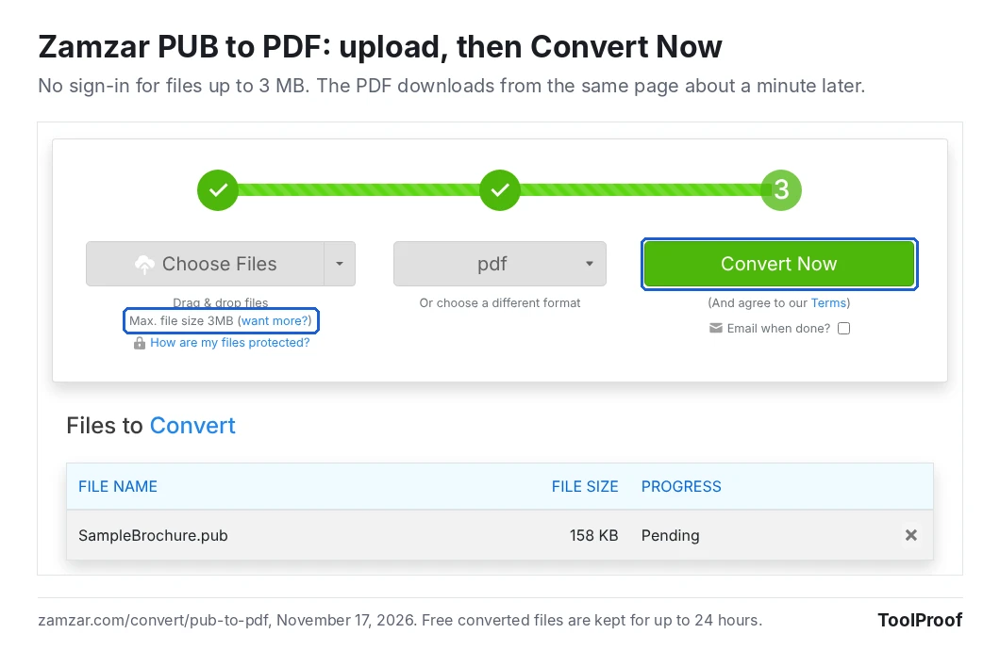
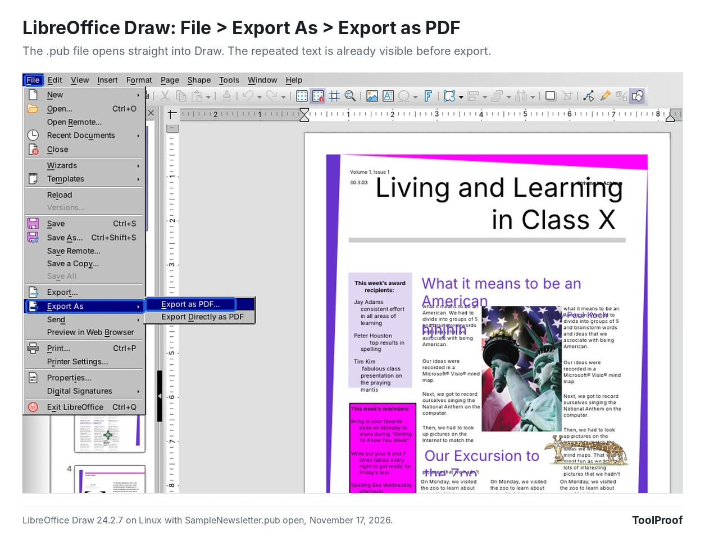

To convert a Publisher file to PDF, open it in Publisher and choose **File > Export > Create PDF/XPS Document** if any copy of Publisher still runs on your PC. If none does, the free Zamzar website gave us the cleanest PDFs in our November 17, 2026 test: the PDF it made from our brochure names Microsoft Publisher 2010 as the program that created it, and both of its PDFs kept the original fonts. LibreOffice Draw, which is free and works offline, handled a two-page brochure well but repeated every newsletter story in each of the columns it flows through.

We ran the same two sample Publisher files, a two-page art gallery brochure and a four-page school newsletter, through LibreOffice Draw and four free converter websites, then compared every PDF with the text stored inside the .pub files. CloudConvert and FreeConvert turned out to run LibreOffice on their servers (versions 26.8.0 and 26.2.5, according to their PDFs), and both repeated the newsletter text exactly the way Draw did. Aspose's free PUB converter returned a server error on both files.

| Method | Best for | What we got | Free limits |
| --- | --- | --- | --- |
| **Publisher's own export** | Anyone who still has Publisher 2021 or older | Microsoft's steps, not tested by us | Needs a working copy of Publisher |
| **Zamzar** (website) | Newsletters, booklets, anything in columns | Clean PDFs with the original fonts | 3 MB per file, files kept up to 24 hours |
| **LibreOffice Draw** (free app) | Flyers, cards, brochures, private files | Brochure close, newsletter text repeated | None, works offline |
| **CloudConvert, FreeConvert** (websites) | Nothing LibreOffice can't do | Same repeats as LibreOffice | 10 files a day / 1 GB per file |

![Results table for the same two Publisher files, November 17, 2026. Zamzar: PDF made by Publisher 2010 according to the brochure PDF, brochure kept original fonts and was clean, newsletter clean with no repeats, free up to 3 MB per file. LibreOffice Draw: brochure close with font swaps, newsletter text repeated three times, free and offline. FreeConvert, made with LibreOffice 26.2.5: brochure close with Office fonts, newsletter text repeated, 1 GB per file. CloudConvert, made with LibreOffice 26.8.0: brochure close with font swaps, newsletter repeated, 10 files a day. Aspose PUB app: server error on both files](./images/convert-publisher-file-to-pdf/publisher-to-pdf-results-table.webp)

## Can you still save a Publisher file as a PDF in Publisher?

You can if you own a one-time purchase copy such as Publisher 2021, 2019 or 2016, because Microsoft says those versions keep installing and running after their support ended on October 13, 2026. Microsoft 365 subscribers are in a different spot: Microsoft's [Publisher retirement page](https://support.microsoft.com/en-us/publisher/microsoft-publisher-will-no-longer-be-supported-after-october-2026) says they lose access to Publisher on or shortly after October 1, 2026, as a removal update rolls out, and can no longer open or edit their files in it. Our [Microsoft end of support dates list](/posts/microsoft-end-of-support-dates) has the other Office and Windows deadlines from the same month.

If Publisher still opens on your PC, Microsoft's [PDF export steps](https://support.microsoft.com/en-us/publisher/save-as-or-convert-a-publication-to-pdf-or-xps-using-publisher) are:

1. Open the file in Publisher.
2. Choose **File > Export > Create PDF/XPS Document > Create PDF/XPS**.
3. Type a file name and set **Save as type** to **PDF**.
4. Select **Options** and pick **Standard** for email and home printing, **High Quality Printing** for a copy shop, or **Commercial Press** for a professional printer.
5. Select **OK**, then **Publish**.

The retirement page gives a shorter route that ends in the same place: **File > Save as**, choose **PDF** as the file type, and save. Commercial Press makes the largest files, so if a PDF turns out too big to email, our guide to [compressing a PDF for free](/posts/compress-pdf-free) can shrink it. We couldn't run Publisher on our test computer, so these steps come from Microsoft's documentation rather than our own test. If your Publisher came with [Office 2021, whose support also ended on October 13](/posts/office-2021-end-of-support), it still works today, which makes now a good time to export everything you want to keep.

## How to convert a Publisher file to PDF without Publisher

Zamzar's free PUB to PDF converter gave us the most faithful PDFs of any tool that doesn't need Publisher on your computer. The brochure PDF it returned lists Microsoft Publisher 2010 as the program that made it, so Zamzar appears to run the conversion through Publisher on its own servers. The newsletter PDF lists only Zamzar as its maker, but it used the same Office fonts as the original (Franklin Gothic and Rockwell Condensed) and had none of the repeated text described below.

1. Go to Zamzar's [PUB to PDF page](https://www.zamzar.com/convert/pub-to-pdf/).
2. Select **Choose Files** and pick your .pub file. Free files can be up to 3 MB.
3. Leave the format set to **pdf** and select **Convert Now**.
4. When the conversion finishes, select **Download**.

Each of our files took about a minute from upload to download, with no account. The catch is privacy: your file goes to Zamzar's servers, and Zamzar says free converted files are stored for up to 24 hours. For a church bulletin or a club flyer that's usually fine. For a document with names, addresses or anything you'd rather not upload, use LibreOffice instead, and accept that you may need to check the layout.

## How to open a Publisher file in LibreOffice Draw

LibreOffice Draw opens a .pub file directly and saves it as a PDF without uploading it anywhere, which makes it the best free choice for private files. LibreOffice is a free office suite for Windows and Mac, and version 26.8.3 was the current release on its [download page](https://www.libreoffice.org/download/) on November 17, 2026.

1. Install LibreOffice from libreoffice.org.
2. Open LibreOffice, choose **File > Open** and pick your .pub file. It opens in Draw.
3. Look through every page in the **Pages** panel on the left before you export (see the next section for why).
4. Choose **File > Export As > Export as PDF**, keep the default settings and select **Export**.
5. Pick a folder, type a name and select **Export** again.

We ran these steps in LibreOffice Draw 24.2.7, the version our Linux test computer had installed.

## Why a newsletter looks wrong in LibreOffice

LibreOffice repeats any story that Publisher flows through linked text boxes, so a newsletter with columns comes out with the same paragraphs side by side. In our four-page newsletter, each column of a three-column story started the story again from the first line instead of picking up where the previous column stopped. The PDF ended up with 2,460 more words than the newsletter actually contains, about two and a half times its real text, and 28% of its letters were printed on top of other letters where the extra text ran into the next story. Zamzar's newsletter PDF had no repeated stories and no overlapping letters.

Missing fonts make it worse but are not the cause. Publisher files often use Office fonts such as Franklin Gothic and Rockwell Condensed, and when a computer doesn't have them, LibreOffice swaps in a different font that takes more room, so headlines spill onto a second line and run into the text below. FreeConvert's servers have those Office fonts, and its PDF had fewer overlapping letters (19%), but it repeated exactly the same 2,460 words. The page number on page 2 also came out as "PAGE #" in every LibreOffice-made PDF instead of "PAGE 2".

Simple layouts are a different story. Our brochure keeps each block of text in its own box, and LibreOffice got every word of it with nothing repeated. The fonts changed, some lines broke in different places and about 1% of the letters overlapped, but the pages were easy to read and print. If your Publisher files are flyers, cards, certificates or brochures like that, LibreOffice is a fine free option. If they are newsletters, bulletins or anything with stories that continue from one column or page to the next, check every page, or use Zamzar.

## Other free converter websites we tried

The other converter websites we tried didn't beat LibreOffice, because the two that worked run LibreOffice themselves.

- **CloudConvert** made its PDFs with LibreOffice 26.8.0 and substitute fonts. The newsletter had the same repeated stories, with 30% of its letters overlapping. The free plan allows [10 conversions a day](https://cloudconvert.com/pricing), and CloudConvert's [privacy policy](https://cloudconvert.com/privacy) says files are deleted automatically within 24 hours.
- **FreeConvert** made its PDFs with LibreOffice 26.2.5 and the original Office fonts, which made it the best looking of the LibreOffice results, but the newsletter text was still repeated. Its [PUB to PDF page](https://www.freeconvert.com/pub-to-pdf) allows files up to 1 GB and says they are deleted after 8 hours.
- **Aspose PUB to PDF** uses its own conversion code rather than LibreOffice, but both of our files failed with the error "One or more errors occurred. (Could not load file or assembly 'Aspose.PDF…'" on November 17, 2026. It may work again later.

Because CloudConvert used a newer LibreOffice (26.8.0) than the one on our test computer, its results also show that updating LibreOffice doesn't fix the repeats.

## Can you open a Publisher file in Word or on a Mac?

Microsoft's route from Publisher to Word goes through a PDF. Convert the file to PDF first, then in Word choose **File > Open**, pick the PDF and select **OK**. Microsoft warns that the layout may change, especially in files with many pictures. Our test of [free ways to convert a PDF to Word](/posts/pdf-to-word-free) shows which tools keep the most formatting.

On a Mac, the options are the same two that don't need Publisher: LibreOffice, which has downloads for Apple silicon and Intel Macs, or Zamzar in any browser. We ran LibreOffice on Linux, but the part that reads Publisher files is shared by the Windows, Mac and Linux versions, so expect the same repeats with newsletters.

Affinity, the design app, says on its [Publisher page](https://www.affinity.studio/microsoft-publisher-alternative-for-teams) that it opens .pub files from Publisher 97 and later as editable Affinity documents, and Microsoft's own retirement page names Affinity as a program that "may be able to import native Publisher files." We didn't test Affinity, because it runs only on Windows and Mac.

## Which one should you use?

- **You still have Publisher 2021, 2019 or 2016:** export every file you care about from Publisher now, while it still runs. That copy will never be more reliable than it is today.
- **Newsletters, bulletins or anything with columns, and no Publisher:** use Zamzar, as long as each file is under 3 MB and you're fine uploading it.
- **Private files, big files or no internet:** use LibreOffice Draw, and look through every page before you export. Simple one-box-per-section layouts come out well.
- **You want to keep editing the design:** try Affinity, or convert to PDF and open the PDF in Word, knowing the layout may need fixing.

## How we tested

We used two Publisher files from the Apache POI project's public test files (Apache License 2.0): SampleBrochure.pub, a two-page landscape brochure, and SampleNewsletter.pub, a four-page newsletter whose stories continue across three linked columns. To know what each PDF should contain, we read the text stored inside each .pub file (660 and 1,614 words, counted the same way as the PDFs).

On November 17, 2026, we converted both files with LibreOffice Draw 24.2.7 on Linux, exporting the newsletter through the File menu shown above, and uploaded both files without an account to Zamzar, CloudConvert, FreeConvert and Aspose's PUB to PDF app in Chromium. We read each PDF with PDFium, the PDF engine inside Chrome, and measured three things: how many of the original words were in it, how many extra words it had, and what share of letters overlapped another line's letters by at least 30%. We also rendered every page and compared it by eye, and read each PDF's properties to see which program had made it.

We downloaded the current LibreOffice 26.8.3 too, but our test computer's security settings blocked us from running it. The Publisher import code in LibreOffice 26.8.3 differs from the one in 24.2.7 only by memory safety fixes, according to its release notes, and the PDFs made by LibreOffice 26.2.5 and 26.8.0 on FreeConvert and CloudConvert repeated exactly the same 2,460 words. Our test computer didn't have the Office fonts the files use, so LibreOffice substituted other fonts, as it would on a Mac or a PC without Office.

## FAQ

### Will my .pub files stop working after Publisher is removed?

The files themselves don't change, but a Microsoft 365 subscription no longer gives you a Publisher app to open them with. A one-time purchase copy of Publisher keeps opening them, and LibreOffice and Zamzar can still read them. Converting them to PDF now means you won't depend on any of those later.

### How do I find all my Publisher files?

Search for ".pub" on your PC, in OneDrive and in SharePoint, as Microsoft's retirement page suggests. Every Publisher file ends in .pub, so the search finds them wherever they are saved.
