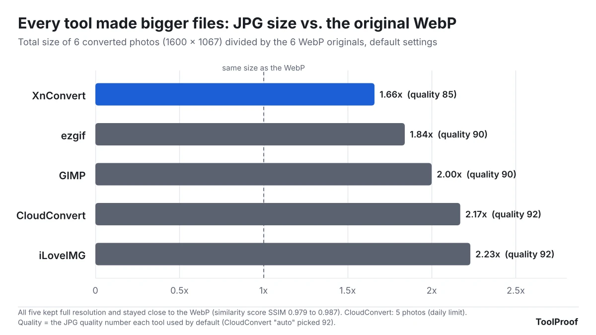
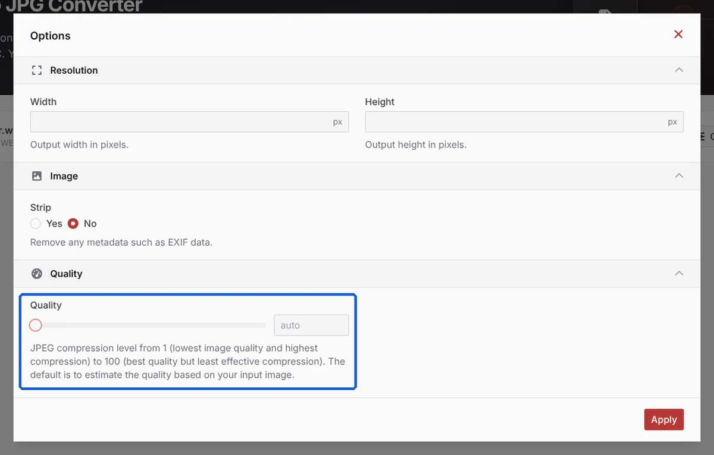
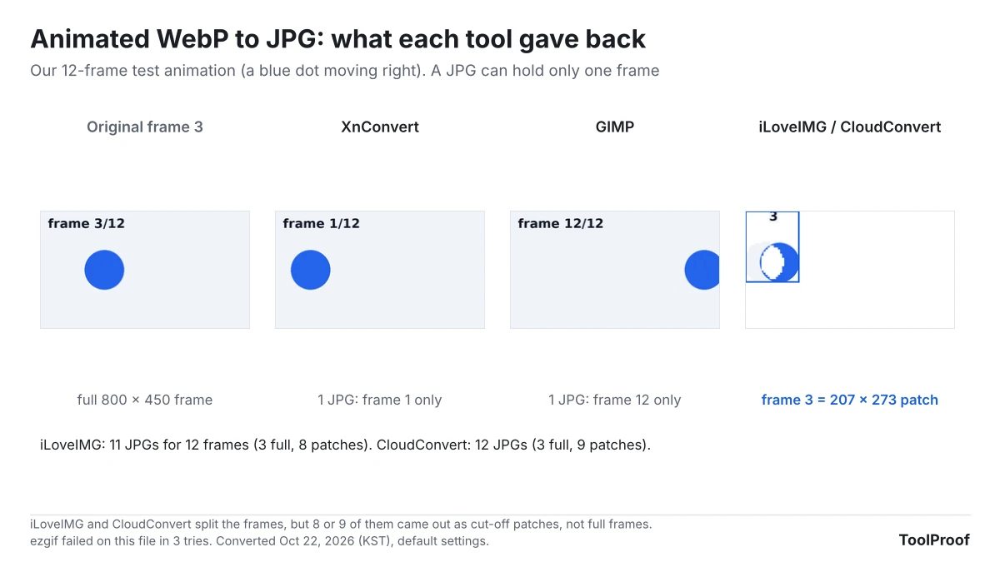
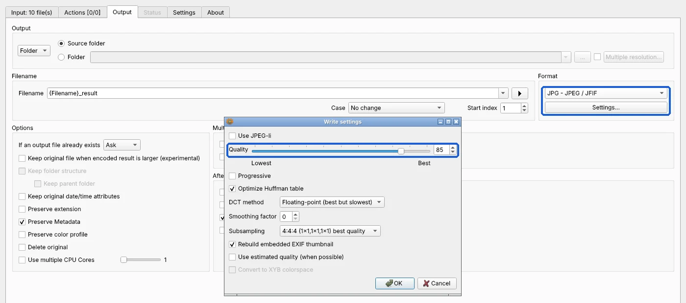

To convert a WebP image to JPG for free, upload it to a converter website such as ezgif, or install the free desktop app XnConvert if you have many files or would rather not upload them. For ordinary photos, all five free tools we tested did the job: every JPG kept the full resolution and stayed close to the original. The problems start with WebP files that have a transparent background or are animated, and that is where the tools differed most.

We tested this on October 21–22, 2026, with 10 WebP files we made ourselves: 6 photos at 1600 × 1067 pixels, 3 graphics with transparent backgrounds, and one 12-frame animation. We ran them through two desktop apps (XnConvert 1.118.0 and GIMP 3.2.6) and three websites (ezgif, CloudConvert and iLoveIMG) with their default settings and no account. Two results stood out. First, every JPG was bigger than the WebP it came from, by 1.66 to 2.23 times. Second, transparent artwork disappeared in all five tools: four painted the background white, which wiped out our white sticker, and iLoveIMG painted it black, which hid our dark logo.

## WebP to JPG converters at a glance

| Tool | Type | Default JPG quality | Size vs. WebP | Transparent areas | Animated WebP | Best for |
| --- | --- | --- | --- | --- | --- | --- |
| **XnConvert** | Desktop app (Windows, Mac, Linux) | 85 | 1.66x | White | First frame only | Many files, no uploading |
| **ezgif** | Website | 90 | 1.84x | White, or a color you pick | Failed in 3 tries | One file with transparency |
| **GIMP** | Desktop app | 90 | 2.00x | White | Last frame only | Editing before you convert |
| **CloudConvert** | Website | Auto (92 in our test) | 2.17x | White | 12 JPGs, 9 cut-off | A few files a day |
| **iLoveIMG** | Website | 92 | 2.23x | **Black** | 11 JPGs, 8 cut-off | Photos only |

"Size vs. WebP" is the total size of our 6 converted photos divided by the 6 WebP originals. A higher quality number means a bigger file that keeps more detail. All five tools are free for personal use; the limits are covered in each section below.

## How we tested

We judged each tool on four things, because these are what decide whether the JPG is usable:

- **Picture quality and file size** for ordinary photos, since that is what most people convert.
- **What happens to transparent areas.** JPG cannot store transparency, so every tool has to fill the see-through parts with a color.
- **What happens to animations.** A JPG holds one still image, so an animated WebP has to be cut down somehow.
- **Free limits and sign-up**, checked on each site's own pages.

The 6 photos are public-domain pictures (CC0, from the PD12M collection) that we resized and saved as WebP at quality 80, a common setting on websites. The transparent files are our own graphics: a dark "ToolProof" logo, a white "SALE" sticker and a round photo cutout with soft edges. The animation is a 12-frame clip of a blue dot moving right, saved the usual way, where most frames store only the part of the picture that changed.

XnConvert and GIMP ran on a Linux test computer (Intel Xeon, 4 cores). The websites ran in the Chromium browser on the same computer. To compare quality, we used a similarity score called SSIM, where 1.0 means identical to the WebP. Every photo from every tool scored between 0.973 and 0.994, so none of them visibly damaged a photo. CloudConvert converted 5 of the 6 photos before its free daily limit stopped us.

## Results: photos are easy, file size is not

Every tool kept the full 1600 × 1067 resolution, and the median similarity score ranged from 0.979 (XnConvert, ezgif) to 0.987 (CloudConvert, iLoveIMG). The bigger difference was file size. Our 6 WebP photos added up to 1,215 KB. After conversion, they took 2,013 KB with XnConvert and 2,715 KB with iLoveIMG.

This is normal: WebP compresses better than JPG, so the same picture needs more bytes as a JPG. The tools that chose a higher quality number made bigger files without a visible gain. iLoveIMG and CloudConvert gave us byte-for-byte identical JPGs for all 5 photos we converted with both.

If a form or website has a size limit, a lower quality setting brings the file down. Our [test of compressing an image to 100 KB](/posts/compress-image-to-100kb) shows how far you can go before photos start to look worse.

## Transparent WebP: the background color decides what survives

A transparent WebP, such as a logo or a sticker, loses its transparency as a JPG, and the color that replaces it can erase your artwork. Four tools (XnConvert, GIMP, CloudConvert and ezgif) filled the transparent area with white. That kept our dark logo readable, but our white "SALE" sticker came out as a blank white square. iLoveIMG did the opposite: it filled the background with black, so the sticker survived but the dark logo almost vanished, and the photo cutout came back with green streaks where the background should have been.

Only ezgif lets you choose the fill color: under **Background color** on its convert page, the default is white (#ffffff). CloudConvert's **Options** panel offers size, metadata and quality settings, but no background color, and iLoveIMG shows no options at all ("All images will be converted to JPG").

If the transparency matters, convert to PNG instead of JPG. PNG keeps transparent areas: when we exported the same three files from GIMP as PNG, the transparency and every visible pixel matched the WebP exactly. The PNG steps in each tool are the same as below, with PNG picked as the format.

## Animated WebP: no tool gave a clean result

A JPG can hold only one picture, so an animated WebP either loses all but one frame or turns into a pile of JPGs. XnConvert kept only the first frame, and GIMP kept only the last one (frame 12), with no warning from either. iLoveIMG and CloudConvert split the animation into separate JPGs, but most of them were not full pictures. Animated WebPs usually store only the changed part of each frame, and both sites saved those parts as is: CloudConvert returned 12 files, 9 of them small cut-off patches, and iLoveIMG returned 11 files for 12 frames, 8 of them patches. ezgif's server reported "Argh! It failed..." on this file in all 3 of our tries.

If you want to keep the animation, a JPG is the wrong target. ezgif lists separate WebP to GIF and WebP to MP4 converters on the same site, which keep the motion; we did not test those.

## How to convert WebP to JPG with XnConvert (many files, no upload)

XnConvert is a free batch converter for Windows, Mac and Linux. It converts files on your computer, so nothing is uploaded, and it handled all 10 of our files in one run. According to [XnConvert's download page](https://www.xnview.com/en/xnconvert/), it is free for private and educational use; companies need a license (15.00 € for one, as of October 2026).

1. Download XnConvert from the [official site](https://www.xnview.com/en/xnconvert/) and install it.
2. Open it, go to the **Input** tab and click **Add files...** or **Add folder...** (or drag your WebP files into the window).
3. Go to the **Output** tab. Under **Format**, change **Same as original** to **JPG - JPEG / JFIF**.
4. Optional: click **Settings...** under the format to change **Quality** (85 by default).
5. Under **Output**, choose **Source folder** to save next to the originals, or pick a folder. New files get "_result" added to the name by default.
6. Click **Convert**.

We found no background color setting on the Output tab or in the JPG settings, so transparent areas come out white.

## How to convert WebP to JPG with ezgif (one file, pick the background)

ezgif is a free website with no sign-up. It was the only tool that let us choose what color replaces transparency, which makes it the best pick for a logo or sticker that has to be a JPG.

1. Open [ezgif's WebP to JPG converter](https://ezgif.com/webp-to-jpg).
2. Choose your WebP file and click **Upload!**
3. Under **Background color**, pick a color that contrasts with your artwork (for example black for a white logo). Leave **JPG image quality factor** at 90 or lower it for a smaller file.
4. Click **Convert to JPG!**, then click **Save** under the converted image.

ezgif's page says uploaded files are automatically deleted 1 hour after upload. A few of our uploads timed out and worked on the second try.

## GIMP, CloudConvert and iLoveIMG

**GIMP** (free, open source) opens a WebP like any other image. Choose **File > Export As**, type a name ending in .jpg, click **Export**, then **Export** again in the JPEG options (quality 90 by default). It is more work than XnConvert for one quick conversion, but it is worth it if you want to crop or touch up the picture first. The current version is [GIMP 3.2.6](https://www.gimp.org/downloads/).

**CloudConvert** made good photo JPGs and has the most settings of the three websites (size, quality, removing metadata). The free plan is [10 conversion credits per day](https://cloudconvert.com/pricing), and the site refused one of our files with "Your daily limit of 10 conversion credits exceeded".

**iLoveIMG** is fine for ordinary photos, but avoid it for transparent images, since it filled their backgrounds with black. Its free plan covers the basic tools with "limited document processing", and Premium costs $5 a month billed yearly ($60) or $9 monthly, according to its [pricing page](https://www.iloveimg.com/pricing).

## Converting WebP on Windows and Mac without new software

We could not test these because our test computer runs Linux, so this section relies on Apple's and Microsoft's own pages.

- **Mac:** According to [Apple's Preview guide](https://support.apple.com/guide/preview/prvw1012/mac), open the image in Preview, choose **File > Export**, then pick **JPEG** in the **Format** menu and adjust the quality. To convert several images at once, open them in one Preview window, select them in the sidebar and export. Apple's page lists the formats you can export to, not every format Preview can open.
- **Windows:** Microsoft's free [WebP Image Extension](https://apps.microsoft.com/detail/9pg2dk419drg) lets File Explorer, Photos and other Windows apps open WebP images. We did not find a Microsoft page that documents saving a WebP as JPG in Paint or Photos, so for Windows we recommend XnConvert or a website above.

## Which one should you use?

- **A handful of ordinary photos:** any of the five. ezgif needs no install; XnConvert gave the smallest files at default settings.
- **Many files, or private images:** XnConvert. It converts everything in one run and nothing leaves your computer.
- **A logo, icon or sticker with a transparent background:** convert to PNG if the place you're uploading to accepts it. If it must be a JPG, use ezgif and pick a background color that contrasts with the artwork. Avoid iLoveIMG for these files.
- **An animated WebP:** don't convert it to JPG. A GIF or MP4 converter keeps the motion; a JPG keeps one frame at best.

## FAQ

### Why did my WebP turn black when I converted it to JPG?

The image almost certainly has a transparent background. JPG cannot store transparency, so the converter has to fill those areas with a color. In our test iLoveIMG used black, which hid dark artwork. Use a tool that fills with white, pick the color yourself in ezgif, or save as PNG to keep the transparency.

### Do I lose quality converting WebP to JPG?

A little, because JPG compresses the picture again, but in our test it was not visible on photos: every JPG scored at least 0.973 out of 1.0 for similarity to the WebP. What you mostly lose is space, since the JPGs were 1.66 to 2.23 times larger.

### Can I convert many WebP files to JPG at once for free?

Yes. XnConvert converts a whole folder in one run, with no daily limit for personal use. Among the websites, CloudConvert's free plan stops at 10 conversion credits a day.

Converting iPhone photos instead? See our [test of free HEIC to JPG converters](/posts/convert-heic-to-jpg-free), which uses XnConvert and GIMP too. If you need a transparent cutout in the first place, we tested [free remove.bg alternatives](/posts/remove-bg-alternative-free), and to put converted images into a single document, see [how to turn JPGs into a PDF for free](/posts/jpg-to-pdf-free).
