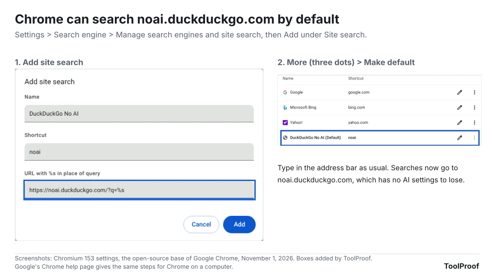
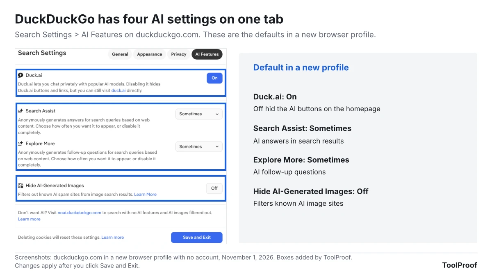
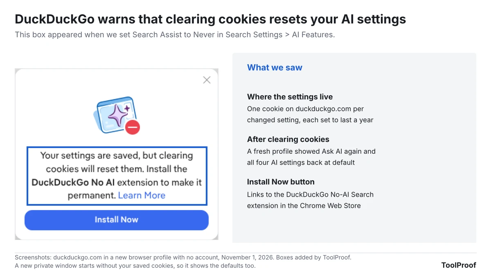
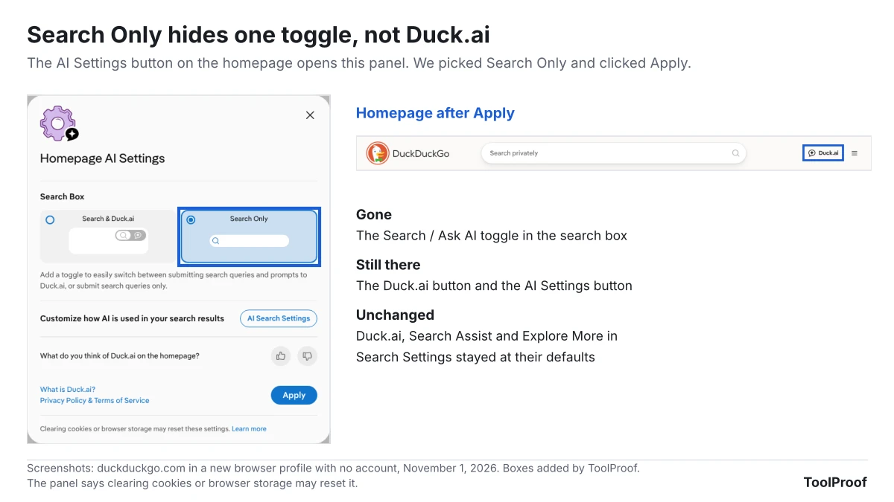

To use DuckDuckGo with no AI, search from **noai.duckduckgo.com** instead of duckduckgo.com. That version turns off Search Assist (DuckDuckGo's AI answers), hides Duck.ai (its AI chat) and filters out AI-generated images, with nothing to set up. To make it your everyday search, install DuckDuckGo's own **DuckDuckGo No-AI Search** extension for Chrome or Firefox, or add noai.duckduckgo.com as your default search engine in Chrome's settings.

You can also turn the AI off on the regular site under **Settings > AI Features**, but those switches are stored as cookies. In our November 1, 2026 test, a fresh browser profile without those cookies had every AI feature back on. We tested duckduckgo.com in Chromium 153, the open-source version of Chrome, in a new browser profile with no account. We checked all four AI settings, the homepage's own AI Settings button, noai.duckduckgo.com and Chrome's search engine settings, and compared which AI buttons each one removed.

| Method | What it turns off | Survives clearing cookies? | Best for |
| --- | --- | --- | --- |
| Search from noai.duckduckgo.com | Search Assist, Duck.ai and AI images | Yes, there is nothing to save | Any browser, including phones |
| DuckDuckGo No-AI Search extension | Makes noai.duckduckgo.com your default search | Yes | Chrome and Firefox on a computer |
| Chrome site search set as default | Same as the extension, with no extension | Yes | Chrome users who avoid extensions |
| **Settings > AI Features** on duckduckgo.com | Each AI feature separately | No, stored in cookies | Keeping some AI, such as Duck.ai |
| DuckDuckGo browser **Settings > AI Features** | Duck.ai, Search Assist and AI images in the app | Yes, according to DuckDuckGo | People who use the DuckDuckGo browser |
| **Search Only** in the homepage AI Settings button | Only the Ask AI toggle in the search box | May reset, says DuckDuckGo | Not enough on its own |

## What is noai.duckduckgo.com?

The address noai.duckduckgo.com is DuckDuckGo's official AI-free version of its search engine, and it works without any settings. DuckDuckGo's [help page on noai.duckduckgo.com](https://duckduckgo.com/duckduckgo-help-pages/ai-features/about-noaiduckduckgocom) says it blocks three things: Search Assist, Duck.ai and AI-generated images. Results otherwise work the same as on duckduckgo.com, and DuckDuckGo says the address will stay AI-free if it adds new AI features later.

In our test, the noai homepage showed just the logo and a search box. The regular homepage had a **Search** and **Ask AI** toggle inside the search box, a **Duck.ai** button at the top right, a yellow **OPTIONAL** note inviting you to chat, and an **AI Settings** button at the bottom right. None of these appeared on noai.duckduckgo.com. Its settings page also had no **AI Features** tab at all, and **Hide AI-Generated Images** was already on, while the same setting was off on duckduckgo.com in the same new profile.

## How to make noai.duckduckgo.com your default search

Making noai.duckduckgo.com your default search engine means every search you type in the address bar goes to the AI-free version, so you never depend on saved settings. There are two ways to do it, depending on your browser.

### Chrome or Firefox: install the DuckDuckGo No-AI Search extension

1. Open the extension's page in the [Chrome Web Store](https://chromewebstore.google.com/detail/duckduckgo-no-ai-search/faoilnlkccdjdkpljainiiimmijofmpd) or on [Firefox Add-ons](https://addons.mozilla.org/en-US/firefox/addon/duckduckgo-no-ai-search/). DuckDuckGo links to both from its help page.
2. Check the publisher: **Duck Duck Go, Inc.** in the Chrome Web Store, **by DuckDuckGo** on Firefox Add-ons.
3. Click **Add to Chrome** in the Chrome Web Store, or the add button on Firefox Add-ons, and confirm.
4. Search from the address bar as usual.

As of November 1, 2026, the Chrome version had 40,000 users and the Firefox version 39,560. We didn't install it, but we opened the Firefox version's package (version 2026.9.25). It adds a default search engine named **DuckDuckGo (No AI)** that sends address bar searches to noai.duckduckgo.com, which matches the store description. Checking the publisher matters because DuckDuckGo [warns about unofficial extensions](https://duckduckgo.com/duckduckgo-help-pages/add-ons/removal) that route searches through its engine without being affiliated with it.

### Chrome without an extension: add a site search

Chrome lets you add noai.duckduckgo.com yourself and make it the default, which is what the extension does for you.

1. Open the three-dot menu and choose **Settings**.
2. Click **Search engine**, then **Manage search engines and site search**.
3. Next to **Site search**, click **Add**.
4. Type a name, such as **DuckDuckGo No AI**, a shortcut, such as **noai**, and this address in **URL with %s in place of query**: **https://noai.duckduckgo.com/?q=%s**. Chrome replaces **%s** with whatever you search for.
5. Click **Add**. Then click **More** (the three dots) next to your new entry and choose **Make default**.

In our test, the entry moved to the top list as **DuckDuckGo No AI (Default)**, and the main **Search engine** page showed it as the engine for the address bar. The steps match [Google's Chrome help page](https://support.google.com/chrome/answer/95426?hl=en&co=GENIE.Platform%3DDesktop), which notes that in some countries a custom site search can't be the default in a Guest profile.

On Safari, on a phone or in any browser where you can't add a search engine, bookmark noai.duckduckgo.com or set it as your homepage and start your searches there.

## How to turn off AI in DuckDuckGo's search settings

If you'd rather keep using duckduckgo.com, you can turn off each AI feature in its settings. This is also the way to keep one feature, such as Duck.ai, while hiding the others.

1. Go to duckduckgo.com, click the menu (three lines) at the top right and choose **Settings**.
2. Click the **AI Features** tab.
3. Click **Duck.ai** so it shows **Off**.
4. Set **Search Assist** to **Never**.
5. Set **Explore More** to **Never**.
6. Click **Hide AI-Generated Images** so it shows **On**.
7. Click **Save and Exit**.

Here is what each setting does, based on what we saw and DuckDuckGo's own descriptions:

- **Duck.ai** (default **On**): Turning it off removed the **Ask AI** toggle, the **Duck.ai** button, the **OPTIONAL** chat note and the **AI Settings** button from the homepage in our test. The settings page says you can still open duck.ai directly. DuckDuckGo's [help page on hiding Duck.ai](https://duckduckgo.com/duckduckgo-help-pages/duckai/how-to-hide-ai-chat) still calls this switch **Chat**.
- **Search Assist** (default **Sometimes**): These are AI-written answers built from web pages, with a link to one or two sources. DuckDuckGo's [Search Assist help page](https://duckduckgo.com/duckduckgo-help-pages/results/ai-assisted-answers) says you can also change it from the gear icon on an answer.
- **Explore More** (default **Sometimes**): The settings page describes it as AI-generated follow-up questions for your searches. DuckDuckGo's [help page on opting out of AI](https://duckduckgo.com/duckduckgo-help-pages/ai-features/opting-out-of-ai) doesn't mention it as of November 1, 2026, so set it to **Never** even if you follow those steps.
- **Hide AI-Generated Images** (default **Off**): It filters known AI image sites out of image results. DuckDuckGo's [help page on AI images](https://duckduckgo.com/duckduckgo-help-pages/results/how-to-filter-out-ai-images-in-duckduckgo-search-results) says it relies on public blocklists and won't catch every AI image. You can also pick **Hide** from the **AI images** filter on the Images tab.

## Why do DuckDuckGo's AI settings keep coming back?

DuckDuckGo's AI settings come back because the site saves them as cookies in your browser, not in an account. When we set **Search Assist** to **Never**, a box popped up saying: "Your settings are saved, but clearing cookies will reset them." Its **Install Now** button linked to the No-AI extension.

After we saved all four changes, the browser held one small cookie per setting, each set to last a year. A fresh profile without those cookies showed the **Ask AI** toggle again, and all four settings were back at their defaults. The same happens if your browser clears cookies when it closes, in a private window, on another browser or on another device.

If you want to keep duckduckgo.com with your own mix of settings, DuckDuckGo's [help page on saving settings](https://duckduckgo.com/duckduckgo-help-pages/settings/save) suggests two fixes:

- Add duckduckgo.com as an exception in whatever clears your cookies.
- Use **Cloud Save** on the settings page. You save your settings under a passphrase and load them again after cookies are cleared or on another computer. DuckDuckGo says in its [Cloud Save help page](https://duckduckgo.com/duckduckgo-help-pages/settings/cloud-save) that it stores no personal information with them and can't recover a forgotten passphrase.

## What does Search Only on the homepage change?

The **Search Only** option in the homepage's **AI Settings** button hides only the **Ask AI** toggle in the search box, not Duck.ai. In our test, we clicked **AI Settings** at the bottom right of the homepage, chose **Search Only** and clicked **Apply**. The toggle disappeared, but the **Duck.ai** button and the **AI Settings** button stayed, and Duck.ai, Search Assist and Explore More were all still at their defaults in **Settings > AI Features**. The panel itself says clearing cookies or browser storage may reset it. Use its **AI Search Settings** button to reach the full settings instead.

## How to turn off AI in the DuckDuckGo browser

The DuckDuckGo browser for Windows, Mac, iPhone and Android has its own AI switches under **Settings > AI Features**. We couldn't run the app on our test computer, so these steps come from DuckDuckGo's help pages:

- Turn off **Duck.ai** to disable Duck.ai features in the browser completely, as DuckDuckGo's [help page on opting out of AI](https://duckduckgo.com/duckduckgo-help-pages/ai-features/opting-out-of-ai) describes.
- Choose how often Search Assist appears under **Search Assist Settings**.
- Turn on **Hide AI Images**, or select **Use DuckDuckGo Without AI** for search with no AI images, Search Assist answers or Duck.ai prompts.

DuckDuckGo says the browser keeps these settings inside the app, so clearing cookies or using its Fire Button doesn't reset them.

## FAQ

### Does DuckDuckGo use AI automatically?

Yes, partly. In a new browser profile, Search Assist and Explore More were both set to **Sometimes** and the Duck.ai buttons were on. DuckDuckGo says it doesn't track how you use these features or train AI on your data, and both are free with no account.

### Is Search Assist DuckDuckGo's version of AI Overviews?

Search Assist is DuckDuckGo's AI answer box, similar to Google's AI Overviews. You can set it to **Never** in DuckDuckGo's settings or avoid it entirely on noai.duckduckgo.com. Google's AI Overviews work differently, and our [guide to turning off AI in Chrome, Gmail, Word and more](/posts/turn-off-ai-features) shows what you can and can't turn off there.

### Can I still use Duck.ai after turning it off?

Yes. Turning off **Duck.ai** in DuckDuckGo's settings only hides its buttons and links. You can still go to duck.ai directly whenever you want to use it.

## Which option should you use?

- **You never want AI in search:** Install the DuckDuckGo No-AI Search extension in Chrome or Firefox, or set up the Chrome site search above. It keeps working after you clear cookies.
- **You use Safari or a phone browser:** Bookmark noai.duckduckgo.com, or use the DuckDuckGo browser and select **Use DuckDuckGo Without AI**.
- **You like Duck.ai but not AI answers:** Stay on duckduckgo.com, set **Search Assist** and **Explore More** to **Never**, and save your settings with **Cloud Save** so a cookie cleanup doesn't undo them.

Your browser may have AI of its own. Our guides cover [turning off AI in Firefox](/posts/turn-off-ai-in-firefox), [turning off Copilot in Microsoft Edge](/posts/turn-off-copilot-in-edge), [turning off AI in Chrome](/posts/turn-off-ai-in-chrome) and [turning off AI in Brave](/posts/turn-off-ai-in-brave).

## How we tested

We tested on November 1, 2026, with Chromium 153.0.8010.12 in a new browser profile with no account, language set to US English. We recorded the four settings and their defaults on the **AI Features** tab, then turned off Duck.ai and checked the homepage, then changed the other three settings and checked what the settings page had saved. We also read the cookies DuckDuckGo saved and opened a fresh profile to see whether the settings stayed. Separately, we tried the homepage's **Search Only** option, opened noai.duckduckgo.com and its settings page, and added noai.duckduckgo.com as Chrome's default in Chromium's settings.

DuckDuckGo's search results pages returned an error page to our automated test browser, so we didn't see Search Assist answers, Explore More questions or the Images tab ourselves. What those features do comes from DuckDuckGo's help pages. We didn't install the No-AI extension or the DuckDuckGo browser. For the extension, we read its store pages and the Firefox version's package.
