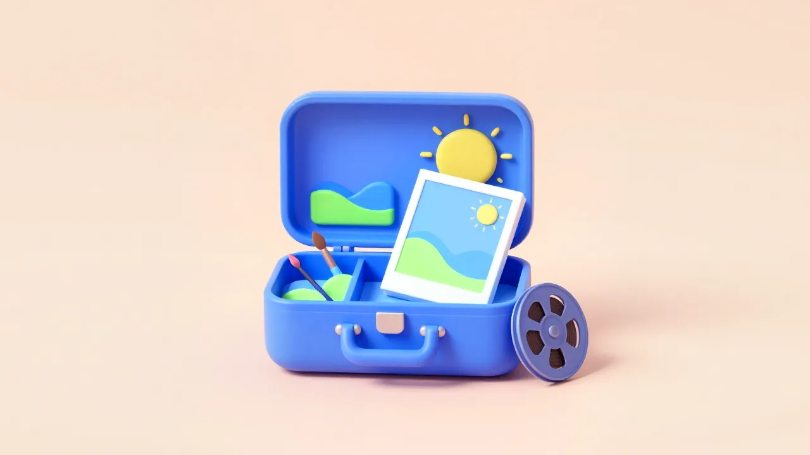
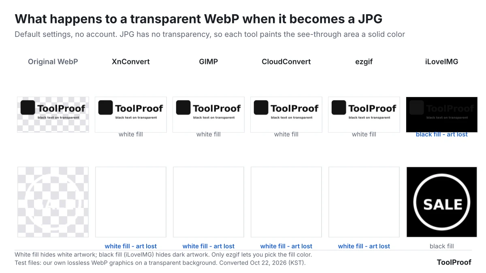

The best free image converter for most people is **XnConvert**, a desktop app for Windows, Mac and Linux that turned whole folders of HEIC and WebP files into JPGs without uploading anything. It was our pick in both conversion tests we ran, with one setting change: tick **Preserve color profile**, or colors come out duller. For the other everyday photo jobs, our picks are **GIMP** for getting a photo under 100 KB, **iLoveIMG** for removing a background, **ExifCleaner** or the **ExifRemove** website for stripping location data, and **HandBrake** for fitting a video under Discord's 20 MB limit.

This page collects six tests of 14 free tools that we ran from October 15 to 22, 2026. Each job had its own set of test files, and we judged the tools on what you notice afterward: whether colors, rotation and location data survive, how big the file comes out, and whether your photo has to be uploaded. Each section below gives the short result and links to the full test, which has step-by-step instructions and screenshots.

## Best free photo tools at a glance

Free desktop apps won five of the six jobs, and the one website pick, iLoveIMG, won background removal because it was the only site that gave full-size downloads for free.

| Job | Our pick | Works on | Why it won | Full test |
| --- | --- | --- | --- | --- |
| HEIC to JPG | **XnConvert** (app) | Windows, Mac, Linux | Converted 24 HEIC photos in 33 seconds, all upright, with accurate colors once one box is ticked | [Convert HEIC to JPG for free](/posts/convert-heic-to-jpg-free) |
| WebP to JPG | **XnConvert** (app), or **ezgif** (website) for transparent images | Windows, Mac, Linux / any browser | Smallest JPGs of 5 tools. ezgif was the only one that let us pick the background color | [Convert WebP to JPG for free](/posts/convert-webp-to-jpg-free) |
| Photo under 100 KB | Resize to 1024 px, then **GIMP** (app) | Windows, Mac, Linux | Resizing first got 20 of 20 photos under 100 KB. GIMP shows the file size before you save | [Compress an image to 100KB](/posts/compress-image-to-100kb) |
| Remove a background | **iLoveIMG** (website) | Any browser | The only site that gave us full-size cutouts free, with no account | [Free remove.bg alternatives](/posts/remove-bg-alternative-free) |
| Remove photo metadata | **ExifCleaner** (app), or **ExifRemove** (website) | Windows, Mac, Linux / any browser | Removed all personal data, kept portraits upright and never uploaded the photo | [Remove metadata from photos](/posts/remove-metadata-from-photos) |
| Video for Discord or email | **HandBrake** (app) | Windows, Mac, Linux | A bitrate set for 19 MB fit Discord's free 20 MB limit at full 1080p | [Compress video for Discord and email](/posts/compress-video-for-discord-email) |

"App" means a program you install on your own computer, so your files never leave it. The website picks upload your photo to the company's servers, except ExifRemove, which does its work inside your browser.

## How we tested

We ran XnConvert and ExifCleaner on a Linux computer through their own windows and buttons, the way you would on Windows or a Mac, and used the websites in the Chromium browser without signing in. Two apps ran without their windows. GIMP's exports ran from a script with GIMP's default export settings, which in the HEIC test gave the same files as exporting from GIMP's window. HandBrake's window wouldn't open on our test computer, so we ran the same HandBrake version with its built-in presets and settings. Each job had test files built so we knew what the right result looked like:

- **HEIC to JPG:** 24 HEIC photos with a wide-color profile, a date and a GPS location, 4 of them portraits stored sideways
- **WebP to JPG:** 6 photos, 3 graphics with transparent backgrounds and a 12-frame animation
- **Under 100 KB:** 20 phone-size photos (12 megapixels), compressed to five common upload limits at nine sizes and scored for quality
- **Background removal:** 20 photos from a public test set that comes with hand-drawn outlines of each subject, so every cutout could be scored
- **Metadata:** 8 photos tagged with a made-up GPS location, camera, serial number, author and date
- **Video:** three 1-minute 1080p clips (animation, live action and a screen recording with small text), scored with Netflix's VMAF video quality score

In the 100 KB test, a script found the highest JPEG quality that fit each limit, and we used GIMP for the steps and screenshots. We couldn't run Windows or macOS, so built-in options such as the Mac's Preview, the iPhone Photos app and Windows Paint come from Apple's and Microsoft's own guides, not from our measurements.

We picked one tool per job by asking what most people need from it: photos that look the same and stay upright, no surprise uploads, a file that actually fits the limit, and no sign-up. As of October 26, 2026, the download pages of [XnConvert](https://www.xnview.com/en/xnconvert/), [GIMP](https://www.gimp.org/downloads/) and [HandBrake](https://handbrake.fr/) still list the versions we tested: 1.118.0, 3.2.6 and 1.11.2.

## Best free image converter for HEIC to JPG: XnConvert

XnConvert is the best free way to convert iPhone HEIC photos to JPG on Windows, because it converts a whole folder in one run without uploading anything. In our October 15, 2026 test of 24 HEIC photos, XnConvert 1.118 finished in 33 seconds against 67 seconds for GIMP 3.2.6, and both turned all four portrait photos upright.

Both apps dropped the photo's color profile by default, so reds, oranges and greens came out flatter (a median color shift of 1.63 for XnConvert). Ticking **Preserve color profile** on XnConvert's **Output** tab cut that to 0.67, the normal small loss from saving as JPEG. XnConvert also keeps the GPS location by default. That is what you want for your photo library and not what you want before posting, so untick **Preserve Metadata** to remove it in the same step. XnConvert is free for private and educational use; companies need a license, according to its [download page](https://www.xnview.com/en/xnconvert/).

On a Mac you don't need an app: Finder's **Convert Image** quick action can turn an iPhone .heic photo into a .jpeg, and Preview's **File > Export** saves JPEG too, according to Apple's [Finder guide](https://support.apple.com/guide/mac-help/perform-quick-actions-in-the-finder-mchl97ff9142/mac) and [Preview guide](https://support.apple.com/guide/preview/prvw1012/mac). To stop an iPhone from saving HEIC in the first place, choose **Settings > Camera > Formats > Most Compatible**; Apple says all new photos then use JPEG ([Apple Support](https://support.apple.com/en-us/116944)). Steps for all of these are in our [HEIC to JPG test of XnConvert and GIMP](/posts/convert-heic-to-jpg-free).

## Best free WebP to JPG converter: XnConvert, or ezgif for transparent images

For ordinary photos, any of the five free WebP converters we tested does the job, and XnConvert made the smallest files. In our October 21 to 22, 2026 test of 6 WebP photos, every tool kept the full resolution and scored at least 0.973 out of 1 for similarity to the original, while the JPGs came out 1.66 times (XnConvert) to 2.23 times (iLoveIMG) the size of the WebP files.

The tools split on WebP images with a transparent background, such as logos and stickers. JPG can't store transparency, so a converter has to fill those areas with a color. XnConvert, GIMP, CloudConvert and ezgif filled them with white, which erased our white sticker, and iLoveIMG filled them with black, which hid our dark logo. ezgif was the only one that let us choose the fill color, under **Background color** on its [WebP to JPG page](https://ezgif.com/webp-to-jpg).

If you need to keep the transparency, save as PNG instead of JPG. No tool gave a clean result for an animated WebP: XnConvert and GIMP each kept a single frame, and the websites returned cut-off pieces or failed. CloudConvert's free plan allows [10 conversions a day](https://cloudconvert.com/pricing), and ezgif says uploads are deleted an hour later. Steps for XnConvert and ezgif are in our [WebP to JPG test of five free tools](/posts/convert-webp-to-jpg-free).

## Best free way to compress an image to 100KB: resize first, then GIMP

To get a phone photo under 100 KB without wrecking it, shrink it to about 1024 pixels on the long side before you lower the JPEG quality. In our October 16, 2026 test of 20 photos at 12 megapixels, resizing to 1024 pixels put all 20 under 100 KB with a medium quality score of 52.8 (on the SSIMULACRA2 scale, 50 is medium and 90 means you can't see a difference). Compressing the same photos at full size left 6 of 20 over the limit even at JPEG quality 2, and turned most of the rest into blocks of color.

GIMP 3.2.6 is our pick for doing it, because its JPEG export window shows the file size before you save, so you can lower the quality until the number fits. For other limits, resize the long side to 1280 pixels for 200 KB and 1600 to 1920 pixels for 500 KB. On a Mac, Preview can resize several photos at once with **Tools > Adjust Size**, according to [Apple's Preview guide](https://support.apple.com/guide/preview/prvw2015/mac). The full size table and GIMP steps are in our [test of compressing an image to 100 KB](/posts/compress-image-to-100kb).

## Best free background remover: iLoveIMG

iLoveIMG is the best free remove.bg alternative we tested, because it was the only website that let us download every cutout at full size without paying or signing up. In our October 21, 2026 test of 20 photos with hand-drawn outlines, iLoveIMG made 17 clean cutouts, close to remove.bg's 19 and removal.ai's 18, but those two gave free users only a small preview of about 600 × 400 pixels. Pixlr gave full-size files too, but stopped us after 3 free saves in a day.

iLoveIMG's [pricing page](https://www.iloveimg.com/pricing) lists **Remove background** in the free Basic plan, up to three images at a time, as of October 26, 2026. Plants tripped up every tool in our test, and iLoveIMG's edges around hair and fur looked rougher than removal.ai's. Your photo is uploaded to iLoveIMG's servers to be processed.

The timing matters because remove.bg's standalone website shuts down on December 1, 2026 at 9:00 a.m. CET, and its background removal moves into Canva, according to [remove.bg's FAQ](https://www.remove.bg/faq). If the photo is already on your device, the built-in tools are free and don't upload anything: Preview's **Remove Background** button on a Mac ([Apple's guide](https://support.apple.com/guide/preview/remove-a-background-prvw15636/mac)), lifting a subject from a photo on iPhone, and the **Remove background** button in Windows 11 Paint ([Windows Insider Blog](https://blogs.windows.com/windows-insider/2023/09/07/background-removal-in-paint-begins-rolling-out-to-windows-insiders/)). Our [test of free remove.bg alternatives](/posts/remove-bg-alternative-free) has the steps and the accuracy results.

## Best free photo metadata remover: ExifCleaner or ExifRemove

ExifCleaner is the best free app for removing metadata from photos, and ExifRemove is the best website, because both removed every piece of personal data we planted, kept portrait photos upright and never sent the photos anywhere. In our October 22, 2026 test, ExifCleaner 4.6.0 cleaned 8 photos tagged with a GPS location, camera, serial number, author and date without re-compressing the picture.

There was one catch with ExifCleaner 4.6.0 on our Linux test computer. With **Save as copy** on, its default, all 8 photos failed with "Couldn't verify cleaned output." Turning it off fixed that, but then ExifCleaner changes your original files, so clean copies. [ExifRemove](https://exifremove.com/) works in any browser, including on a phone, and takes JPG files up to 25 MB each and up to 50 photos at once, according to its page.

Three popular metadata websites, Jimpl, Verexif and IMGonline, also removed everything, but they uploaded each photo and deleted the rotation tag, so both of our portrait photos came back sideways. If you share from an iPhone, you may not need a tool at all: Apple's [personal safety guide](https://support.apple.com/guide/personal-safety/manage-location-metadata-in-photos-ips0d7a5df82/web) says to tap **Options** on the share sheet and turn off **Location**. Steps for every tool, and for iPhone, Mac, Android and Windows, are in our [test of six free photo metadata removers](/posts/remove-metadata-from-photos).

## Best free video compressor for Discord and email: HandBrake

HandBrake is the best free way to shrink a video for Discord or email, because you can set an average bitrate that lands the file just under the limit at full 1080p resolution. In our October 16, 2026 test of three 1-minute 1080p clips, HandBrake 1.11.2 with a bitrate set for 19 MB (2,380 kbps) made files of 17.0 to 19.0 MB with VMAF quality scores of 90.4 to 99.6 out of 100.

Don't rely on HandBrake's ready-made Social presets for Discord. Free Discord accounts can upload files up to 20 MB, up from 10 MB since August 2026, according to Discord's [File Attachments FAQ](https://support.discord.com/hc/en-us/articles/25444343291031-File-Attachments-FAQ). The **Social 25 MB 1 Minute** preset made files of 20.2 to 23.9 MB, all over that limit, and **Social 10 MB 1 Minute** fit but dropped the picture to 960 × 540 and blurred small text. For Gmail, where personal accounts can attach up to 25 MB per [Google's help page](https://support.google.com/mail/answer/6584?hl=en), the Social 25 MB preset is a good fit. The bitrate for other video lengths is in our [test of 7 HandBrake settings for Discord and email](/posts/compress-video-for-discord-email).

## Default settings that caught us out

Seven default settings changed our results, and each one had a simple fix. Desktop apps tended to keep everything without asking (XnConvert kept the GPS location) or to drop things quietly (GIMP's JPEG export left out the date and color profile), while websites made the choice for you with no setting to change (iLoveIMG's black background). Check the first file before you convert or clean a whole batch.

![Table of seven defaults. XnConvert HEIC to JPG dropped the color profile, fix: tick Preserve color profile. XnConvert kept the GPS location in 24 of 24 photos, fix: untick Preserve Metadata. GIMP JPEG export had Save Exif and Save color profile off, fix: tick both. iLoveIMG filled transparent areas with black, fix: use ezgif or save as PNG. ExifCleaner 4.6.0 with Save as copy on failed on 8 of 8 photos, fix: turn it off and clean copies. Jimpl, Verexif and IMGonline turned 2 of 2 portrait photos sideways, fix: use ExifRemove or ExifCleaner. HandBrake Social 25 MB made 20.2 to 23.9 MB files, fix: set a bitrate for 19 MB](./images/free-image-converter-photo-tools/photo-tool-default-traps.webp)

## Apps or websites: where your photo goes

The four desktop apps we picked (XnConvert, GIMP, ExifCleaner and HandBrake) work on your own computer, so nothing is uploaded, and none of them stopped us with a daily limit. Websites are quicker for one file, but most of them upload it, and their free plans have limits.

| Tool | Type | Is your file uploaded? | Free limit (as of October 2026) |
| --- | --- | --- | --- |
| XnConvert | App | No | Free for private use; companies need a license |
| GIMP, HandBrake, ExifCleaner | App | No | None we hit |
| ExifRemove | Website | No, it runs in your browser | JPG only, 25 MB per photo, 50 photos per batch |
| ezgif | Website | Yes, deleted after 1 hour per the site | 200 MB per file |
| iLoveIMG | Website | Yes | "Limited document processing," background removal up to 3 images at a time |
| CloudConvert | Website | Yes | 10 conversions a day |
| Pixlr | Website | Yes | 3 free saves a day in our test |

iLoveIMG's Premium plan costs $5 a month billed yearly ($60) or $9 billed monthly, according to its pricing page. We didn't need it for any of our tests.

## Which free photo tools should you install?

- **If you install one app:** XnConvert. It converts HEIC and WebP to JPG in batches, and with **Preserve Metadata** unticked it strips the location in the same run.
- **A photo for a form with a size limit:** GIMP, after resizing to 1024 pixels for 100 KB or 1280 pixels for 200 KB.
- **A logo or sticker with a transparent background:** save it as PNG if you can. If it must be a JPG, use ezgif and pick a background color that contrasts with the artwork.
- **Cutting out a person, pet or product:** iLoveIMG for free full-size files, or the built-in tool on your Mac, iPhone or Windows 11 PC.
- **Before you post or send photos:** turn off **Location** in the iPhone share sheet, or run the files through ExifRemove on any device.
- **A video for Discord or email:** HandBrake, with the bitrate from our table instead of a Social preset.

If you need to turn photos into a single PDF, our [guide to the best free PDF tools](/posts/best-free-pdf-tools) covers JPG to PDF with the same approach. To pull the text out of a photo of a document or receipt, see our [test of free offline image to text (OCR) apps](/posts/image-to-text-offline-free).
