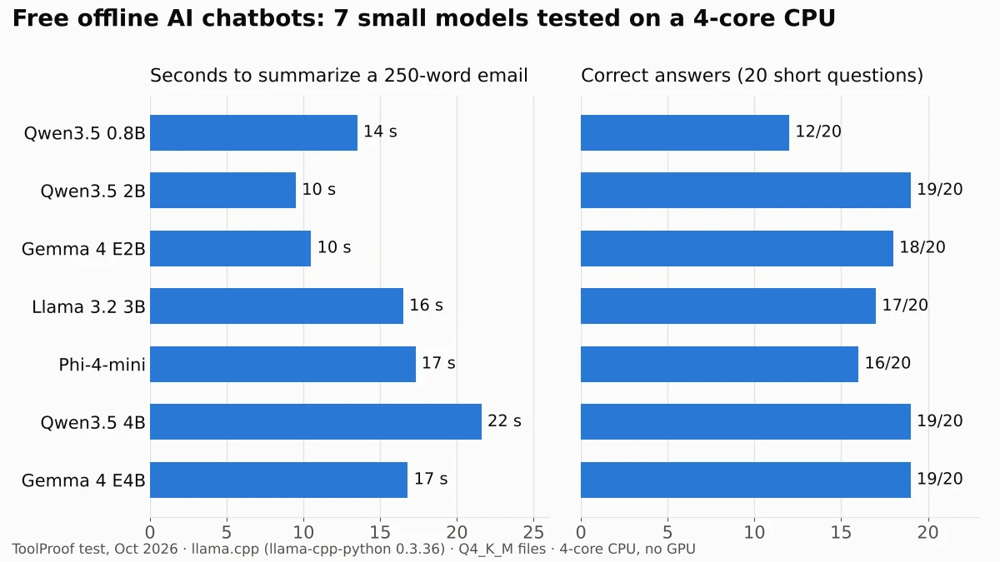
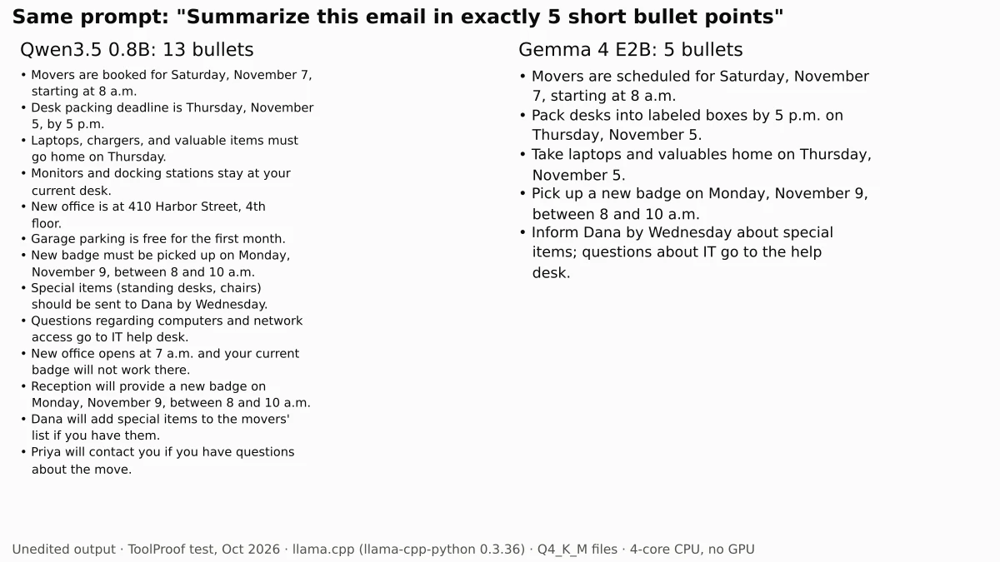
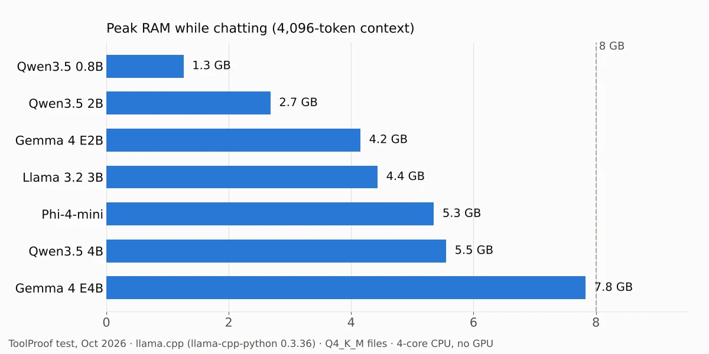
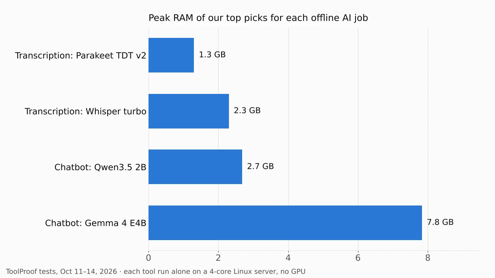

You can run five everyday AI jobs on your own PC for free and with no internet connection: chatting with an AI assistant, transcribing audio, reading text aloud, removing photo backgrounds and copying text out of images. In our tests on a plain 4-core computer with no graphics card, every job worked fully offline once the model was downloaded, and most of our top picks needed less than 3 GB of memory. For an offline chatbot, small models such as **Qwen3.5 2B** and **Gemma 4 E2B** answered 18 to 19 of our 20 test questions correctly and summarized an email in about 10 seconds.

This page collects what we measured. For the chatbot, we ran seven free models through the same email summary and 20 short questions on October 14, 2026. The transcription, voice, background removal and image-to-text results come from our separate, more detailed tests, linked in each section. Everything here is free to download, and none of it needs an account once it's installed.

## Best free offline AI tools at a glance

| Job | Our pick | Free app to run it | Speed on our 4-core CPU | Peak RAM | Full test |
| --- | --- | --- | --- | --- | --- |
| Chatbot (ChatGPT-style) | Qwen3.5 2B or Gemma 4 E2B | Ollama, LM Studio, Jan | About 10 s to summarize a 250-word email | 2.7–4.2 GB | Below |
| Speech to text | Parakeet TDT (v2 for English) or Whisper turbo | Vibe, Buzz, Handy | 1 min 45 s for a 22-minute call | 1.3 GB | [8 transcription models tested](/posts/transcribe-audio-offline-free) |
| Text to speech | Kokoro v1.0 (natural) or Piper medium (fast) | Piper, sherpa-onnx | 28 s (Kokoro) or under 4 s (Piper) per minute of speech | 0.3–0.6 GB | [11 offline voices tested](/posts/free-offline-text-to-speech) |
| Background removal | BiRefNet (best) or IS-Net (fast) | rembg | 41 s (BiRefNet) or 1.5 s (IS-Net) per photo | 1.1–9.6 GB | [8 background removal models tested](/posts/remove-background-from-image-free-offline) |
| Image to text (OCR) | Tesseract (fast) or docTR (most words) | Tesseract, NAPS2 | 0.5 s (Tesseract) or 3 s (docTR) per image | 0.06–1.3 GB | [4 offline OCR tools tested](/posts/image-to-text-offline-free) |

The speed column comes from different test days. The chatbot ran on a 2.3 GHz server; the other four tests ran on a 2.8 GHz one, so compare models within a row, not across rows. A recent laptop, especially one with a graphics card or an Apple silicon chip, will usually be faster.

## Offline AI chatbot: which free model to use

The best free offline chatbot model for an ordinary computer in our test was **Qwen3.5 2B**: it got 19 of 20 questions right, wrote the fastest email summary and used 2.7 GB of memory. **Gemma 4 E2B** was nearly as good (18 of 20, same speed) and was one of only four models that kept all four dates and deadlines in its summary, but it needed 4.2 GB.

| Model (Ollama name) | Correct (of 20) | Email summary | Words per second | Wait for first word | Download | Peak RAM | License |
| --- | --- | --- | --- | --- | --- | --- | --- |
| Qwen3.5 0.8B (`qwen3.5:0.8b`) | 12 | 14 s, ignored "5 bullets" | 12.8 | 0.9 s | 0.5 GB | 1.3 GB | Apache 2.0 |
| **Qwen3.5 2B** (`qwen3.5:2b`) | **19** | **10 s** | 6.7 | 1.8 s | 1.3 GB | 2.7 GB | Apache 2.0 |
| **Gemma 4 E2B** (`gemma4:e2b`) | 18 | **10 s**, all 4 dates | 8.8 | 2.1 s | 3.1 GB | 4.2 GB | Apache 2.0 |
| Llama 3.2 3B (`llama3.2:3b`) | 17 | 16 s | 7.1 | 2.9 s | 2.0 GB | 4.4 GB | Llama 3.2 Community License |
| Phi-4-mini (`phi4-mini`) | 16 | 17 s | 5.5 | 3.3 s | 2.5 GB | 5.4 GB | MIT |
| Qwen3.5 4B (`qwen3.5:4b`) | **19** | 22 s, all 4 dates | 3.9 | 4.2 s | 2.7 GB | 5.6 GB | Apache 2.0 |
| Gemma 4 E4B (`gemma4:e4b`) | **19** | 17 s, all 4 dates | 4.7 | 4.0 s | 5.0 GB | 7.8 GB | Apache 2.0 |

Speeds are medians of three runs. "Words per second" is how fast text appeared once the model started answering. Download sizes are the 4-bit files we used; the files Ollama downloads may be packaged differently, so your sizes and speeds will vary.

- **Best for most computers: Qwen3.5 2B.** It had the best score-to-speed ratio, and its 2.7 GB peak leaves room for a browser on an 8 GB laptop. Its one wrong answer was a recipe question (it said 22.5 cups of sugar instead of 1 7/8), and its summary left out the Wednesday deadline.
- **Best summaries on a modest PC: Gemma 4 E2B.** It wrote five clean bullets with every date and deadline, about as fast as Qwen3.5 2B. It missed two math questions.
- **If you have 16 GB of RAM: Gemma 4 E4B.** It got all eight math questions right and wrote a complete summary, but it was slower and peaked at 7.8 GB. Its one miss was a fact: it said water boils at 32 degrees Fahrenheit.
- **Skip for anything factual: Qwen3.5 0.8B.** It was the fastest, but it said the capital of Australia is Sydney, got six of eight math questions wrong and wrote 13 bullet points when we asked for five.

Treat the scores as a sanity check, not a ranking. Twenty questions are enough to separate the tiny model from the rest, but a gap of one or two answers between the larger models could flip with different questions. Every model made at least one mistake, so check anything important, the same way you would with ChatGPT.

### How much memory an offline chatbot needs

A 2B to 4B model needs roughly 3 to 6 GB of free memory, based on the peaks we measured with a 4,096-token conversation window. Gemma 4's "E" models use more memory than their names suggest: Google's [Gemma 4 model card](https://huggingface.co/google/gemma-4-E2B-it) lists E2B as 2.3 billion effective parameters but 5.1 billion including embeddings, which is why its file was more than twice the size of Qwen3.5 2B's.

Longer conversations and pasted documents use more memory than our test did, so leave some headroom. These models are far smaller than the ones behind ChatGPT or Gemini, so expect weaker answers on hard reasoning and recent events; none of them can look anything up online.

## How to run an AI chatbot offline

The easiest way is a free desktop app that downloads the model for you and then runs it on your computer. We tested the models directly with llama.cpp, the engine LM Studio says it uses, rather than through these apps, so the details below come from each app's official documentation as of October 2026.

| App | Platforms | Cost and license | Offline once set up? |
| --- | --- | --- | --- |
| [Ollama](https://ollama.com/download) | Windows 10 22H2 or later, macOS 14 or later, Linux | Free, MIT license | Yes; you can turn off its cloud features |
| [LM Studio](https://lmstudio.ai/download) | Windows (x64 with AVX2, or ARM), Mac with Apple silicon on macOS 14 or later, Linux | Free plan for local models | Yes, according to its offline guide |
| [Jan](https://jan.ai/download) | Windows, Mac, Linux | Free, Apache 2.0 license | Yes, "full offline support" |

### Ollama

1. Download and install Ollama from [ollama.com/download](https://ollama.com/download).
2. Open a terminal (PowerShell on Windows, Terminal on Mac).
3. Type `ollama run qwen3.5:2b` (or `ollama run gemma4:e2b`) and press Enter. The first run downloads the model; after that it starts without the internet.
4. Type your question at the prompt.

Ollama now also offers cloud models. Its [FAQ](https://docs.ollama.com/faq) says it doesn't see your prompts when you run models locally, and you can switch to local-only mode by setting the environment variable `OLLAMA_NO_CLOUD=1` and restarting Ollama.

### LM Studio

1. Install LM Studio from [lmstudio.ai/download](https://lmstudio.ai/download).
2. Open the **Discover** tab and search for a model, such as "Qwen3.5 2B" or "Gemma 4 E2B".
3. Go to the **Chat** tab, open the model loader and select the model you downloaded.
4. Start chatting.

LM Studio's [offline guide](https://lmstudio.ai/docs/app/offline) says that once a model is on your computer, chatting, chatting with documents and its local server work without the internet, and that "nothing you enter into LM Studio when chatting with LLMs leaves your device." Searching for and downloading models, and checking for app updates, still need a connection. Its [system requirements](https://lmstudio.ai/docs/app/system-requirements) recommend 16 GB of RAM, and it doesn't support Intel Macs.

LM Studio's website now leads with Bionic, an agent app with paid cloud plans. Its [pricing page](https://lmstudio.ai/pricing) says the free plan includes running local models; the paid plans add US-hosted cloud models, which are not offline.

## Offline speech to text

For free offline transcription, use **Parakeet TDT 0.6B v2** if your audio is English, or **Whisper large-v3-turbo** if you need the most accurate result and can wait. In our [test of 8 free offline transcription models](/posts/transcribe-audio-offline-free) on a 22-minute conference call, Whisper turbo got 10.5% of words wrong and Parakeet v2 11.1%, but Parakeet finished in 1 minute 45 seconds versus 9 minutes 37 seconds. Free apps such as Vibe and Handy run Whisper and Parakeet (they offer Parakeet v3, which was a little less accurate in our test) without uploading your audio.

## Offline text to speech

For a natural-sounding offline voice, use **Kokoro v1.0**; for speed on an old computer, use a **Piper medium** voice. In our [comparison of 11 free offline text-to-speech voices](/posts/free-offline-text-to-speech), Kokoro took about 28 seconds to make a minute of speech and scored highest on an automatic naturalness check, while Piper's medium voices took under 4 seconds and were almost as clear. Both used less than 700 MB of memory.

## Offline background removal

To cut out photos offline for free, use the open-source tool rembg with **birefnet-general** for the cleanest edges or **isnet-general-use** for speed. In our [test of 8 free offline background removal models](/posts/remove-background-from-image-free-offline) on 50 photos, BiRefNet gave clean cutouts on 89% of photos but took 41 seconds and 9.6 GB of memory each, while IS-Net took 1.5 seconds and 1.1 GB with more mistakes. rembg also has a simple web interface that runs on your own computer.

## Offline image to text (OCR)

To copy text out of screenshots, scans and photos offline, use **Tesseract** for speed or **docTR** when you need every word. In our [test of 4 free offline OCR tools](/posts/image-to-text-offline-free) on 50 images, Tesseract took about half a second per image with around 55 MB of memory and gave near-perfect text on 42 images with its `--psm 6` setting, while docTR read 99% of all words but often scrambled the line order on receipts and photos. For a single screenshot, Windows Snipping Tool's Text actions and Live Text on a Mac or iPhone are already built in.

## How much RAM you need for offline AI

8 GB of RAM is enough for every job on this page except the largest chatbot and background removal models; 16 GB gives you room for Gemma 4 E4B and BiRefNet. The chart shows the peak memory of our picks for each job, measured with each tool running alone.

Your browser and other apps need memory too, so on an 8 GB computer, close what you don't need before running a 4B chatbot model. Some AI is already on your computer: Chrome, for example, can download an on-device model for its built-in AI features (news reports put it at roughly 4 GB), which you can [turn off and delete](/posts/turn-off-ai-in-chrome) if you'd rather use your own tools.

## Other tools we looked at

- **GPT4All** by Nomic: a free, MIT-licensed desktop chatbot app that its [website](https://www.nomic.ai/gpt4all) says runs on your device with "no cloud required." We didn't include it in the table because we didn't confirm which current models it offers.
- **Larger chatbot models** (8B and up, such as Qwen3.5 9B or Gemma 4 12B): we skipped them because they need more memory than most laptops can spare and would be much slower without a graphics card.
- **Llama 3.2 1B and other tiny models:** our results for Qwen3.5 0.8B suggest models under 1 billion parameters are too unreliable for factual questions.

## What we tested

- **Chatbot engine:** [llama-cpp-python](https://pypi.org/project/llama-cpp-python/) 0.3.36 (llama.cpp), built for the test CPU, 4 threads, 4,096-token context, temperature 0. Each model ran alone in a fresh process. "Thinking" mode, where a model has one, was off, which is the default in the chat templates we used.
- **Model files:** 4-bit Q4_K_M GGUF files from Hugging Face: Unsloth's builds of Qwen3.5, Gemma 4 and Phi-4-mini, and Bartowski's build of Llama 3.2 3B.
- **Email summary:** a 253-word office-move email we wrote, with the instruction to summarize it in exactly 5 bullet points including every date and deadline. We timed three runs and checked the first for the bullet count and four dates (the move, packing deadline, badge pickup and a Wednesday deadline).
- **20 questions:** 8 math word problems, 6 general-knowledge facts and 6 instruction or extraction tasks (for example, returning a JSON object or answering only YES or NO), all with answers we could check automatically. We reviewed every answer marked wrong by hand and accepted equivalent forms such as 1 7/8 for 1.875.
- **Memory:** the peak resident memory of the process, which includes the model file and the conversation cache.
- **Machine:** a Linux cloud server with 4 Intel Xeon cores at 2.3 GHz, 16 GB of RAM and no graphics card, October 14, 2026. The transcription, voice, background removal and OCR tests ran on October 11 to 14 on a 2.8 GHz 4-core server; see each linked article for its method.

## FAQ

### Is there an AI that works completely offline?

Yes. All the tools on this page run on your own computer after a one-time model download, and we ran every test with the models stored locally. Apps can still go online for updates, model downloads or optional cloud features, so check each app's settings if you need a computer that never connects.

### Can I use these offline AI models for work?

Usually, yes, but check the license of each model. Qwen3.5 and Gemma 4 use Apache 2.0 and Phi-4-mini uses MIT, all of which allow commercial use, according to their Hugging Face pages. Llama 3.2 has its own Llama 3.2 Community License with extra conditions. For background removal, rembg's default `bria-rmbg` model isn't free for commercial use, as we explain in [our background removal test](/posts/remove-background-from-image-free-offline).

### Is an offline chatbot as good as ChatGPT?

No, not for hard questions. The models in our test are a few billion parameters and run on a CPU, so they are best for drafting, rewording, summarizing and simple questions where you can check the answer. Their advantage is privacy and cost: your text stays on your computer and there is no subscription.
