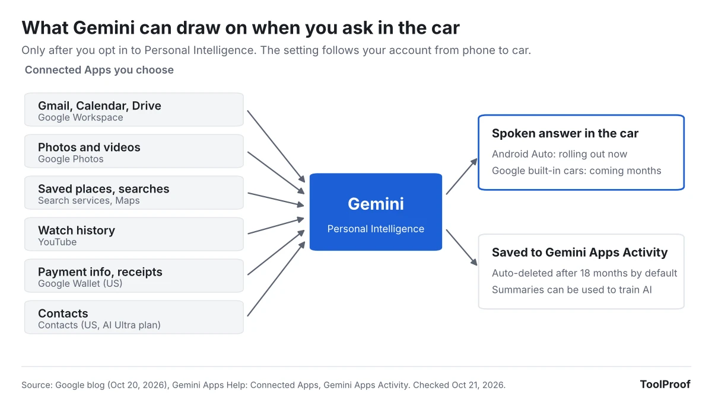

Gemini on Android Auto can now answer questions using your own Gmail, Calendar, Google Photos, Maps and other Google apps, through a feature Google calls Personal Intelligence. Google started rolling it out on October 20, 2026. It is opt-in, but the opt-in isn't specific to the car. If you already turned Personal Intelligence on in the Gemini app on your phone, Google says it "comes with you into the car" with no extra step.

So the thing to do now is check which apps you have connected to Gemini before your next drive, especially if other people ride in your car. If you never opted in, nothing changes: Gemini still handles calls, messages, music and navigation, but its answers won't be based on your data.

We read Google's announcement and four Gemini and Android Auto help pages on October 21, 2026. Personal Intelligence is a staged rollout, and we couldn't run Android Auto ourselves, so the settings paths below come from Google's help pages rather than our own screens.

## What happened

On October 20, 2026, Google published [Get hands-free personalized help on the road with Gemini](https://blog.google/products-and-platforms/platforms/android/android-auto-cars-with-google-built-in-gemini-personal-intelligence/). It says Gemini is now available globally on Android Auto and in cars with Google built-in, and that Personal Intelligence "is rolling out starting today" on Android Auto and "in the coming months" on cars with Google built-in.

Google's examples are things you can't easily do while driving: "What's my flight gate? And is my flight on time?" (from a confirmation email), "Take me to my doctor's appointment" (from your calendar), and "Find the car wash from the photo I took last week and navigate there" (from Google Photos). Your apps "aren't connected until you choose to turn it on," and cars with Google built-in "only share personal responses when you're in the car with your phone connected."

The same post limits Personal Intelligence to personal Google accounts for people 18 and older. It isn't offered to work, school or education accounts, or in the European Economic Area, Switzerland, the United Kingdom and Nigeria.

## Who is affected

| If you... | What changes |
| --- | --- |
| Use Android Auto and already turned on Personal Intelligence in the Gemini app | Gemini in the car can now answer from your connected apps, as the rollout reaches you |
| Use Android Auto and never opted in | Nothing, until you opt in. Calls, music, maps and general questions work as before |
| Drive a car with Google built-in | Personal answers arrive "in the coming months," and only with your phone connected |
| Sign in with a work or school Google account, or are under 18 | Not eligible for Personal Intelligence |
| Live in the EEA, UK, Switzerland or Nigeria | Not available yet |
| Ride as a passenger, including kids | Google's help page says Gemini in Android Auto "is available to anyone in the vehicle, including children" |

To use Gemini on Android Auto at all, Google's [car help page](https://support.google.com/gemini/answer/16735982?hl=en) lists an Android phone running Android 11 or newer with at least 2 GB of RAM, with Gemini set as your digital assistant. Android Auto's own [voice help page](https://support.google.com/androidauto/answer/6348083?hl=en) says Gemini is replacing Google Assistant on most phones in 2026.

## What changes for you

Personal Intelligence covers more than your inbox. Google's [Connect your Google apps](https://support.google.com/gemini/answer/16598406?hl=en) page lists six app groups you can connect: Google Workspace (Gmail, Calendar, Drive and more), Google Photos, Search services (including Maps and Shopping), YouTube history, Google Wallet (U.S. only) and Contacts. Google's [Connected Apps data page](https://support.google.com/gemini/answer/16836988?hl=en) says Contacts personalization is U.S. and English only and requires an AI Ultra subscription.

Three details from that data page matter most once these answers move into a car:

- **What's used for AI training.** Google says Gemini doesn't train its models directly on your Gmail inbox, Drive, Calendar or Photos library. It does train on "summaries, excerpts, generated media, and inferences" from the emails, photos and files it uses to answer you, and notes that for a short or very relevant email, "the summary may just be the email."
- **People may read some of it.** A subset of Connected Apps data, including summaries and excerpts of your emails and files, is reviewed by human reviewers. Google says it first disconnects those chats from your account. Its advice: don't connect apps that hold information "you wouldn't want a reviewer to see."
- **How long chats are kept.** Your Gemini chats, including ones in the car, go to Gemini Apps Activity. Google's [activity help page](https://support.google.com/gemini/answer/13278892?hl=en) says Keep Activity is on by default for adults and that activity older than 18 months is deleted automatically unless you change it.

Personal Intelligence needs Keep Activity turned on. Turning Keep Activity off turns off personal answers everywhere, including the car.

Google also warns on its car help page that Gemini "can hallucinate" and shouldn't be relied on for safety-related matters while driving. A flight gate or an appointment address is still worth checking against the original email when it matters.

## What to do now

Do these on your phone before you drive, not from the car screen:

1. Open the **Gemini** app, tap **Menu**, then your **profile picture**, then **Personal Intelligence** > **Connected Apps**. On the web, go to gemini.google.com and choose **Menu** > **Settings & help** > **Personal Intelligence** > **Connected Apps**.
2. Turn off any app you don't want Gemini to answer from. For driving, Google Workspace (calendar and email) and Search services (saved places) cover most of Google's examples. Google Wallet and Contacts are the ones to think twice about.
3. If you never opted in and want to, look for the **Get started** card in the Gemini app, then choose **Choose apps** instead of **Connect all** so you pick each app yourself.
4. Review what's already saved: on gemini.google.com, open **Settings & help** > **Activity**. Delete chats you don't want kept, and if 18 months is longer than you want, pick a 3-month auto-delete period.
5. To remove something Gemini learned from an app, do both steps: disconnect the app and delete the chats that mention it. Google says either step alone isn't enough.
6. If you want no personal answers at all, turn off Keep Activity on the same Activity page and choose **Turn off and delete activity**. Google says chats are still held for up to 72 hours after that.

If you had connected Gmail or Google Photos to Gemini before, check the list anyway. Google's help page says those connections "have been reset with the launch of Personal Intelligence," so your current settings may not be the ones you remember choosing.

## Our take

Personal Intelligence in the car is useful, and the default here is better than it sounds in headlines: nothing is connected unless you opt in. Our concern is narrower. The opt-in is one account-wide switch. Google says the setting follows you from phone to car, and none of the help pages we read describe a car-only off switch. Google's own help page also says Gemini in Android Auto is available to anyone in the vehicle. Put those together and the risk is likely a shared-car one: a passenger asking about your calendar or recent emails while your phone is connected, and Gemini answering out loud.

So our recommendation is to connect narrowly. Workspace and Search services cover most of what a driver needs, while Wallet, Contacts and Photos add sensitive data for little benefit on the road. We would also like Google to add a simple "personal answers in the car" switch, separate from the phone setting.

The other side: the alternative to asking Gemini is often picking up your phone to search your inbox at a red light. If you mostly drive alone, a voice answer from your calendar is safer than that, and the training and review rules are the same ones that already apply when you use Personal Intelligence on your phone.

## What to watch next

- **Cars with Google built-in:** Google says Personal Intelligence comes to them "in the coming months," with personal answers only when your phone is connected.
- **Google Assistant to Gemini:** Android Auto's help page says Google is moving Assistant users to Gemini during 2026. When your phone switches, these settings start to apply in your car.
- **More connected apps:** Google's Personal Intelligence page says Gemini will draw on "even more of your Google apps and services" in the coming months. Each new one is worth checking in **Connected Apps**.

If you are reviewing Gemini settings anyway, our guide to [what happens to Gemini Gems as they become Skills](/posts/gemini-gems-to-skills) covers another change in the same app. Google's help page says Personal Intelligence isn't available in some features, including Gems. For Google's AI features on your computer, see [how to turn off AI in Chrome, including the on-device model](/posts/turn-off-ai-in-chrome).
