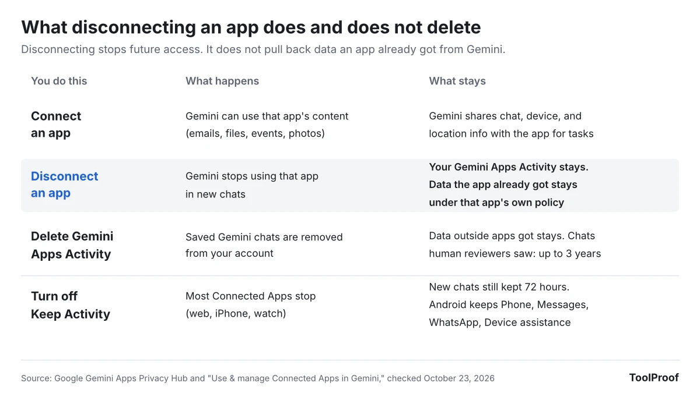

Google has moved Gemini's Connected Apps, the links that let Gemini read and act in other services such as Gmail, Spotify, Instacart, or Experian, into a new **Customize** menu that also holds your skills. Google says you can now connect more than 40 outside apps, and the new menu shows every connected app on one page. The catch: disconnecting an app stops future access, but it doesn't delete what the app or Gemini already saved.

Google announced the menu on the Google Workspace Updates blog on October 21, 2026, and says the rollout started October 13 and can take up to 15 days to reach everyone. To see who can use which apps, we downloaded Google's official Connected Apps availability table on October 23, 2026 and sorted all 83 entries by company, country, age, and account type. We don't have a Gemini account in our test setup, so the menu steps below come from Google's help pages, not our own screenshots.

## What happened

On October 21, 2026, Google published [An easier way to customize how Gemini works for you](https://workspaceupdates.googleblog.com/2026/10/an-easier-way-to-customize-how-gemini-works-for-you.html). It describes a "centralized customize hub" in the Gemini app that brings **Skills** (saved instructions) and **Connected apps** together, with "more than 40 external services, as well as Google apps." The [Gemini release notes](https://gemini.google/release-notes/) list the same change under October 13, 2026.

According to Google, Customize is rolling out globally on the web, in the mobile app, and in the Gemini desktop apps for Windows and macOS, for all plans including free accounts. "Most connected apps" work only in English in the US, with some in other English-speaking countries, Brazil, and India. The [Customize help page](https://support.google.com/gemini/answer/18736938?hl=en) says it is for signed-in users 18 and older.

The menu has three tabs: **Discover** (suggested apps and skills), **Connectors** (apps you've connected and others you can add), and **Skills**. It replaces the old Connected Apps page in Settings.

## Who is affected

Google's [Connected Apps availability table](https://support.google.com/gemini/table/17434654?hl=en) lists 83 apps as of October 23, 2026. We grouped them by who makes them: 12 are Google's own (such as Google Workspace, Google Photos, and Google Home), 20 are phone features or phone-maker apps (Samsung Notes, Xiaomi Calendar, your phone's calling app), and 51 come from other companies, which matches Google's "more than 40."

| If you... | What you get |
| --- | --- |
| Use a personal Google account in the US | The widest choice: everything except the 10 Brazil- or India-only apps and school-only Google Classroom. 27 of the 51 apps from other companies are listed as US only, including Experian, Zocdoc, Zillow, Dropbox, and Ticketmaster |
| Use a personal account outside the US | Fewer outside apps. Ten are limited to Brazil or India, and OpenTable works only in the UK and US |
| Use a work or school account | Only 23 apps accept work or school accounts, including Google Workspace, GitHub, monday.com, and phone notes and calendar apps. Your administrator decides whether apps can be connected |
| Are under 18 | Customize is for 18 and older, according to Google's help page. The table sets 18 as the minimum age for 55 of the 83 apps |
| Use an iPhone instead of Android | No Phone, Messages, WhatsApp, Device assistance, Find Hub, or Google Play actions. Those six are Android only |

## What changes for you

Connected Apps now sit one tap from the main menu instead of inside Settings, so they're easier to find and easier to add by accident from the Discover tab. Google's [Connected Apps help page](https://support.google.com/gemini/answer/13695044?hl=en) also says "some Connected Apps are designed to automatically work with Gemini," and that Gemini always uses public information from Google Search, Flights, Hotels, Maps, and YouTube. Google says Gemini won't access your personal information in those services without your permission.

When you connect an app, Google's [Gemini Apps Privacy Hub](https://support.google.com/gemini/answer/13594961?hl=en) says the data exchanged can include information from your Gemini chats, your device and language, your location, and content from the app, like emails, files, events, photos, and videos. Outside apps "use data from Gemini consistent with their own privacy policies," not Google's.

Disconnecting is where most people will be surprised. According to the same Privacy Hub page:

- Disconnecting an app doesn't delete anything from your Gemini Apps Activity
- Data an outside app already received from Gemini stays with that app, under its own policy, even if you delete your Gemini activity
- Chats that human reviewers already looked at are kept for up to three years, separate from your account
- Turning off **Keep Activity** stops most Connected Apps on the web, iPhone, and watches, but Gemini still keeps new chats for 72 hours

## What to do now

Take five minutes to check what Gemini can reach. These steps follow Google's help pages for the computer, Android, and iPhone versions.

1. Open Gemini. On a computer, go to gemini.google.com and look in the sidebar. In the mobile app, tap **Menu** at the top.
2. Select **Customize**. If you don't see it, select **More** first. If it still isn't there, the rollout hasn't reached you yet: use **Settings**, then **Connected Apps** (or **Personal Intelligence > Connected Apps**).
3. Open the **Connectors** tab to see every app that's connected.
4. For any app you don't use, especially ones with money, health, or home data like Experian, Zocdoc, or Google Home, select **More options**, then **Disconnect**.
5. To remove past chats that used an app, open [Gemini Apps Activity](https://myactivity.google.com/product/gemini) and delete them there. Disconnecting alone doesn't do this.
6. For outside apps such as Instacart or Experian, check that company's own privacy settings for data it received through Gemini. Google says those apps keep data under their own rules.
7. Only add a custom app (an app connected by a web address, called an MCP server) if you fully trust who runs it. Google says it does "not control, monitor, or secure" these servers.

If you only want Gemini out of your inbox, Gmail has its own switch, separate from Connected Apps. Our guide to [turning off Gemini in Gmail](/posts/turn-off-gemini-in-gmail) matches each Gmail AI feature to the setting that controls it.

## Our take

Customize is a better control panel, but treat a connection like a phone app permission: connect an app for a task, and disconnect it when you're done, at least for apps that hold sensitive data.

The facts point that way. Google's own pages say disconnecting doesn't delete Gemini activity, outside apps keep what they received under their own policies, and reviewed chats stay for up to three years. Meanwhile Google has added outside apps in three batches since May, the list now has 51 from other companies, and the new Discover tab exists to suggest more. A credit-monitoring app or a doctor-booking app connected once for a single question has no reason to stay connected, and the cost of reconnecting is small: Google's help page says that if you type @ and pick an app that isn't connected, Gemini asks for your permission to connect it.

The other side: if you use Gemini every week to order groceries or book tables, keeping those apps connected is the point, and disconnecting each time adds friction for little gain. And for people outside the US, most of the new apps aren't available yet, so the menu mostly changes where Skills live.

## What to watch next

- **About October 28, 2026**: 15 days after the October 13 start, when Google says the menu should be visible to everyone. Some help pages, such as the one for [custom apps](https://support.google.com/gemini/answer/17209137?hl=en), still describe the old Settings path
- **November 2026**: Gems go away for personal accounts and turn into skills, which now live in the same Customize menu. Our guide to [moving Gemini Gems to skills](/posts/gemini-gems-to-skills) covers what doesn't carry over
- **More countries**: Google says most outside apps are US and English only for now. We'll update this article when the list changes
- **Gemini in the car and browser**: Connected Apps also feed [Gemini's Personal Intelligence on Android Auto](/posts/gemini-android-auto-personal-intelligence) and Gemini in Chrome, which our guide to [turning off AI in Chrome](/posts/turn-off-ai-in-chrome) covers

## How we checked

- **Google pages** (opened October 22 and 23, 2026): Google Workspace Updates post of October 21, 2026; Gemini release notes; Gemini help pages for [Customize](https://support.google.com/gemini/answer/18736938?hl=en), [Connected Apps](https://support.google.com/gemini/answer/13695044?hl=en) (computer, Android, and iPhone versions), [work and school accounts](https://support.google.com/gemini/answer/14959807?hl=en), [custom apps](https://support.google.com/gemini/answer/17209137?hl=en), and [skills](https://support.google.com/gemini/answer/17094296?hl=en); the [Gemini Apps Privacy Hub](https://support.google.com/gemini/answer/13594961?hl=en); and Google Blog posts of [August 12](https://blog.google/innovation-and-ai/products/gemini-app/new-connected-apps-services-gemini-august-2026/) and [September 23, 2026](https://blog.google/innovation-and-ai/products/gemini-app/new-connected-apps-gemini/)
- **App list count**: we saved Google's availability table on October 23, 2026 and counted its 83 rows by category, country, minimum age, and account type. Google's table has no "made by" column, so the company groups are ours, based on each app's name
- **One mismatch in Google's pages**: the Workspace post says Customize comes to the Windows app, while the skills help page says skills work only in the mobile app, the Mac app, and on the web
