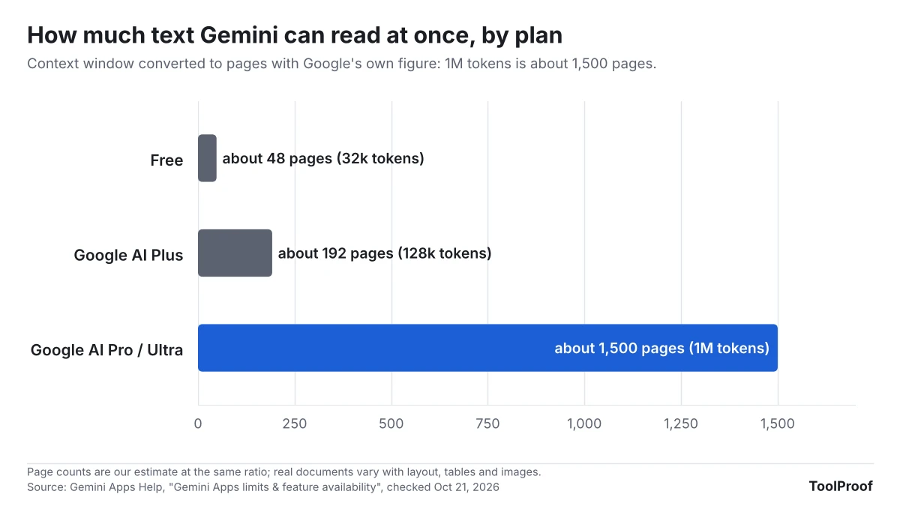

If you use Gemini without paying, most of your answers now come from Flash-Lite, Google's fastest and smallest model. Google started the switch for free personal accounts on October 9, 2026. You can no longer pick Flash or Pro yourself, and Gemini only hands a free prompt to those bigger models when its automatic model selection decides the question needs it.

For quick everyday questions you may not notice a difference. You will notice it with long documents, tricky reasoning and long chats: the free plan can read about 32,000 tokens at a time (roughly 48 pages by Google's own conversion), against 128,000 on Google AI Plus and 1 million on Google AI Pro. Google AI Plus subscribers are next. They keep Flash but lose Pro on a date Google says it will send by email.

We read Google's change notice, its Gemini model and limits help pages and the U.S. plan page on October 21, 2026, and put what each plan now gets on one page.

## What happened

Google's help article [Changes to Gemini model access and limits](https://support.google.com/gemini/answer/17004136?hl=en) says model availability for personal accounts is changing in October 2026, and that the changes "will start to take effect for users without an AI subscription on October 9th." AI Plus subscribers "should receive an email that explains when these changes will take effect" for them.

After the change, free accounts use **Auto**, which is the default. In Google's words, most prompts go to Flash-Lite, and "prompts that need deeper reasoning may go to Flash or Pro." If you turn automatic selection off, every free answer uses Flash-Lite. AI Plus keeps Flash-Lite and Flash, while AI Pro and AI Ultra keep all three. Google's [plan page](https://gemini.google/subscriptions/) also lists Gemini 4 Argon, its newest model released on October 13, only for AI Pro and Ultra.

This is the second change this year. On May 17, 2026, Google moved Gemini to usage limits based on how much computing each prompt takes. Those limits refresh every 5 hours until you reach a weekly cap, according to the same help article.

## Who is affected

The change only covers personal Google Accounts. Work and school accounts follow their Workspace license, Google says.

| If you have... | Models you can use | What changed |
| --- | --- | --- |
| No plan (free) | Flash-Lite; Flash or Pro only when Auto picks them | Since Oct 9, you can't choose Flash or Pro |
| Google AI Plus ($4.99/month) | Flash-Lite and Flash | Loses Pro on the date in Google's email |
| Google AI Pro ($19.99/month) | Flash-Lite, Flash, Pro, Argon | Nothing taken away; Argon added Oct 13 |
| Google AI Ultra (from $99.99/month) | Flash-Lite, Flash, Pro, Argon | Nothing taken away |
| A work or school account | Depends on your organization's license | Not covered by this change |

Prices are Google's U.S. list prices on its [plan page](https://gemini.google/subscriptions/) as of October 21, 2026.

One wrinkle if you pay for AI Plus: Google's separate [About Gemini models](https://support.google.com/gemini/answer/18648722?hl=en) page still listed Pro for AI Plus when we checked, while the change notice and the plan page don't. The change notice says each Plus account gets its own date by email, so that email is the one to go by.

## What changes for you

**Answers on hard questions may be weaker.** Flash-Lite is, in Google's description, "built for quick answers to everyday questions and lightweight tasks." Pro is the model for complex prompts and in-depth problem-solving. Auto can still route a hard question to Pro, but you can't force it.

**Long files are the biggest practical change.** The "context window" is how much text Gemini can hold in mind at once, including your file and the conversation so far. Google says 1 million tokens is about 1,500 pages. At the same ratio, the free plan's 32,000 tokens is about 48 pages and AI Plus's 128,000 is about 192 pages. If you upload something bigger, Google warns that answers may miss details spread through the file.

**Most features are still free.** Google's [limits page](https://support.google.com/gemini/answer/16275805?hl=en) still marks Canvas, skills, Deep Research, connected apps, audio overviews, image generation with Nano Banana 2 and music generation as available without a plan. Video generation, Daily Brief, scheduled actions, redoing images with Nano Banana Pro and Tasks in Gemini need a paid plan. Heavy features such as Deep Research use up your limit faster, and Google says free users may lose some of them "during periods of high demand." Gemini also shows up inside Gmail without a plan: free U.S. accounts get "Help me write" and Suggested Replies, and our guide to [turning off Gemini in Gmail](/posts/turn-off-gemini-in-gmail) shows the one setting that removes them.

## What to do now

1. **Keep Auto turned on.** On a computer, go to [gemini.google.com](https://gemini.google.com), click **Settings > Usage limits** at the bottom left, and check that auto model selection is on at the bottom of that page. With it off, every free answer uses Flash-Lite.
2. **Check which model answered.** On a response, click **More**, choose **Show thinking steps** and scroll to the bottom, where Gemini names the model it used. This tells you whether Auto is sending your harder questions to Flash or Pro.
3. **Raise the thinking level for a hard question.** Google's [model help page](https://support.google.com/gemini/answer/18648722?hl=en) lists **Low**, **Medium** and **High** thinking levels for free accounts too, set from the model menu at the bottom of the chat box. Google says a higher level gives more thorough answers but uses more of your limit.
4. **Break long documents into parts.** If you work with reports longer than about 40 pages, split the PDF before you upload it, and start a new chat for each new topic, which Google says also saves usage. Our [test of free ways to split a PDF](/posts/split-pdf-free) covers apps that do it without losing forms or bookmarks.
5. **If you pay for AI Plus, watch for Google's email.** If you mainly used Plus for Pro, decide whether to move to AI Pro or keep Plus for Flash, 2x limits and 400 GB of storage. You change plans at **Google One > Manage membership > Change membership plan**, per Google's [plan help](https://support.google.com/gemini/answer/14517446?hl=en).
6. **If you're a U.S. college student, look at the student offer.** Google's [student page](https://gemini.google/students/) offers eligible U.S. college students 18 and older a year of AI Pro at no cost if they redeem by December 31, 2026. It needs a payment method and renews at $19.99 a month unless you cancel.

## Our take

For most people who use Gemini a few times a day, the free plan is still enough, and the one thing worth doing is leaving Auto on. Google's own notice says Auto is the only way a free account still reaches Flash or Pro, yet the switch sits under **Usage limits** in settings, not next to the chat box. Turning it off locks you to the smallest model for every answer.

The real loss is long documents. A 48-page working window rules out the jobs many people bought into Gemini for, such as asking questions about a lease, a 100-page report or a semester of class notes in one go. If that's how you use it, AI Plus is the cheapest fix at $4.99 a month, because the jump to 128,000 tokens matters more there than access to Pro. AI Pro at $19.99 makes sense only if you need Pro or Argon reasoning or the 1-million-token window.

AI Plus subscribers get the worst deal. Anyone who paid for Plus partly to use Pro is losing it on a date sent by email, which can differ by account, while one of Google's help pages still lists Pro for Plus. Google should put the date on the subscription page itself, not just in an email that is easy to miss.

The other side: compute-based limits mean Google is spending its biggest models where they are needed, and a free plan that still includes Deep Research, Canvas and connected apps remains generous. Google calls Flash-Lite its fastest model, so short everyday prompts will likely come back quicker than before.

If you'd rather not depend on any plan, our [test of free offline AI tools](/posts/free-offline-ai-tools) shows which chatbot models run on an ordinary PC with no account, though they are far smaller than Gemini Pro.

## What to watch next

- **AI Plus dates.** Google hasn't published a single date for Plus; it is sending them by email. We'll update this article if Google posts one.
- **Gems becoming skills.** Google is replacing Gems with skills in the same app. Our guide on [moving your Gemini Gems to skills](/posts/gemini-gems-to-skills) covers the dates and what carries over.
- **Gemini in the car.** Gemini's personal answers are also coming to Android Auto; our article on [Gemini Personal Intelligence in Android Auto](/posts/gemini-android-auto-personal-intelligence) covers what it can see and the settings to check.
- **The student offer** ends for new sign-ups on December 31, 2026.

All plan details are as of October 21, 2026. Google says its limits "may change without notice."
