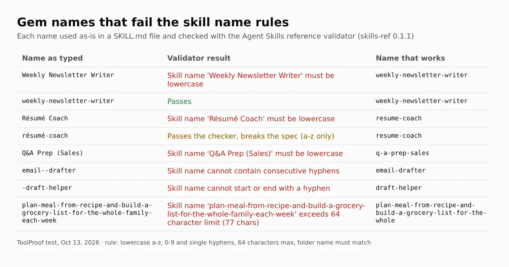

Google is replacing Gems in the Gemini app with **skills**, saved sets of instructions you can call in any chat by typing `/` and the skill's name. If you use Gemini with a personal Google account and you're 18 or older, Google turns your Gems into skills on November 17, 2026, and the Gems themselves become read-only that day: you can still open them, but you can't use or edit them. On December 17, 2026, Gems are removed, along with any files that didn't carry over. Work accounts keep Gems until at least March 1, 2027, and school accounts until at least June 1, 2027. You don't have to do anything, but audio, video, older Office files and some Gem tools don't carry over, so it's worth moving your most-used Gems yourself before November 17.

Skills started rolling out in the Gemini app on October 13, 2026, and Google expects the rollout to finish by mid-November. The rollout of skills inside Workspace apps such as Docs and Gmail was put on hold the same day, and Google hadn't posted a new date as of November 5. Everything below comes from Google's own help pages and announcements, which we first read on October 13 and checked again on November 5, 2026. By then Google had added the November 17 and December 17 dates and put Word, Excel and PowerPoint files on its list of files skills accept. We also rebuilt a sample Gem as a skill file and ran it through the open Agent Skills checker to see which mistakes break an upload.

## When do Gems go away?

On personal Google accounts, Gems stop working on November 17, 2026 and are removed on December 17, 2026, while work and school accounts keep them into 2027. Google's [Gems transition FAQ](https://support.google.com/gemini/answer/18560919) and its [Workspace admin guide](https://knowledge.workspace.google.com/admin/generative-ai/gemini-app/about-the-transition-to-skills) list these milestones, as of November 5, 2026:

| Account | What happens | When |
| --- | --- | --- |
| Personal Google account, 18 or older | Gems turned into skills; Gems become read-only (you can open them, but not use, edit, or create them) | November 17, 2026 |
| Personal Google account, 18 or older | Gems removed, along with any files that didn't carry over | December 17, 2026 |
| Personal Google account, under 18 | Gems turn into skills later | Not announced |
| Work and school accounts | Gems move to **Settings** in the Gemini app, still usable | November 17, 2026 |
| Work (business, enterprise, nonprofit) | Gems can't be created, edited, or used; remaining Gems become draft skills | No sooner than March 1, 2027 |
| School (education) | Same, plus Gems removed from Google Classroom | No sooner than June 1, 2027 |

From November 17 to December 17 you can still open a personal account's Gems, and Google's FAQ suggests using that time to compare each Gem with its new skill and download any files that didn't transfer. After December 17, the Gems and their files are gone from the Gemini app.

Two related Google tools shut down with personal Gems in November: Opal, the mini-app builder, and Gems by Google Labs. Google's [skills announcement](https://blog.google/products-and-platforms/products/gemini/automate-tasks-with-skills/) notes that Gems by Google Labs will not be turned into skills, so save anything you need from them first.

## What's the difference between Gems and skills?

A skill does the same job as a Gem, saving your instructions and reference files, but you use it inside any chat instead of opening a separate Gem window. Google's [skills help page](https://support.google.com/gemini/answer/17094296) lists these differences:

- **Called from any chat**: type `/` and pick the skill, or `@` if your account has Google's updated shortcut. Gemini can also apply a skill on its own when your request matches the skill's description.
- **Stackable**: you can use several skills in one chat, such as a writing-style skill plus a brand-guidelines skill.
- **A portable file format**: each skill is a `SKILL.md` text file in an open format Google says lets you copy skills between platforms, so you can download a skill as a .zip file or upload one you made elsewhere.
- **No per-skill chat list**: a Gem kept its own list of recent chats. Chats that used a skill appear in your normal chat history.
- **Up to 100 turned on at once**: you can create as many skills as you like, but only 100 can be active.

Since October 2026, skills sit next to Connected Apps in a new **Customize** menu in the Gemini app, which our look at [the Gemini Customize menu and its 83 Connected Apps](/posts/gemini-connected-apps) walks through.

## Do you need a paid plan for skills?

No. Google's help page says skills are available without a Google AI subscription and can be used in your chats. A few news sites reported that skills would be limited to paid plans, but Google's own pages say otherwise, as of November 5, 2026. To create and use skills right now, you need to:

- Be 18 or older
- Sign in with a personal Google account (work and school accounts are coming later)
- Have **Keep Activity** turned on
- Use the Gemini web app at gemini.google.com, the Gemini app on Mac, or the Gemini mobile app

Uploading a skill file or folder works only on the web and in the Mac app for now. Keep Activity is the setting Google used to call Gemini Apps Activity, and our guide to [turning off Gemini Apps Activity](/posts/turn-off-gemini-apps-activity) lists what else stops when it's off.

## What doesn't carry over from a Gem

Audio, video, older Office files, archives, GitHub files, and Gem tools such as Canvas and Deep Research don't carry over from a Gem to a skill, according to Google's help pages as of November 5, 2026. Check this list before you rely on the automatic move.

| Gem feature | In skills, November 5, 2026 |
| --- | --- |
| Default tools: Create video, Create music, Canvas, Deep Research, Guided Learning | Not supported in skills yet |
| Audio and video files | Left out of the automatic move; skills don't accept them |
| Older Office files (.doc, .xls, .ppt) and archives such as .zip | Left out of the automatic move; skills don't accept them |
| Files from GitHub | Left out of the automatic move |
| Word, Excel, and PowerPoint files (.docx, .xlsx, .pptx) | Accepted. Google's list on October 13 didn't include them |
| More than 100 MB of files in one Gem | The automatic move drops the largest files first until the skill is under 100 MB |
| Files added from Google Drive | Google's pages disagree: the skills help page lists Drive, Google Photos, and Gemini Notebook as file sources, while the transition FAQ says Drive files are coming "in the coming weeks" |
| Sharing a Gem with other people | Not yet; Google says "in the coming weeks" |
| Gems in Workspace and the Gemini app | Skills don't sync between the two; rebuild each one separately |

Google's Workspace admin guide says migrated Gems arrive as inactive **draft skills** that you review and turn on, while the FAQ for personal accounts says only that Gems are recreated as skills. Either way, open each new skill afterward and check its instructions and files. Google's FAQ suggests opening the Gem and its new skill side by side to spot files that didn't transfer, then downloading them from the Gem before December 17.

## How to move a Gem to a skill yourself

Google's [step-by-step guide](https://support.google.com/gemini/answer/18560919#gem_to_skill) has three parts. Copying the text is enough for a Gem without files; a Gem with knowledge files needs all three.

### 1. Save the Gem's files

1. Go to gemini.google.com and open the sidebar, then click **Gems** (under **More** if you don't see it).
2. Next to the Gem you want to move, click **Edit**.
3. If the Gem has files under **Knowledge**, open each one and click **Download**.
4. Create a folder on your computer and give it the skill's name in lowercase with hyphens, such as `weekly-newsletter-writer`. Put the downloaded files in it.

Keep the Gem's tab open for the next step.

### 2. Create the skill

1. Open gemini.google.com in a new tab, click **Customize** in the sidebar (under **More** if you don't see it), then **Skills**.
2. Click **Create**, then **Create manually**.
3. Copy the name, description, and instructions from your Gem into the skill. Gemini changes the name to the required format for you.
4. Click **Create**.

Google's skills help page now also describes an **Add** button at the top of a new skill for attaching files from your computer, Google Drive, Google Photos, or Gemini Notebook. If your account shows it, add the Gem's files there before step 4 and skip part 3. If it doesn't, part 3 is the route Google's Gems guide gives.

### 3. Add the files back

1. On the Skills page, hover over the new skill and choose **Download** from its menu. You get a .zip file with a `SKILL.md` file inside.
2. Move `SKILL.md` into the folder with your Gem's files.
3. Back on the Skills page, choose **Replace skill** from the same menu, click **folder**, pick your folder, and click **Upload**. The folder name must match the skill's name.

Word, Excel, and PowerPoint files in the current formats (.docx, .xlsx, .pptx) can go in as they are. Older .doc, .xls, and .ppt files can't, so open them in Word, Excel, or PowerPoint and save a copy in the newer format first. Audio, video, and .zip files aren't accepted at all, and uploads can't be larger than 100 MB in total.

## What we tested: a Gem rebuilt as a skill file

We built a sample Gem, a newsletter writer with four knowledge files, and converted it into a skill folder with a short Python script that follows Google's upload rules. Then we checked the result with skills-ref 0.1.1, the reference checker for the open Agent Skills format that Gemini skills use. We could not sign in to Gemini from our test machine, so this checks the file, not Gemini's upload screen. We ran the test on October 13 and again on November 5, 2026, after Google changed its list of accepted files.

With Google's November 5 rules, three of our sample Gem's four knowledge files went into the skill unchanged, and the 37 KB folder passed skills-ref 0.1.1. On October 13, two of the four would have caused problems: the .docx style guide, which Google's list didn't accept then, and a hidden `.DS_Store` system file. Only the `.DS_Store` file still has to go, because Google's help page warns that hidden files like it can make an upload fail. In both runs `SKILL.md` sat at the top level of the .zip file, as Google requires.

Names are the other common snag. A skill name must use lowercase letters, numbers, and single hyphens, up to 64 characters, and the folder name must match it. We tried eight Gem-style names:

Most failures were obvious, such as capital letters and spaces. One was not: `résumé-coach` passed the checker, because skills-ref 0.1.1 accepts any lowercase letter, but the [Agent Skills specification](https://agentskills.io/specification) allows only a to z. If you name the folder yourself, drop accents and stick to plain letters so the skill works in other apps too.

## Should you move your Gems now?

If you only have a few Gems with plain instructions, waiting for the November 17 move is fine; then check the skills it creates. Move a Gem yourself first if it:

- Has audio, video, older .doc, .xls, or .ppt files, or archives, which the automatic move leaves out
- Depends on Canvas, Deep Research, or another Gem tool that skills don't support yet
- Is one you use every day, so you can test the skill version before the Gem turns read-only on November 17

Whichever you choose, December 17 is the last day you can open a Gem and download its files.

If you also use Gemini inside Chrome, our guide to [turning off AI features in Chrome](/posts/turn-off-ai-in-chrome) covers where Gemini shows up in the browser. Since October 28, 2026, Gemini in Chrome can also fill web forms with details from your Gmail, and our test of [Chrome autofill settings](/posts/chrome-autofill-settings) shows where to switch that off, along with what turning off each of Chrome's other form-filling switches, from saved addresses to card security codes, keeps. Firefox can put Gemini in its sidebar too, and our guide to [turning off AI in Firefox](/posts/turn-off-ai-in-firefox) shows how one switch blocks that chatbot. If you search with DuckDuckGo, our guide to [using DuckDuckGo with no AI](/posts/duckduckgo-no-ai) shows how to switch off its AI answers and chat for good. Microsoft Edge builds in its own assistant, Copilot, and our test of [turning off Copilot in Microsoft Edge](/posts/turn-off-copilot-in-edge) shows which switch hides it from the toolbar and menus. Brave has its own assistant too, Leo, and our test of [turning off AI in Brave](/posts/turn-off-ai-in-brave) shows which switches hide it and which setting removes it.

If you connect Gmail or Photos to Gemini, our look at [Gemini's Personal Intelligence on Android Auto](/posts/gemini-android-auto-personal-intelligence) explains which settings control what Gemini can use in your car. To keep Gemini out of your inbox altogether, our guide to [turning off Gemini in Gmail](/posts/turn-off-gemini-in-gmail) matches each Gmail AI feature to the setting that controls it. If you connected Gmail or Photos to Google Search instead, our look at [Google's October 2026 privacy policy change on Gmail and Photos ads](/posts/google-gmail-photos-ads) shows which switch keeps that data out of ads. And if you use a personal and a work account on the same Android phone, our guide to [removing a phone number from your Google account](/posts/remove-phone-number-from-google-account) explains why Android may have put your phone number on both and how to take it off the account that shouldn't have it.

If you build skills that create images, our test of [how to check if an image is AI-generated](/posts/check-if-image-is-ai-generated) shows which edits remove the labels Google adds. For the AI switches in other apps, from Copilot in Word to Apple Intelligence on iPhone, our [guide to turning off AI in Chrome, Gmail, Word and more](/posts/turn-off-ai-features) shows where each one lives.

If you use Gemini without a paid plan, our look at [the Gemini free plan's switch to Flash-Lite](/posts/gemini-free-flash-lite) covers which models and file sizes each plan now gets.

Gems aren't the only tool with a 2026 deadline. If you use the Arc browser, our article on [Arc shutting down on December 22](/posts/arc-browser-shutting-down) covers what moves to Dia and what you need to save before then.

## FAQ

### Can I import skills from other AI apps into Gemini?

Yes. Google says you can upload a `SKILL.md` file, or a folder or .zip file with `SKILL.md` in its main folder, that you made on another platform. For now, scripts that need internet access don't work, and every file must be on Google's supported list, which covers text, PDF, image, and current Office formats such as .docx and .xlsx.

### Will my shared Gems still work?

Sharing isn't available for skills yet; Google says it's coming in the next few weeks. Google's Workspace admin guide says a work or school Gem's sharing settings carry over to its skill when it migrates, but the FAQ for personal accounts doesn't say what happens to Gems you shared. Until sharing arrives, the people you shared a Gem with would need to build their own copy of the skill.

### Do Gems in Google Classroom move to skills?

Google's guide only describes automatic migration for Gems in the Gemini app. Gems in Google Classroom and supported learning systems are removed no sooner than June 1, 2027, and Google recommends Gemini Notebook and Guided Learning (coming soon to Classroom) for student use instead.
