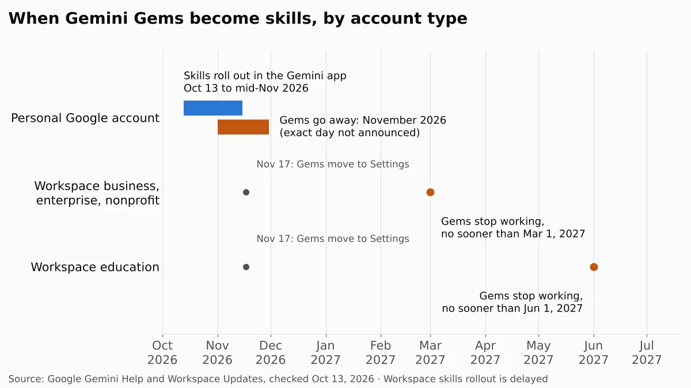
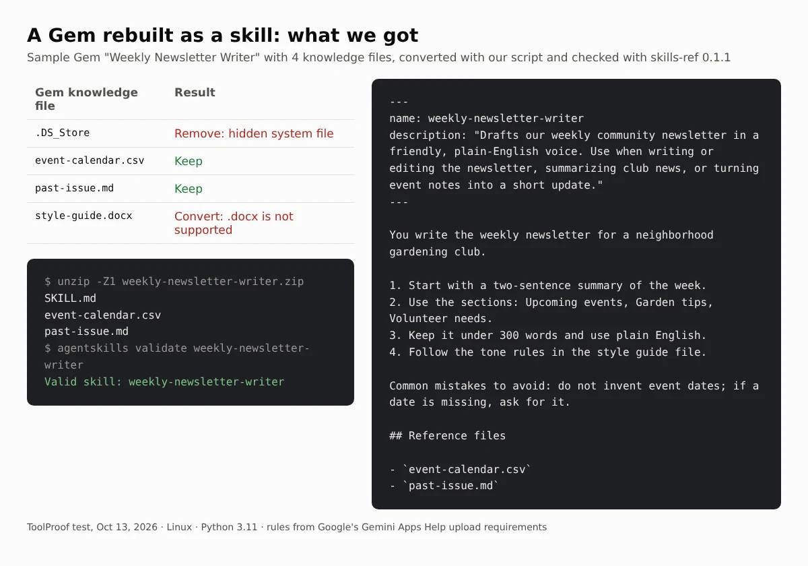
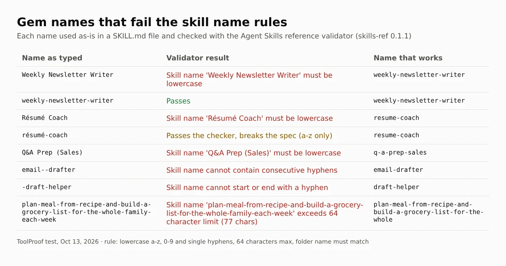

Google is replacing Gems in the Gemini app with **skills**, saved sets of instructions you can call in any chat by typing `/` and the skill's name. If you use Gemini with a personal Google account, Gems go away in November 2026, and Google says it will turn your remaining Gems into skills automatically. Work accounts keep Gems until at least March 1, 2027, and school accounts until at least June 1, 2027. You don't have to do anything, but a few things don't carry over cleanly, so it's worth moving your most-used Gems yourself.

Skills started rolling out in the Gemini app on October 13, 2026, and Google expects the rollout to finish by mid-November. The rollout of skills inside Workspace apps such as Docs and Gmail was put on hold the same day, with no new date. Everything below comes from Google's own help pages and announcements, which we read on October 13, 2026. We also rebuilt a sample Gem as a skill file and ran it through the open Agent Skills checker to see which mistakes break an upload.

## When do Gems go away?

The date depends on the account you sign in to Gemini with. Google's [Gems transition FAQ](https://support.google.com/gemini/answer/18560919) and its [Workspace admin guide](https://knowledge.workspace.google.com/admin/generative-ai/gemini-app/about-the-transition-to-skills) list these milestones:

| Account | What happens | When |
| --- | --- | --- |
| Personal Google account | Gems removed, remaining Gems turned into skills | November 2026 (day not announced) |
| All accounts | Gems move to **Settings** in the Gemini app, still usable | November 17, 2026 |
| Work (business, enterprise, nonprofit) | Gems can't be created, edited, or used | No sooner than March 1, 2027 |
| School (education) | Same, plus Gems removed from Google Classroom | No sooner than June 1, 2027 |

Two related Google tools shut down with personal Gems in November: Opal, the mini-app builder, and Gems by Google Labs. Google's [skills announcement](https://blog.google/products-and-platforms/products/gemini/automate-tasks-with-skills/) notes that Gems by Google Labs will not be turned into skills, so save anything you need from them first.

## What's the difference between Gems and skills?

A skill does the same job as a Gem, saving your instructions and reference files, but you use it inside any chat instead of opening a separate Gem window. Google's [skills help page](https://support.google.com/gemini/answer/17094296) lists these differences:

- **Called from any chat**: type `/` (Google says this will change to `@`) and pick the skill. Gemini can also apply a skill on its own when your request matches the skill's description.
- **Stackable**: you can use several skills in one chat, such as a writing-style skill plus a brand-guidelines skill.
- **A portable file format**: each skill is a `SKILL.md` text file in an open format Google says lets you copy skills between platforms, so you can download a skill as a .zip file or upload one you made elsewhere.
- **No per-skill chat list**: a Gem kept its own list of recent chats. Chats that used a skill appear in your normal chat history.
- **Up to 100 turned on at once**: you can create as many skills as you like, but only 100 can be active.

Since October 2026, skills sit next to Connected Apps in a new **Customize** menu in the Gemini app, which our look at [the Gemini Customize menu and its 83 Connected Apps](/posts/gemini-connected-apps) walks through.

## Do you need a paid plan for skills?

No. Google's help page says skills are available without a Google AI subscription and can be used in your chats. A few news sites reported that skills would be limited to paid plans, but Google's own pages say otherwise, as of October 2026. To create and use skills right now, you need to:

- Be 18 or older
- Sign in with a personal Google account (work and school accounts are coming later)
- Have **Keep Activity** turned on
- Use the Gemini web app at gemini.google.com, the Gemini app on Mac, or the Gemini mobile app

Uploading a skill file or folder works only on the web and in the Mac app for now. Keep Activity is the setting Google used to call Gemini Apps Activity, and our guide to [turning off Gemini Apps Activity](/posts/turn-off-gemini-apps-activity) lists what else stops when it's off.

## What doesn't carry over from a Gem

These are the gaps Google lists between Gems and skills, as of October 13, 2026. Check them before you rely on the automatic move.

| Gem feature | In skills today |
| --- | --- |
| Default tools: Create video, Create music, Canvas, Deep Research, Guided Learning | Not supported in skills yet |
| Files added from Google Drive | Not yet; Google says "in the coming weeks" |
| Sharing a Gem with other people | Not yet; Google says "in the coming weeks" |
| Files from GitHub | Not supported |
| Word, Excel, and other binary files | Not supported; skills accept text files, PDFs, and images |
| Gems in Workspace and the Gemini app | Skills don't sync between the two; rebuild each one separately |

Google says the automatic move makes your Gems into **draft skills**, so plan to open each one afterward and check its instructions and files.

## How to move a Gem to a skill yourself

Google's [step-by-step guide](https://support.google.com/gemini/answer/18560919#gem_to_skill) has three parts. Copying the text is enough for a Gem without files; a Gem with knowledge files needs all three.

### 1. Save the Gem's files

1. Go to gemini.google.com and open the sidebar, then click **Gems**.
2. Next to the Gem you want to move, click **Edit**.
3. If the Gem has files under **Knowledge**, open each one and click **Download**.
4. Create a folder on your computer and give it the skill's name in lowercase with hyphens, such as `weekly-newsletter-writer`. Put the downloaded files in it.

Keep the Gem's tab open for the next step.

### 2. Create the skill

1. Open gemini.google.com in a new tab and go to the Skills page. Google's guide says **Settings > Skills**; its skills help page says **Customize > Skills** in the sidebar (under **More** if you don't see it). Use whichever your account shows.
2. Click **Create manually**.
3. Copy the name, description, and instructions from your Gem into the skill. Gemini changes the name to the required format for you.
4. Click **Create**.

### 3. Add the files back

1. On the Skills page, hover over the new skill and choose **Download** from its menu. You get a .zip file with a `SKILL.md` file inside.
2. Move `SKILL.md` into the folder with your Gem's files.
3. Back on the Skills page, choose **Replace skill** from the same menu, click **folder**, and pick your folder. The folder name must match the skill's name.

If a Gem file is a Word document or spreadsheet, save it as a PDF or plain text first, since skills don't accept .docx or .xlsx files. Uploads can't be larger than 100 MB in total.

## What we tested: a Gem rebuilt as a skill file

We built a sample Gem, a newsletter writer with four knowledge files, and converted it into a skill folder with a short Python script that follows Google's upload rules. Then we checked the result with skills-ref 0.1.1, the reference checker for the open Agent Skills format that Gemini skills use. We could not sign in to Gemini from our test machine, so this checks the file, not Gemini's upload screen.

Two of the four files would have caused problems. The style guide was a .docx file, which skills don't accept. The folder also held a hidden `.DS_Store` system file; Google's help page warns that hidden files like this can make an upload fail. After we removed one and set the other aside for conversion, the skill passed the check, with `SKILL.md` at the top level of the .zip file as Google requires.

Names are the other common snag. A skill name must use lowercase letters, numbers, and single hyphens, up to 64 characters, and the folder name must match it. We tried eight Gem-style names:

Most failures were obvious, such as capital letters and spaces. One was not: `résumé-coach` passed the checker, because skills-ref 0.1.1 accepts any lowercase letter, but the [Agent Skills specification](https://agentskills.io/specification) allows only a to z. If you name the folder yourself, drop accents and stick to plain letters so the skill works in other apps too.

## Should you move your Gems now?

If you only have a few Gems with plain instructions, waiting for the automatic move is fine, then check the drafts it creates. Move a Gem yourself first if it:

- Uses Word or Excel files, which you'll need to convert anyway
- Depends on Canvas, Deep Research, or another Gem tool that skills don't support yet
- Is one you use every day, so you can fix the instructions before November

If you also use Gemini inside Chrome, our guide to [turning off AI features in Chrome](/posts/turn-off-ai-in-chrome) covers where Gemini shows up in the browser. Since October 28, 2026, Gemini in Chrome can also fill web forms with details from your Gmail, and our look at [Chrome enhanced autofill pulling from Gmail](/posts/chrome-enhanced-autofill-gmail) shows where to switch that off. For the rest of Chrome's form-filling switches, from saved addresses to card security codes, our test of [Chrome autofill settings](/posts/chrome-autofill-settings) shows what turning each one off keeps. Firefox can put Gemini in its sidebar too, and our guide to [turning off AI in Firefox](/posts/turn-off-ai-in-firefox) shows how one switch blocks that chatbot. And if you build skills that create images, our test of [how to check if an image is AI-generated](/posts/check-if-image-is-ai-generated) shows which edits remove the labels Google adds. If you connect Gmail or Photos to Gemini, our look at [Gemini's Personal Intelligence on Android Auto](/posts/gemini-android-auto-personal-intelligence) explains which settings control what Gemini can use in your car. To keep Gemini out of your inbox altogether, our guide to [turning off Gemini in Gmail](/posts/turn-off-gemini-in-gmail) matches each Gmail AI feature to the setting that controls it. For the AI switches in other apps, from Copilot in Word to Apple Intelligence on iPhone, our [guide to turning off AI in Chrome, Gmail, Word and more](/posts/turn-off-ai-features) shows where each one lives. If you connected Gmail or Photos to Google Search instead, our look at [Google's October 2026 privacy policy change on Gmail and Photos ads](/posts/google-gmail-photos-ads) shows which switch keeps that data out of ads. And if you use a personal and a work account on the same Android phone, our article on [Android phone number verification](/posts/google-phone-number-verification) explains why both may now carry your phone number, and our guide to [removing a phone number from your Google account](/posts/remove-phone-number-from-google-account) shows how to take it off the account that shouldn't have it.

If you use Gemini without a paid plan, our look at [the Gemini free plan's switch to Flash-Lite](/posts/gemini-free-flash-lite) covers which models and file sizes each plan now gets.

Gems aren't the only tool with a 2026 deadline. If you use the Arc browser, our article on [Arc shutting down on December 22](/posts/arc-browser-shutting-down) covers what moves to Dia and what you need to save before then.

## FAQ

### Can I import skills from other AI apps into Gemini?

Yes. Google says you can upload a `SKILL.md` file, or a folder or .zip file with `SKILL.md` in its main folder, that you made on another platform. For now, scripts that need internet access don't work, and every file must be a supported text, PDF, or image type.

### Will my shared Gems still work?

Sharing isn't available for skills yet; Google says it's coming in the next few weeks. Until then, the people you shared a Gem with would need to build their own copy of the skill.

### Do Gems in Google Classroom move to skills?

Google's guide only describes automatic migration for Gems in the Gemini app. Gems in Google Classroom and supported learning systems are removed no sooner than June 1, 2027, and Google recommends Gemini Notebook and Guided Learning (coming soon to Classroom) for student use instead.
