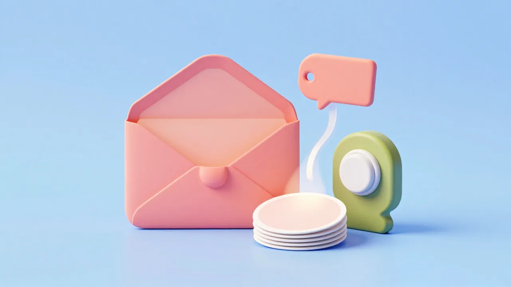
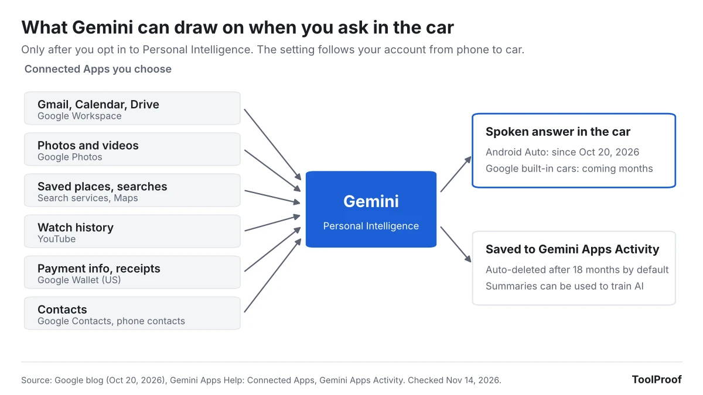

Google Personal Intelligence has two separate settings: one for Google Search services such as AI Mode and Ask Maps, under **Search Services Personalization** in your Google Account, and one for the Gemini app, under **Personal Intelligence > Connected Apps**. Nothing is connected until you choose to connect it, and disconnecting an app in one place doesn't disconnect it in the other. If you connected Gmail or Google Photos to Search, Google's privacy policy has let what Search learns from them shape your ads since October 16, 2026.

To stop Personal Intelligence everywhere, disconnect your apps in both places and then delete the saved history that disconnecting leaves behind. We re-read Google's privacy policy and 11 Google help pages for this guide on November 14, 2026, and checked them again on November 25, 2026. By then Google had renamed the Gemini setting that Personal Intelligence depends on from Keep Activity to History and added Google Drive and Google Wallet to the apps Search can use. We don't have a Google account in our test setup, so the menu steps come from Google's help pages, not our own screens.

## Search and Gemini: two Personal Intelligence settings

Personal Intelligence in Search and Personal Intelligence in the Gemini app are separate opt-ins with their own app lists, required settings and ad rules.

| | Search services (AI Mode, Ask Maps) | Gemini app (also Gemini in Chrome, on a smartwatch and in Android Auto) |
| --- | --- | --- |
| Where you connect or disconnect apps | Google Account > **Search Services Personalization** > **Additional Personal Intelligence Connected Content Apps** | Gemini app > **Menu** > your profile picture > **Personal Intelligence** > **Connected Apps** |
| Apps you can connect | Google Workspace (Gmail, Calendar and Drive), Google Photos, Google Wallet, with Gemini chats "coming soon" | Google Workspace (Gmail, Calendar, Drive and more), Google Photos, Search services, YouTube, Google Wallet (US only), Contacts |
| Setting it can't work without | **Personalized Recommendations** in Search services | **History** in Gemini (formerly Keep Activity) |
| Used to show you ads | Yes: summaries and inferences from connected apps "may be used to show you ads" | No: Google says Gemini chats "are not being used to show you ads" |
| Used to train AI and seen by human reviewers | Summaries, excerpts and inferences, yes | Summaries, excerpts and inferences, yes |
| History that disconnecting doesn't delete | Search Services History | Gemini History |

One Gmail setting feeds both. Google's Gmail help lists Personal Intelligence in the Gemini app and in Search services among the features that need **Smart features in other Google products**, and the Gemini help page says Gemini "can't connect to Google Workspace when this setting is off."

## How to disconnect Gmail and Photos from Google Search

You disconnect Gmail and Google Photos from Search in your Google Account, under Search Services Personalization. These steps follow Google's help pages on [Personal Intelligence in Search](https://support.google.com/websearch/answer/16859283?hl=en) and [Personalized Recommendations](https://support.google.com/websearch/answer/17026260?hl=en).

1. On a computer, open your Google Account and go to **Search Services Personalization**, or go straight to google.com/search-personalization.
2. Open **Additional Personal Intelligence Connected Content Apps**. If Google Workspace, Google Photos or Google Wallet is connected, disconnect it. Google says you can disconnect content apps from Search services "at any time." As of November 25, 2026, its help page lists Gemini chats as a fourth app "coming soon."
3. To turn off Personal Intelligence in Search entirely, go to **Data & privacy > Personalization settings** and turn off **Personalized Recommendations in Search services**. Google lists this setting as a requirement for Personal Intelligence.
4. To delete what Search already saved, go to activity.google.com and delete your Search Services History. Google says disconnecting an app doesn't delete that history, which "can still be used for product improvement, including training generative AI models."

If you don't see these settings, your account hasn't moved to Google's new Search services settings yet. Google says they are "rolling out gradually over the next few months," and until then, history and personalized recommendations for Search are still controlled by **Web & App Activity**. Turning off Personalized Recommendations also doesn't turn off or delete Search Services History; that is a separate switch.

## How to turn off Personal Intelligence in the Gemini app

In the Gemini app, you turn Personal Intelligence off app by app in Connected Apps, for one chat with the **Tools** menu, or entirely by turning off History, the setting Google called Keep Activity until November 2026. These steps come from Google's [Connect your Google apps](https://support.google.com/gemini/answer/16598406?hl=en) and [Gemini History](https://support.google.com/gemini/answer/13278892?hl=en) help pages.

1. **On a phone:** open the Gemini app, tap **Menu**, then your profile picture or initial, then **Personal Intelligence** > **Connected Apps**, and turn off each app you don't want Gemini to use.
2. **On the web:** at gemini.google.com, choose **Menu** > **Settings** > **Personal Intelligence** > **Connected Apps**, then **More options** > **Disconnect** next to each app. Google's page said **Settings & help** and showed an on/off switch for each app as recently as October 21, 2026, so older guides may show that path.
3. **For a single chat:** in the text box, tap **Tools** and turn **Personal Intelligence** off. Gemini remembers that choice for the chat, but new chats start with it on, and the chat is still saved to your Gemini History unless you use a temporary chat.
4. **To remove something Gemini learned:** disconnect the app and delete the chats that contain the information. Google says you need both steps, because Gemini can still use the information from past chats after you disconnect, or find it again in the app if you only delete the chats.
5. **To turn it off entirely:** at gemini.google.com, choose **Settings** > **History** (or go to myactivity.google.com/product/gemini), select **On**, then **Turn off and delete history**. With History off, Google's help page lists only Device assistance, Gemini Notebook, Messages, Phone and WhatsApp as connected apps you can still use, so Gmail, Photos and the other Personal Intelligence apps stop. Google says conversations are still saved with your account for around two months. Some Google help pages, including Connect your Google apps, still call this setting **Keep Activity**.

If you connected Gmail or Google Photos to Gemini before Personal Intelligence launched, check the list anyway. Google's help page says those settings "have been reset with the launch of Personal Intelligence with Connected Apps." Gemini can also still use public information from Google Search and YouTube when those apps are disconnected.

## Does Personal Intelligence use your Gmail and Photos for ads?

Personal Intelligence can shape your ads only in Search. Since October 16, 2026, Google's privacy policy has let what Search learns from a connected Gmail or Google Photos account be used for ads, while Google says Gemini chats aren't used for ads.

The [privacy policy](https://policies.google.com/privacy?hl=en-US) in force since October 16, 2026 says: "We don't show you personalized ads based on your content from Drive, Gmail, or Google Photos, unless you choose to make data from these services available to other Google services that support personalized ads." It adds that "Search may process some of the data that you allow Search to access to personalize content, including ads." The archived April 2, May 26 and October 1, 2026 versions had the same promise without the "unless" exception. On the same day, Google added an update to its [June 23, 2017 blog post](https://blog.google/products-and-platforms/products/gmail/g-suite-gains-traction-in-the-enterprise-g-suites-gmail-and-consumer-gmail-to-more-closely-align/), which had said consumer Gmail content "will not be used or scanned for any ads personalization": if users connect Workspace apps to other Google services, "that same subset of data can also be used to show ads."

Google's Search help page answers the question this way: "Ads will not be based directly on your Gmail inbox or your Google Photos library." It goes on to say that Search "may reference summaries, excerpts and inferences from these sources," and "that same info may be used to show you ads." The same page says Google doesn't personalize ads on sensitive categories such as race, religion, sexual orientation or health, and that advertisers don't get access to your Gmail inbox or Google Photos.

For the Gemini app, Google's [Gemini Apps Privacy Hub](https://support.google.com/gemini/answer/13594961?hl=en) says: "Your Gemini Apps chats are not being used to show you ads. If this changes, we will clearly communicate it to you."

If you want AI Mode to keep using your email but don't want ads based on it, you can turn off ad personalization instead. Google's [My Ad Center help](https://support.google.com/My-Ad-Center-Help/answer/12155656?hl=en) gives the steps: go to [My Ad Center](https://myadcenter.google.com), select **Off** next to **Personalized ads**, and confirm. Ads on Google then depend on things like the time of day, the topic of the page and your current location, and the ad topics and brands you customized are deleted. Your phone number has its own ads setting on each Google account, which our guide to [removing a phone number from your Google account](/posts/remove-phone-number-from-google-account) shows how to find.

## What Google does with data from connected apps

Google says neither Search nor Gemini trains its AI models directly on your Gmail inbox or Google Photos library, but both train on summaries, excerpts and inferences drawn from them, and human reviewers see a subset. Both help pages add that "where the email or file is brief or particularly relevant," the summary "may just be the email or file."

- **Human review:** Google's [Connected Apps data page](https://support.google.com/gemini/answer/16836988?hl=en) and the Search help page say reviewers, including trained service providers, see interactions, summaries and excerpts from your emails and files. Google says it first disconnects them from your account and reduces personal information, and that people don't view media from your Photos library except for abuse cases or feedback you send. Its advice on both pages: don't connect apps that hold information you wouldn't want a reviewer to see.
- **Photos:** Gemini's data page says your Google Photos data "is used to infer your interests, relationships to people in your photos, and where you've been, including by associating your face with corresponding location data and timestamps." Both Search and Gemini need **Face Groups** turned on, with your own face selected, and **Estimate missing locations** before they can use Photos at all.
- **New data:** the same page says that if new data is added to a connected app later, "Gemini will have access to that data."
- **Deleting:** disconnecting an app or deleting an email doesn't delete your Gemini History or Search Services History. Google says changes in a connected app may take days to show up in Gemini.

Our guide to [turning off Gemini Apps Activity, now called History](/posts/turn-off-gemini-apps-activity) explains what else stops when you turn it off, how long each kind of chat is kept, and how to keep your History but stop AI training.

## Personal Intelligence in Android Auto

If you turned on Personal Intelligence in the Gemini app, it also answers from your connected apps in Android Auto, with no separate car setting described in Google's help pages. Google's [October 20, 2026 announcement](https://blog.google/products-and-platforms/platforms/android/android-auto-cars-with-google-built-in-gemini-personal-intelligence/) said Personal Intelligence "is rolling out starting today" on Android Auto and "in the coming months" on cars with Google built-in, and that if you already enabled it in the Gemini app, "it comes with you into the car."

Google's examples are a flight gate from a confirmation email, an appointment from your calendar, and a place from a photo you took. Three things on Google's [car help page](https://support.google.com/gemini/answer/16735982?hl=en) matter once those answers are spoken out loud:

- Gemini in Android Auto "is available to anyone in the vehicle, including children."
- Gemini "can hallucinate" and "should not be relied on for critical information or safety-related matters while operating the vehicle," so check a gate or address against the original email when it matters.
- You need an Android phone with Android 11 or newer and at least 2 GB of RAM, with Gemini set as your digital assistant. Android Auto's [voice help page](https://support.google.com/androidauto/answer/6348083?hl=en) says Gemini is replacing Google Assistant on most mobile devices.

Cars with Google built-in "only share personal responses when you're in the car with your phone connected," according to the announcement. To stop personal answers in the car, use the Gemini steps above on your phone. If you want Gemini off on the phone itself, our guide to [turning off Gemini on an Android phone](/posts/turn-off-gemini-on-android-phone) covers the power button, "Hey Google" and the default assistant.

## Who can use Personal Intelligence

Personal Intelligence needs a personal Google Account and an age of 18 or older, and neither version is available in the UK or the European Economic Area. Work, school and supervised accounts can't use it.

- **Search:** on November 14, 2026, the help page's supported list had 191 countries and territories, including the US, Canada, Australia, India, Japan, South Korea, Brazil and Mexico, but not the UK, Ireland, Germany, France, Spain, Italy, Poland, Norway or Switzerland. Connecting Google Calendar or Google Drive works only in the US in English, and connecting Google Photos or Google Wallet isn't available in all regions. Ask Maps can use Gmail in English in the US, Canada, India and Australia, and in six other language and country pairs, such as Japanese in Japan and Spanish in Mexico.
- **Gemini app:** not available in the European Economic Area, Nigeria, Switzerland or the United Kingdom, or in some Gemini features, including Gems. Google Wallet can be connected only in the US.
- **Gmail:** Google's [smart features help page](https://support.google.com/mail/answer/15604322?hl=en) says these settings start out off in the European Economic Area, Japan, Switzerland and the UK.

## Which settings should you change?

- **You never connected anything on purpose:** open both lists once, Search Services Personalization and the Gemini app's Connected Apps. If nothing is connected, you're done. To keep Gmail out of both in one step, turn off **Smart features in other Google products** in Gmail; Gemini inside Gmail keeps working, as our guide to [turning off Gemini in Gmail](/posts/turn-off-gemini-in-gmail) explains.
- **You use AI Mode with your email but don't want it shaping ads:** keep the connection and turn off **Personalized ads** in My Ad Center. Google says that setting covers the ads you see on Google services on every device where you're signed in, not only ads based on Gmail.
- **You use Gemini in a car other people ride in:** two of Google's three driving examples, a flight gate and a doctor's appointment, come from Gmail and Calendar, so connecting Google Workspace covers most of them. Google Wallet and Contacts add payment and contact details that none of the examples use, and anyone in the car can hear the answers.
- **You want none of it:** disconnect your apps in both places, turn off Personalized Recommendations, turn off Gemini History with **Turn off and delete history**, and delete your Search Services History.

Outside apps such as Spotify are connected to Gemini from a different list, which our look at [Gemini's Customize menu for Connected Apps](/posts/gemini-connected-apps) covers. Gemini in Chrome can fill web forms from Gmail, and our guide to [Chrome autofill settings](/posts/chrome-autofill-settings#how-do-you-stop-chrome-from-filling-forms-with-your-gmail) covers the switch that stops it. For the AI switches in other Google, Microsoft and Apple products, see our [guide to turning off AI in Chrome, Gmail, Word and more](/posts/turn-off-ai-features).

## How we checked

- **November 25, 2026:** we compared all 15 saved pages with the live versions, and four had changed in substance. The Gemini help pages and Privacy Hub (updated November 24, 2026) now call Keep Activity **History**, say chats are kept for around two months when it's off (it was 72 hours), and list the few connected apps that still work with it off. The Search Personal Intelligence page added Google Drive and Google Wallet and lists Gemini chats as "coming soon." The privacy policy text, the Gemini connecting and car pages, Android Auto, My Ad Center and Gmail Help had not changed, and the 2017 Gmail post still carries its October 16, 2026 update
- **November 14, 2026:** we opened Google's Privacy Policy (effective October 16, 2026) and 11 help pages in Chromium and saved their text: Google Search Help on [Personal Intelligence](https://support.google.com/websearch/answer/16859283?hl=en), [Personalized Recommendations](https://support.google.com/websearch/answer/17026260?hl=en) and [the new Search services settings](https://support.google.com/websearch/answer/17025248?hl=en); Gemini Apps Help on connecting apps (Android and computer versions), Connected Apps data, Gemini Apps Activity (now Gemini History), the Privacy Hub and Gemini in the car; Android Auto Help; My Ad Center Help; and Gmail Help on smart features. We also reopened the 2017 Gmail blog post and its October 16, 2026 update
- **Earlier checks:** on October 24, 2026 we compared the current policy with the archived April 2, May 26 and October 1, 2026 versions; on October 21, 2026 we read Google's Android Auto announcement and its help pages
- **What changed by November 14:** the Gemini web steps (**Settings** instead of **Settings & help**, and **More options > Disconnect** instead of a switch), and Contacts is no longer described as US-only and English-only with an AI Ultra subscription
- **History of this page:** it combines two earlier ToolProof news articles, one on Google's October 16, 2026 privacy policy change (published October 24, 2026) and one on Personal Intelligence reaching Android Auto (published October 20, 2026), which now redirects here. The earlier version said the Search help page listed 194 countries; the list has 191 entries, and we had counted its three region headings
- **Not checked:** we couldn't open the settings screens without a Google account, and Google's pages don't say where in Search ads based on connected apps appear
