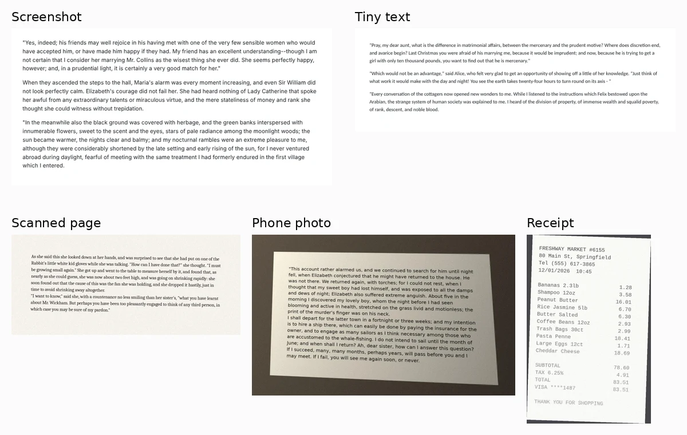

To turn an image into text for free without uploading it anywhere, start with the tool already on your computer: **Snipping Tool's Text actions** on Windows, which Microsoft says recognizes text locally, or **Live Text** on a Mac or iPhone. For many images at once, the free open-source engine **Tesseract** was the best all-rounder in our test: it took about half a second per image, used around 55 MB of memory and, with one setting changed, gave near-perfect text on 42 of our 50 test images.

We ran four free OCR (optical character recognition) engines fully offline on October 14, 2026: Tesseract, RapidOCR, EasyOCR and docTR, seven configurations in all. Each read the same 50 images, 10 each of web screenshots, tiny 11-pixel text, scanned pages, angled phone photos and store receipts, on a 4-core computer with no graphics card. We checked every result against the original text. docTR read the most words correctly (99%), but on photos and receipts it often put lines in the wrong order, so the text needs rearranging after you paste it.

## Free offline image to text tools at a glance

| Tool | Best for | Near-perfect images (of 50) | Words read correctly | Receipt prices and numbers found | Time per image | Peak RAM |
| --- | --- | --- | --- | --- | --- | --- |
| **Tesseract 5.3** with `--psm 6` | Most images, old PCs | **42** | 96.4% | 86% | **0.5 s** | **0.06 GB** |
| Tesseract 5.3 (default) | Screenshots and scans | 33 | 93.1% | 51% | 0.6 s | 0.06 GB |
| **docTR** (default) | Getting every word, tiny text | 33 | **99.0%** | 97% | 3.0 s | 1.3 GB |
| docTR (mobile models) | Same, faster | 31 | **99.1%** | 98% | 1.1 s | 1.1 GB |
| **RapidOCR** (small, default) | Phone photos | 34 | 93.6% | 95% | 1.5 s | 0.6 GB |
| RapidOCR (medium) | Receipts, if you can wait | 35 | 97.3% | 98% | 26 s | 0.9 GB |
| EasyOCR 1.7 | Not recommended | 1 | 85.6% | 47% | 3.6 s | 1.8 GB |

"Near-perfect" means at most 2% of characters were wrong, missing or out of order compared with the original, so you could paste the text with little or no cleanup. "Words read correctly" ignores order, so it shows how much of the text a tool recognized even when the layout came out scrambled. All four engines are free and open source under the Apache 2.0 license.

## The quickest way: tools already on your computer

If you only need text from one image now and then, you don't need to install anything. We didn't run these built-in tools in our test, so the steps below come from Microsoft's and Apple's documentation as of October 2026.

### Windows 11 and Windows 10: Snipping Tool

1. Press **Windows logo key + Shift + S** and select the part of the screen with the text.
2. In the Snipping Tool window, select the **Text actions** button.
3. Select the text you want and copy it, or choose **Copy all text**. **Quick redact** hides email addresses and phone numbers before you share the snip.

Microsoft's [Snipping Tool guide](https://support.microsoft.com/en-us/windows/use-snipping-tool-to-capture-screenshots-00246869-1843-655f-f220-97299b865f6b) says "all text recognition processes are performed locally on your device," so the image isn't uploaded. If you have PowerToys, its [Text Extractor](https://learn.microsoft.com/en-us/windows/powertoys/text-extractor) (default shortcut **Win + Shift + T**) copies text from any part of the screen straight to the clipboard, although Microsoft now recommends Snipping Tool instead.

### Mac and iPhone: Live Text

- **Mac:** open the image in Preview, drag across the text, Control-click your selection and choose **Copy Text**. If you can't select text, choose **Tools > Text Selection**, according to Apple's [Preview guide](https://support.apple.com/guide/preview/prvw625a5b2c/mac).
- **iPhone:** point the Camera at the text, wait for the yellow frame, tap the text button, then touch and hold to **Copy** or **Select All** ([Apple's iPhone guide](https://support.apple.com/guide/iphone/iphcf0b71b0e/ios)).

Apple says Live Text isn't available in all regions or languages, and its guides don't say whether it works without an internet connection.

These built-in tools are made for one image at a time. For a folder of scans or screenshots, or when you want the same result every time, use one of the engines below.

## Our results by image type

Every engine handled clean screenshots and scanned pages reasonably well; the differences showed up with tiny text, angled photos and receipts.

- **Screenshots and scanned pages:** Tesseract and docTR were almost perfect. Tesseract got 99.8% of the words on the scans, and all 10 scans and all 10 screenshots came out near-perfect.
- **Tiny text:** docTR read 99.6% of the words in 11-pixel text. Tesseract read 91.9%, mostly because it turned every capital "I" into a vertical bar "|" and sometimes merged words. EasyOCR read only 70.2%.
- **Phone photos:** RapidOCR got all 10 angled photos near-perfect with both its small and medium models. Tesseract's default setting got 6 of 10; with `--psm 6` it got all 10.
- **Receipts:** the hardest test. Tesseract's default setting skipped most of the price column on 7 of the 10 receipts and found only half of the prices and numbers overall. With `--psm 6` it kept each price on the same line as its item, though it still misread a few characters, for example "12oz" as "120z".

The chart above shows why we report two accuracy numbers. docTR found nearly every price on the receipts, but it printed most of them in a separate list after the item names, so you'd have to match them up again by hand. That's why docTR read 99% of words overall yet got none of the 10 receipts near-perfect.

## Which free OCR tool should you use?

### Tesseract: best for most people

**Tesseract** was the fastest engine and used the least memory by far: about 0.5 seconds per image and around 55 MB of RAM, so it runs comfortably on an old laptop. With its page-layout setting changed to `--psm 6` (treat the image as one block of text), it gave the most near-perfect results of any configuration, 42 of 50. The default setting was just as good on screenshots and scans but much worse on receipts and photos.

- **Good:** fast, tiny, reads more than 100 languages according to its [README](https://github.com/tesseract-ocr/tesseract), keeps lines in reading order, and many free apps are built on it.
- **Weak:** small text. It read 91.9% of the words in our 11-pixel screenshots and confused "I" with "|".
- **License:** Apache 2.0, free for personal and commercial use.

### docTR: best for reading every word

**docTR** read the most words correctly, 99% overall and 99.6% of tiny text, which no other tool matched. The catch is layout: on tilted photos and receipts, it split lines into separate blocks, so copied text came out partly out of order. Its faster mobile models were almost as accurate (99.1% of words) at 1.1 seconds per image. docTR is a Python library, so it suits people comfortable installing Python packages.

### RapidOCR: best for phone photos

**RapidOCR**, which runs PaddleOCR's PP-OCRv6 models through ONNX Runtime, read 99.8% of the words in our angled phone photos at 1.5 seconds each and got every photo near-perfect. With default settings, though, it turned some long lines in our screenshots into scattered letters and missed more than 3% of the words on 12 of the 20 screenshot images. The medium model garbled fewer lines and found 98% of receipt prices, but it still skipped a whole paragraph on one scan and took about 26 seconds per image, roughly 18 times as long as the small model.

### EasyOCR: skip it for English text

**EasyOCR** came last on almost every measure. It read 70.2% of the words in tiny text and 47% of the prices on receipts, often dropped the space after commas, and got only 1 of 50 images near-perfect. Its strength is breadth (its [README](https://github.com/JaidedAI/EasyOCR) lists more than 80 languages), but for English text, Tesseract or docTR did much better on our images.

## How to convert an image to text offline with Tesseract

Tesseract runs from the command line. The steps below are how we ran it, with the install options from the [Tesseract documentation](https://tesseract-ocr.github.io/tessdoc/Installation.html).

1. **Install it.** On Windows, the documentation points to the installers from UB Mannheim. On a Mac with Homebrew, run `brew install tesseract`. On Ubuntu or Debian Linux, run `sudo apt install tesseract-ocr`.
2. **Open a terminal** in the folder with your image (PowerShell on Windows, Terminal on Mac).
3. **Run** `tesseract receipt.jpg result --psm 6`. Tesseract saves the text to `result.txt` in the same folder. For a normal document or screenshot, you can leave off `--psm 6`.
4. **Check the result**, especially numbers. Even the best configuration in our test misread a few characters on receipts.

If you'd rather not use a terminal, [NAPS2](https://www.naps2.com/), a free and open-source scanning app for Windows, Mac and Linux, can add OCR text to scans and PDFs. Its [OCR guide](https://www.naps2.com/doc/ocr) says you download a language the first time you click the **OCR** button, then saved PDFs become searchable. It can't save the text straight to a text file; you copy it from the PDF instead.

For docTR or RapidOCR, install Python and run `pip install "python-doctr[torch]"` or `pip install rapidocr onnxruntime`. Both download their model files on first use, after which they work offline.

## Other tools we looked at

- **Online converters and Google Lens:** they work in a browser or phone app, but they send your image to a server, which is what this guide avoids. If an image contains bank details, IDs or medical information, use one of the offline options above.
- **PaddleOCR:** we tested its PP-OCRv6 models through RapidOCR, a lighter way to run them, rather than the full PaddlePaddle framework.
- **Handwriting:** all of our test images were printed or on-screen text. We didn't test handwriting, which is much harder for these engines.

## What we tested

- **Images:** 50 images we generated so we'd know the exact correct text: 10 web screenshots rendered in Chromium (16-pixel text), 10 screenshots with 11-pixel text, 10 scanned-style pages (tilted up to 2 degrees, with noise, blur and JPEG compression), 10 phone-style photos (perspective, uneven lighting, blur) and 10 receipts in a monospaced font with fading. The paragraphs come from three public-domain books on Project Gutenberg; the receipts list made-up items and prices.
- **Engines:** Tesseract 5.3.4 (LSTM engine, English), RapidOCR 3.10.0 with ONNX Runtime 1.31 (PP-OCRv6 small and medium models), EasyOCR 1.7.2 and docTR 1.1.0 (default `fast_base` + `crnn_vgg16_bn`, and mobile `db_mobilenet_v3_large` + `crnn_mobilenet_v3_small`), all with default settings unless noted.
- **Scoring:** we ignored capitalization and normalized curly quotes and spaces. "Near-perfect" is a character error rate of 2% or less, counting line order. "Words read correctly" is the share of the original words found anywhere in the output. For receipts, we also counted how many prices, dates and other numbers appeared exactly.
- **Speed and memory:** median seconds per image after the model loaded, and the peak memory of the process. Each engine ran alone.
- **Machine:** a Linux cloud server with 4 Intel Xeon cores at 2.8 GHz, 16 GB of RAM and no graphics card, October 14, 2026.

Synthetic test images are cleaner and more consistent than real photos of crumpled receipts, so expect lower accuracy on your own hardest images. The ranking between tools is the useful part.

We've run the same kind of hands-on test for other jobs you can do offline for free, including [background removal](/posts/remove-background-from-image-free-offline), [speech to text](/posts/transcribe-audio-offline-free) and [text to speech](/posts/free-offline-text-to-speech), and collected the results in our [guide to the best free offline AI tools](/posts/free-offline-ai-tools).

## FAQ

### Is there a free image to text converter with no sign-up and no limits?

Yes. Every tool in this guide is free, needs no account and has no page or image limit, because it runs on your own computer. Windows Snipping Tool and Mac or iPhone Live Text are built in; Tesseract, docTR, RapidOCR and EasyOCR are free downloads.

### Can I extract text from a screenshot without the internet?

Yes. On Windows, Microsoft says Snipping Tool's Text actions recognize text locally on your device. Tesseract and the other engines we tested also ran with no internet connection once installed; only docTR, EasyOCR and RapidOCR's medium model needed to download model files the first time.
