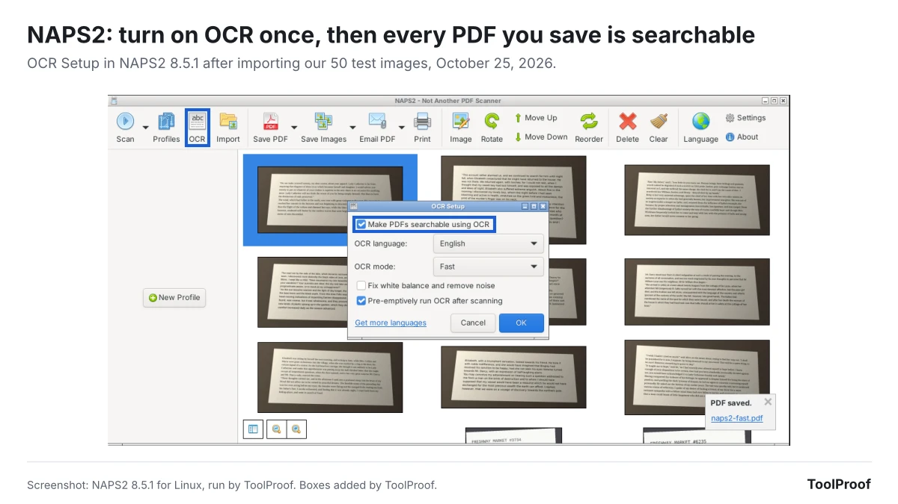
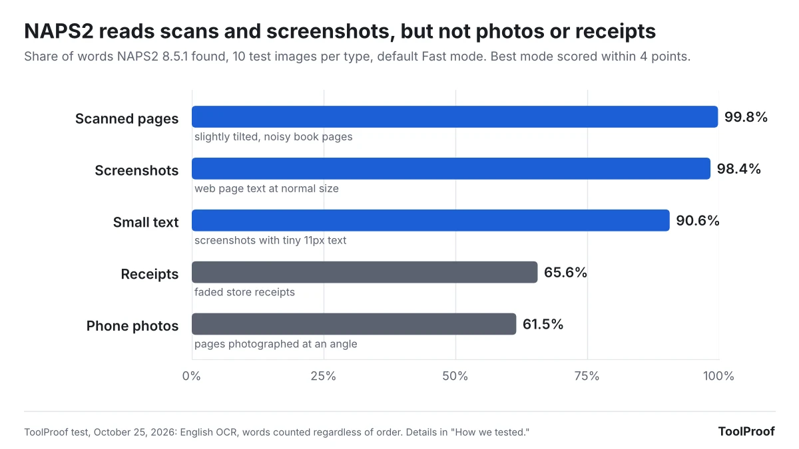
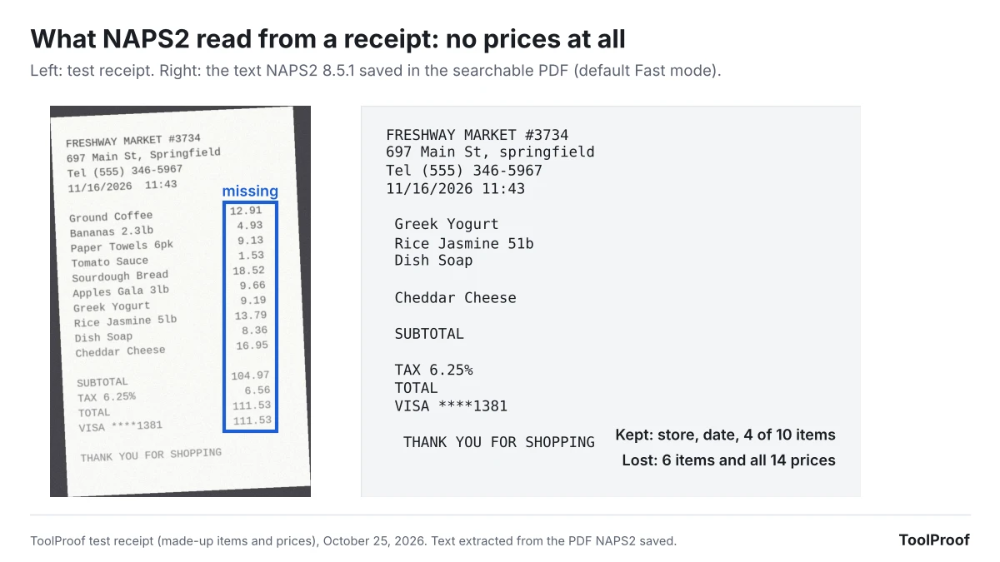

To turn an image into text for free without uploading it anywhere, start with the tool already on your computer: **Snipping Tool's Text actions** on Windows, which Microsoft says recognizes text locally, or **Live Text** on a Mac or iPhone. For a folder of scanned pages, the free, open-source scanning app **NAPS2** can add OCR (optical character recognition) text to scans and PDFs so you can search and copy it.

In our October 2026 test of NAPS2 8.5.1 on 50 test images, it found 99.8% of the words on scanned pages and 98.4% in screenshots, but only 61.5% in phone photos of a page, and it left out every price on 6 of 10 receipts. The Snipping Tool and Live Text steps come from Microsoft's and Apple's documentation; we didn't run those two ourselves.

## The quickest way: tools already on your computer

If you only need text from one image now and then, you don't need to install anything.

### Windows 11 and Windows 10: Snipping Tool

1. Press **Windows logo key + Shift + S** and select the part of the screen with the text.
2. In the Snipping Tool window, select the **Text actions** button.
3. Select the text you want and copy it, or choose **Copy all text**. **Quick redact** hides email addresses and phone numbers before you share the snip.

Microsoft's [Snipping Tool guide](https://support.microsoft.com/en-us/windows/use-snipping-tool-to-capture-screenshots-00246869-1843-655f-f220-97299b865f6b) says "all text recognition processes are performed locally on your device," so the image isn't uploaded. If you have PowerToys, its [Text Extractor](https://learn.microsoft.com/en-us/windows/powertoys/text-extractor) (default shortcut **Win + Shift + T**) copies text from any part of the screen straight to the clipboard, although Microsoft now recommends Snipping Tool instead.

### Mac and iPhone: Live Text

- **Mac:** open the image in Preview, drag across the text, Control-click your selection and choose **Copy Text**. If you can't select text, choose **Tools > Text Selection**, according to Apple's [Preview guide](https://support.apple.com/guide/preview/prvw625a5b2c/mac).
- **iPhone:** point the Camera at the text, wait for the yellow frame, tap the text button, then touch and hold to **Copy** or **Select All** ([Apple's iPhone guide](https://support.apple.com/guide/iphone/iphcf0b71b0e/ios)).

Apple says Live Text isn't available in all regions or languages, and its guides don't say whether it works without an internet connection.

These built-in tools are made for one image at a time. For a folder of scans, use NAPS2.

## For a folder of scans: NAPS2

[NAPS2](https://www.naps2.com/), a free and open-source scanning app for Windows, Mac and Linux, turns scans and images into searchable PDFs, and in our test it read scanned pages and screenshots almost perfectly but missed much of the text in phone photos and receipts. The app has no ads or usage limits, according to its website, and version 8.5.1 was current as of October 2026.

### How to make a searchable PDF in NAPS2

1. Click **OCR** in the toolbar (on a Mac, **Tools > OCR**). The first time, NAPS2 asks which languages to download. Check yours and click **Download**; English was 12.3 MB in our test.
2. In **OCR Setup**, check **Make PDFs searchable using OCR**, make sure the right **OCR language** is selected, and click **OK**.
3. Click **Import** and select your images or scanned PDFs (you can pick many at once), or click **Scan** to scan new pages.
4. Click **Save PDF**. NAPS2 adds the recognized text while it saves.
5. Open the PDF in any PDF reader, use **Select All** and **Copy**, and paste the text where you need it.

NAPS2's [OCR guide](https://www.naps2.com/doc/ocr) says it can't save the text straight to a text file, which is why you copy it from the PDF. If you import a PDF that already has text on some pages, NAPS2 leaves those pages alone and only reads the pages without text. If you only need a few pages of a long scanned PDF, you can [split the PDF for free](/posts/split-pdf-free) first.

### How accurate is NAPS2 OCR?

In our October 2026 test, NAPS2 8.5.1 found 99.8% of the words on 10 scanned pages and 98.4% in 10 screenshots, but only 61.5% in 10 phone photos and 65.6% on 10 receipts.

| Image type (10 each) | Words found | What went wrong |
| --- | --- | --- |
| Scanned book pages, slightly tilted and noisy | 99.8% | Nothing major: every word on 8 of 10 pages |
| Screenshots of web page text | 98.4% | A few misread words |
| Screenshots with tiny 11px text | 90.6% | Words run together ("of course" became "ofcourse") and dropped letters ("little" became "litle") |
| Store receipts | 65.6% | No prices at all on 6 of 10 receipts |
| Phone photos of a page, taken at an angle | 61.5% | Whole blocks of text skipped: 39 to 104 words in a row missing on 7 of 10 photos |

Receipts were the clearest failure. On 6 of the 10, NAPS2 saved some item names but none of the prices, totals included. Across all 10 receipts it read 36 of 133 prices. On the photos, the words it did save were mostly right, but it skipped whole blocks of text: one page of 148 words came out as 73, ending after the first paragraph.

Changing the settings didn't fix this. NAPS2's guide says **Best** mode "sometimes" gives better results than the default **Fast** mode, but in our test Best found 82.4% of all words against 83.2% for Fast. Adding **Fix white balance and remove noise** scored 81.3%, and neither setting read a single price on the six receipts where Fast found none.

So use NAPS2 for scanned documents and screenshots, and don't trust a NAPS2 PDF of a receipt or a page photo for prices or complete text without checking it against the picture.

### How we tested NAPS2

We installed NAPS2 8.5.1 for Linux on October 25, 2026, downloaded English, imported 50 test images and saved a searchable PDF three times: with the default Fast mode, with Best, and with Best plus Fix white balance and remove noise. NAPS2's [project page](https://github.com/cyanfish/naps2) says its OCR uses the open-source Tesseract engine. We ran the Linux version, not the Windows or Mac version.

The images are a set we made for this guide: 10 each of web page screenshots, screenshots with 11px text, simulated scans (tilted up to 2 degrees, with noise and blur), phone-style photos (angled, unevenly lit) and receipts with made-up items and prices. The page text comes from public-domain books on Project Gutenberg. We pulled the text from each page of the saved PDF and counted how many of the original words appeared, in any order, plus how many prices matched exactly on the receipts.

## What about online converters and Google Lens?

Online converters and Google Lens work in a browser or phone app, but they send your image to a server, which is what this guide avoids. If an image contains bank details, IDs or medical information, use one of the offline options above.

We've run hands-on tests for other jobs you can do offline for free, including [speech to text](/posts/transcribe-audio-offline-free), and collected the results in our [guide to the best free offline AI tools](/posts/free-offline-ai-tools).

## FAQ

### Is there a free image to text converter with no sign-up and no limits?

Yes. Every tool in this guide is free, needs no account and has no page or image limit, because it runs on your own computer. Windows Snipping Tool and Mac or iPhone Live Text are built in; NAPS2 is a free download.

### Can I extract text from a screenshot without the internet?

Yes, on Windows. Microsoft says Snipping Tool's Text actions recognize text locally on your device. Apple's guides don't say whether Live Text works offline.
