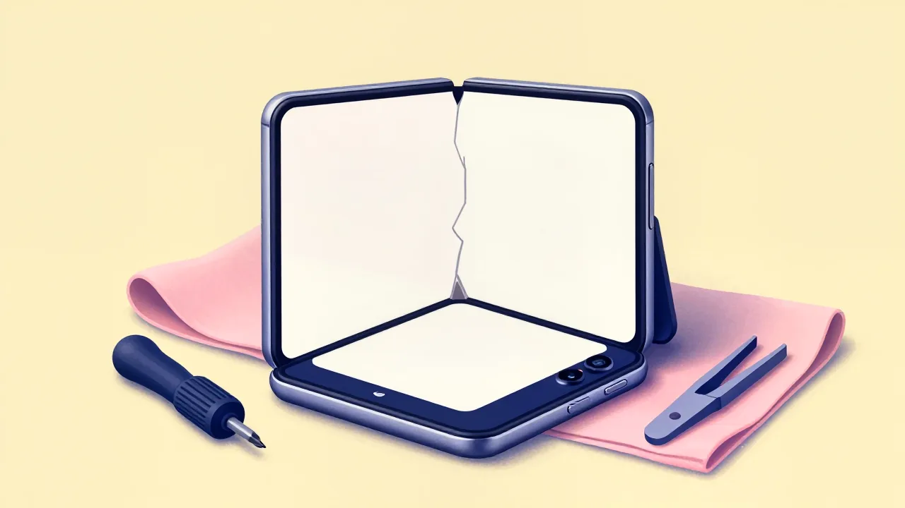
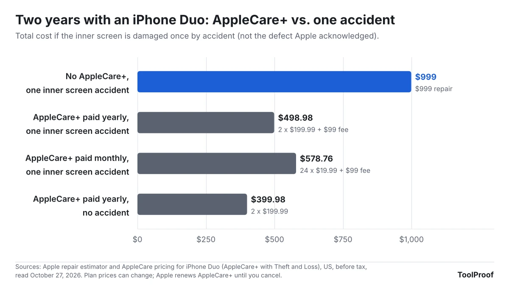

If the inner screen of your iPhone Duo cracks along the fold without a drop, contact Apple: the company told 9to5Mac on October 26, 2026, that it is "aware of an issue impacting the inner display on a small number of iPhone Duo units" and that affected owners "should contact AppleCare for a replacement." 9to5Mac reported that you don't need AppleCare+ for it. Damage that Apple doesn't count as part of that issue is expensive: Apple's own repair estimator lists inner display damage on iPhone Duo at $999 out of warranty, or $99 with AppleCare+, against $379 for an iPhone 18 Pro Max screen.

On October 27, 2026 (UTC), we read Apple's repair estimator for iPhone Duo and iPhone 18 Pro, its AppleCare prices and fees, its one-year warranty, its returns policy, the Apple Upgrade lease FAQ and Apple's iOS 27 guide to preparing an iPhone for service. Apple hasn't said what causes the cracks or how many phones are affected, and it hasn't posted a service program for them. Two deadlines matter now: Apple's 14-day return window and the 60 days you have to add AppleCare+.

| Your situation | What Apple charges | What to do |
| --- | --- | --- |
| Inner screen cracked along the fold on its own (the issue Apple acknowledged) | A replacement, per Apple's statement | Contact Apple Support |
| Inner screen damaged by a drop, pressure or a sharp object | $99 with AppleCare+, $999 without | Check your coverage first |
| Only the top cover layer is scratched or worn | $19 with AppleCare+, $49 without | Leave the layer on and let Apple replace it |
| Outer screen cracked | $29 with AppleCare+, $379 without | Same process as any iPhone screen |

## What happened

Apple's first foldable iPhone went on sale in Apple Stores on [October 23, 2026](https://www.apple.com/newsroom/2026/10/iphone-duo-arrives-at-apple-store-locations-worldwide/), starting at $1,999. Over that weekend, owners on Reddit and other forums reported inner screens cracked along the center line of the hinge, [9to5Mac reported](https://9to5mac.com/2026/10/26/apple-responds-to-reports-of-iphone-duos-inner-display-cracking/). On October 26, Apple gave 9to5Mac this statement: "We are aware of an issue impacting the inner display on a small number of iPhone Duo units. If users experience issues with their iPhone Duo display, they should contact AppleCare for a replacement."

According to 9to5Mac, Apple says the problem tends to show up relatively quickly and most units aren't affected. The site also reported that AppleCare+ isn't required for the replacement and that people who bought from a carrier should contact AppleCare directly rather than the carrier. Apple hasn't named a cause. As of October 27, Apple's [Service Programs page](https://support.apple.com/service-programs), where it lists repair programs such as the iPhone 14 Plus rear camera program from November 2024, has no iPhone Duo entry.

## Who is affected

The reported cracks are on the 7.6-inch inner screen, which Apple says is "made of more than 10 ultrathin layers with a custom nano-texture finish" on its [iPhone Duo page](https://www.apple.com/iphone-duo/). What you can do depends on how you got the phone.

| If you | What applies |
| --- | --- |
| Bought from Apple and received the phone in the last 14 days | You can return it within 14 days of receiving it, in its original condition with all parts and packaging ([Apple returns policy](https://www.apple.com/shop/help/returns_refund)) |
| Bought from a carrier | 9to5Mac reported that Apple wants you to contact AppleCare, not your carrier |
| Lease through Apple Upgrade | The lease doesn't include AppleCare. Without it, a phone returned not "in good working condition" gets a one-time damage fee, or you can repair it before returning it ([Apple Upgrade FAQ](https://www.apple.com/shop/apple-upgrade)) |
| Have AppleCare+ or AppleCare One | No fee for mechanical failures; accidental damage costs $99 for the inner screen and $19 for the cover layer |
| Have no AppleCare plan | Apple's warranty covers defects for one year from purchase; accidental damage is billed at out-of-warranty prices |

If you're still deciding how to pay for an iPhone Duo, our earlier look at [what iPhone Duo costs to buy or lease](/posts/iphone-duo-sold-out) compares the options.

## What changes for you

### Apple decides at inspection whether a crack is the defect

Apple's warranty covers "defects in materials and workmanship" for one year, and the same document excludes "damage caused by accident, abuse, misuse" and other external causes ([Apple One (1) Year Limited Warranty](https://www.apple.com/legal/warranty/products/ios-warranty-document-us.html)). Apple's repair page says, "We'll inspect your device to determine the final service fee." Apple hasn't published how a technician tells the fold-line crack it acknowledged apart from a crack caused by pressure or a drop, and that call is the difference between a replacement under warranty and a $999 bill, or $99 with AppleCare+.

### An inner screen repair costs 2.6 times an iPhone 18 Pro Max screen

Apple's estimator lists iPhone Duo inner display damage at $999 out of warranty, 2.6 times the $379 it lists for an iPhone 18 Pro Max screen and about three times the $329 for an iPhone 18 Pro screen. With AppleCare+, the inner screen fee is $99, while Apple charges $29 for an iPhone 18 Pro or Pro Max screen. The iPhone Duo's outer screen is priced like a regular iPhone screen: $379, or $29 with AppleCare+. Apple says its out-of-warranty estimates may be subject to tax and that Apple Authorized Service Providers set their own prices.

### The cover layer is a separate, cheaper repair

Apple prices "cover layer damage" on iPhone Duo separately from the screen underneath: $49 out of warranty and $19 with AppleCare, and Apple's [AppleCare page](https://www.apple.com/applecare/) says a separate fee applies to replacing it. Apple's warranty doesn't cover "protective coatings that are designed to diminish over time" unless a defect caused the failure, so ordinary wear on that layer is a paid repair. Don't try to peel or replace it yourself: Apple's iPhone safety guide says iPhone "should only be serviced by a trained technician," and the warranty excludes damage from service by anyone other than Apple or an Apple Authorized Service Provider.

### Your return and AppleCare+ deadlines are already running

Apple's return window is 14 days from the day you received the phone, so a phone delivered on October 23 can be returned through November 6. You can add AppleCare+ in the Settings app for 60 days after a new Apple purchase, according to Apple's AppleCare FAQ; for launch-week buyers, that window closes between December 15 and December 22. The one-year warranty runs from the date of purchase, into October 2027 for those phones.

## What to do now

1. **Check your coverage.** Go to **Settings > General > AppleCare & Warranty** to see whether you have AppleCare+ or AppleCare One and when your warranty ends.
2. **Stop using a cracked screen.** Apple's [iPhone safety guide](https://support.apple.com/guide/iphone/important-handling-information-iph301fc905/ios) says, "Don't use iPhone with cracked glass, as it may cause injury."
3. **Back up the phone.** Apple says a phone may come back from service erased, so you'll restore it from an iCloud backup or a backup on your computer.
4. **Turn on Ready for Repair in Find My.** On iOS 27, open the **Find My** app, select your iPhone Duo, tap the **More** button, tap **Repair or Trade In**, then tap **Enable**. Apple's [service checklist](https://support.apple.com/en-us/109519) also asks you to turn off Apple Cash and remove cards from Wallet.
5. **Contact Apple.** Start at [support.apple.com/repair](https://support.apple.com/repair), in the Apple Support app or at 1-800-692-7753, and say the inner screen cracked along the fold. Bring the phone, your receipt and a photo ID. Carriers still handle some iPhone features, such as the monthly fee for [sharing one number with a second iPhone](/posts/iphone-handoff-verizon-cost), but 9to5Mac reported that these screen replacements go through Apple.
6. **Decide on AppleCare+ before the 60 days run out.** AppleCare+ with Theft and Loss for iPhone Duo costs $19.99 a month or $199.99 a year, according to Apple's AppleCare pricing on October 27.

## Our take

Apple's promise to replace the affected screens is the right first move, but it sits in a statement to a news site rather than in a policy owners can show at the Genius Bar. Apple already has a place for that: its Service Programs page, where past defects such as the iPhone 14 Plus rear camera issue got a written program. That matters here because the warranty excludes accidental damage and Apple decides at inspection which kind of crack it's looking at, with a $999 difference on the line. Apple should publish a service program that says which symptoms qualify and for how long.

Until it does, AppleCare+ is easier to justify on an iPhone Duo than on a regular iPhone. Two years of AppleCare+ paid yearly costs $399.98. One accidental inner screen repair costs $999 without it, or $498.98 in total with it. The other side: Apple says only a small number of phones are affected and that the fault shows up early, inside the one-year warranty, and $400 is a lot to spend on coverage that only pays off after an accident. If you're careful with your phones, skipping it is a reasonable bet.

## What to watch next

- **A service program:** whether Apple adds an iPhone Duo display program to its [Service Programs page](https://support.apple.com/service-programs), with eligible symptoms and a time limit.
- **A cause:** Apple hasn't said what makes the screens crack or whether later production units are different.
- **Repair prices:** whether Apple changes the $999 inner display estimate or the $99 AppleCare fee.
- **Deadlines:** the 14-day return window for launch-week deliveries ends November 6, and the 60-day AppleCare+ window for those buyers closes in mid to late December.

## How we checked

On October 27, 2026 (UTC), we opened Apple's iPhone repair estimator with iPhone Duo and iPhone 18 Pro selected on both the out-of-warranty and AppleCare tabs, and saved the prices the page loads from Apple's servers. We also read Apple's AppleCare page and fee list, the AppleCare plan prices that page loads, the Apple One (1) Year Limited Warranty for iPhone, Apple's returns policy, the Apple Upgrade FAQ, the iPhone Duo product page, Apple's Service Programs list, the iPhone User Guide's safety page and Apple's "Prepare your iPhone or iPad for a service appointment" (dated September 15, 2026). Apple's statement comes from 9to5Mac's October 26 report. We didn't have an iPhone Duo, so we couldn't open its Settings or Find My screens ourselves.
