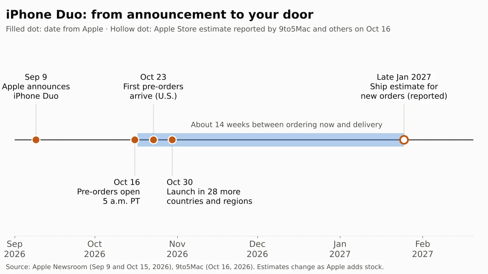
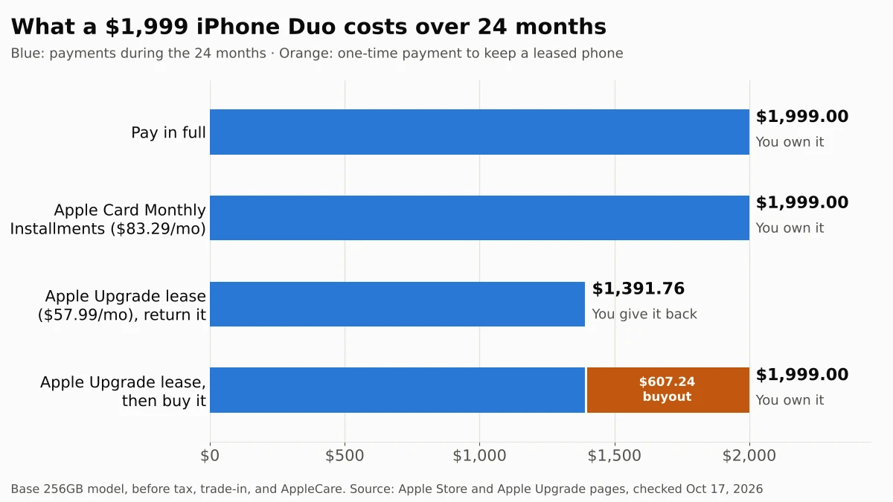

If you didn't pre-order an iPhone Duo in the first minutes on Friday, October 16, plan on waiting until late January 2027. Apple's first foldable iPhone, which starts at $1,999, sold out almost immediately, and Apple's online store moved estimated ship dates for new orders to around January 25, according to 9to5Mac and other Apple news sites. Apple says it will keep taking orders online.

The wait itself costs you nothing. An order that ships to your address can be canceled until it ships, and Apple doesn't bill you for a canceled item. The bigger decision is how to pay. Over 24 months, the iPhone Duo costs $1,999 whether you pay up front or use Apple Card Monthly Installments, while Apple's new lease, Apple Upgrade, costs $1,391.76 if you hand the phone back at the end.

We read Apple's press releases, store pages, lease terms and return policy on October 17, 2026, and worked out what each way of paying costs. Delivery estimates come from news reports, because we couldn't load them from Apple's store ourselves.

## What happened

Apple [announced iPhone Duo](https://www.apple.com/newsroom/2026/09/apple-unveils-iphone-duo/) on September 9, 2026. It folds open to a 7.6-inch screen and starts at $1,999 for 256GB, with 512GB, 1TB and 2TB versions at $2,199, $2,599 and $3,199 on Apple's [store page](https://www.apple.com/shop/buy-iphone/iphone-duo). [Pre-orders opened](https://www.apple.com/newsroom/2026/10/open-up-to-new-possibilities-with-iphone-duo/) at 5 a.m. PT on October 16, with the first orders arriving on October 23 and a launch in 28 more countries and regions on October 30.

Within minutes, every configuration was backordered. By 8:30 a.m. ET, all color and storage combinations showed an estimated ship date of January 25, and some buyers saw January 29, 9to5Mac reported. Apple told CNBC it is "working hard to get this revolutionary new product into customers' hands as quickly as possible" and will keep accepting orders online. CNBC also reported that Apple wouldn't say whether its stores will have iPhone Duo stock on October 23.

## Who is affected

| If you... | What it means for you |
| --- | --- |
| Pre-ordered in the first minutes on October 16 | Your order page shows your date. The earliest orders arrive October 23 |
| Order from Apple now | Expect late January 2027, based on reported estimates. You can cancel free until it ships |
| Hope to buy in an Apple Store on October 23 | Uncertain. Apple hasn't said whether stores will have stock |
| Want to lease it with Apple Upgrade | You need AT&T, T-Mobile or Verizon, a Klarna account and a card Klarna accepts |
| Live outside the U.S. | 28 more countries and regions get it October 30. Apple Upgrade is U.S.-only, and Siri AI won't be in the EU at first |
| Are tempted by a reseller | MacRumors reported one resold for $5,000 on eBay. Apple only takes returns of items bought directly from Apple |

## What changes for you

The delay mostly changes when your payments start, not how much you pay. With Apple Upgrade, the first payment is due about 30 days after the phone ships or is ready for pickup, according to Apple's lease terms. What does change your total is the way you pay.

| Way to pay (256GB model) | Monthly | What you pay | At the end |
| --- | --- | --- | --- |
| Pay in full | None | $1,999 up front | You own it |
| Apple Card Monthly Installments (0% APR) | $83.29 for 24 months | $1,999 | You own it, plus 3% Daily Cash up front ($59.97) |
| Apple Upgrade lease, 24 months | $57.99 | $1,391.76 | Return it, upgrade, or pay $607.24 to keep it |
| Apple Upgrade lease, 12 months | $82.99 | $995.88 | Return it, upgrade, or pay $1,003.12 to keep it |
| Carrier deal through Apple | Depends on plan | Up to $1,200 in bill credits over 36 months with a trade-in, per Apple | Credits stop and you owe the balance if you leave the plan |

All prices are before tax and as of October 17, 2026. We calculated the lease totals from Apple's monthly prices and the [Apple Upgrade](https://www.apple.com/shop/apple-upgrade) rule that buying out a leased device costs its price at signing minus the payments you've made. Apple says you won't pay more than the full price if you return the device in good working condition. Apple Trade In also offers $175 to $885 in credit for an iPhone 13 or later.

The lease is new and has rules that a purchase doesn't. Apple's FAQ lists these:

- **You don't own the phone.** At the end you return it, upgrade, or pay the remaining amount to keep it.
- **Card limits.** Klarna, which provides the lease, doesn't accept American Express or UnionPay, or cards from some issuers, including Chase, Capital One and Citibank. Apple Pay and PayPal aren't accepted either.
- **Doing nothing costs money.** If you don't act at the end, the lease runs month to month for up to six months, then Klarna charges you the buyout.
- **Damage and loss.** A damaged phone returned without AppleCare means a one-time damage fee. If it's lost or stolen without theft coverage, you pay the price minus what you've paid. AppleCare isn't included, but you can add it within 60 days of enrolling.
- **Leaving early** means paying all remaining monthly payments.

A few things also change if you're coming from another iPhone. iPhone Duo unlocks with **Touch ID** in the side button rather than Face ID, takes eSIM only, and weighs 254 grams, a little more than the 249-gram iPhone 18 Pro Max, according to Apple's [tech specs](https://www.apple.com/iphone-duo/specs/). If you plan to keep your current iPhone as well, iOS 27 can share one number between the two, for a monthly carrier fee covered in our look at [what iPhone Handoff costs on Verizon and T-Mobile](/posts/iphone-handoff-verizon-cost). It shoots photos as HEIF or JPEG, so our guide to [converting HEIC photos to JPG for free](/posts/convert-heic-to-jpg-free) still applies. Apple also says Apple Intelligence will add support for SynthID, the watermark covered in our guide to [checking whether an image is AI-generated](/posts/check-if-image-is-ai-generated).

## What to do now

1. **Check an existing order.** Sign in to your [Order Listing](https://secure.store.apple.com/shop/order/list) page or the Apple Store app to see your current delivery or pickup date.
2. **Cancel if you change your mind.** While the item says **Processing**, open it on the Order Listing page and select **Cancel Item**. Apple's [order help page](https://www.apple.com/shop/help/viewing_changing_orders) says you aren't billed for a canceled shipping order, and it starts the refund right away for a pickup order.
3. **If you want one, order online now.** Apple hasn't said whether stores will have stock, and an online order can be canceled until it ships.
4. **Pick your payment by how long you'll keep it.** If you'd upgrade within two years, look at the lease. If you'll keep it longer, buy it. Before choosing the lease, check that your debit or credit card isn't one Klarna turns down.
5. **Skip resellers.** Apple's [sales policy](https://www.apple.com/shop/help/returns_refund) only accepts returns of items bought directly from Apple, and it may cancel orders it suspects are for resale.
6. **Note the return window when it arrives.** You have 14 calendar days from delivery to return it. If Apple cuts the price within those 14 days, you can ask for the difference, though limited-time sales don't count.

## Our take

For most people who qualify, the Apple Upgrade lease is the better way to pay for an iPhone Duo, unless you're sure you'll keep it past two years.

Here's why. Leasing for 24 months costs $1,391.76, about 70% of the price, and if you then decide to keep the phone, the buyout is $607.24, which brings the total to exactly $1,999. Apple prices the iPhone 18 Pro lease the same way: $839.76 over 24 months on a $1,199 phone, also 70%. So the lease costs no more than Apple's 0% installment plan if you end up keeping the phone, and it lets you walk away after two years if you don't.

That walk-away option is worth more on a first-generation foldable than on a regular iPhone. No one knows yet what a two-year-old iPhone Duo will be worth, because there's no used market for one. Its hinge and folding screen are new parts, and even with AppleCare, Apple charges a separate service fee to replace the folding screen's cover layer. With the lease, Klarna carries that resale risk instead of you. The low monthly payment, $57.99 against $83.29, is a bonus, not the reason.

The case for buying is real, though. If you have an Apple Card, installments earn 3% Daily Cash up front, about $60 on the base model, so keeping a bought phone ends up cheaper than leasing and buying it out. Buying also means you own the phone from day one, can sell it or trade it in whenever you like, and don't face Klarna's card rules or a damage check at the end.

## What to watch next

- **October 23:** first deliveries, and whether Apple Stores have any iPhone Duo stock to sell in person
- **October 30:** launch in 28 more countries and regions
- **Later this year:** Apple Pencil (USB-C) support for iPhone Duo, which Apple announced without a date
- **Apple Intelligence pricing:** Apple's fine print says some features have daily usage limits and that "expanded access to such features will be available for a fee in the future." No price or date yet
