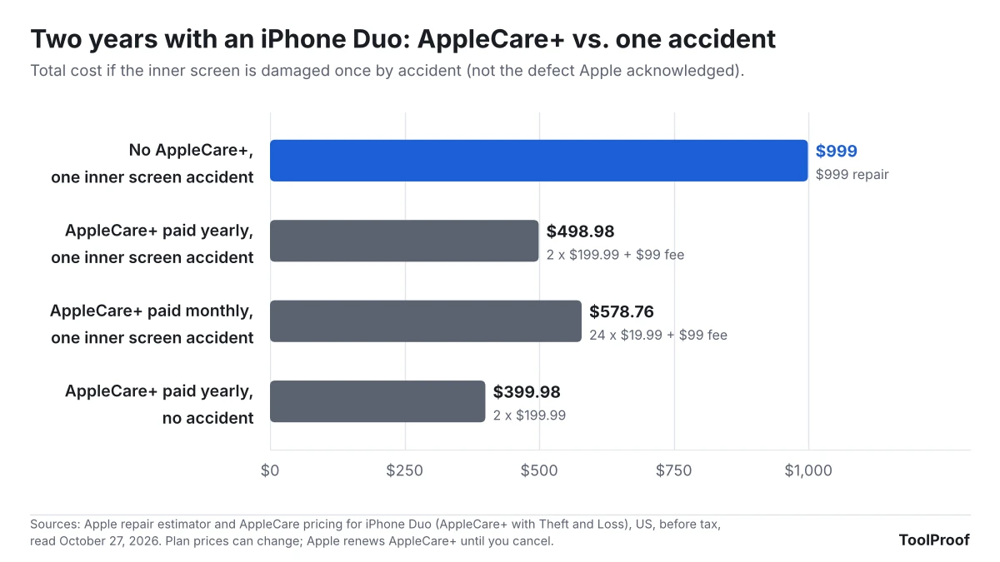
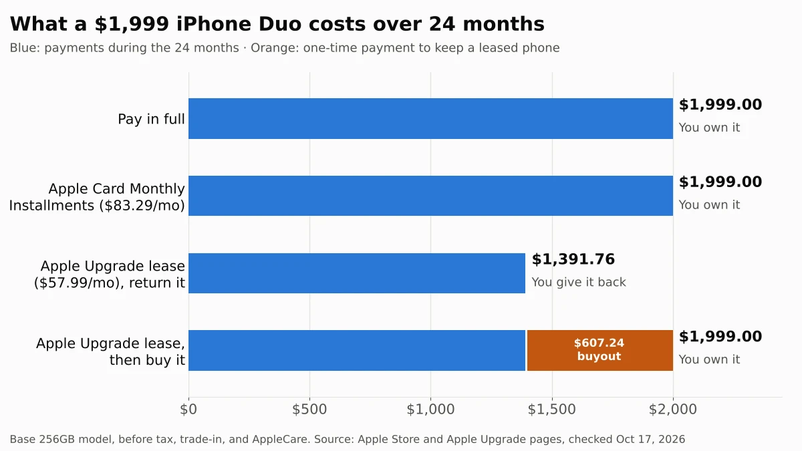
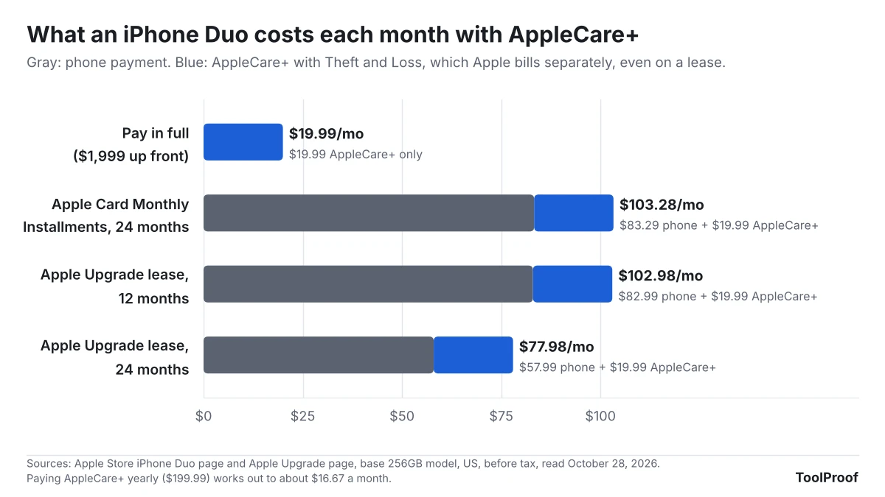

AppleCare+ for iPhone Duo costs $19.99 a month or $199.99 a year on Apple's U.S. store, and it cuts the price of fixing an accidentally damaged inner screen from $999 to $99. AppleCare One Individual costs the same $19.99 a month and covers your iPhone Duo plus up to two more Apple devices, so if an iPad, Apple Watch or Mac in your house also needs coverage, it gets you more for the same money. If the inner screen cracks along the fold without an accident, Apple says to contact AppleCare for a replacement, and 9to5Mac reported that you don't need a plan for it.

On November 18, 2026 (UTC), we checked Apple's iPhone Duo store page, its AppleCare plans and fee list, its repair estimator for iPhone Duo and iPhone 18 Pro, the Apple Upgrade lease terms, Apple's one-year warranty and its returns policy. All prices are before tax and as of November 2026. We didn't have an iPhone Duo, so the Settings and Find My steps below come from Apple's documentation.

| Repair at Apple | Without AppleCare | With AppleCare+ or AppleCare One |
| --- | --- | --- |
| Inner (folding) screen damage | $999 | $99 |
| Outer screen damage | $379 | $29 |
| Back glass damage | $199 | $29 |
| Cover layer damage only | $49 | $19 |
| Battery service | $229 | $0 once capacity drops below 80% |
| Other accidental damage | $1,499 | $99 |
| Theft or loss | Not covered | $149 with theft and loss coverage |

## How much does AppleCare+ cost for iPhone Duo?

AppleCare+ with Theft and Loss for iPhone Duo costs $19.99 a month or $199.99 a year until you cancel, according to [Apple's AppleCare pricing](https://www.apple.com/applecare/) in November 2026. That's $5 a month more than for an iPhone 18 Pro or iPhone Air ($14.99) and $7 more than for an iPhone 17 ($12.99). Paying yearly saves $39.89 a year over paying monthly.

Apple sells three plans that cover an iPhone Duo, and the [service fees](https://www.apple.com/legal/applecare/fees-deductibles/) in the table above are the same in all three.

| Plan | Price | What it covers |
| --- | --- | --- |
| AppleCare+ with Theft and Loss | $19.99/month or $199.99/year | This iPhone Duo only, with up to 2 theft or loss claims every 12 months |
| AppleCare One Individual | $19.99/month, plus $5.99/month for each product over three | Up to 3 Apple products, including ones you already own, with up to 3 theft or loss claims in total every 12 months |
| AppleCare One Family | $49.99/month | Every eligible device for up to six people in your Family Sharing group |

You can add AppleCare+ or AppleCare One Individual when you buy the phone, or later in the Settings app for 60 days after a new Apple purchase. AppleCare One can also take devices you already own if they're in good condition and four years old or newer, and Apple says a diagnostic check or inspection may be required.

## What iPhone Duo repairs cost without AppleCare

Without AppleCare, Apple's [repair estimator](https://support.apple.com/iphone/repair/screen-replacement) lists $999 to fix accidental damage to the iPhone Duo's 7.6-inch inner screen and $1,499 for other damage. The inner screen repair is 2.6 times the $379 Apple lists for an iPhone 18 Pro Max screen and about three times the $329 for an iPhone 18 Pro screen. The iPhone Duo's outer screen is priced like a regular iPhone screen, at $379.

These are estimates. Apple says it will inspect the phone to set the final fee, that the prices may be subject to tax and a shipping fee if it mails your phone, and that Apple Authorized Service Providers set their own prices for repairs that a plan doesn't cover. With AppleCare+ or AppleCare One, the fee is the same at Apple and at authorized providers.

## Is AppleCare+ worth it on an iPhone Duo?

AppleCare+ pays for itself on an iPhone Duo after one accidental inner screen repair. Two years of AppleCare+ paid yearly plus one $99 repair come to $498.98, about half the $999 Apple charges without a plan. Paid monthly, the same two years and one repair come to $578.76.

The math only works if the accident is to the inner screen or worse. If you never have an accident, two years of the plan cost $399.98 for nothing but battery service and support. If your only accident is a cracked outer screen, you'd pay $379 without a plan against $428.98 with two years of it. The plan also covers theft and loss, which Apple's warranty doesn't.

## What if the inner screen cracks along the fold?

If your iPhone Duo's inner screen cracks along the fold without a drop or pressure, contact Apple, because Apple has acknowledged a defect that affects some units. "We are aware of an issue impacting the inner display on a small number of iPhone Duo units. If users experience issues with their iPhone Duo display, they should contact AppleCare for a replacement," Apple told [9to5Mac](https://9to5mac.com/2026/10/26/apple-responds-to-reports-of-iphone-duos-inner-display-cracking/) on October 26, 2026. 9to5Mac reported that you don't need AppleCare+ for that replacement and that people who bought from a carrier should contact AppleCare directly, not the carrier.

A few days later, Apple sent a memo to Apple Stores and Apple Authorized Service Providers telling technicians to inspect affected phones and repair or replace them under their standard procedures, [MacRumors reported](https://www.macrumors.com/2026/10/30/apple-alerts-stores-to-iphone-duo-display-cracking/). Apple said there's no recall, and it hasn't named a cause. As of November 18, Apple's [Service Programs page](https://support.apple.com/service-programs), where it lists written repair programs such as the iPhone 14 Plus rear camera program, has no iPhone Duo entry.

That leaves one judgment call in Apple's hands. Its [one-year limited warranty](https://www.apple.com/legal/warranty/products/ios-warranty-document-us.html) covers defects in materials and workmanship but not "damage caused by accident, abuse, misuse," and the technician decides at inspection which kind of crack it is. That decision is the difference between a free replacement and a $999 bill without a plan, or $99 with one.

## Why the cover layer is a separate repair

Replacing only the thin layer on top of the iPhone Duo's inner screen costs $49 without AppleCare and $19 with it, far less than the $999 or $99 for the screen underneath. Apple's [AppleCare page](https://www.apple.com/applecare/) says a separate service fee applies to replacing the iPhone Duo's cover layer, and its warranty doesn't cover "protective coatings that are designed to diminish over time" unless a defect caused the failure.

Don't peel or replace the layer yourself. Apple's [iPhone safety guide](https://support.apple.com/guide/iphone/important-handling-information-iph301fc905/ios) says iPhone "should only be serviced by a trained technician," and the warranty excludes damage from service by anyone other than Apple or an authorized provider.

## Buying, financing or leasing an iPhone Duo

Over 24 months, a 256GB iPhone Duo costs $1,999 whether you pay up front or use Apple Card Monthly Installments, while the Apple Upgrade lease costs $1,391.76 if you hand the phone back at the end. The 512GB, 1TB and 2TB models cost $2,199, $2,599 and $3,199 on [Apple's store](https://www.apple.com/shop/buy-iphone/iphone-duo).

| Way to pay (256GB model) | Monthly | What you pay | At the end |
| --- | --- | --- | --- |
| Pay in full | None | $1,999 up front | You own it |
| Apple Card Monthly Installments (0% APR) | $83.29 for 24 months | $1,999 | You own it, and Apple Card gives 3% Daily Cash ($59.97) |
| Apple Upgrade lease, 24 months | $57.99 | $1,391.76 | Return it, upgrade, or pay $607.24 to keep it |
| Apple Upgrade lease, 12 months | $82.99 | $995.88 | Return it, upgrade, or pay $1,003.12 to keep it |
| Carrier financing through Apple | From $55.52 for 36 months | Depends on the carrier deal | Depends on the carrier deal |

We calculated the lease totals from Apple's monthly prices and the [Apple Upgrade](https://www.apple.com/shop/apple-upgrade) rule that keeping a leased phone costs its price at signing minus the payments you've made. Apple says you won't pay more than the full price if you return the phone in good working condition. The lease comes with rules a purchase doesn't have:

- **AppleCare isn't included.** You can add it within 60 days of enrolling, or put the leased phone on your AppleCare One plan when you enroll. Apple bills it separately from the lease.
- **Damage without AppleCare** means a one-time damage fee from Klarna, which provides the lease, unless you repair the phone before returning it. Apple's FAQ doesn't say how much the fee is.
- **Loss or theft without theft coverage** means paying the phone's price at signing minus what you've paid.
- **Card limits.** Klarna doesn't accept American Express or UnionPay cards, or cards from some issuers, including Chase, Capital One and Citibank.
- **Doing nothing at the end** extends the lease month to month for up to six months, and then Klarna charges you to buy the phone.

AppleCare+ adds the same $19.99 a month to every way of paying, so it doesn't change which one is cheapest. With it, the 24-month lease comes to $77.98 a month, against $103.28 with Apple Card Monthly Installments.

If you trade in an older iPhone toward the Duo, check whether you need its serial number for [Apple's Siri settlement claim](/posts/apple-siri-settlement-claim) before you hand it over. If you'll keep your current iPhone instead, our look at [what iPhone Handoff costs on Verizon and T-Mobile](/posts/iphone-handoff-verizon-cost) covers sharing one number between two iPhones.

## Deadlines that start the day you get the phone

Four dates decide what an iPhone Duo can still cost you, and all of them count from when you buy or receive it:

- **14 days:** Apple's [returns policy](https://www.apple.com/shop/help/returns_refund) gives you 14 calendar days from delivery to return a phone bought from Apple. If Apple cuts the price within those 14 days, you can ask for the difference. An Apple Upgrade lease can also be returned within 14 days of receiving the phone.
- **60 days:** the window to add AppleCare+ in the Settings app after a new Apple purchase, or after enrolling in Apple Upgrade.
- **One year:** Apple's limited warranty covers defects from the date you bought the phone.
- **12 or 24 months:** the end of an Apple Upgrade lease, when you return, upgrade or buy.

## Before you take your iPhone Duo in for repair

Apple's [service checklist](https://support.apple.com/en-us/109519) asks you to do these steps first, and they apply whether you're paying for a repair or asking for the fold-line replacement:

1. **Check your coverage.** Open **Settings > General > AppleCare & Warranty** to see your plan.
2. **Stop using a cracked screen.** Apple's safety guide says, "Don't use iPhone with cracked glass, as it may cause injury."
3. **Back up the phone** to iCloud or your computer. Apple says it may come back erased.
4. **Turn off Apple Cash** in **Settings > Wallet & Apple Pay**, and remove your cards and passes from the Wallet app.
5. **Turn on Ready for Repair.** On iOS 27, open the **Find My** app, select your iPhone Duo, tap the **More** button, tap **Repair or Trade In**, then tap **Enable**.
6. **Contact Apple** at [support.apple.com/repair](https://support.apple.com/repair), in the Apple Support app or at 1-800-692-7753. Bring the phone, your receipt if you have it and a photo ID.

## Which option fits you?

Pick coverage by what else you own and how you pay:

- **You also own an iPad, Apple Watch or Mac without coverage:** AppleCare One Individual. It costs the same $19.99 a month as AppleCare+ for the iPhone Duo alone and covers up to three products.
- **The iPhone Duo is the only device you'd cover:** AppleCare+ paid yearly, at $199.99 a year instead of $239.88 paid monthly.
- **You lease with Apple Upgrade:** add coverage within the first 60 days. It turns a damage fee of unknown size at the end of the lease into a known $99 or less per accident.
- **You could absorb a $999 repair:** skipping the plan is a fair bet if you're careful, since a single cracked outer screen costs less without it. One inner screen accident costs more than twice as much without it.
- **Your inner screen cracked along the fold:** contact Apple before paying anyone for a repair, and say it cracked at the fold without a drop.

## How we checked

We first published this page on October 17, 2026, as a news column about iPhone Duo selling out at launch, and on October 27 published a separate column about cracked inner screens. On November 19, 2026, we combined them into this guide and checked every source again on November 18 (UTC): Apple's iPhone Duo store page and product page, the AppleCare page with its plan prices and footnotes, Apple's AppleCare fee list, the repair estimator with iPhone Duo, iPhone 18 Pro and iPhone 18 Pro Max selected on both the out-of-warranty and AppleCare tabs, the Apple Upgrade FAQ and lease terms, the Apple One (1) Year Limited Warranty for iPhone, Apple's returns and sales policy, its Service Programs list, the iPhone User Guide's safety page and Apple's "Prepare your iPhone or iPad for a service appointment" (dated November 18, 2026). Repair prices and AppleCare prices were the same as when we first checked them in October. Apple's statement about the cracked screens comes from 9to5Mac's October 26 report and its store memo from MacRumors' October 30 report. We didn't have an iPhone Duo, so we couldn't open its Settings or Find My screens ourselves.
