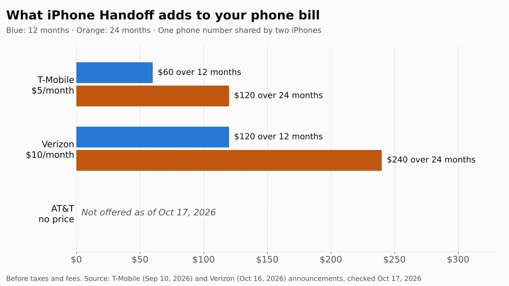

iPhone Handoff, the iOS 27 feature that lets two iPhones share one phone number, will cost $10 a month on Verizon. That's twice the $5 T-Mobile charges, and AT&T doesn't offer it at all yet. Over two years, that's $240 on Verizon or $120 on T-Mobile, before taxes and fees, for the convenience of switching between two iPhones without carrying two numbers.

Most people don't need it. If your second device is an iPad or a Mac, you can already use your iPhone number for Messages and FaceTime for free. Handoff is for people who really alternate between two iPhones, such as a new iPhone Duo and an iPhone 18 Pro. If that's you, it's worth knowing one rule before you sign up: deleting the eSIM doesn't stop the charge. You have to ask your carrier to turn it off.

We read Apple's setup guide, T-Mobile's announcement and FAQ, and Verizon's announcement on October 17, 2026, and worked out what the fee adds up to on each carrier. We couldn't try Handoff ourselves, because it needs two iPhones on a supported carrier.

## What happened

On October 16, Verizon [announced](https://www.verizon.com/about/news/iphone-duo-verizon-offers) that iPhone Handoff is "coming soon" and "will be available from Verizon for $10/month on compatible iPhones models running iOS 27." It didn't give a start date. The announcement came with Verizon's iPhone Duo pre-order deals, a day after Apple opened pre-orders for its first foldable iPhone.

T-Mobile was first. On September 10, it [said](https://www.t-mobile.com/news/devices/iphone-18-pro-iphone-duo-apple-watch-release) it was "introducing the feature at $5/month." Apple's own [setup guide](https://support.apple.com/en-us/127274), published September 9, still lists only two supported carriers as of October 17, 2026: T-Mobile in the U.S. and Telekom in Germany. It also warns that "carrier fees might apply."

Here's how Handoff works, according to Apple. Your calls, voicemail, messages and Find My location follow whichever iPhone you unlock. Only one iPhone has your number at a time, and you see "Switched to this iPhone" at the top of the screen when it moves.

## Who is affected

| If you... | What it means for you |
| --- | --- |
| Have a T-Mobile postpaid plan | Available now for $5 a month plus taxes and fees. The second iPhone gets its own allowance, including 50GB of premium data in the U.S. |
| Have Verizon | Coming at $10 a month, with no start date yet |
| Have AT&T | Not available. AT&T isn't on Apple's list, and we found no AT&T announcement |
| Have a T-Mobile business or prepaid account | Not available at launch. T-Mobile limits it to postpaid consumer and sole proprietor accounts |
| Use two numbers on one iPhone (Dual SIM) | Apple says it works if both carriers support it, but T-Mobile allows only one number for now |
| Want your number on an iPad or Mac | You don't need Handoff. It's iPhone-only, and Apple already lets you use your number for Messages and FaceTime on those devices |

## What changes for you

The main change is a new monthly line item. At current prices, Handoff adds $60 a year on T-Mobile and $120 a year on Verizon. On Verizon, two years of Handoff ($240) is more than four months of Apple's lowest iPhone Duo lease payment ($57.99 a month), which is the kind of number worth weighing if you're [deciding how to pay for an iPhone Duo](/posts/iphone-duo-sold-out).

| Carrier | Monthly fee | 12 months | 24 months | Status as of Oct 17, 2026 |
| --- | --- | --- | --- | --- |
| T-Mobile | $5 | $60 | $120 | Available, postpaid consumer accounts |
| Verizon | $10 | $120 | $240 | "Coming soon," no date |
| AT&T | None | - | - | Not offered |

Prices are before taxes and fees. We multiplied each carrier's announced monthly price by 12 and 24.

Beyond the fee, Apple's guide lists a few things that work differently once two iPhones share one number:

- **One main iPhone.** One phone becomes the main iPhone. Some carrier services, like Call Forwarding and Caller ID, and your carrier account settings can only be managed there.
- **Apple Watch stays put.** Your watch stays paired to one iPhone and doesn't follow your number. Away from that iPhone, it needs Wi-Fi or its own cellular plan.
- **Some Wallet items work on one phone only.** Payment cards work on both, but certain transit passes, IDs and work badges might not.
- **Some apps need approval again.** Banking apps, for example, may ask you to approve the second iPhone from the first.
- **Turning it off takes a call.** Apple says you must contact your carrier to turn off Handoff, and if you delete the eSIM, "your carrier may continue to charge you."

T-Mobile adds its own rules in its [FAQ](https://www.t-mobile.com/devices/new-apple-iphone-release). Both iPhones need two-factor authentication and a passcode or Face ID turned on, and the second iPhone shouldn't have any other phone service on it. Like a smartwatch line, the second phone gets a separate billing number on your account, but you still make and take calls on your one number.

This works much like a smartwatch plan, where you pay the carrier every month so a second device can use your number. Google's [Pixel Watch Safety Signal shutdown](/posts/pixel-watch-safety-signal-ending) is a reminder that carrier services tied to a device can change or end after you buy it.

## What to do now

1. **Decide whether you'll really switch phones.** If you'd carry the second iPhone only now and then, you'll pay every month for a feature you rarely use.
2. **Check your carrier.** T-Mobile postpaid customers can sign up now. Verizon customers should wait for Verizon's terms. AT&T customers can't use it yet.
3. **Use your iPad or Mac without paying.** On your iPhone, open **Settings > Apps > Messages > Send & Receive** and make sure your number is checked. Then do the same under **Settings > Apps > FaceTime**. Apple's [guide](https://support.apple.com/en-us/108758) shows how to turn the number on for your iPad or Mac.
4. **If you sign up, set it up on the iPhone without your number.** Open **Settings > Cellular**, tap **Set Up Cellular** or **Add eSIM**, choose **Use Number on This iPhone and Another**, and tap **Continue**. Keep both iPhones next to each other on Wi-Fi and signed in to the same Apple Account.
5. **Make the phone you use most the main iPhone.** Carrier settings are managed there, and Apple recommends pairing your Apple Watch to it.
6. **To stop paying, contact your carrier.** Deleting the eSIM isn't enough. Check your next bill to confirm the fee is gone.

## Our take

For most people, iPhone Handoff isn't worth paying for, and at $10 a month, Verizon's price is hard to justify unless you switch iPhones every week.

The facts behind that view: Handoff doesn't add a second number or make either phone do anything new. It moves one number between two phones you already own, and only one of them is active at a time. T-Mobile does give the second phone its own data allowance for that $5, but Verizon hasn't said yet what its $10 includes. And if your other screen is an iPad or a Mac, it already gets your messages and FaceTime calls for free. So the people who benefit are a small group: those who own two iPhones and actually alternate, such as using a foldable on weekends and a Pro during the week. For them, $5 is a reasonable convenience fee. Paying $240 over two years on Verizon for the same convenience is likely to make sense only if you'd otherwise pay for a full second line.

That's the strongest case for Handoff. If you already pay for a second line on a second iPhone just so you're reachable on both, Handoff could replace it with one number that follows you, so people don't have to guess which number to call. Depending on your plan, that could cost less, not more, and it removes the hassle of two numbers. Compare it with what your second line costs today before you decide.

## What to watch next

- **Verizon's start date and terms:** whether the $10 includes its own data allowance like T-Mobile's
- **AT&T:** whether it adds Handoff, and at what price, now that the other two big carriers have
- **October 23:** iPhone Duo arrives in stores, the moment many people will first have two iPhones in hand
- **Apple's carrier list:** whether Apple's [setup guide](https://support.apple.com/en-us/127274) adds Verizon once it launches
