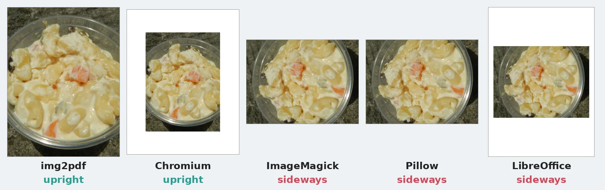
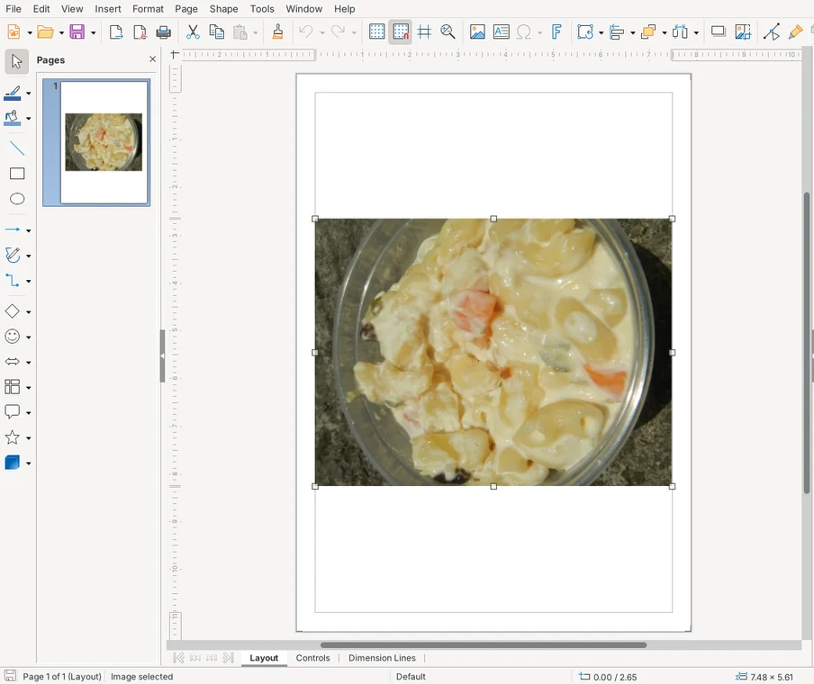
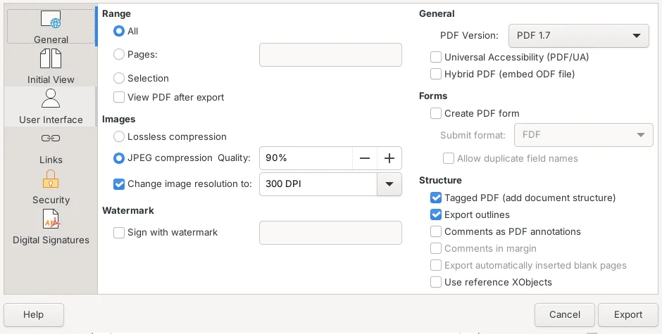
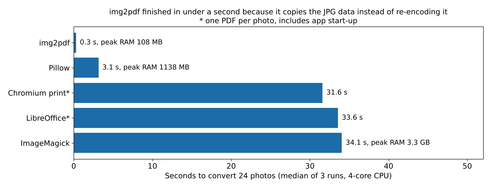

To convert JPG to PDF for free without uploading your photos, use img2pdf. In our test of five free offline tools on 24 phone-size photos, it was the only one that kept every photo pixel-for-pixel identical, kept portrait photos upright and added almost nothing to the file size. It took 0.3 seconds for all 24. Three of the other four tools turned our portrait photos sideways, and two of them quietly lowered the photo quality to make the PDF smaller.

We ran the test on October 16, 2026, with img2pdf 0.6.3, ImageMagick 7.1.2-34, the Python imaging library Pillow 12.3.0, LibreOffice 26.8.1 and the print-to-PDF engine of Chromium 141, the open-source browser behind Google Chrome. Each tool converted the same 24 public-domain photos: 20 landscape shots and 4 portrait shots saved the way phone cameras often save them, as sideways pixels plus a "rotate this" tag. We checked each PDF for file size, whether the photos inside were changed, how they compared with the originals on a quality score, and whether the portrait photos came out upright.

## JPG to PDF tools compared

| Tool (default settings) | PDF size for 24 photos (61.8 MB of JPGs) | Photo quality in the PDF | Portrait photos | Best for |
| --- | --- | --- | --- | --- |
| **img2pdf 0.6.3** | 61.8 MB (+0.02%) | Identical to the original | Upright (4 of 4) | Most people: exact copies, any number of photos |
| **Chromium 141 print to PDF** | 146.3 MB | Identical, but portrait pages stored uncompressed | Upright (4 of 4) | One landscape photo, nothing to install |
| **ImageMagick 7.1.2** | 61.8 MB | Re-saved at JPEG quality 92 (score 92) | Sideways (0 of 4) | Scripts that also resize or crop |
| **Pillow 12.3 (Python)** | 33.1 MB | Re-saved at JPEG quality 75 (score 79) | Sideways (0 of 4) | Python code that already uses Pillow |
| **LibreOffice 26.8** | 20.3 MB | Shrunk to 2244 px wide, quality 90 (score 60) | Sideways (0 of 4) | A PDF you want small, after changing settings |

The quality score is [SSIMULACRA2](https://github.com/cloudinary/ssimulacra2), where 90 means you can't see a difference at normal viewing, 70 is high quality and 50 is medium. We scored the full-resolution photo, so a tool that shrinks the photo loses points even if it looks fine on a phone screen. All five tools are free and work offline.

## How we tested

We used 20 public-domain (CC0) photos from the [PD12M dataset](https://huggingface.co/datasets/Spawning/PD12M), the same set we used in our [HEIC to JPG test](/posts/convert-heic-to-jpg-free) and our [100KB image compression test](/posts/compress-image-to-100kb). We cropped each one to 4032 x 3024 pixels (12 megapixels) and saved it as a JPEG at quality 92, marked 72 DPI. To mimic portrait photos from a phone, we made 4 more files whose pixels are stored sideways with the EXIF Orientation tag set to "rotate 90 degrees," which tells photo viewers to turn the image upright. The 24 files totaled 61.8 MB.

Each tool turned all 24 photos into PDF with its default settings:

- **img2pdf**: `img2pdf *.jpg -o photos.pdf`
- **ImageMagick**: `magick *.jpg photos.pdf`
- **Pillow**: `Image.save("photos.pdf", save_all=True, append_images=...)`
- **LibreOffice**: `soffice --headless --convert-to pdf`, which makes one PDF per photo with the same PDF export settings as **File > Export As > Export as PDF** in LibreOffice Draw
- **Chromium**: opened each photo in the browser and printed it to PDF with Playwright, one PDF per photo, on US Letter paper

Then we pulled the photo back out of each PDF with Poppler's `pdfimages`, compared its pixels with the original, scored any changed photo against the original with SSIMULACRA2, and rendered every page to check which way it faced. The test machine was a 4-core Intel Xeon at 2.8 GHz with 16 GB of RAM running Ubuntu 24.04, and each conversion ran three times. Our scripts and results are in our test folder.

## Why some tools turn portrait photos sideways

Many phone photos aren't really stored upright. The camera saves the pixels in the sensor's landscape shape and adds an EXIF Orientation tag that says "rotate this 90 degrees." Photo apps read the tag, so the photo looks right in your gallery. A PDF tool that ignores the tag puts the raw sideways pixels on the page.

In our test, ImageMagick, Pillow and LibreOffice ignored the tag with their default settings, so all 4 portrait photos came out on their side. img2pdf and Chromium read the tag and showed all 4 upright. img2pdf does it without touching the photo: it copies the JPG data as is and adds a page rotation, so the pixels stay identical.

LibreOffice shows the problem as soon as you open the photo. When we opened one of our portrait photos in LibreOffice Draw, it appeared sideways on the page, and exporting it gave a sideways PDF.

ImageMagick can fix this with one extra option: `magick *.jpg -auto-orient photos.pdf` turned all 4 portrait photos upright in our test. It still re-saves every photo, though, as the next section shows.

## Why the PDF size changes, and what it costs

A PDF can hold a JPG exactly as it is. Tools that do this make a PDF about the same size as your photos, and nothing about the photo changes. Tools that decode the photo and save it again either make the PDF smaller by lowering the quality, or bigger by storing it in another format.

Here is what each tool did with the photos:

- **img2pdf** copied all 24 JPGs into the PDF unchanged. The PDF was 12,847 bytes bigger than the photos, about 535 bytes per page.
- **ImageMagick** decoded and re-saved every photo at JPEG quality 92, the same quality it read from our files. The PDF was almost exactly the same size, but no photo was identical to the original anymore. The median score was 92, close to the "can't see a difference" line, and the worst photo scored 89.
- **Pillow** re-saved every photo at JPEG quality 75, its default. The PDF was 46% smaller, and the median score dropped to 79. Pillow's [file format documentation](https://pillow.readthedocs.io/en/stable/handbook/image-file-formats.html) says RGB images in a PDF use JPEG encoding and that JPEG's default quality is 75.
- **LibreOffice** made the smallest PDF, 67% smaller than the photos, because its PDF export is set to **JPEG compression** at **90%** quality and **Change image resolution to 300 DPI** by default. A 12-megapixel photo fitted to the page came out 2244 x 1683 pixels on A4 paper (2313 x 1734 on US Letter), about a third of the original pixels. That's fine on a screen but not if someone needs to zoom in. Our snowy forest photo, full of fine branches, scored 27.
- **Chromium** kept the landscape photos as they were. To turn the portrait photos upright, it decoded them and stored the pixels without JPEG compression, so each portrait page was 20 to 27 MB, roughly 10 to 13 times the size of the 1.7 to 2.5 MB original. Four portrait photos made up 92.6 MB of the 146.3 MB total.

If a smaller PDF is the goal, it's better to make an exact PDF first and then shrink it with a tool where you choose the trade-off. We measured those trade-offs in our [PDF compression test](/posts/compress-pdf-offline-free).

## How to convert JPG to PDF with img2pdf (Windows, Mac, Linux)

img2pdf is a free, open-source program that runs on your computer, so your photos are never uploaded. Its [project page](https://pypi.org/project/img2pdf/) describes it as "lossless conversion of raster images to PDF" and says the input image is "pasted into the PDF document as-is" when possible, which matches what we measured. It's a command-line program, so you type one line instead of clicking buttons.

1. Install Python from [python.org](https://www.python.org/downloads/) if you don't have it.
2. Open **Terminal** (Mac, Linux) or **Command Prompt** (Windows) and run `pip install img2pdf`. If `pip` isn't found, try `pip3` on Mac or `py -m pip` on Windows.
3. Go to the folder with your photos, for example `cd Desktop/photos`.
4. Run `img2pdf *.jpg -o photos.pdf`. Each photo becomes one page, in file name order. To choose the order, list the files yourself: `img2pdf first.jpg second.jpg -o photos.pdf`. Windows Command Prompt doesn't expand `*.jpg` the way Mac and Linux terminals do, so if you get a file-not-found error there, list the files by name.

If you don't want to install Python on Windows, img2pdf's [releases page](https://gitlab.mister-muffin.de/josch/img2pdf/releases) offers a ready-made `img2pdf.exe` (version 0.6.0 as of October 2026). We didn't test the Windows file.

### Put the photos on Letter or A4 pages

By default, img2pdf makes each page the size of the photo at the DPI saved in the file. Our photos were marked 72 DPI, so each page was 56 x 42 inches. That looks normal in a PDF viewer, but a form upload or a printer may expect a standard page. To fit each photo on a US Letter page instead, run:

`img2pdf --pagesize Letter --auto-orient *.jpg -o photos.pdf`

Use `A4` instead of `Letter` outside the US. The `--auto-orient` option turns the page sideways for landscape photos, so the photo fills the page. Without it, our landscape photos were small in the middle of portrait pages. The photos stayed pixel-identical either way, and the PDF size didn't change.

### If img2pdf says "Invalid rotation (0)"

When we set a photo's EXIF Orientation tag to 0, img2pdf stopped with `error: Invalid rotation (0): use --rotation=ifvalid`. The img2pdf documentation explains that 0 isn't a permitted value, but some Android phones and Canon cameras write it anyway. Adding `--rotation=ifvalid` to the command made the PDF without the error.

## How to turn JPGs into a PDF on a Mac without installing anything

We couldn't run macOS in our test, so these steps come from Apple's guides, and we didn't measure what they do to photo quality. If you need exact copies of your photos, use img2pdf.

- **Finder:** select the photos in the order you want them, Control-click the selection and choose **Quick Actions > Create PDF**. Apple's [Combine files into a PDF guide](https://support.apple.com/guide/mac-help/mchl21ac2368/mac) says the files appear in the PDF in the order you selected them, and the PDF is named after the first file.
- **Preview:** open the photos, choose **File > Print**, then open the **PDF** pop-up menu and choose **Save as PDF** ([Save a document as a PDF](https://support.apple.com/guide/mac-help/save-a-document-as-a-pdf-on-mac-mchlp1531/mac)). Apple's [Preview printing guide](https://support.apple.com/guide/preview/print-pdfs-and-images-prvw15175/mac) describes **Auto Rotate** and **Scale to Fit** options in the print dialog for fitting each photo to the paper.

## How to turn a JPG into a PDF on Windows without installing anything

Windows also includes a virtual printer named **Microsoft Print to PDF** that shows up in the print dialog of most apps. We couldn't find a current Microsoft help page for it, and we couldn't run Windows in our test, so we can't say what it does to photo quality or orientation. For exact copies on Windows, use img2pdf from Python or the `img2pdf.exe` file described above.

## If you use LibreOffice, change two settings first

LibreOffice can keep your photos exact, but not with its default export settings. In LibreOffice Draw, choose **File > Export As > Export as PDF**, then under **Images**:

1. Select **Lossless compression** instead of **JPEG compression**.
2. Clear the **Change image resolution to** check box.

With those two settings, LibreOffice copied all 24 of our photos into the PDF unchanged, with pixels identical to the originals and a total size of 61.9 MB. Portrait photos still came out sideways, so rotate them in Draw before exporting, or use img2pdf for portrait photos. We confirmed the defaults (90% quality, 300 DPI) both in the dialog and in LibreOffice's own configuration file. The [LibreOffice PDF export help](https://help.libreoffice.org/latest/en-US/text/shared/01/ref_pdf_export_general.html) explains that lossless compression keeps all pixels, while JPEG compression at a low quality loses some.

## Which tool is fastest?

img2pdf turned all 24 photos into one PDF in 0.3 seconds, about 10 times faster than Pillow and over 100 times faster than the other three tools, because it copies the JPG data instead of decoding and re-saving it. ImageMagick took 34 seconds and peaked at 3.3 GB of memory.

The Chromium and LibreOffice times include starting the program and writing one PDF per photo, so they aren't a measure of work per photo. Times are the median of three runs.

## FAQ

### Does converting JPG to PDF reduce quality?

It depends on the tool. img2pdf, Chromium (for landscape photos) and LibreOffice with **Lossless compression** kept the photos exactly as they were in our test. ImageMagick, Pillow and LibreOffice with its default settings re-saved the photos, and LibreOffice also shrank them to fit 300 DPI on the page.

### How do I combine multiple JPGs into one PDF?

List them in one img2pdf command, such as `img2pdf 1.jpg 2.jpg 3.jpg -o combined.pdf`. Each photo becomes one page in the order you list them. On a Mac, select the photos in Finder in the order you want and use **Quick Actions > Create PDF**.

### How do I make a JPG to PDF under 100KB or 200KB?

A PDF made with img2pdf is as big as your photos, so shrink the photos first. Our [image compression test](/posts/compress-image-to-100kb) found that resizing a 12-megapixel photo to 1024 pixels on its long side fit it under 100 KB every time, then img2pdf adds only about half a kilobyte per page. To shrink a PDF you already made, see our [PDF compression test](/posts/compress-pdf-offline-free).

### Can I search the text in a PDF made from photos?

Not right away. A PDF made from photos holds pictures, not text. To make scanned pages searchable, run OCR on them; we compared free offline tools in our [image to text (OCR) test](/posts/image-to-text-offline-free).

## Which method should you use?

- **You want your photos exactly as they are:** img2pdf. It was the only tool with identical pixels, upright portrait photos and no size gain, all with default settings.
- **You're printing or uploading to a form:** img2pdf with `--pagesize Letter --auto-orient`, so each photo sits on a standard page.
- **You're on a Mac and don't want to install anything:** Finder's **Quick Actions > Create PDF**.
- **You want the PDF as small as possible:** make it with img2pdf, then compress it with a tool you can control, or use LibreOffice's default export and accept softer, lower-resolution photos.
- **You already use LibreOffice:** turn on **Lossless compression** and turn off **Change image resolution** first, and rotate portrait photos before exporting.

If your photos came from an iPhone as HEIC files, convert them first; we compared tools for that in our [HEIC to JPG test](/posts/convert-heic-to-jpg-free). Going the other way? See our test of how to [convert PDF to Word offline](/posts/convert-pdf-to-word-offline-free). To turn PDF pages back into images, see our [PDF to JPG test](/posts/pdf-to-jpg-high-quality).
