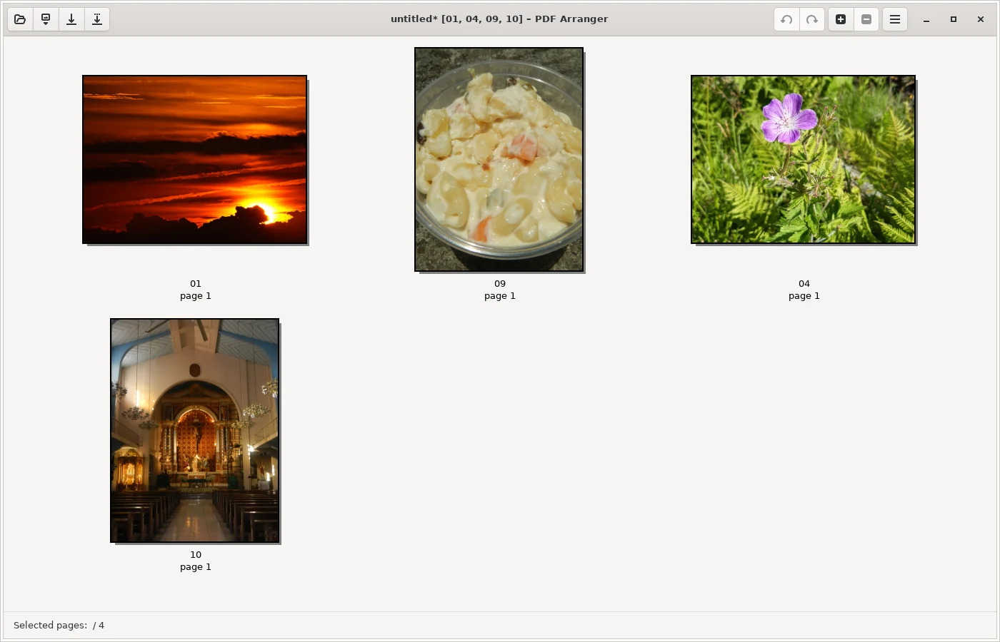
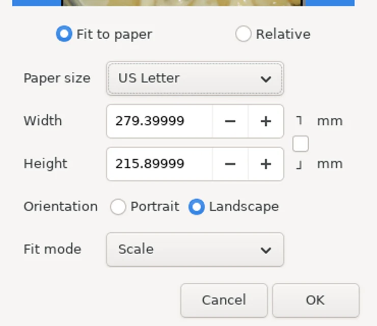
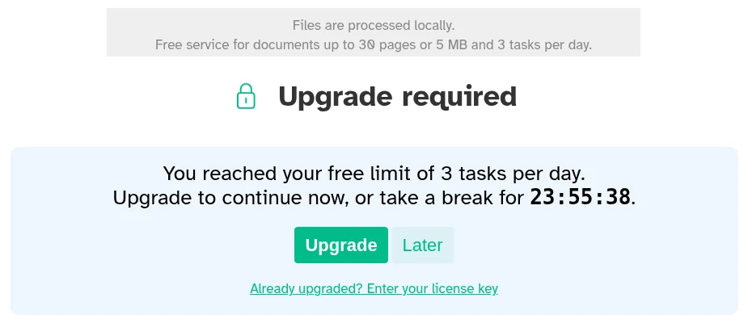
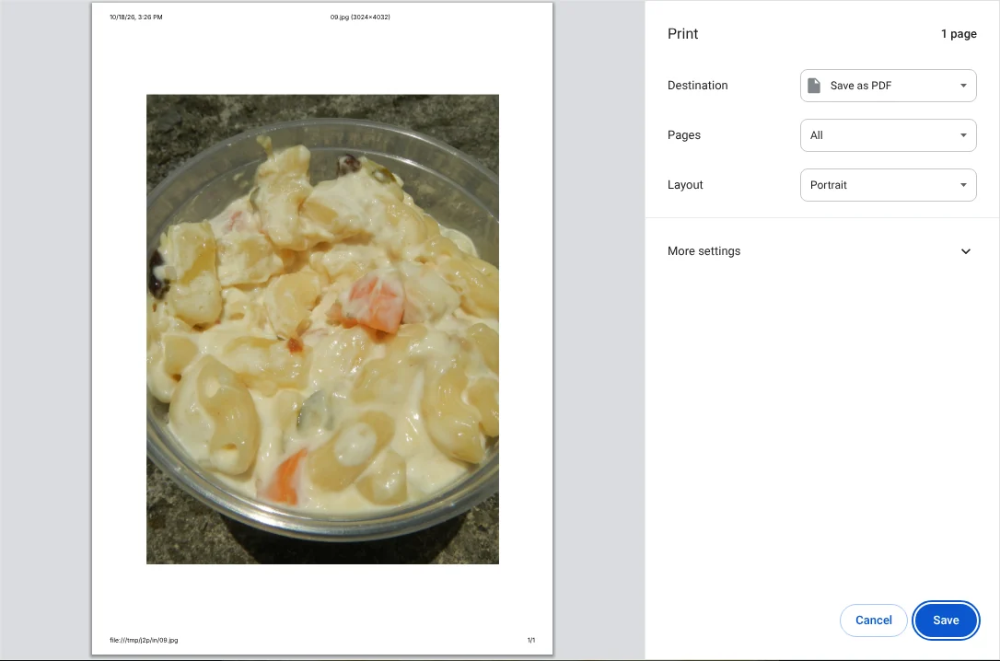
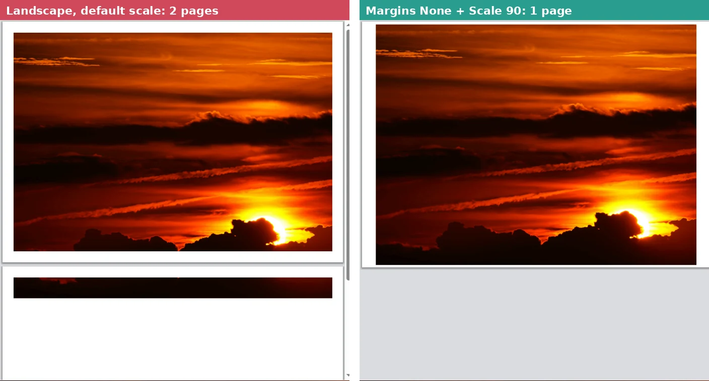

To convert JPG photos to one PDF for free, add them to the free PDF Arranger app (Windows) or Sejda PDF Desktop (Windows, Mac), set the page size to US Letter, and save. In our test both put all 10 photos in one PDF and kept every portrait shot upright. PDF Arranger kept every photo exactly as it was with no limits, while Sejda's free version stopped us after 3 conversions a day. For a single photo, Chrome's **Print > Save as PDF** works on any computer, but it can't combine photos, and it turned a 1.85 MB portrait photo into a 21.6 MB PDF.

We tested this on October 18, 2026, with 10 photos the size a phone camera takes (12 megapixels, 22.6 MB in total). Two of them were portrait shots saved the way phones save them: the image is stored sideways with a tag that tells apps to turn it upright, which is the usual reason a photo ends up lying on its side in a PDF. We converted the set in each app, then checked every page of every PDF: which way each photo faced, whether the photo inside was the original image data or a re-saved copy, the page size and the file size. All three ways run on your computer, so your photos are never uploaded.

![Grid comparing three free ways to convert JPG to PDF. PDF Arranger 1.14 puts many photos in one PDF, kept 2 of 2 portrait photos upright and 10 of 10 photos as is, made a 22.6 MB PDF, but its default page is the photo size of 56 by 42 inches, with no limit. Sejda PDF Desktop 7.9.10 free did the same with 8 of 10 photos as is because 2 portraits were re-saved, a 20.7 MB PDF, A4 pages by default with Letter in the menu, and a limit of 3 tasks a day. Chrome 141 Print to Save as PDF makes one PDF per photo, kept portraits upright, kept landscape photos as is but not portrait ones, made a 21.6 MB PDF from one portrait photo, and adds the date and file path by default](./images/jpg-to-pdf-free/jpg-to-pdf-what-each-app-does.webp)

## Free ways to convert JPG to PDF at a glance

| Method | Works on | Many photos in one PDF | Photos kept as is | Free-version limit |
| --- | --- | --- | --- | --- |
| **PDF Arranger** (free app) | Windows, Linux | Yes | Yes, all 10 | None |
| **Sejda PDF Desktop** (free version) | Windows, Mac, Linux | Yes | Landscape yes, portrait re-saved | 3 tasks a day |
| **Chrome** (Print > Save as PDF) | Any computer with Chrome | No, one photo per PDF | Landscape yes, portrait stored uncompressed | None |
| **Finder Create PDF** (built into Mac) | Mac | Yes | Not tested | None |

The first three rows are what we measured. The Mac row comes from Apple's documentation, because we couldn't run macOS in our test setup. Windows also has a built-in "Microsoft Print to PDF" printer, but we couldn't run Windows or find an official Microsoft guide for printing photos with it, so it isn't in our results. The Chrome steps below work the same way on Windows.

## How we tested

We used 10 public-domain photos, cropped to 4032 by 3024 pixels, the size of a typical 12-megapixel phone photo, and saved as standard JPG files of 0.87 to 5.48 MB each (22.6 MB together). Two of the 10 were portrait shots stored sideways with an orientation tag, like photos from a phone held upright.

We converted them with [PDF Arranger](https://github.com/pdfarranger/pdfarranger) 1.14.0, [Sejda PDF Desktop](https://www.sejda.com/desktop) 7.9.10 (free version) and the print preview of Chromium 141, the open-source browser Chrome is built on. We clicked through each app's own screens on a Linux computer and left every setting at its default unless we say otherwise. For each PDF we checked four things that decide whether the result is usable:

- **Which way each photo faces**: we rendered every page and compared it with the upright photo
- **Whether the photo was kept as is**: we compared the image data inside the PDF with the original JPG, byte for byte. A re-saved photo can lose a little detail each time
- **Page size**: the size the PDF will print at, and whether it fits US Letter paper
- **File size**: matters for email attachments and upload forms

## Results: every portrait photo stayed upright

All three ways turned both portrait photos upright and kept all eight landscape photos as the original image data, byte for byte. The differences were in the portrait photos, the page size and the limits.

- **PDF Arranger** kept all 10 photos as is, including the two portraits, which it turns upright by rotating the page instead of changing the photo. Its PDF was 22.6 MB, only about 6 KB more than the 10 photos together.
- **Sejda** kept the eight landscape photos as is but re-saved the two portraits after turning them. Each portrait shrank from about 1.85 MB to 0.91 and 0.95 MB. In a pixel-by-pixel comparison, the re-saved photos differed from the originals by 1.3 out of 255 on average (about 0.5%), a difference we would not expect most people to notice on screen or on paper. The 10-photo PDF was 20.7 MB.
- **Chrome** kept a landscape photo as is (a 0.89 MB PDF from a 0.87 MB photo), but stored the turned portrait photo with no compression at all: the 1.85 MB photo became a 21.6 MB PDF, 11.6 times larger, with no gain in quality. Two such photos already go over the [25 MB attachment limit](https://support.google.com/mail/answer/6584) of a personal Gmail account.

## How to convert JPG to PDF with PDF Arranger (Windows)

PDF Arranger is the best choice when you want every photo kept exactly as it was and no daily limit. It's free and open source, and the Windows version is on its [GitHub releases page](https://github.com/pdfarranger/pdfarranger/releases).

1. Open PDF Arranger, click the **Open** button (the folder icon) and select your JPG files. Its [user manual](https://github.com/pdfarranger/pdfarranger/wiki/User-Manual) lists importing images as a built-in feature: each photo becomes one page.
2. Drag the pages into the order you want. Portrait photos already appear upright.
3. Press **Ctrl+A** to select every page, then right-click a page and choose **Page Size...** (or press **S**).
4. Choose **Fit to paper**, set **Paper size** to **US Letter**, keep **Fit mode** on **Scale**, and click **OK**.
5. Press **Ctrl+Shift+S** (**Save As**), name the file, and save.

Step 4 matters. Without it, PDF Arranger makes each page the size of the photo itself. Its status bar showed our pages as 1422.4 by 1066.8 mm, which is 56 by 42 inches. PDF viewers shrink that to fit the screen, but a print shop or an upload form that checks page size may not. After **Fit to paper** with US Letter, our landscape pages became 11 by 8.25 inches and portrait pages 6.4 by 8.5 inches: the pages fit on Letter paper but keep the photo's shape, so there are no white borders. The photos inside were still the original data, byte for byte.

## How to convert JPG to PDF with Sejda PDF Desktop (Windows and Mac)

Sejda PDF Desktop is the easiest of the three, with page size, orientation and margins on one screen, and it runs on Mac too. The free version is limited to 3 tasks a day.

1. Open Sejda PDF Desktop, click **All Tools**, and choose **JPG to PDF** under **Convert to PDF**.
2. Click **Choose image files** and select your photos. They appear in a grid, portrait photos upright, and you can drag them to reorder or use the rotate buttons on each one.
3. Set **Page size** to **Letter (8.5 x 11)**. The default in our test was A4, which is slightly narrower and taller than Letter. **Fit to image** makes each page the size of the photo instead.
4. Leave **Page orientation** on **Auto** so landscape photos get landscape pages, and pick a **Margin** (**None**, **Small margin 0.5"** or **Large margin 1"**).
5. Keep **Merge into one document** checked and click **Convert to PDF**, then choose where to save.

The tool's start screen says "Files are processed locally" and "Free service for documents up to 30 pages or 5 MB and 3 tasks per day." Sejda's [download page](https://www.sejda.com/desktop) lists "Images up to 5MB" among its free limits, but our 22.6 MB set of 10 photos, including one 5.48 MB photo, converted without a complaint. The task count did: after three conversions, the fourth one showed "You reached your free limit of 3 tasks per day" with a countdown of almost 24 hours. Plan your settings before you convert, because every attempt counts.

## How to convert a JPG to PDF in Chrome

Chrome can turn one photo into a PDF with nothing to install, on Windows or Mac. Each photo becomes its own PDF, so use it for one or two pictures, not a set.

1. Open the JPG in Chrome, for example by dragging the file onto a Chrome window. The photo opens in its own tab.
2. Press **Ctrl+P** (**Command+P** on a Mac), as described in [Google's guide to printing from Chrome](https://support.google.com/chrome/answer/1069693).
3. Set **Destination** to **Save as PDF**.
4. Click **More settings**, check that **Paper size** is **Letter**, and uncheck **Headers and footers**.
5. Click **Save** and choose where to save the file.

Step 4 is easy to miss. With the default settings, Chrome printed the date and time, the file name, the full file path on our computer and a page number on the page, and our test setup chose A4 paper. The file path can include your user name, so turn the headers off before you send the PDF to anyone.

### Don't switch a landscape photo to Landscape layout

Chrome put our landscape photo on a portrait page with blank space above and below. When we changed **Layout** to **Landscape**, the photo no longer fit: Chrome made 2 pages, with a thin strip of the photo on the second one. Setting **Margins** to **None** didn't fix it. Setting **Scale** to **Custom** and **90** together with **Margins** set to **None** put the photo on one landscape page. Chrome also remembered the Landscape layout for our next print, so check it each time.

Keep the 21.6 MB portrait result above in mind: if the PDF is for email or an upload form, use PDF Arranger or Sejda for portrait photos.

## How to convert JPG to PDF on a Mac

A Mac can do it in Finder without any app. According to [Apple's Mac User Guide](https://support.apple.com/guide/mac-help/mchl21ac2368/mac), select the photos in a Finder window, Control-click them, and choose **Quick Actions > Create PDF**. The photos appear in the PDF in the order you selected them, and the PDF gets a name similar to the first file. We couldn't run macOS, so we didn't measure the page size, file size or photo quality of this method.

For a single photo, you can also open it in Preview and use **File > Print**, then **Save as PDF** from the PDF menu, as described in [Apple's guide to saving as PDF](https://support.apple.com/guide/mac-help/save-a-document-as-a-pdf-on-mac-mchlp1531/mac).

## Other tools we looked at

- **Online JPG to PDF converters**: search suggestions for "jpg to pdf" include websites such as iLovePDF, Smallpdf and Adobe's online tool, which work by uploading your photos. We left them out because all three methods above work without uploading anything.
- **PDFsam Basic**: we didn't test it with photos. It did best in our [test of free apps for merging PDFs](/posts/merge-pdf-files-free), so it's a good way to combine the PDFs you make here with other PDF files.

If your photos are in Apple's HEIC format, convert them first with the steps in our [HEIC to JPG test](/posts/convert-heic-to-jpg-free). If the PDF needs to stay under an upload limit, shrink the photos before converting, using our [guide to compressing images to 100 KB](/posts/compress-image-to-100kb). And if you need to pull pages back out of the finished PDF, our [test of free ways to split a PDF](/posts/split-pdf-free) covers that. To turn PDF pages back into JPG images, see our [test of three free PDF to JPG apps](/posts/pdf-to-jpg-free).

## Which one should you use?

- **Several photos into one PDF, kept exactly as they were**: PDF Arranger on Windows. Set the page size to US Letter before saving.
- **A Mac, or the simplest screen**: Sejda PDF Desktop, with Page size set to Letter. Do your conversions in one go, because the free version allows 3 a day.
- **One landscape photo, right now**: Chrome's Save as PDF, with Headers and footers turned off.
- **Portrait photos for email or upload**: avoid Chrome, which made a 1.85 MB photo into a 21.6 MB PDF in our test.

For other PDF jobs, such as splitting, merging or compressing, see our [roundup of the best free PDF tools](/posts/best-free-pdf-tools).
