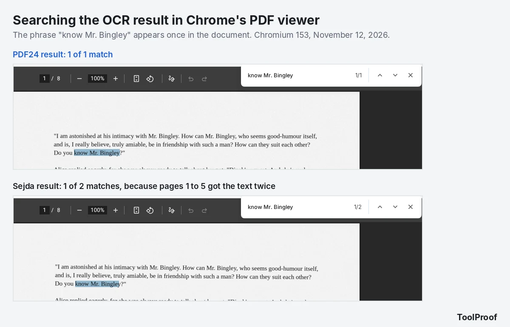
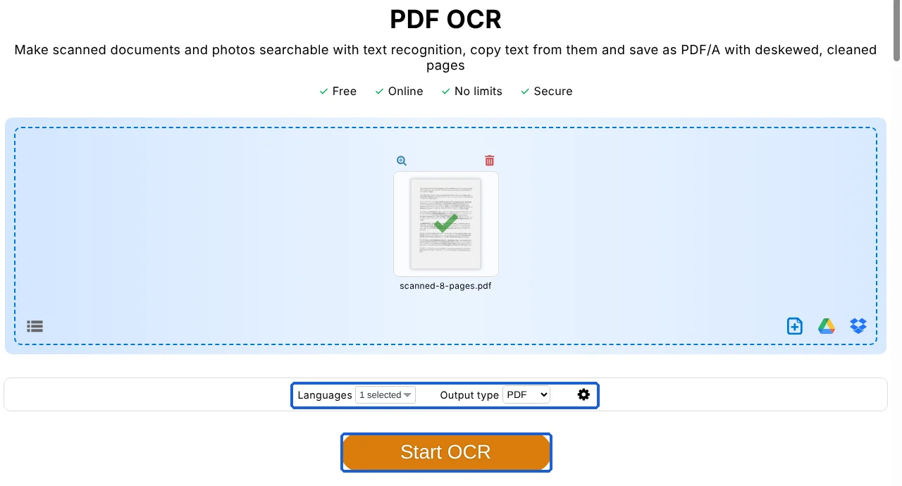
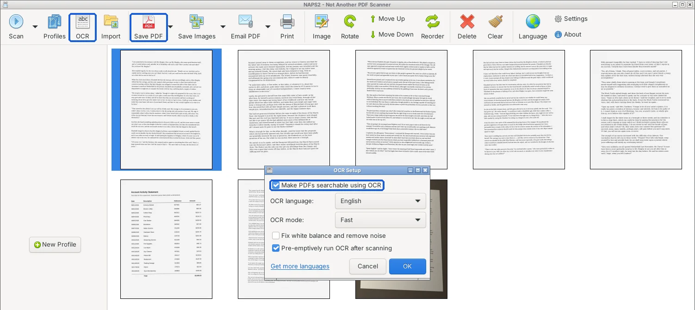
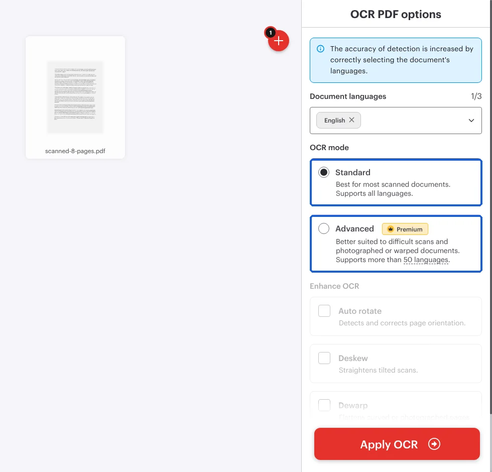

To make a scanned PDF searchable for free, run it through OCR (optical character recognition, software that reads the words in a picture) and save the result as a new PDF. The free PDF24 OCR website is the easiest choice for most people, and the free NAPS2 app does the same job on your own computer without uploading anything. In our November 12, 2026 test, we ran the same 8-page scan through NAPS2 8.6.0, PDF24, iLovePDF and Sejda with their default settings. All four made 99.7% to 100% of the words on ordinary scanned pages searchable in Chrome's PDF viewer and got every number in a statement table right.

The differences showed up elsewhere. Only PDF24 read a phone photo of a page well (99.0% of the words), iLovePDF cut the page images to half their resolution while doubling the file size, and Sejda added the text twice on some pages. We also tried a PDF that already had some real text, and iLovePDF was the only tool that turned those pages into pictures.

| Tool | Best for | Words found on scans / phone photo | What it did to the pages | Free limits |
| --- | --- | --- | --- | --- |
| **PDF24 Tools** (website) | Most people | 99.8% / 99.0% | Kept 300 ppi, straightened tilted pages | None stated, no sign-in |
| **NAPS2** (desktop app) | Private files, no upload | 99.8% / 86.7% | Kept 300 ppi, smaller file | None, runs offline |
| **Sejda** (website) | Keeping scans exactly as they were | 100% / 93.2% | Left the page images untouched | 10 pages or 50 MB, 3 tasks an hour |
| **iLovePDF** (website) | Quick one-off scans | 99.7% / 87.1% | Cut images to 150 ppi, file grew 2x | "Limited," no numbers given |

![Results table for four free tools on the same 8-page scan. NAPS2 8.6.0: 99.8% of words on scanned pages, 99.6% on 8-point print, 100% of table numbers, 86.7% on a phone photo, kept 300 ppi, left real-text pages alone, 5.9 MB. PDF24 Tools: 99.8%, 99.3%, 100%, 99.0%, kept 300 ppi and straightened pages, left real-text pages alone, 7.3 MB. iLovePDF: 99.7%, 97.8%, 100%, 87.1%, cut to 150 ppi, turned real-text pages into images and removed a link, 14.8 MB. Sejda: 100%, 99.6%, 100%, 93.2%, untouched, left real-text pages alone, 7.4 MB](./images/make-pdf-searchable-free/make-pdf-searchable-results.webp)

## Is your PDF already searchable?

Your PDF is already searchable if you can press Ctrl+F (Command+F on a Mac), type a word you can see on the page and have the viewer jump to it. If the search finds nothing, or dragging across the page selects the whole page as one picture instead of single words, the PDF is a scan and needs OCR.

PDFs made from a scanner, a copier's "scan to email" button or a phone camera app are usually pictures of pages. PDFs saved from Word, a web browser or a bank's website usually have real text already, and running OCR on them can only make them worse.

## How we tested

We built two test PDFs so we knew every word on every page:

- **An 8-page scan**, saved the way an office scanner does it: US Letter pages as 300 ppi (pixels per inch) grayscale pictures, 7.3 MB in total. Pages 1 to 5 are book text in 11-point type, tilted up to 1.2 degrees with a little blur and grain. Page 6 is an account statement table with dates, reference numbers and dollar amounts (made-up test data). Page 7 is 8-point fine print, and page 8 imitates a phone photo of a page, taken at an angle with uneven light.
- **A 3-page mixed PDF**: pages 1 and 3 have real text (one of them has a clickable link), and page 2 is a scan. This is what you get when someone adds a scanned signature page to a typed document.

We ran both files through each tool with its default settings and no account: NAPS2 8.6.0 (the Linux version of the same free app that runs on Windows and Mac), and the PDF24 Tools, iLovePDF and Sejda websites in Chromium 153. Then we read the text layer each tool added with PDFium, the PDF engine inside Chrome and Edge, and checked:

- **Words found**: the share of the real words on each page that are in the new text layer, so a search would find them
- **Phrase search**: 20 four-word phrases per page, searched the way Chrome's PDF viewer searches
- **Page quality**: whether the page pictures kept their resolution and how close they stayed to the original
- **File size**, and whether pages that already had real text came through unchanged

Limits of this test: the scans are generated, not from a real scanner, every tool got one run, and all text is English. We did not compare speed, because the computer was busy with other work during the NAPS2 run.

## Results: every tool read the scans, but not the phone photo

On the five ordinary scanned pages, the four tools found between 99.7% and 100% of the words, and Chrome's search found 98 to 100 of our 100 test phrases. All four got all 57 dates, reference numbers and dollar amounts in the statement table right, so searching a scanned bank statement for an amount works with any of them.

The fine print and the phone photo split them apart:

- **8-point fine print**: NAPS2 and Sejda found 99.6% of the words, PDF24 99.3% and iLovePDF 97.8%.
- **Phone photo of a page**: PDF24 found 99.0% of the words and 18 of 20 test phrases. Sejda found 93.2%, iLovePDF 87.1% and NAPS2 86.7%, each with 14 of 20 phrases. NAPS2's slower **Best** mode did not help on our photo (85.2%).

If most of your pages are phone photos, start with PDF24. For flatbed scans, any of the four made the file searchable.

Sejda had one quirk. On pages 1 to 5 of our result, Sejda had placed its invisible text layer twice, so Chrome counted every match on those pages twice: a phrase that appears once showed as "1/2." Search still works, but if you select and copy text from those pages, expect the words to come out twice. Pages 6 to 8 had a single layer.

### What happened to the pages

The tools also changed the page pictures in different ways, which matters if you print the PDF or zoom in:

- **Sejda** left every page picture exactly as it was, down to the pixel, and added only the text. The file grew from 7.33 MB to 7.39 MB.
- **PDF24** kept the 300 ppi grayscale pages but straightened the tilted ones, because its **Deskew pages** setting is on by default. The file stayed at 7.34 MB.
- **NAPS2** saved the pages again as 300 ppi color JPEGs. We could not see a difference (a pixel comparison scored 43.6 dB, where 40 dB and up is hard to tell apart), and the file shrank to 5.90 MB.
- **iLovePDF** replaced each page with a 150 ppi picture, half the original resolution, stored with weaker compression, so the file grew to 14.81 MB, twice the original. The pages also came back about 1.3% smaller than US Letter.

## How to make a PDF searchable with PDF24

PDF24's free OCR website works in any browser with no sign-up, and its page lists the tool as free with no limits. Your file is uploaded to PDF24's servers, which recognize the text and delete files "after a short period," according to the tool page.

1. Go to [PDF24 Tools OCR PDF](https://tools.pdf24.org/en/ocr-pdf) and click **Choose files**, or drag your PDF onto the page.
2. Check **Languages**. The English page starts with English selected. If the document is in another language, add it here.
3. Leave **Output type** on **PDF**. Choose **PDF/A** only if you need an archive format.
4. Click **Start OCR**.
5. When the page says "PDF24 has recognized the text in your file," click **Download**.

The gear icon next to **Output type** has more settings. **Deskew pages** is on by default, while **Rotate pages**, **Remove background**, **Clean pages**, **Force OCR** and **Combine files** are off. Turn off **Deskew pages** if your pages must stay exactly as scanned, for example a signed form.

Our 8-page file took 48 seconds in our last run, and longer on an earlier try, so give it a few minutes for bigger files. On Windows, PDF24 also offers a desktop program, PDF24 Creator, which its OCR page recommends as an alternative.

## How to make a PDF searchable offline with NAPS2

[NAPS2](https://www.naps2.com/download) is a free, open-source scanning app for Windows, Mac and Linux that adds OCR to PDFs you import, with no ads or limits and no upload. It is the best fit for tax records, medical papers or anything you would rather not send to a website.

1. Install NAPS2 and open it.
2. Click **Import** and choose your scanned PDF. The pages appear as thumbnails.
3. Click **OCR**. The first time, NAPS2 asks you to pick a language to download (English was 12.3 MB). Select it and click **Download**.
4. In **OCR Setup**, check **Make PDFs searchable using OCR**, make sure the right **OCR language** is selected and leave **OCR mode** on **Fast**. Click **OK**.
5. Click **Save PDF**. NAPS2 suggests the original file name in the original folder, so type a new name to keep your original, then click **Save**.

NAPS2 keeps that setting, so every PDF you save afterward gets OCR too. Our [test of free offline image-to-text tools](/posts/image-to-text-offline-free) covers NAPS2's other OCR options and how it handles screenshots and receipts.

## How to make a PDF searchable with Sejda

Sejda's free OCR website keeps your scanned pages exactly as they are, but the free version only takes documents up to 10 pages or 50 MB, and 3 tasks per hour. Sejda says files are deleted after 2 hours.

1. Go to [Sejda OCR](https://www.sejda.com/ocr-pdf) and click **Upload PDF file**.
2. Wait for the pages to load. Each page shows a **Quick single page mode** button, which you can skip.
3. At the bottom, check **Language** and keep **PDF** checked under **Output formats**. Check **Text** too if you also want a plain text file.
4. Click **Recognize text on all pages**.
5. When "Your document is ready" appears, click **Download**.

For longer files, Sejda's Web Week Pass is a one-time $5 charge for 7 days that raises the OCR limit to 100 pages. Sejda Desktop, which also has a free version with page and hourly limits, converts files on your own computer, according to [Sejda's pricing page](https://www.sejda.com/upgrade).

## iLovePDF OCR PDF: fast, but check the pages afterward

iLovePDF returned our 8-page scan in 12 seconds, the fastest of the four, and its text was as searchable as the others on ordinary scans. The trade-off is what it does to the pages: half the resolution, twice the file size, and real text turned into pictures.

1. Go to [iLovePDF OCR PDF](https://www.ilovepdf.com/ocr-pdf) and click **Select PDF file**.
2. In **OCR PDF options**, check **Document languages** and leave **OCR mode** on **Standard**. **Advanced** is marked **Premium**.
3. Click **Apply OCR**, then **Download PDF**.

With **Standard** selected, the **Enhance OCR** options (**Auto rotate**, **Deskew**, **Dewarp**) were grayed out for us. iLovePDF's [pricing page](https://www.ilovepdf.com/pricing) describes the free plan as "limited document processing" with a limited file size per task, without giving numbers, and its download page said files are deleted after 2 hours. If the 14.8 MB result is too big to email, our [PDF compression test](/posts/compress-pdf-free) shows how to shrink a scan without losing readable text.

## What if your PDF already has some real text?

NAPS2, PDF24 and Sejda left the pages that already had real text alone and added OCR only to the scanned page. NAPS2's [OCR help page](https://www.naps2.com/doc/ocr) states the rule: if a page already has text, it leaves it alone, and if it doesn't, OCR is used. In all three results, the typed pages stayed sharp at any zoom and the link still worked.

iLovePDF turned all three pages into 150 ppi pictures and laid its own OCR text on top. The text stayed searchable (100% of the words on page 1), but the typed pages became slightly blurry when zoomed and the clickable link was gone. If your PDF mixes typed pages and scans, such as a contract with a scanned signature page, use one of the other three.

## Other ways we looked at

- **Google Drive** can read the text in a PDF if you right-click it and choose **Open with > Google Docs**. You get an editable Google Doc, not a searchable PDF, and [Google's help page](https://support.google.com/drive/answer/176692?hl=en) says the file should be 2 MB or smaller and that tables and columns are not likely to come through.
- **Microsoft Word** and other PDF to Word converters are the right tool when you want to edit the text rather than search it. Our [PDF to Word test](/posts/pdf-to-word-free) includes how a scanned page came out.
- **Smallpdf** and **Adobe Acrobat** also offer OCR. We did not test them for this article.

For other PDF jobs, our [roundup of the best free PDF tools](/posts/best-free-pdf-tools) has a tested pick for splitting, merging, converting and compressing. If you are starting from phone photos rather than a PDF, our guide to [combining photos into one PDF](/posts/jpg-to-pdf-free) comes first.

## Which one should you use?

- **Most scanned PDFs, especially phone photos**: PDF24. It read our phone photo best (99.0% of the words), kept the original resolution and left typed pages alone. Turn off **Deskew pages** if you need pages exactly as scanned.
- **Private documents, or many files**: NAPS2. Nothing leaves your computer, there are no limits, and the file came out smaller. It matched the others on clean scans but found only 86.7% of the words on the phone photo.
- **Scans you must keep untouched, 10 pages or fewer**: Sejda. It was the only tool that changed no pixels, but in our test it added the text twice on pages 1 to 5.
- **A quick one-off scan where size and sharpness don't matter**: iLovePDF. Avoid it for PDFs that already have typed pages or links.

## FAQ

### How do I make a large PDF searchable for free?

Use NAPS2 or PDF24 for large PDFs. NAPS2 runs on your computer with no page limit, and PDF24's OCR page lists no limits. Sejda's free version stops at 10 pages or 50 MB, and iLovePDF's free plan is limited without published numbers.

### Is it safe to upload a PDF to an OCR website?

Each website says it deletes uploads: Sejda after 2 hours, iLovePDF after 2 hours according to its download page, and PDF24 after "a short period." If the document holds account numbers, medical details or your Social Security number, NAPS2 avoids the upload entirely.

### Why can't search find a word I can see in the scan?

OCR misread it, which happens most with photos, tiny print and blurry scans. Sejda's guide advises scanning at a higher resolution and not compressing the scan before OCR. For phone photos, PDF24 found the most words in our test.
