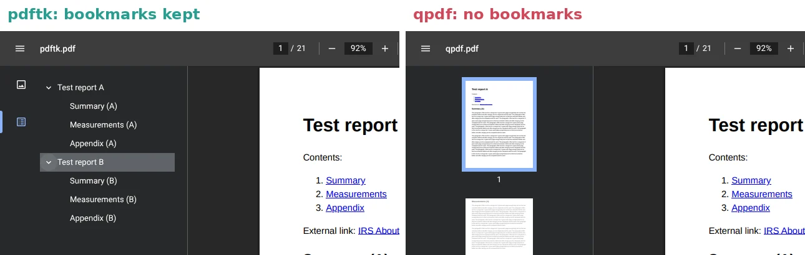
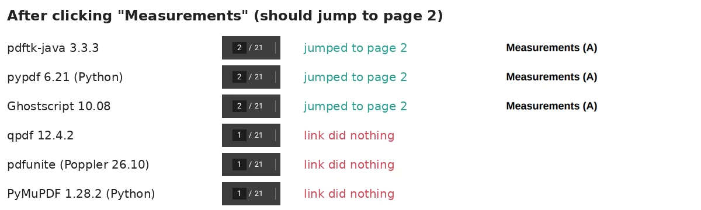
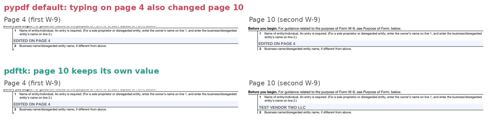
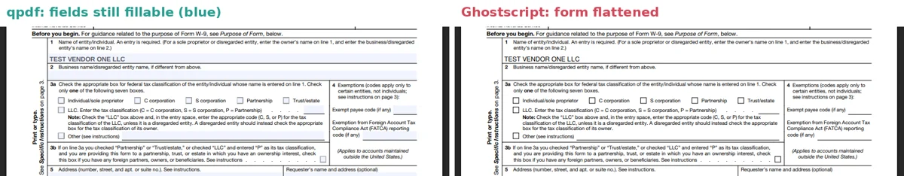

To merge PDF files for free without uploading them, use pdftk: `pdftk first.pdf second.pdf cat output merged.pdf`. In our test of six free offline tools, it was the only one whose default command kept every bookmark, every table-of-contents link and every form field working. On a Mac you can also combine PDFs in Preview, and on Windows the free PDF24 Creator app has a merge tool that works offline; we didn't test those two. Merging sounds like it can't go wrong, but it can: three of the six tools dropped bookmarks or broke links, and two of them tied two copies of the same form together, so typing a name into one changed the other.

We ran the test on October 16, 2026, with qpdf 12.4.2, pdfunite from Poppler 26.10.0, Ghostscript 10.08.0, pdftk-java 3.3.3, and the Python libraries pypdf 6.21.0 and PyMuPDF 1.28.2. Each tool merged the same five PDFs into one 21-page file: two short reports with bookmarks and clickable contents, two copies of the IRS Form W-9 filled in with different names, and three pages of photos. We checked the merged file's structure, then opened it in Chrome 141's built-in PDF viewer and clicked the links, opened the bookmarks panel and typed into the form.


## PDF merge tools compared

| Tool | Bookmarks and contents links | Fillable forms | Speed (21 pages) | Best for |
| --- | --- | --- | --- | --- |
| **pdftk-java 3.3.3** | All kept | Kept; second copy renamed so both stay separate | 0.61 s | Most people, any PDF |
| **pypdf 6.21** (Python) | All kept | Two copies of a form get linked, unless you add one line of code | 0.24 s | Python scripts |
| **Ghostscript 10.08** | All kept | Flattened: values stay visible, but the form can't be filled anymore | 0.50 s | PDFs without forms, when you also want to rewrite the file |
| **qpdf 12.4.2** | Lost (links stay but do nothing) | Kept and separate | 0.06 s | Scans and other PDFs without bookmarks |
| **pdfunite** (Poppler 26.10) | Lost (links do nothing) | Linked, and the form dictionary is dropped | 0.16 s | Plain PDFs without forms or bookmarks |
| **PyMuPDF 1.28.2** (Python) | Lost (internal links removed) | Kept and separate | 0.16 s | Python scripts that rebuild bookmarks themselves |

All six are free, open-source and run offline on Windows, Mac and Linux. None of them changed the photos: every image came out pixel for pixel the same as the original, and every tool kept the two web links. Times are the median of three runs on a 4-core cloud server.

## How we tested

We built a set of five PDFs that each test one thing merging can break:

- **Two three-page reports we made** with Chromium's print-to-PDF. Each has four bookmarks (one for the title and one for each section), a contents list with three links that jump to the sections, and one web link.
- **Two copies of IRS Form W-9** (Rev. March 2024), downloaded from [irs.gov](https://www.irs.gov/pub/irs-pdf/fw9.pdf). It's a six-page fillable form, and US government forms are in the public domain. We typed "TEST VENDOR ONE LLC" into line 1 of the first copy and "TEST VENDOR TWO LLC" into the second, the way you might collect W-9s from two contractors and combine them into one file.
- **Three photo pages**: public-domain (CC0) photos from the [PD12M dataset](https://huggingface.co/datasets/Spawning/PD12M), 3000 pixels wide, placed one per page with img2pdf, the tool that won our [JPG to PDF test](/posts/jpg-to-pdf-free-offline).

Each tool merged them in the same order: report A, W-9 A, W-9 B, photos, report B. That's 21 pages and 5.6 MB of input. We used each tool's basic merge command with no extra options, because that's what most guides tell you to type.

Then we checked four things in each merged file:

1. **Bookmarks:** are all eight still there, and do they point to the right pages?
2. **Contents links:** do the six links inside the reports still jump to the right page? We clicked them in Chrome.
3. **Forms:** are the W-9 fields still fillable, and do the two copies stay separate? We typed into line 1 of the first W-9 in Chrome and then looked at the second one.
4. **Content:** are the photos and the text of every page exactly the same as before?

## What can go wrong when you merge PDFs

The pages themselves came through fine with every tool. What breaks is the extra structure around them: the bookmarks panel, links that jump inside the document, and form fields.

### Bookmarks disappear with qpdf, pdfunite and PyMuPDF

pdftk, pypdf and Ghostscript kept all eight bookmarks pointing at the right pages. qpdf, pdfunite and PyMuPDF kept none, so Chrome didn't even show its bookmarks button for those files.



That's documented behavior, not a bug. The [qpdf manual](https://qpdf.readthedocs.io/en/stable/cli.html) says outlines (bookmarks) and form fields are copied in their entirety from the primary input file only, and the usual merge command starts from an empty file (`--empty`), so there are none to copy. [PyMuPDF's documentation](https://pymupdf.readthedocs.io/en/latest/document.html#Document.insert_pdf) says its insert function doesn't copy the source's table of contents.

### Contents links do nothing after qpdf, pdfunite and PyMuPDF

The contents list at the top of each report links to its sections. In Chrome, clicking **Measurements** in the merged file from pdftk, pypdf or Ghostscript jumped to page 2. In the qpdf and pdfunite files, the link was still underlined and clickable, but nothing happened. PyMuPDF had removed the internal links altogether.



The reason is the same as with bookmarks. Chromium's print-to-PDF makes these links point to named spots in the document, and the list of names is stored once for the whole file rather than on each page. qpdf and pdfunite copied the links but not the list. PyMuPDF's documentation says named links are "always excluded."

The two web links (to irs.gov) worked in every merged file.

### Two copies of the same form can get linked together

This was the problem we didn't expect to find. Every field in a PDF form has a name, and the two W-9 copies use exactly the same names. Chrome's viewer treats fields with the same name as one field shown in two places, which is how a form can repeat your name on every page.

qpdf, pdftk and PyMuPDF rename the fields in the second copy while merging, so both W-9s stay separate. pypdf and pdfunite keep the names as they are. In Chrome, we typed "EDITED ON PAGE 4" into line 1 of the first W-9 in each merged file, then scrolled to the second W-9 on page 10.



In the pypdf and pdfunite files, the second W-9 now said "EDITED ON PAGE 4" too. Both copies had looked correct when we opened them, so you'd only notice after someone edits one. If you combine several filled copies of the same form, such as W-9s, timesheets or permission slips, use pdftk or qpdf.

pdfunite also left out the file's form dictionary, the part that tells a viewer the file has a form, and the `pdfinfo` tool from the same Poppler package reported an internal error when it read the merged file. Chrome still let us type into the fields.

### Ghostscript flattens forms

Ghostscript kept bookmarks and links, but it turned the W-9 fields into ordinary page content. The names we had typed are still visible and printable, but the light blue fillable boxes are gone and you can't type in them. Its [documentation](https://ghostscript.readthedocs.io/en/latest/VectorDevices.html) notes that Widget annotations, the boxes that make up form fields, aren't preserved as annotations.



Ghostscript also rewrites every page instead of copying it, and it took its document title from the last file ("Test report B"). The text and photos came through unchanged in our test, but use it for merging only if you don't need the forms to stay fillable.

## How to merge PDFs with pdftk

pdftk is a command-line tool. You type one line to merge, and it works the same on every system.

1. **Install it:**
   - **Mac:** install [Homebrew](https://brew.sh/), then run `brew install pdftk-java`.
   - **Ubuntu or Debian:** `sudo apt install pdftk-java`.
   - **Windows:** [PDF Labs](https://www.pdflabs.com/tools/pdftk-server/) offers a free installer for PDFtk Server 2.02, the original version that pdftk-java was ported from. We tested pdftk-java on Linux, not the Windows installer.
2. **Open a terminal** (Terminal on Mac, Command Prompt or PowerShell on Windows) in the folder with your PDFs.
3. **Run:**

```bash
pdftk first.pdf second.pdf third.pdf cat output merged.pdf
```

The files are merged in the order you list them. To merge every PDF in the folder in alphabetical order, use `pdftk *.pdf cat output merged.pdf`. If you run it a second time, `merged.pdf` is now one of the inputs, and pdftk stops with "The given output filename: merged.pdf matches an input filename" instead of overwriting it, so delete or move the old file first. To take only some pages, add a range after a letter you assign to each file: `pdftk A=report.pdf B=form.pdf cat A1-3 B1 output merged.pdf` takes pages 1 to 3 of the report and page 1 of the form.

When pdftk merged our two W-9s, it put `1.` in front of the field names in the second copy. That's what keeps them separate, and nothing changes on the page.

## How to combine PDFs on a Mac with Preview

According to [Apple's Preview guide](https://support.apple.com/guide/preview/combine-pdfs-prvw43696/mac), you combine PDFs by dragging pages between documents:

1. Open the PDFs in **Preview**.
2. In each one, choose **View > Thumbnails**.
3. Drag thumbnails from one PDF's sidebar into the other's. To add a whole PDF, drag its icon from Finder into the sidebar of the open document.

Apple warns that Preview saves changes automatically, so choose **File > Duplicate** first if you want to keep the original files. We couldn't run Preview in our Linux test environment, so we don't know how it handles bookmarks, links or forms. Check those in the merged file before you send it.

## How to merge PDFs on Windows without uploading them

Besides pdftk, there are two free options that keep your files on your computer:

- **PDF24 Creator**: a free desktop app for Windows 10 and 11. [PDF24](https://tools.pdf24.org/en/creator) says it works offline, doesn't upload your files, and can merge and split PDFs. We didn't test it.
- **qpdf**: very fast and keeps forms separate, but loses bookmarks and contents links (see the next section). Fine for scans and PDFs without them.

## Fixes for the other tools

If you already use one of the other tools, here is what helps:

- **qpdf:** start from your first file instead of an empty one: `qpdf first.pdf --pages . second.pdf third.pdf -- merged.pdf`. The `.` means "the first file." This keeps the first file's bookmarks and links, but only those: in our test, 4 of 8 bookmarks and 3 of 6 links survived. There's no option to keep them from every file.
- **pypdf:** the [pypdf documentation](https://pypdf.readthedocs.io/en/stable/user/merging-pdfs.html) warns that merged forms can end up with fields of the same name, and suggests adding a group name to each form first. This version passed all four of our checks:

```python
from pypdf import PdfReader, PdfWriter

writer = PdfWriter()
for i, path in enumerate(["report-a.pdf", "w9-a.pdf", "w9-b.pdf"]):
    reader = PdfReader(path)
    if reader.get_fields():
        reader.add_form_topname(f"file{i + 1}")
    writer.append(reader)
writer.write("merged.pdf")
```

- **PyMuPDF:** it keeps forms separate on its own, but you have to rebuild the bookmarks yourself with `get_toc()` and `set_toc()`; its documentation points to an example script that does this. It can't keep the named links from files like our reports.
- **pdfunite:** there are no options for bookmarks or forms. Use it only for plain PDFs.

## Speed and memory

All six merged our 21 pages in well under a second, so speed won't decide this for most people. qpdf was the fastest at 0.06 seconds. pdftk was the slowest at 0.61 seconds and used the most memory, mostly because it has to start Java first.


Timing includes starting the program, and for pypdf and PyMuPDF it includes starting Python.

## Other tools we looked at

- **iLovePDF, Smallpdf, Adobe's online merge and other websites:** they work in a browser but upload your files to their servers. We didn't test them, because this test is about tools that keep your files on your computer. Don't upload tax forms or other documents with personal information unless you're comfortable with the site's privacy terms.
- **Adobe Acrobat:** we only tested free, open-source tools, so we left it out.
- **Word and LibreOffice:** they can open a PDF as an editable document, which is a conversion rather than a merge and can change the layout. If that's what you need, see our [PDF to Word test](/posts/convert-pdf-to-word-offline-free).

## FAQ

### Does merging PDFs lower the quality?

Not with these tools. All six kept our photos pixel for pixel identical, and five of them kept the text of every page exactly the same. Ghostscript changed only the form pages, because it printed the form values into the page. If the merged file is too big to email, compress it as a separate step; our [PDF compression test](/posts/compress-pdf-offline-free) shows which settings shrink files without visible loss.

### Can I merge scanned PDFs or photos into one PDF?

Yes. Scanned PDFs are just pages of images, and every tool kept our photo pages unchanged, so even qpdf or pdfunite works fine for them. If you're starting from JPG photos rather than PDFs, convert them in one step with img2pdf, which kept photos untouched in our [JPG to PDF test](/posts/jpg-to-pdf-free-offline). To make the text in a scan searchable afterward, run OCR; we compared free offline OCR tools in our [image to text test](/posts/image-to-text-offline-free).

## Which method should you use?

- **Most people, any system:** pdftk. It's the only tool whose basic command kept bookmarks, links and forms in our test.
- **Mac, a few files, no command line:** Preview, then check the bookmarks and any forms in the result.
- **Windows, no command line:** PDF24 Creator (untested by us), or pdftk through the PDF Labs installer.
- **Scans or simple PDFs, lots of files:** qpdf, the fastest.
- **Python scripts:** pypdf with `add_form_topname` for files with forms.
- **Avoid for forms:** Ghostscript (flattens them) and pdfunite (links copies together).

If you need the pages as images instead of one PDF, our [PDF to JPG test](/posts/pdf-to-jpg-high-quality) shows which settings keep small print readable.
