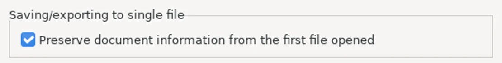
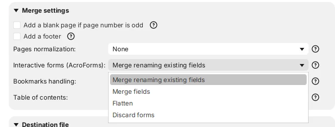
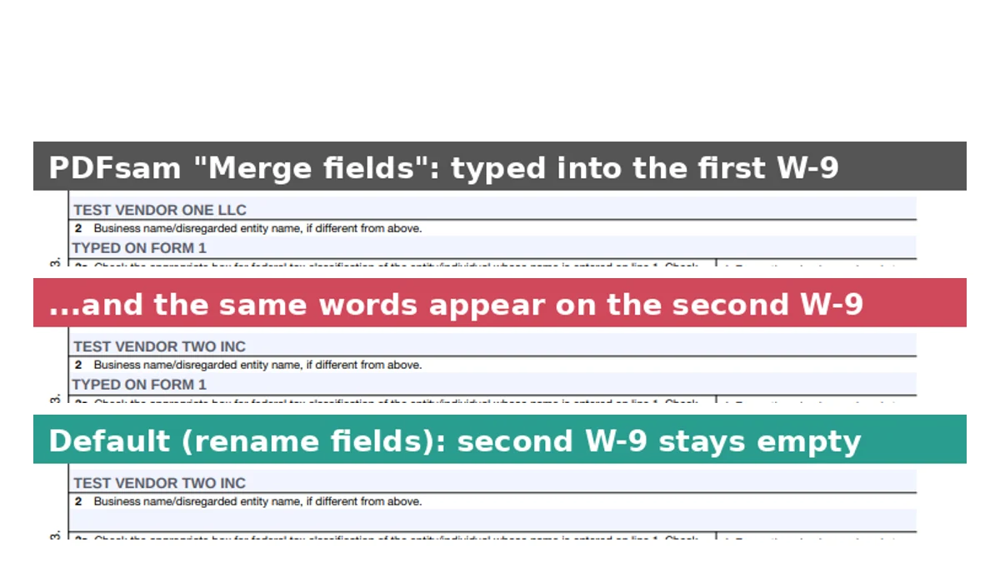
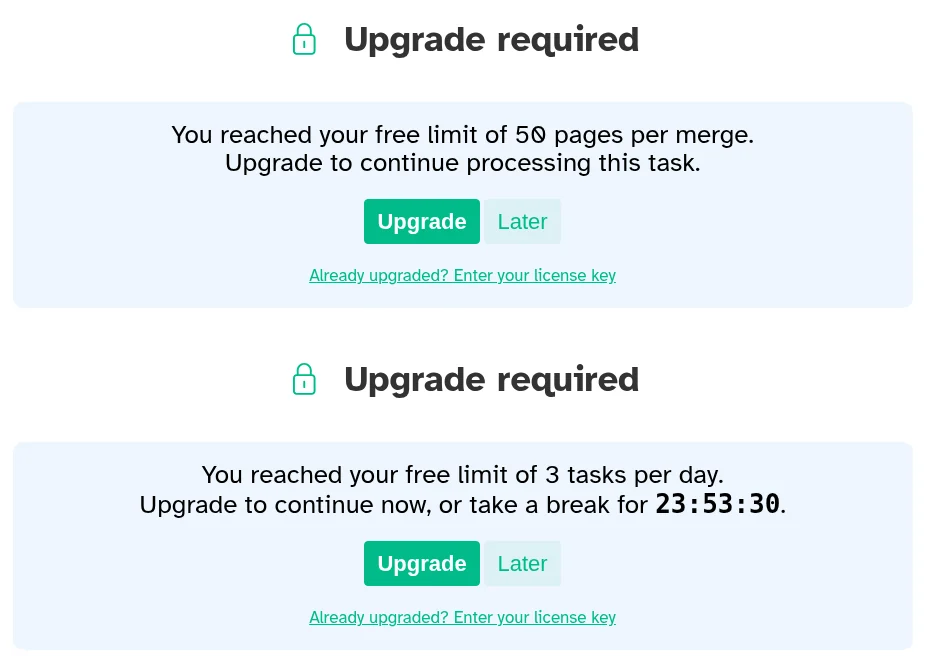
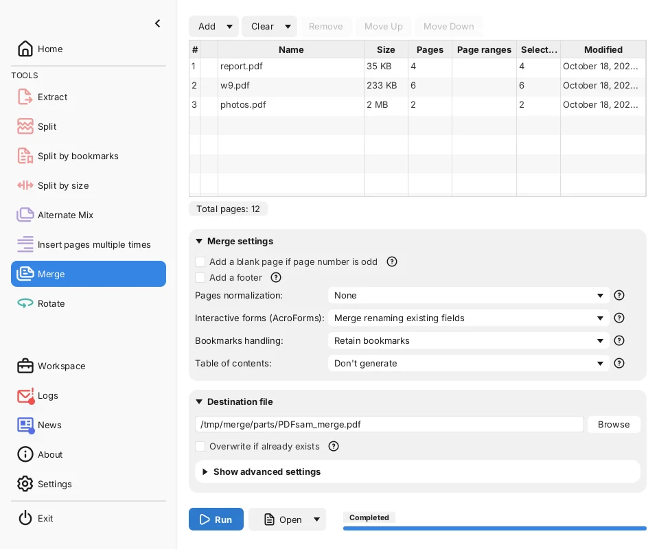
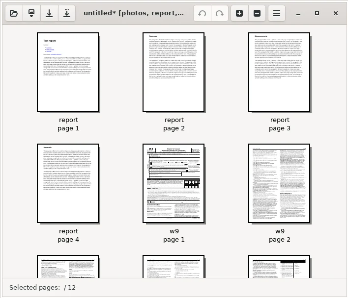
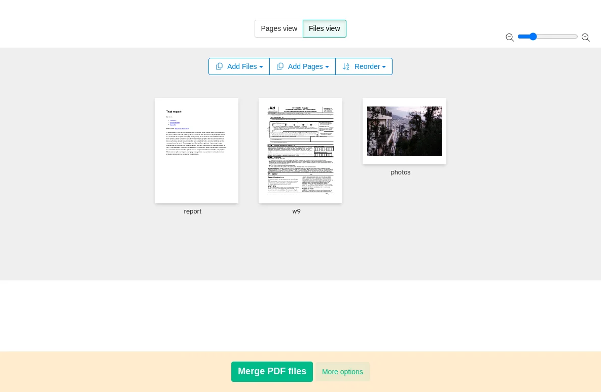

To merge PDF files for free, install PDFsam Basic, add your files in order, and click **Run** in its **Merge** tool. It has no page or daily limits, works offline on Windows, Mac and Linux, and in our test it kept every bookmark, link and fillable form field no matter which file came first. PDF Arranger, another free app, did just as well when the file with bookmarks was first, but dropped all of them when it wasn't. Sejda PDF Desktop also merged cleanly, but its free version stopped us at 50 pages per merge and 3 tasks a day.

We tested this on October 18, 2026, by merging the same three files in each app: a 4-page report with bookmarks and a clickable table of contents, the 6-page IRS Form W-9 with the name line filled in, and two pages of photos. We also merged two filled-in copies of the W-9, which is where a wrong setting can quietly link the two forms together. Then we checked every result page by page and typed into the forms in Chrome's PDF viewer. All three apps run on your computer, so your files are never uploaded.

![Grid comparing three free apps for merging PDFs. PDFsam Basic 6.0.6 kept 12 of 12 pages of text, the photos as the same files, 4 of 4 bookmarks and 3 of 3 links whether the report came first or second, kept two W-9s separate and has no limit. PDF Arranger 1.14 kept the same when the report was first, but 0 of 4 bookmarks and 0 of 3 links when it was second. Sejda PDF Desktop 7.9.10 free kept everything we tested, with the second-position test not run, and limits merges to 50 pages and 3 tasks a day](./images/merge-pdf-files-free/merge-pdf-what-each-app-keeps.webp)

## Free ways to merge PDFs at a glance

| Method | Works on | Limits on the free version | Keeps bookmarks and links | Keeps two copies of a form separate |
| --- | --- | --- | --- | --- |
| **PDFsam Basic** (free app) | Windows, Mac, Linux | None | Yes, in any order | Yes (default setting) |
| **PDF Arranger** (free app) | Windows, Linux | None | Only from the first file | Yes |
| **Sejda PDF Desktop** (free version) | Windows, Mac, Linux | 50 pages per merge, 3 tasks a day | Yes, with the bookmarked file first | Yes (default setting) |
| **Preview** (built into Mac) | Mac | None | Not tested | Not tested |

The first three rows are what we measured. The Preview row comes from Apple's documentation, because we couldn't run macOS in our test setup.

## How we tested

We used three input files, each checking something different:

- **report.pdf (4 pages)**: a report we made, with 4 bookmarks (the clickable outline in a PDF viewer's sidebar), a table of contents with 3 links that jump to later pages, and 1 link to a website
- **w9.pdf (6 pages)**: the IRS [Form W-9](https://www.irs.gov/pub/irs-pdf/fw9.pdf) (Rev. March 2024), a public fillable form with 23 fields, with "TEST VENDOR ONE LLC" typed on line 1. A second copy says "TEST VENDOR TWO INC"
- **photos.pdf (2 pages)**: two public-domain photos, one per page, about 1.2 MB each

We merged them with [PDFsam Basic](https://pdfsam.org/download-pdfsam-basic/) 6.0.6, [PDF Arranger](https://github.com/pdfarranger/pdfarranger) 1.14.0 and [Sejda PDF Desktop](https://www.sejda.com/desktop) 7.9.10 (free version), clicking through each app's own screens on a Linux computer and leaving every setting at its default unless we say otherwise. For each result we compared the text on every page with the originals, checked that the photos were the identical image files and not re-compressed, counted the bookmarks and links and where they lead, and typed into the W-9s in the PDF viewer of Chromium 141, the open-source browser Chrome is built on.

## Results: what each app keeps

All three apps kept the text of all 12 pages word for word, kept both photos as the original image data byte for byte, and kept the W-9 fillable. With the report first, all three also kept 4 of 4 bookmarks and 3 of 3 working contents links. The merged files were close in size: 2.55 MB from PDFsam Basic and Sejda, 2.58 MB from PDF Arranger, against 2.74 MB for the three inputs added together.

The differences showed up in two less obvious cases.

### PDF Arranger keeps bookmarks only from the first file

When we put the W-9 first and the report second, PDF Arranger's merged file had 0 bookmarks, and the 3 contents links in the report no longer went anywhere. PDFsam Basic, merging in the same order, kept all 4 bookmarks, now pointing to pages 7 to 10, and all 3 links still jumped to the right pages.

The cause is a PDF Arranger preference that is on by default, **Preserve document information from the first file opened**. Its [user manual](https://github.com/pdfarranger/pdfarranger/wiki/User-Manual) says that when it's checked, the app uses the outline (bookmarks) and links from the first file only. When we unchecked it and saved again, all 4 bookmarks came back, but the 3 contents links still led nowhere.

If you merge with PDF Arranger, open the file whose bookmarks and links matter most first.

### Two copies of the same form can end up linked

Two copies of one form, such as two W-9s from different vendors, use the same field names. When they're merged into one file, an app has to decide what to do with the duplicate names. PDFsam Basic and Sejda both show this choice, with **Merge renaming existing fields** as the default. PDFsam Basic also offers **Merge fields**, **Flatten** and **Discard forms**.

With the default, all three apps kept two independent forms: 46 fields in total, and each W-9 kept its own name. With PDFsam's **Merge fields**, 22 of the 23 fields became shared between the two copies. When we typed on line 2 of the first W-9 in Chrome, the same words appeared on line 2 of the second one. Only line 1, where the two copies had different names, stayed separate. **Flatten** turned both forms into plain printed text: the names stayed visible, but nothing could be typed anymore.

Leave the form setting on its default unless you want a blank form to fill once for every copy.

### Sejda's free version stops at 50 pages and 3 tasks a day

Sejda PDF Desktop's merge screen says the free service covers "documents up to 50 pages or 50 MB and 3 tasks per day." When we tried to merge a 64-page set, it showed **You reached your free limit of 50 pages per merge** and saved nothing. That blocked attempt didn't count as a task: our three successful merges did, and the fourth was refused with a countdown of about 24 hours. Sejda's [desktop page](https://www.sejda.com/desktop) lists the paid plans, a week pass or a yearly plan, that remove these limits.

PDFsam Basic merged the same 64 pages without any prompt.

## How to merge PDFs with PDFsam Basic (Windows, Mac and Linux)

PDFsam Basic is free and open source. According to its [download page](https://pdfsam.org/download-pdfsam-basic/), it runs on Windows 10 or later (64-bit), macOS 11 Big Sur or later and Linux. The Windows downloader also offers to try PDFsam Enhanced, a separate product you don't need for merging.

1. Open PDFsam Basic and click **Merge** in the left menu.
2. Drag your PDFs into the box, or click **Add** and choose them. They're merged from top to bottom.
3. To change the order, select a file and click **Move Up** or **Move Down**. To use only some pages of a file, type them in its **Page ranges** cell, such as **1-3,5**.
4. Leave **Interactive forms (AcroForms)** on **Merge renaming existing fields** and **Bookmarks handling** on **Retain bookmarks**.
5. Under **Destination file**, click **Browse** to choose the name and folder for the merged PDF, then click **Run**.

When it finishes, the progress bar shows **Completed** and an **Open** button appears next to **Run**. PDFsam's [feature page](https://pdfsam.org/pdfsam-basic/) also describes a **Table of contents** option that adds a clickable list of the merged files at the start.

## How to merge PDFs with PDF Arranger (Windows)

PDF Arranger lets you see every page as a thumbnail and drag pages into place, which helps when you want to mix pages from several files. Its [download list](https://github.com/pdfarranger/pdfarranger) includes a Windows installer and Linux versions, but no Mac version.

1. Open PDF Arranger and click the **Open** button (the folder icon). Select the file whose bookmarks you want to keep first, along with the others. You can select several files at once.
2. To add more files to the end, open the menu (three lines) and choose **Import**, or press **Ctrl+I**.
3. Drag page thumbnails to put them in order. The bottom bar shows the total, such as **Selected pages: / 12**.
4. Choose **Save As** from the menu (**Shift+Ctrl+S**), type a name and click **Save**.

When we saved, PDF Arranger showed a **Saving produced some warnings** message about a metadata field it couldn't carry over, adding that the document should have no visible issues. Our checks found the pages unchanged.

## How to merge PDFs with Sejda PDF Desktop (free version)

Sejda PDF Desktop is a PDF editing app for Windows, Mac and Linux, according to its [download page](https://www.sejda.com/desktop). The free version is enough for a few small merges a day, within the limits above.

1. Open Sejda PDF Desktop and click **Merge** at the top.
2. Click **Choose PDF & image files** and select your files.
3. In **Files view**, check the order and drag files into place. In our test, the files didn't appear in the order we clicked them, so we dragged them around.
4. Optionally click **More options** to see the bookmark and **Form Fields** settings. The defaults are **Keep all** and **Merge (Rename existing)**.
5. Click **Merge PDF files**, then choose a name and folder for the result.

## How to merge PDFs on a Mac with Preview

Preview, the PDF viewer built into every Mac, can combine PDFs without any extra app. We couldn't run macOS in our test setup, so these steps come from Apple's guide [Combine PDFs in Preview on Mac](https://support.apple.com/guide/preview/combine-pdfs-prvw43696/mac), and we haven't checked what Preview keeps of forms, bookmarks or links.

1. Choose **File > Duplicate** on each PDF first. Apple warns that Preview saves changes automatically, so this keeps your originals.
2. Open the PDFs you want to combine, and choose **View > Thumbnails** in each one.
3. Drag the thumbnails you want from one PDF's sidebar into the other's. To add a whole PDF, drag its icon from the Finder into the sidebar.
4. Drag thumbnails to reorder them.

For files with fillable forms, PDFsam Basic for Mac is the method we confirmed.

## Other tools we looked at

- **Online mergers** such as iLovePDF, Smallpdf, Adobe Acrobat online and Sejda's website top most searches for "merge pdf." They need you to upload your files, so we left them out of this offline test. Think twice before uploading tax forms or anything with personal details.
- **Chrome** can't merge PDFs. Its **Save as PDF** option saves pages from one file at a time, and in our [test of free ways to split a PDF](/posts/split-pdf-free) it also flattened fillable forms.
- If a merged file is too big to email, our guide to [compressing videos for Discord and email](/posts/compress-video-for-discord-email) lists the attachment limits, and our tested settings for [compressing images to 100 KB](/posts/compress-image-to-100kb) help shrink photos before you add them.

## Which one should you use?

- **Most people, on any computer:** PDFsam Basic. No limits, and it kept bookmarks, links and forms in every order we tried.
- **You want to drag individual pages around on Windows:** PDF Arranger. Open the file with the bookmarks first, or turn off **Preserve document information from the first file opened**.
- **A quick small merge with a cleaner screen:** Sejda PDF Desktop's free version, if your result is 50 pages or fewer and you need no more than 3 tasks a day.
- **You're on a Mac without extra apps:** Preview, per Apple's guide.

If your pages are scans and you need to copy text out of them after merging, see our guide to [copying text from images and scans for free](/posts/image-to-text-offline-free).
