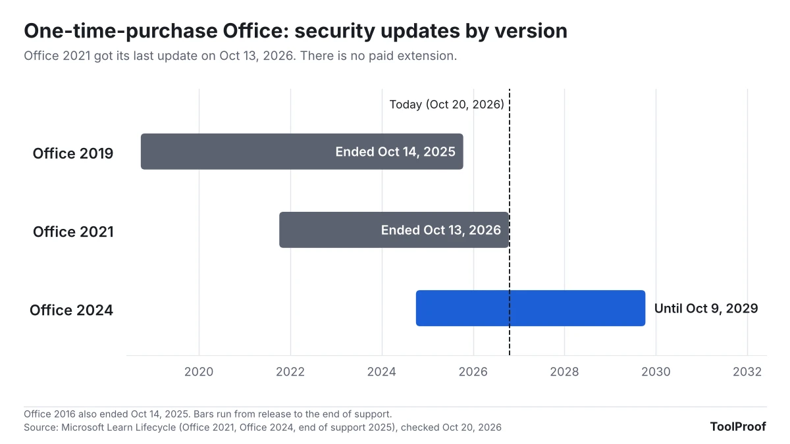

Microsoft stopped supporting Office 2021 on October 13, 2026. Word, Excel, PowerPoint and Outlook 2021 still open and save your files, but they no longer get security fixes, and Microsoft says there will be no extension and no paid Extended Security Updates. Any new hole found in Office 2021 from now on stays open.

You don't have to buy anything today, but you should decide soon. If you only write the occasional letter or budget, Microsoft's free web versions of Word, Excel and PowerPoint cost nothing. If you want desktop apps on one computer without a subscription, Office Home 2024 now costs $179.99 and is supported until October 9, 2029. For a household with three or more computers, Microsoft 365 Family is the cheaper paid route.

We read Microsoft's end-of-support notice, its lifecycle pages and its current U.S. price list on October 20, 2026, and worked out what each option costs over the next three years.

## What happened

Microsoft's support article [End of support for Office 2021](https://support.microsoft.com/en-us/office/system-requirements/end-of-support-for-office-2021) says support "ended on October 13, 2026 and there will be no extension and no extended security updates." After that date Microsoft no longer provides bug fixes, security fixes, software updates, or phone and chat support for Office 2021, and it is retiring most of the online help for it.

The [Office 2021 lifecycle page](https://learn.microsoft.com/en-us/lifecycle/products/office-2021) lists the editions this covers: Home and Student, Home and Business and Professional, including the Mac versions. The business version, Office LTSC 2021, reached its end of support on the same day, according to Microsoft's [2026 end-of-support list](https://learn.microsoft.com/en-us/lifecycle/end-of-support/end-of-support-2026). Office 2016 and Office 2019 already ended on October 14, 2025 ([2025 list](https://learn.microsoft.com/en-us/lifecycle/end-of-support/end-of-support-2025)).

## Who is affected

This only matters if you bought Office once, as a boxed copy, a download or a version that came with a new PC. Microsoft 365 subscriptions are a different product and keep getting updates.

| If you use... | Security updates until | What to do |
| --- | --- | --- |
| Office Home and Student 2021, Home and Business 2021, Professional 2021 (Windows or Mac) | Ended October 13, 2026 | Pick a replacement (below) |
| Office LTSC 2021 at work or school | Ended October 13, 2026 | Ask your IT help desk; it's their call |
| Office 2016 or Office 2019 | Ended October 14, 2025 | Same choices as Office 2021 |
| Office Home 2024 or Home & Business 2024 | October 9, 2029 | Nothing |
| Microsoft 365 Personal, Family or Premium | As long as you subscribe | Nothing |
| Word, Excel and PowerPoint for the web (free) | Kept up to date by Microsoft | Nothing |

Support dates come from Microsoft's [lifecycle pages](https://learn.microsoft.com/en-us/lifecycle/products/office-2024) as of October 20, 2026.

## What changes for you

Office 2021 keeps working: Microsoft says the apps "may continue to function." What changes is what happens when someone finds a security flaw in it. Until October 13, Microsoft fixed those through Microsoft Update. Now, in Microsoft's words, using the apps "could expose yourself to serious and potentially harmful security risks."

You also lose help. Microsoft has ended phone and chat support for Office 2021, and most of its online help pages for that version are being retired.

## What to do now

1. **Check which Office you have.** On Windows, open Word, select **File > Account**, and look under **Product Information**. On a Mac, open Word and choose **Word > About Word**. Microsoft's [version guide](https://support.microsoft.com/en-us/office/lifecycle/lc-account/about-office-what-version-of-office-am-i-using) shows both. If it says Microsoft 365, you're fine. If it says Office 2021, 2019 or 2016, keep going.
2. **If it's a work or school computer**, stop here and ask your IT team. Microsoft says managed copies follow your organization's upgrade plan.
3. **Decide how much Office you actually use.** If you open Word or Excel a few times a month, try the free [Microsoft 365 for the web](https://www.microsoft.com/en-us/microsoft-365/free-office-online-for-the-web) first: sign in with a free Microsoft account to use Word, Excel and PowerPoint in your browser, plus Outlook on the web and 5 GB of OneDrive storage. Upload one of your real files and see whether it works for you.
4. **If you need desktop apps, compare the price over three years** (chart below), not just the sticker price.
5. **Be careful with attachments until you switch.** Don't open Word or Excel files you weren't expecting in Office 2021, especially if they ask you to enable editing or content.

The prices come from Microsoft's [plan comparison page](https://www.microsoft.com/en-us/microsoft-365/buy/compare-all-microsoft-365-products) as of October 20, 2026: Office Home 2024 is a one-time purchase of $179.99 for one PC or Mac, Microsoft 365 Personal is $99.99 a year for one person, and Family is $129.99 a year for up to six people. When Microsoft [launched Office 2024](https://www.microsoft.com/en-us/microsoft-365/blog/2024/09/30/office-2024-for-consumers-available-october-1/) in October 2024, Office Home 2024 cost $149.99 and included Word, Excel, PowerPoint and OneNote, but not Outlook. Office Home & Business 2024 added Outlook for $249.99 at launch; the comparison page didn't show its current price when we checked.

If you'd rather not use a Microsoft account at all, [LibreOffice](https://www.libreoffice.org/download/download-libreoffice/) is a free desktop office suite with downloads for Windows and Mac. In [our test of PDF-to-Word converters](/posts/pdf-to-word-free), LibreOffice Writer 26.8.1 saved Word (.docx) files, though it turned every line of a converted PDF into a separate text box. Open a few of the documents you use most in it before you uninstall Office.

## Our take

For one person with one computer, Office Home 2024 is the cheapest way to keep desktop Word and Excel, but only buy it if you know you need the desktop apps. Here's the math: $179.99 once covers you until October 2029, about $60 a year, while Microsoft 365 Personal is $99.99 a year. But Office Home 2024 has no Outlook, its price has gone up $30 since launch, and in three years you'll be exactly where Office 2021 owners are today, with no upgrade discount. Microsoft's own comparison page says one-time buyers have to pay full price for the next version.

For households, the math flips. Three Office Home 2024 licenses cost $539.97, while three years of Microsoft 365 Family cost $389.97 and cover up to six people, with Outlook, new versions and 2 TB of shared storage (which [shrinks for big families](/posts/microsoft-365-family-storage-2tb) when existing plans renew after May 2027). At two computers the two routes are close ($359.98 vs. $389.97), so Family's extras likely decide it.

The risk of staying on Office 2021 sits mostly where it touches files from other people: email attachments opened in Word or Excel, and mail read in Outlook 2021. And most people who bought Office 2021 for occasional letters and spreadsheets don't need a paid replacement at all. The free web apps stay updated and cost nothing, so that is where we'd start: try them on your own files first.

The other side: if you use Office 2021 offline, never open files from others, and read your email somewhere else, the practical risk of keeping it a while longer is low, and spending $180 to $390 to fix a theoretical problem may feel wasteful. That's a reasonable choice for a computer that only edits your own documents. It isn't for a computer where Outlook 2021 is your mailbox.

## What to watch next

- **November 10, 2026**: the first monthly Patch Tuesday after the end date, per Microsoft's [release schedule](https://learn.microsoft.com/en-us/windows/deployment/update/release-cycle). Any Office fix released that day won't reach Office 2021.
- **October 9, 2029**: Office 2024 reaches its end of support, according to its [lifecycle page](https://learn.microsoft.com/en-us/lifecycle/products/office-2024).

If the same family computer still runs Windows 10, check that it's enrolled in [Extended Security Updates through October 2027](/posts/windows-10-esu-extended). A Windows 11 PC on version 24H2 has its own deadline: [its updates also ended on October 13](/posts/windows-11-24h2-end-of-support).
