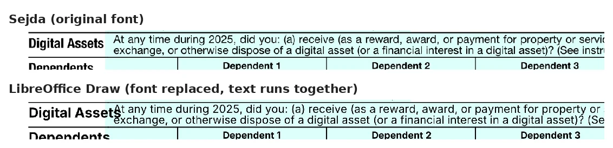
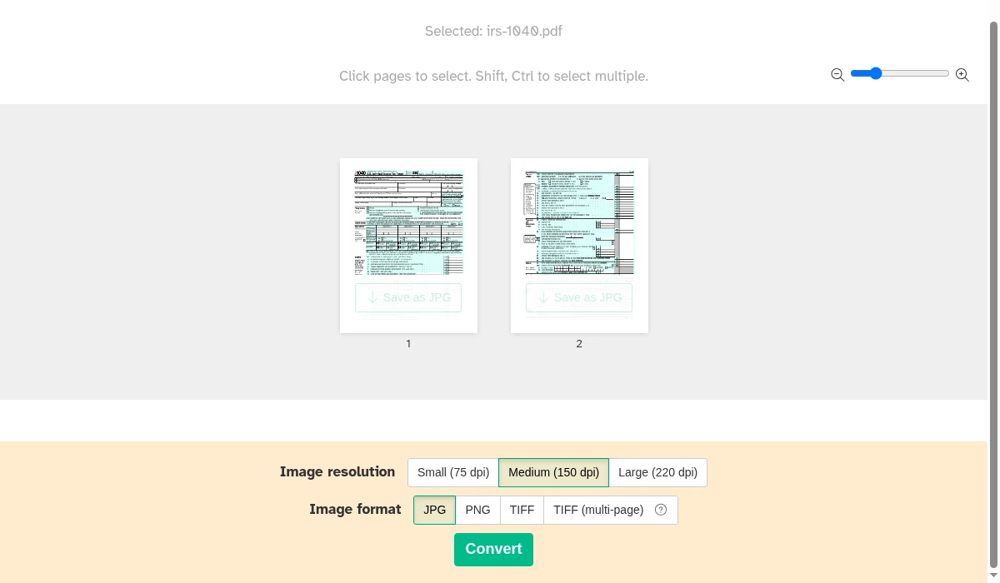
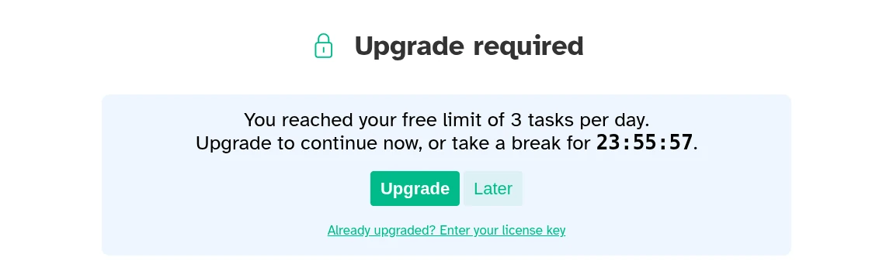
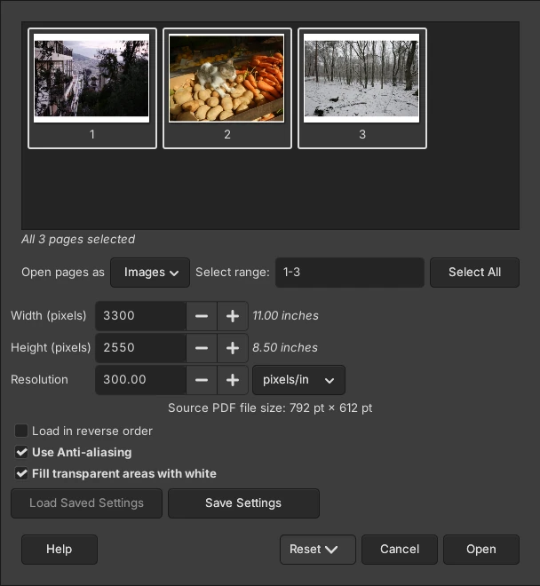
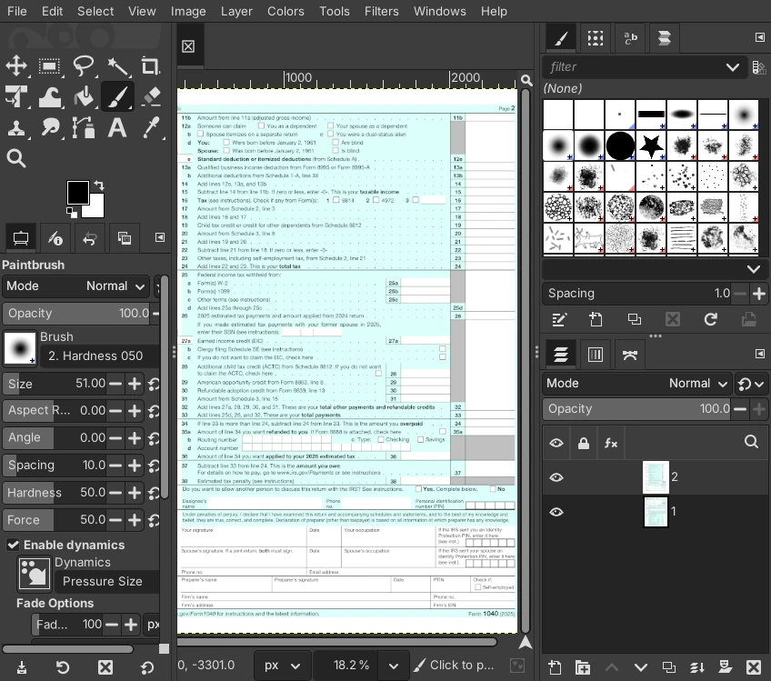
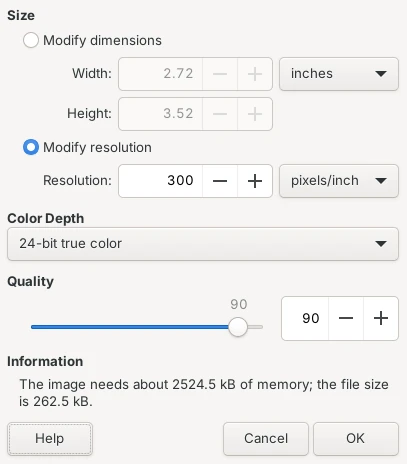
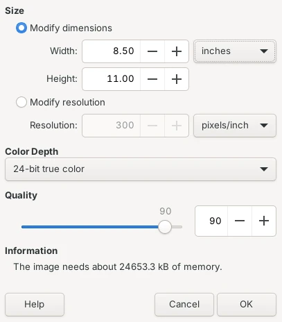

To convert a PDF to JPG for free, open it in the free Sejda PDF Desktop app (Windows, Mac), choose **PDF to JPG**, pick **Large (220 dpi)** and click **Convert**: you get one sharp JPG per page. For the sharpest result with no daily limit, open the PDF in GIMP (Windows, Mac), set **Open pages as** to **Images**, and export each page as JPG at GIMP's default 300 pixels per inch. Be careful with the defaults: in our test, GIMP saved only the last page of a 2-page PDF, and LibreOffice Draw saved only the page on screen at a blurry 816 by 1056 pixels.

We tested this on October 19, 2026, with the IRS Form 1040 (2 pages of small print, US Letter size), a 1-page report with a photo, a chart and 7-point fine print, and a 3-page PDF of photos. We converted them in each app by clicking through its own screens, first with the default settings and then with the settings each app offers for higher quality. Then we checked every JPG: which page it was, its size in pixels, its file size, and how much of the text a text-recognition program could read back from it. All three apps run on your computer, so your PDF is never uploaded.

![Grid comparing three free apps that convert PDF to JPG, using a 2-page IRS Form 1040 with default settings. GIMP 3.2.6 saved only page 2, the last one, at 300 ppi or 2550 by 3301 pixels, can use any resolution you type, made a 1.3 MB file and has no limit. LibreOffice Draw 26.8.1 saved only the page on screen at 96 ppi or 816 by 1056 pixels, its Resolution box doesn't add pixels, made a blurry 0.19 MB file and has no limit. Sejda PDF Desktop 7.9.10 free saved both pages as one JPG each at 150 dpi or 1275 by 1649 pixels, goes up to 220 dpi, made 1.2 MB per page, and allows 3 tasks a day and 20 pages](./images/pdf-to-jpg-free/pdf-to-jpg-default-results.webp)

## Free ways to convert PDF to JPG at a glance

| Method | Works on | Every page in one go | Sharpest setting | Free-version limit |
| --- | --- | --- | --- | --- |
| **Sejda PDF Desktop** (free version) | Windows, Mac, Linux | Yes, one JPG per page | 220 dpi | 3 tasks a day, 20 pages |
| **GIMP** (free app) | Windows, Mac, Linux | No, export each page | Any (300 by default) | None |
| **LibreOffice Draw** (free app) | Windows, Mac, Linux | No, one page at a time | Any, with the right setting | None |
| **Preview** (built into Mac) | Mac | Not tested | Not tested | None |

The first three rows are what we measured. The Mac row comes from Apple's documentation, because we couldn't run macOS in our test setup.

## How we tested

We used three PDFs, all US Letter size:

- **IRS Form 1040** for 2025, downloaded from irs.gov: 2 pages packed with small labels, the kind of form people often need to send as an image
- **A 1-page report** we made in Chrome, with body text, a photo, a bar chart, a table, partly see-through boxes and a line of 7-point fine print at the bottom
- **A 3-page photo PDF** with one public-domain photo per page

We converted them with [GIMP](https://www.gimp.org/downloads/) 3.2.6, [LibreOffice](https://www.libreoffice.org/download/download-libreoffice/) 26.8.1 (its Draw app opens PDFs) and [Sejda PDF Desktop](https://www.sejda.com/desktop) 7.9.10 (free version), on a Linux computer, using each app's own windows and menus. For every JPG we checked:

- **Which page it is**: we compared each JPG with a reference image of every page
- **Size in pixels**: more pixels means smaller text stays readable when someone zooms in or prints. A Letter page at 300 pixels per inch (ppi, also written dpi) is 2550 by 3300 pixels
- **File size**: matters for email and upload limits
- **Readable text**: we ran a free text-recognition (OCR) program on each JPG and counted how many of the page's words it read back correctly. It is a rough stand-in for how readable the text is to a person

## Results: two apps saved only one page by default

Only Sejda turned the 2-page form into 2 JPGs. GIMP and LibreOffice each produced a single JPG, and each picked a different page.

| App and setting | Pages saved from the 2-page form | Pixels per page | File size per page | Words the OCR read (page 1) |
| --- | --- | --- | --- | --- |
| GIMP, defaults | Page 2 only | 2550 x 3301 (300 ppi) | 1.28 MB | 84% (page 2) |
| LibreOffice Draw, defaults | Page 1 only | 816 x 1056 (96 ppi) | 0.19 MB | 52% |
| LibreOffice Draw, Resolution set to 300 | Page 1 only | 816 x 1056 (unchanged) | 0.27 MB | Not comparable |
| LibreOffice Draw, fixed (see below) | Page 1 only | 2550 x 3300 (300 ppi) | 1.33 MB | 82% |
| Sejda, defaults (Medium) | Both | 1275 x 1649 (150 dpi) | 1.21 MB | 81% |
| Sejda, Large | Both | 1870 x 2420 (220 dpi) | 2.06 MB | 85% |

A few things stood out:

- **GIMP's page problem**: GIMP opens a multi-page PDF as one picture with each page as a layer, stacked so the last page sits on top. Saving that as JPG flattens it to what you see, which is the last page. Choosing **Images** instead of **Layers** when you open the PDF fixes it
- **LibreOffice's resolution trap**: its default 96 ppi made the form's small labels fuzzy, and the OCR read only about half the words. Typing 300 in the **Resolution** box didn't help: LibreOffice kept the same 816 by 1056 pixels and shrank the printed size to 2.72 by 3.52 inches instead (the file is labeled 300 ppi, which also throws off OCR programs, so we didn't score it). The fix is in the LibreOffice steps below
- **LibreOffice changes fonts**: when Draw opens a PDF, it can swap the PDF's fonts for ones it has. On the 1040, the label "Digital Assets" ran into the question next to it. GIMP and Sejda kept the original look
- **Sejda's large files**: Sejda saves JPGs at very high quality (an image tool estimated 100 out of 100, versus GIMP's 90), so its 150 dpi pages were about as large as GIMP's 300 ppi pages
- **Fine print and see-through boxes**: on the 1-page report, all three apps kept a white background and the OCR read all 28 words of the 7-point fine print, even from LibreOffice's 96 ppi file

## How to convert PDF to JPG with Sejda PDF Desktop (Windows and Mac)

Sejda is the easiest way to get every page at once. The free version shows its limits on the start screen: "documents up to 20 pages or 50 MB and 3 tasks per day" (its website lists different numbers, so we go by what the app showed us as of October 2026).

1. Download and install [Sejda PDF Desktop](https://www.sejda.com/desktop).
2. Click **All Tools**, then **PDF to JPG** under **Convert from PDF**.
3. Click **Choose PDF files** and pick your PDF. A thumbnail of each page appears.
4. Next to **Image resolution**, click **Large (220 dpi)**. The default is **Medium (150 dpi)**, and it goes back to Medium for every new file.
5. Leave **Image format** on **JPG** and click **Convert**.
6. Choose a folder and click **Select output folder**, then **Continue**. Each page is saved as its own file, named with the page number first (for example, 1_irs-1040.jpg).

Our fourth conversion of the day was blocked with "You reached your free limit of 3 tasks per day" and a countdown of almost 24 hours. Plan your conversions so they fit, or use GIMP for the rest.

## How to convert PDF to JPG with GIMP (Windows and Mac)

GIMP is a free photo editor. It renders PDF pages at 300 ppi by default, the sharpest of the three apps, with no limits. The one setting you must change is how it opens the pages.

1. Download and install [GIMP](https://www.gimp.org/downloads/).
2. Open GIMP, choose **File > Open**, and pick your PDF. A window with a thumbnail of each page opens.
3. Set **Open pages as** to **Images**. This opens each page as a separate picture. With the default, **Layers**, only the last page ends up in your JPG.
4. Leave **Resolution** at **300** pixels/in (raise it for very small print), keep **Fill transparent areas with white** checked, and click **Open**.
5. For each page that opens, choose **File > Export As**, type a name ending in **.jpg**, and click **Export**.
6. In the **Export Image as JPEG** window, leave **Quality** at **90** and click **Export**.

If you only need one page, type its number in **Select range** in step 4 instead. Our 3-page photo PDF opened as three pictures, and the first one exported at 3300 by 2550 pixels. The downside is clicking through the export for every page, so for a long document Sejda is faster.

## How to convert PDF to JPG with LibreOffice Draw (Windows and Mac)

LibreOffice is a free office suite, and its Draw app can open a PDF and export the page on screen as a JPG. Use it if you already have LibreOffice and need one page, and change the size setting the way we describe, or the result is blurry.

1. Download and install [LibreOffice](https://www.libreoffice.org/download/download-libreoffice/).
2. Open the PDF in LibreOffice Draw (**File > Open** in LibreOffice).
3. Select the page you want in the **Pages** panel on the left. In our test, Draw exported only page 1, the page selected when the file opened.
4. Choose **File > Export**, pick **JPEG** in the file type list, type a name and click **Export**. The **JPG Options** window opens.
5. Click **Modify resolution**, change the unit to **pixels/inch**, and type **300**.
6. Now click **Modify dimensions** and set **Width** back to **8.50** inches (for Letter paper). The note at the bottom should say the image needs about 24,653 kB of memory, not 2,524.5 kB.
7. Set **Quality** to **90** and click **OK**.

In our test, LibreOffice remembered the quality setting for the next export but reset the resolution to 96, so repeat steps 5 and 6 every time. Check the result for swapped fonts before you send it, especially on forms.

## How to convert PDF to JPG on a Mac with Preview

According to [Apple's Preview User Guide](https://support.apple.com/guide/preview/convert-image-file-types-prvw1012/mac), open the file in Preview, choose **File > Export**, choose **JPEG** in the **Format** menu, adjust the quality if you like, and click **Save**. Apple's guide doesn't say what happens with multi-page PDFs or at what resolution pages are saved, and we couldn't run macOS to check. If you need every page, or a known resolution, use Sejda or GIMP on the Mac.

## Other tools we looked at

- **Online PDF to JPG converters**: search suggestions for "pdf to jpg" include iLovePDF, Smallpdf, Adobe and Canva, which work by uploading your file. We left them out because the apps above convert on your computer, which matters for tax forms and other private documents.
- **PDF Arranger and PDFsam Basic**: both did well in our tests of [splitting](/posts/split-pdf-free) and [merging PDFs](/posts/merge-pdf-files-free), but they save PDFs only, not JPG images.

Going the other way? Our [JPG to PDF test](/posts/jpg-to-pdf-free) covers turning photos back into a PDF. If the JPG has to stay under an upload limit, our [guide to compressing images to 100 KB](/posts/compress-image-to-100kb) shows how to shrink it. And if you want the text from the page rather than a picture of it, our [test of free OCR apps](/posts/image-to-text-offline-free) covers copying text out of images.

## Which one should you use?

- **Every page of a PDF, quickly**: Sejda PDF Desktop at Large (220 dpi). Fit your work into 3 conversions a day.
- **The sharpest pages, no limits**: GIMP with **Open pages as > Images**, at its default 300 ppi.
- **One page, and LibreOffice is already installed**: LibreOffice Draw, but set the size with the two-step fix and check the fonts.
- **Forms and documents with small print**: avoid LibreOffice's default 96 ppi, which left the OCR reading only about half the words on Form 1040.

If you need to edit the text rather than share a picture of the page, convert the PDF to an editable Word file instead: see [our test of three free PDF to Word tools](/posts/pdf-to-word-free).
