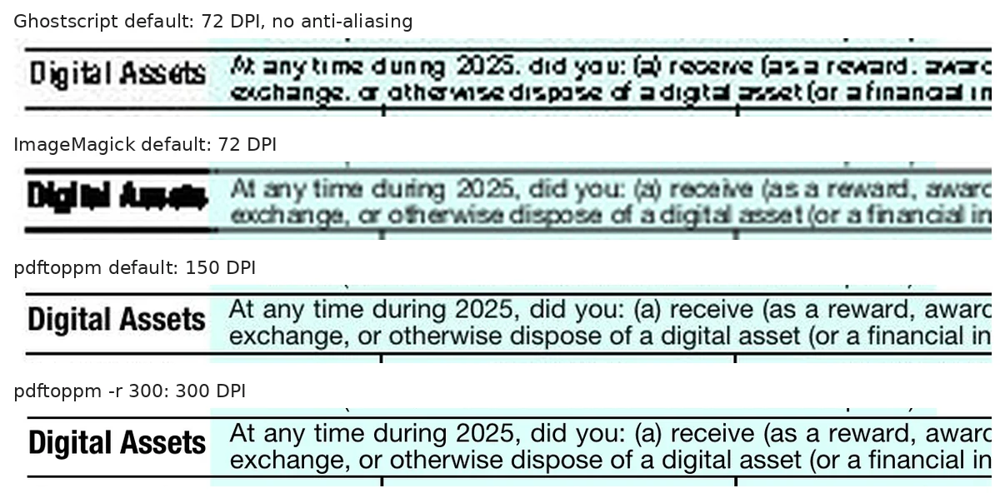
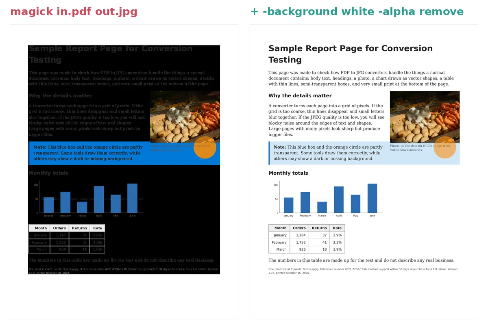
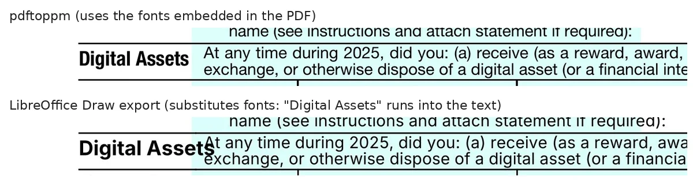
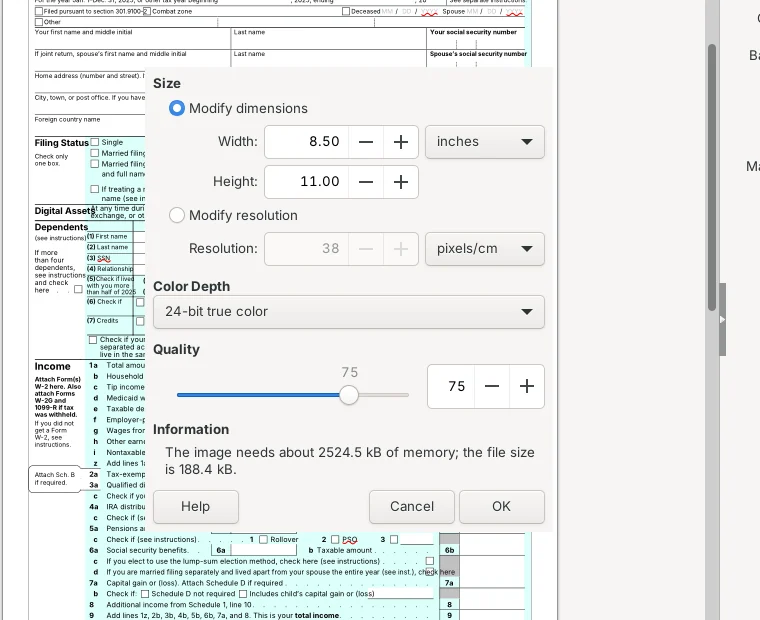
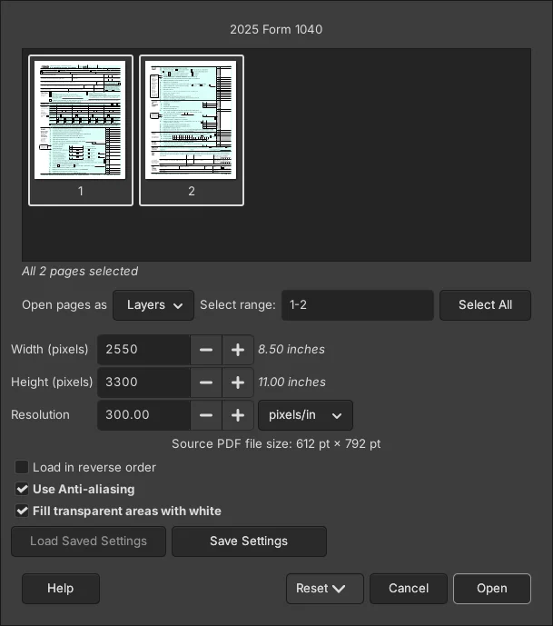

To convert a PDF to a high-quality JPG for free without uploading it, use pdftoppm at 300 DPI: `pdftoppm -r 300 -jpeg -jpegopt quality=90 file.pdf page`. In our test of five free offline tools, it was the fastest and its JPGs were the easiest to read back. The bigger lesson is about defaults. Three of the five tools save pages at 72 DPI unless you tell them otherwise, and at that size the small print on an IRS Form 1040 turned into a blur that OCR could read only 3 to 7% of. Change one number and all five tools landed between 82% and 91%.

We ran the test on October 16, 2026, with pdftoppm from Poppler 26.10.0, the Python library PyMuPDF 1.28.2 (built on the MuPDF engine), Ghostscript 10.08.0, ImageMagick 7.1.2-34 and LibreOffice 26.8.1. Each tool converted the same three PDFs: the two-page 2025 IRS Form 1040, a one-page report we made with a photo, a chart, a table, see-through boxes and 7-point fine print, and three pages of public-domain photos. We measured the size of each JPG, how much of the text Tesseract OCR could still read, how long each tool took, and we looked at every page. We also checked the PDF import settings in GIMP 3.2.6, the free image editor.


## PDF to JPG tools compared

| Tool | Default size of a Letter page | Default problem we found | Setting that fixes it | Best for |
| --- | --- | --- | --- | --- |
| **pdftoppm (Poppler 26.10)** | 1275 x 1650 px (150 DPI), quality 75 | None; fine for screens | `-r 300 -jpegopt quality=90` for print or OCR | Most people, every page in one command |
| **GIMP 3.2.6** | 2550 x 3300 px (300 DPI) | Opens every page as a layer of one image | Convert one page at a time | One page, no command line, Windows |
| **Ghostscript 10.08** | 612 x 792 px (72 DPI), quality 75 | Blurry, and text edges are jagged (no smoothing) | `-r300 -dJPEGQ=90 -dTextAlphaBits=4 -dGraphicsAlphaBits=4` | Windows command line, scripts |
| **PyMuPDF 1.28 (Python)** | 612 x 792 px (72 DPI), quality 95 | Blurry | `get_pixmap(dpi=300)` | Python code |
| **ImageMagick 7.1.2** | 612 x 792 px (72 DPI), quality 92 | Blurry; one PDF came out with a black background | `-density 300` before the file, `-background white -alpha remove` after it | Scripts that also crop or resize |
| **LibreOffice 26.8** | 816 x 1056 px (96 DPI), quality 75 | Saves only the first page and swaps the PDF's fonts | Pixel size in the export dialog; no fix for fonts | Not recommended for this job |

All five are free and work offline. GIMP's sizes come from its import dialog; we didn't measure its output files.

## How we tested

We picked three PDFs that fail in different ways:

- **IRS Form 1040 (2025)**, downloaded from [irs.gov](https://www.irs.gov/pub/irs-pdf/f1040.pdf): two Letter pages of 7- to 9-point text, thin lines and form fields. US government forms are in the public domain.
- **A one-page report we made** in Chromium's print-to-PDF: headings, body text, a public-domain photo, a bar chart drawn as vector shapes, a table, a semi-transparent blue box and orange circle, and a line of 7-point fine print. Like many PDFs saved from a browser, it has no white background painted under the page.
- **Three photo pages**: public-domain (CC0) photos from the [PD12M dataset](https://huggingface.co/datasets/Spawning/PD12M), 3000 pixels wide, placed on landscape Letter pages with img2pdf, the tool that came out on top in our [JPG to PDF test](/posts/jpg-to-pdf-free-offline).

Each tool converted all three PDFs twice: once with its default settings, and once set to 300 DPI and JPEG quality 90 (LibreOffice has no DPI setting, so we gave it the same 2550 x 3300 pixel size). To score readability, we ran [Tesseract 5.3.4](https://github.com/tesseract-ocr/tesseract) OCR on every JPG and counted how many of the PDF's own words it read back correctly, in any order. OCR is a stand-in for your eyes: it can't read everything even at high resolution (the best result on the form was 93%), but it drops sharply when letters blur together. We also opened every JPG and compared close-ups.

The computer was a 4-core Intel Xeon at 2.8 GHz with 16 GB of RAM and no GPU, running Ubuntu 24.04. Times are the median of three runs. We built Poppler 26.10.0 and Ghostscript 10.08.0 from source; the pdftoppm in Ubuntu's own package (Poppler 24.02) made byte-for-byte identical JPGs.

## Why your PDF to JPG comes out blurry

A PDF page has no pixels. Its text and lines are shapes that can be drawn at any size, so a converter has to decide how many pixels to draw them with, measured in dots per inch (DPI). A Letter page at 72 DPI is 612 x 792 pixels, roughly the size of a thumbnail on a phone screen. At 300 DPI it's 2550 x 3300 pixels, the resolution printers usually expect.

Most tools pick 72 DPI on their own because a PDF measures everything in points, 72 to the inch. [ImageMagick's documentation](https://imagemagick.org/command-line-options/#density) says its default "is 72 dots per inch, which is equivalent to one point per pixel." [Ghostscript's](https://ghostscript.readthedocs.io/en/latest/Devices.html) says the default is "usually 72 dpi." PyMuPDF's `get_pixmap()` uses an identity matrix unless you pass `dpi`, and we measured 612 x 792 pixels. pdftoppm is the exception, with a 150 DPI default listed in `pdftoppm -h`.

Here is the same strip of Form 1040 from four outputs, enlarged to the same width:



Ghostscript's default looks worse than the other 72 DPI outputs because it also skips anti-aliasing, the gray edge pixels that make small letters look smooth. Its documentation describes `-dTextAlphaBits` and `-dGraphicsAlphaBits` as the options that "control the use of subsample antialiasing." With both set to 4 at 300 DPI, OCR read 90% of page 1, against 88% without them, and the JPG was 7% smaller.

## What DPI should you use for PDF to JPG?

Use 150 DPI for sharing on screens and 300 DPI if you'll print the image, zoom in on small print or run OCR on it. Going above 300 mostly makes files bigger. We converted Form 1040 with pdftoppm at seven resolutions:


| DPI | Letter page in pixels | Size per page (quality 75) | Size per page (quality 90) | Words OCR read on page 1 |
| --- | --- | --- | --- | --- |
| 72 | 612 x 792 | 125 KB | 180 KB | 4% |
| 100 | 850 x 1100 | 210 KB | 297 KB | 51% |
| 150 | 1275 x 1650 | 386 KB | 546 KB | 81% |
| 200 | 1700 x 2200 | 576 KB | 816 KB | 87% |
| 300 | 2550 x 3300 | 1.0 MB | 1.4 MB | 89% |
| 600 | 5100 x 6600 | 2.6 MB | 3.6 MB | 93% |

Sizes are for the form, which is mostly white. Our photo pages came out larger: 1.8 MB per page at 300 DPI and quality 90. Raising JPEG quality from 75 to 90 made pages about 40% bigger, and OCR results moved only a few points either way, so quality 75 to 85 is plenty for text. Our 7-point fine print on the report page was fully readable from 150 DPI up, but at 72 DPI OCR got only 6 of its 28 words.

If the JPG must stay under an upload limit, like 100 KB or 200 KB, convert at 150 to 200 DPI first and then shrink it. Our [image compression test](/posts/compress-image-to-100kb) measured how far you can go before photos fall apart.

## Why ImageMagick turns a PDF page black

ImageMagick hands PDFs to Ghostscript and asks for an image with a transparent background. If the PDF doesn't paint its own white background, the page stays transparent, and JPEG, which can't store transparency, saves those pixels as black. That's what happened to our browser-made report: black page, dark text, almost nothing readable. OCR read 0% of it at the default size and 2% at 300 DPI. The IRS form and the photo pages were not affected because they cover the whole page.



The fix is to put the page on white before saving. The [ImageMagick documentation](https://imagemagick.org/command-line-options/#alpha) describes `-alpha remove` as "Composite the image over the background color":

```bash
magick -density 300 file.pdf -background white -alpha remove -quality 90 page-%d.jpg
```

`-density` has to come before the file name, because it tells ImageMagick how to read the PDF. ImageMagick numbers pages from 0, so the first page is `page-0.jpg`. It also needs Ghostscript installed: when we removed Ghostscript from the computer, `magick` stopped with a "FailedToExecuteCommand `'gs'`" error. And it was the slowest tool we tried, taking 14.5 seconds and up to 500 MB of memory for the three photo pages at 300 DPI, against 1.0 second for pdftoppm.

## Why LibreOffice isn't a good PDF to JPG converter

LibreOffice opens a PDF as an editable drawing in LibreOffice Draw, then exports what it drew. That causes two problems we could see:

- **It exports one page.** From the command line, `soffice --convert-to jpg` gave us one JPG for each PDF: page 1 of the form and the first of our three photo pages. In Draw, **File > Export** saves the page you're looking at.
- **It swaps the fonts.** Draw lays the text out again with fonts from your computer instead of the ones embedded in the PDF. On Form 1040, the wider replacement font pushed the "Digital Assets" heading into the question next to it.



Its JPEG export dialog defaults to the page size at 38 pixels per centimeter (about 96 DPI) and quality 75. Raising the size to 2550 x 3300 pixels brought OCR on page 1 from 58% to 82%, but didn't fix the fonts.



LibreOffice is a better fit for [converting a PDF to an editable Word file](/posts/convert-pdf-to-word-offline-free), where we tested how well it keeps the layout.

## How to convert PDF to JPG with pdftoppm (Mac, Linux)

pdftoppm comes with Poppler, the PDF engine behind many Linux PDF viewers. It saved every page in one command and was the fastest tool in our test: 1.8 seconds for all six pages at 300 DPI.

1. Install it. On a Mac with [Homebrew](https://formulae.brew.sh/formula/poppler), run `brew install poppler`. On Ubuntu or Debian, run `sudo apt install poppler-utils`.
2. Open Terminal in the folder with your PDF.
3. Run:

```bash
pdftoppm -r 300 -jpeg -jpegopt quality=90 file.pdf page
```

You get `page-1.jpg`, `page-2.jpg` and so on. To convert only some pages, add `-f` (first) and `-l` (last): `pdftoppm -r 300 -jpeg -f 2 -l 2 file.pdf page` saves page 2 alone. For screen use, leave out `-r 300` to get the 150 DPI default.

Poppler's [website](https://poppler.freedesktop.org/) offers source code and automated test builds rather than a Windows installer. On Windows, GIMP or Ghostscript below is the easier route.

## How to convert PDF to JPG with GIMP (Windows, Mac, Linux)

GIMP is a free image editor with a Windows installer. When you open a PDF, it shows an import dialog, and in GIMP 3.2.6 the defaults are already right for high quality: 300 pixels per inch, anti-aliasing on and **Fill transparent areas with white** checked, so it avoids ImageMagick's black page. The libraries bundled in the Linux build include Poppler, the same engine as pdftoppm.



1. In GIMP, choose **File > Open** and pick your PDF.
2. In the import dialog, type the page you want in **Select range** (for example, `2`). Leave **Resolution** at 300, or lower it to 150 for screen use.
3. Click **Open**.
4. Choose **File > Export As**, name the file with `.jpg` at the end and click **Export**.

By default, GIMP opens every selected page as a layer of a single image (**Open pages as: Layers**), which is awkward when you want separate JPGs. For a long PDF, a one-line Ghostscript command is faster.

## How to convert PDF to JPG with Ghostscript (Windows command line)

Ghostscript has an official [64-bit Windows download](https://ghostscript.com/releases/gsdnld.html), and on a Mac `brew install ghostscript` installs it. On Windows the command is `gswin64c`; on Mac and Linux it's `gs`:

```bash
gswin64c -sDEVICE=jpeg -r300 -dJPEGQ=90 -dTextAlphaBits=4 -dGraphicsAlphaBits=4 -o page-%d.jpg file.pdf
```

This saves `page-1.jpg`, `page-2.jpg` and so on. Without `-r300` you get 72 DPI, and without the two `AlphaBits` options the text edges are jagged. It took 2.9 seconds for our six pages.

## How to convert PDF to JPG in Python with PyMuPDF

If you already use Python, PyMuPDF installs with `pip install pymupdf` and needs nothing else. Pass `dpi`, or every page comes out at 72 DPI:

```python
import pymupdf

doc = pymupdf.open("file.pdf")
for i, page in enumerate(doc, start=1):
    page.get_pixmap(dpi=300).save(f"page-{i}.jpg", jpg_quality=90)
```

Its `save()` uses JPEG quality 95 if you don't set `jpg_quality`. At 300 DPI it read as well as pdftoppm (90% on page 1) and took 4.5 seconds for the six pages. PyMuPDF is under the AGPL license, with a paid commercial license from Artifex.

## How to save a PDF page as a JPG on a Mac without installing anything

Apple's [Preview guide](https://support.apple.com/guide/preview/convert-image-file-types-prvw1012/mac) describes exporting to another format: choose **File > Export**, pick **JPEG** from the **Format** menu, adjust the quality slider and click **Save**. Apple's page is written for images and doesn't say how it handles multi-page PDFs or what resolution it uses, and we couldn't test Preview on our Linux test computer. If the result looks soft, use pdftoppm at 300 DPI instead.

## Which tool is fastest?

| Tool (300 DPI, quality 90) | Form, 2 pages | Report, 1 page | Photos, 3 pages | Peak memory |
| --- | --- | --- | --- | --- |
| pdftoppm | 0.46 s | 0.28 s | 1.05 s | 66 MB |
| Ghostscript (with anti-aliasing) | 0.90 s | 0.48 s | 1.50 s | 33 MB |
| PyMuPDF | 1.14 s | 0.65 s | 2.73 s | 186 MB |
| ImageMagick (white background) | 4.56 s | 2.41 s | 14.47 s | 500 MB |

LibreOffice took 0.8 to 1.6 seconds per file at the larger size, but for one page only, so it isn't in the table. ImageMagick's memory figure includes the Ghostscript process it starts; the times include starting each program.

## FAQ

### Does converting PDF to JPG reduce quality?

Yes, in two ways. Text and lines become a fixed grid of pixels, so they blur when you zoom past the DPI you picked, and JPEG compression adds faint noise around sharp edges. At 300 DPI and quality 90 the noise is hard to see at normal zoom. If the PDF already holds photos, converting at a low DPI also shrinks them: at 72 DPI our 3000-pixel-wide photos came out 792 pixels wide.

### Should I convert a PDF to JPG or PNG?

JPG is smaller and fine for photos and most documents. PNG keeps text edges perfectly sharp but makes much larger files for pages with photos. pdftoppm, Ghostscript and ImageMagick can all save PNG instead; with pdftoppm, use `-png` in place of `-jpeg`. We didn't measure PNG sizes in this test.

### Can I make the text in the JPG searchable or editable?

Not directly; a JPG is a picture of the text. Run OCR on it to get the text back. We compared free offline OCR tools in our [image to text test](/posts/image-to-text-offline-free). If you only need the text, `pdftotext file.pdf` from the same Poppler package pulls it straight from the PDF without OCR.

## Which method should you use?

- **Most people on Mac or Linux:** pdftoppm, at the default 150 DPI for screens or `-r 300` for print and OCR.
- **Windows, one page, no command line:** GIMP, with its default 300 DPI import.
- **Windows, many pages:** Ghostscript, with `-r300` and the two `AlphaBits` options.
- **Python:** PyMuPDF, always with `dpi=` set.
- **Already using ImageMagick:** add `-density 300` before the file and `-background white -alpha remove` after it.

Whatever you use, check the first page at 100% zoom before converting a long document. If the JPG is too big to email afterward, our [PDF compression test](/posts/compress-pdf-offline-free) shows how to shrink the PDF itself, which is often a better option than sending page images.
