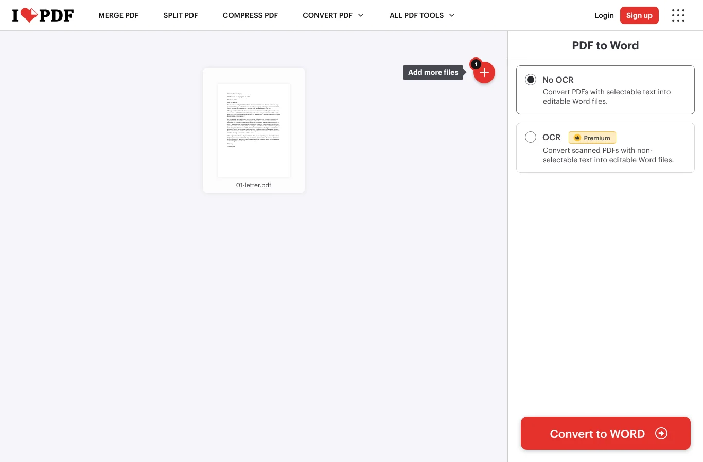
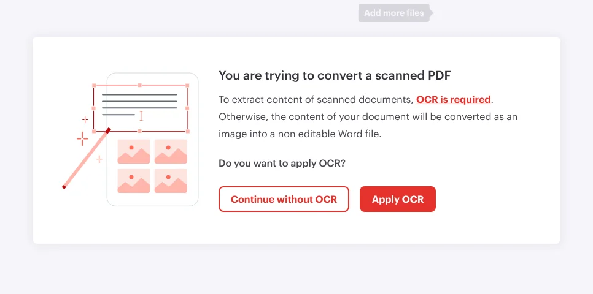
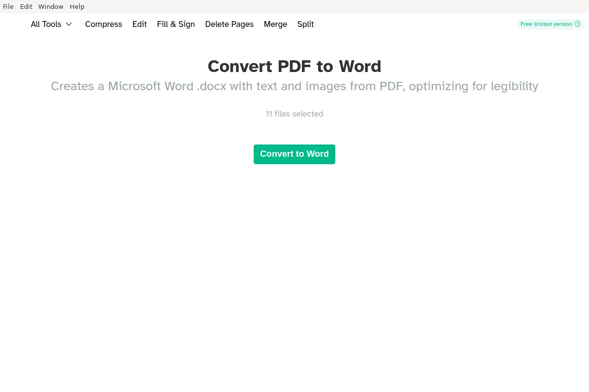
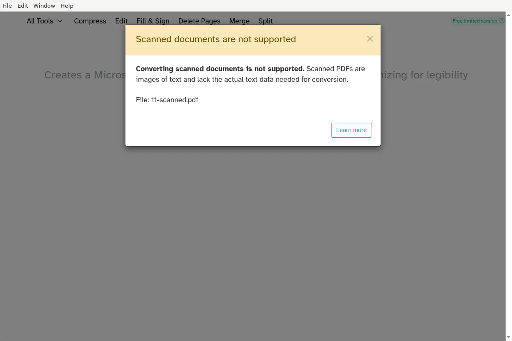
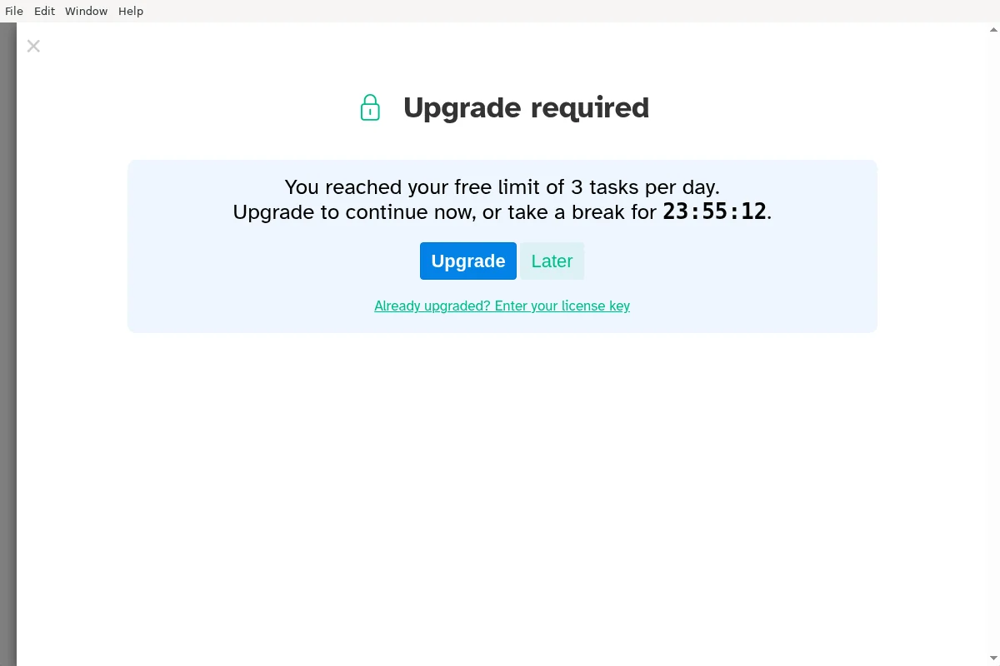
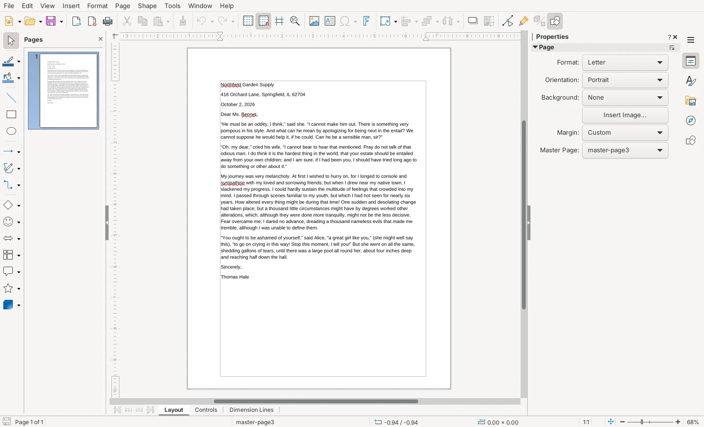
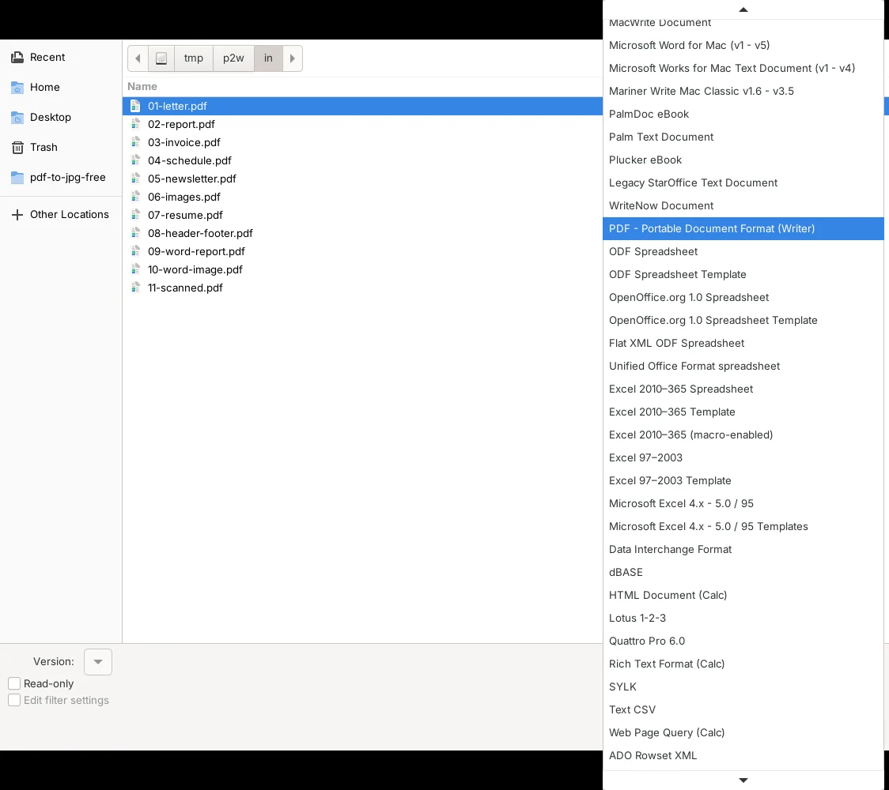
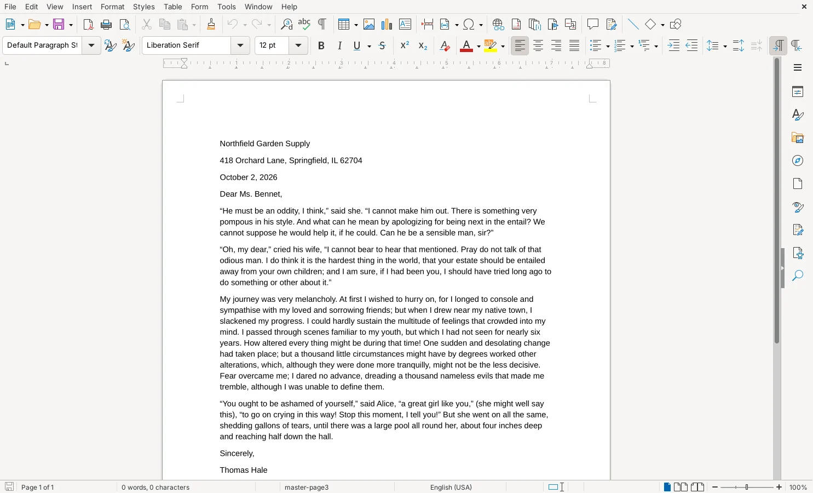

To convert a PDF to Word for free, upload it to iLovePDF's **PDF to WORD** page, click **Convert to WORD** and download the .docx file: in our test it was the only free tool that kept tables as real Word tables and kept two-column pages in two columns. If you'd rather not upload the file, the free Sejda PDF Desktop app converts on your computer and gives you clean paragraphs that are easy to edit, but it drops tables and columns and allows only 3 files a day. LibreOffice Writer looks perfect on screen, yet every line comes out as a separate text box, so editing is painful.

We tested this on October 19 and 20, 2026, with 11 PDFs whose exact contents we knew in advance: a letter, a two-page report, an invoice with a table, a schedule, a two-column newsletter, a page with pictures, a résumé, a report with page headers, two files saved from a word processor, and one scanned page with no real text in it. We converted them by clicking through each tool's own screens, then checked every Word file: did all the words survive, are the paragraphs normal paragraphs you can type into, did tables come back as tables, and what happens when you add a sentence.

![Grid comparing three free PDF to Word tools on 11 test PDFs. LibreOffice Writer 26.8.1: 0% of paragraphs editable normally because every line is a text box, 0 of 5 tables rebuilt, looks like the PDF, scanned PDF comes out as a picture only, no limit. Sejda PDF Desktop 7.9.10 free: 100% of paragraphs editable on 3 files, 0 of 2 tables rebuilt because rows become plain lines, does not look like the PDF with one column and 9 pt text, refuses scanned PDFs, 1 file per task and 3 tasks a day. iLovePDF web free: 82% of paragraphs editable with some split in two, 4 of 5 tables rebuilt, columns kept, OCR read 99.7% of words on the scanned PDF, 1 file per task and 15 MB with uploads](./images/pdf-to-word-free/pdf-to-word-results.webp)

## Free ways to convert PDF to Word at a glance

| Method | Works on | Tables | Layout | Scanned PDFs | Free-version limit |
| --- | --- | --- | --- | --- | --- |
| **iLovePDF** (website) | Any browser | Rebuilt (4 of 5) | Kept, including columns | OCR option | 1 file at a time, 15 MB, file is uploaded |
| **Sejda PDF Desktop** (free version) | Windows, Mac, Linux | Lost (plain lines) | One plain column | Refused | 1 file at a time, 3 tasks a day |
| **LibreOffice Writer** (free app) | Windows, Mac, Linux | Lost (loose text boxes) | Looks identical, hard to edit | Picture only | None |
| **Microsoft Word** (if you have it) | Windows, Mac | Not tested | Not tested | Not tested | Needs Word |
| **Google Docs** (free with a Google account) | Any browser | Not tested | Not tested | Not tested | 2 MB |

The first three rows are what we measured. The Word and Google Docs rows come from Microsoft's and Google's help pages, because we couldn't run them in our test setup.

## How we tested

We reused the 11 test PDFs from our earlier PDF-to-Word measurements, so we knew every word, paragraph and table cell that should come out. The text is public-domain book passages from Project Gutenberg, and the invoice, schedule and résumé values are made up. Two of the files were saved from a word processor the way most people create PDFs, and the scanned page is an image of the letter with no text layer.

We converted them with [LibreOffice](https://www.libreoffice.org/download/download-libreoffice/) 26.8.1 (Writer), [Sejda PDF Desktop](https://www.sejda.com/desktop) 7.9.10 (free version) and the [iLovePDF](https://www.ilovepdf.com/pdf_to_word) website (free, not signed in), on a Linux computer, using each tool's own windows and buttons. Sejda's free version converts only one file per task and 3 tasks a day, so it got the invoice, the newsletter and one word-processor report, plus the scanned page, which it refused. For each Word file we checked:

- **Words kept**: how many of the original words are in the Word file
- **Editable paragraphs**: whether each paragraph is one normal paragraph you can click into and type, instead of a stack of separate lines or text boxes
- **Tables**: whether a table comes back as a real Word table with each value in the right cell
- **Layout**: page count, columns and text size, viewed in LibreOffice Writer 24.2 (not Microsoft Word, so fonts may look slightly different in Word)

## Results: all words survived, but only one tool kept the structure

Every tool kept all or nearly all of the words from the text PDFs (LibreOffice and Sejda 100%, iLovePDF 99.96%). The differences are in what you can do with those words afterward.

| Tool | Editable paragraphs | Tables rebuilt | Pages and columns | Scanned page |
| --- | --- | --- | --- | --- |
| LibreOffice Writer | 0% (every line is a text box) | 0 of 5 | Same page count, columns look right | Picture of the page, 0 words |
| Sejda PDF Desktop (3 files) | 100% | 0 of 2 | Two-page files shrank to 1 page, 9 pt text, one column | "Scanned documents are not supported" |
| iLovePDF | 82% (about 1 in 5 paragraphs split in two) | 4 of 5 | Same page count, real two-column section | Without OCR: picture, 0 words. With OCR: 99.7% of words |

A few things stood out:

- **LibreOffice's copy is a picture made of text boxes.** Each line of the PDF becomes its own box placed at the exact spot it was on the page. It looks identical, and the status bar even says **0 words**, because Writer doesn't count text inside boxes. On the invoice, the shaded header row of the table came out as a gray bar with the column names hidden behind it.
- **Sejda goes the other way.** You get clean paragraphs in a plain single column, and the newsletter's two columns read in the right order. But the 11-point body text became 9-point, headings lost their styles, and each table row turned into a line of values separated by spaces.
- **iLovePDF came closest to a real Word document.** The invoice and schedule tables were rebuilt cell by cell, the newsletter kept a two-column section, the report kept its headings as Word heading styles, and the bulleted list came back as a real Word list. It missed the résumé's borderless table, which came back as lines of text, and it sometimes broke a paragraph in two where a line ended in the PDF.

### What happens when you edit

To see how each file behaves when you actually work in it, we typed a sentence into the first paragraph of the converted newsletter and looked at the page again.

In LibreOffice's file, the new sentence was cut off after one word, because the line's text box doesn't grow and the next line is a different box. In Sejda's and iLovePDF's files, the rest of the paragraph moved down to make room, as you'd expect in Word.

## How to convert PDF to Word with iLovePDF (any browser)

iLovePDF is the best free choice when the PDF has tables, columns or headings you want to keep. It runs in your browser, so it works the same on Windows, Mac, Chromebook and phones.

1. Go to [ilovepdf.com/pdf_to_word](https://www.ilovepdf.com/pdf_to_word) and click **Select PDF file**.
2. Leave **No OCR** selected if the PDF has real text (you can select words in it). **OCR** is marked **Premium**.
3. Click **Convert to WORD**, then **Download WORD**.

When we uploaded the scanned page, iLovePDF stopped and asked whether to apply OCR (text recognition, which reads the words from the picture). Clicking **Apply OCR** without signing in gave us an editable file with 99.7% of the words, but because iLovePDF lists PDF to Word with OCR as a Premium feature, don't count on it staying free. **Continue without OCR** puts the page in Word as a picture.

Your file is uploaded to iLovePDF's servers. According to [iLovePDF's FAQ](https://www.ilovepdf.com/help/faq), files are kept for a maximum of 2 hours and then deleted, and you can delete them yourself after downloading. Free use is one file per task and 15 MB per task; Premium costs $9 a month or $60 a year as of October 2026 ([pricing](https://www.ilovepdf.com/pricing)). For contracts, medical or tax documents, use one of the apps below instead.

## How to convert PDF to Word with Sejda PDF Desktop (Windows and Mac)

Sejda PDF Desktop is the choice when you can't upload the file and mainly need the text to edit. According to [Sejda](https://www.sejda.com/desktop), files are processed on your computer, not uploaded.

1. Install Sejda PDF Desktop from [sejda.com/desktop](https://www.sejda.com/desktop) and open it.
2. Open **All Tools** and click **PDF To Word**.
3. Click **Choose PDF files** and pick one PDF.
4. Click **Convert to Word** and choose where to save the .docx file.

The free version is limited to one file per task and 3 tasks a day; when we chose 11 files at once, it asked us to upgrade, and the fourth task of the day showed a 24-hour countdown. The annual Desktop+Web plan costs $63 a year as of October 2026. Sejda also refuses scanned PDFs with "Scanned documents are not supported".

After converting, select all the text in Word and set the font size back to what you want, since Sejda shrinks body text to 9 point.

## How to convert PDF to Word with LibreOffice Writer (Windows and Mac)

LibreOffice is free with no limits and never uploads anything, but use it only when you need a Word file that looks like the PDF and you'll change just a few words. The catch starts with opening the file: if you simply open a PDF, LibreOffice sends it to Draw, its drawing app, which can't save Word files.

1. Open **LibreOffice Writer** and choose **File > Open**.
2. In the file type list at the bottom of the Open window, choose **PDF - Portable Document Format (Writer)**. The list is long; it's below the Word and other text formats.
3. Select your PDF and click **Open**.
4. Choose **File > Save As**, set the file type to **Word 2010–365 Document (.docx)** and click **Save**.
5. When asked about the format, click **Use Word 2010–365 Document Format**.

In Word, each line will be a text box. To fix a typo, click into the line and edit it; to rewrite a paragraph, it's faster to copy the text out and paste it into a new document.

## How to convert PDF to Word in Microsoft Word or Google Docs

If you already have Word (Microsoft 365, Word 2024, 2021, 2019 or 2016), choose **File > Open**, pick the PDF and click **OK** when Word says it will make an editable copy. According to [Microsoft](https://support.microsoft.com/en-us/office/opening-pdfs-in-word-1d1d2acc-afa0-46ef-891d-b76bcd83d9c8), this works best with PDFs that are mostly text, and pages that are mostly charts or graphics may come in as a picture.

In Google Drive, right-click the PDF and choose **Open with > Google Docs** to get an editable copy you can then save as a Word file. [Google's help page](https://support.google.com/drive/answer/176692?hl=en) says the file should be 2 MB or smaller and that lists, tables, columns, footnotes and endnotes are not likely to be detected, so expect results closer to Sejda's than iLovePDF's.

## Other tools we looked at

- **ONLYOFFICE Desktop Editors** can open PDFs and save them as Word files, but its Linux app wouldn't start in our test setup, so we couldn't measure it.
- **Adobe Acrobat online** wasn't reachable from our test setup.
- **Scanned PDFs**: if your PDF is a scan and you don't want to use iLovePDF's OCR, first turn the page into text with a free OCR app (see [our test of free offline text recognition](/posts/image-to-text-offline-free)), then paste the text into Word.

## Which one should you use?

- **The PDF has tables, columns or a layout you want to keep, and it isn't sensitive**: iLovePDF.
- **You can't upload the file and mainly need the text**: Sejda PDF Desktop, up to 3 files a day.
- **You need it to look identical and will change only a word or two**: LibreOffice Writer, with the Writer file type chosen.
- **You already pay for Microsoft 365**: try Word's own **File > Open** first.

Need to go the other way or rearrange pages first? See how to [turn pages of a PDF into JPG images](/posts/pdf-to-jpg-free), [make a PDF from photos](/posts/jpg-to-pdf-free), [pull out just the pages you need](/posts/split-pdf-free) or [combine several PDFs into one](/posts/merge-pdf-files-free).

Or see our [roundup of the best free PDF tools](/posts/best-free-pdf-tools) for one pick per job across all six of our PDF tests.
