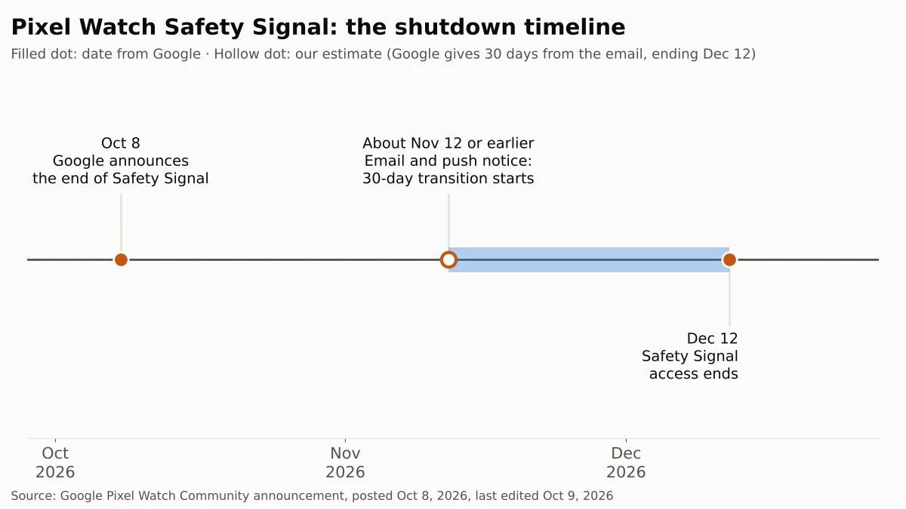

If you wear a Pixel Watch 2 or Pixel Watch 3 with LTE, pay for Google Health Premium and never added your watch to a phone plan, your watch loses its free emergency connection on December 12, 2026. After that date, Emergency SOS and Fall Detection can only reach help when your watch is near your phone, on Wi-Fi, or on its own carrier line. If your watch already has a carrier plan, or you always carry your phone, nothing changes for you.

The people who should act before December 12 are those who rely on the watch alone: someone who walks or runs without a phone, or an older relative who wears the watch at home and leaves the phone in another room. For them, the fix is a cellular line for the watch, which costs nothing extra if they already use Google Fi on an Android phone.

We read Google's announcement and its Pixel Watch, Google Health and Google Fi help pages on October 17, 2026, and compared what each says about emergency calls without a phone. We checked the same pages again on October 30, 2026, and the dates and steps had not changed.

## What happened

On October 8, 2026, Google posted an [announcement in the Pixel Watch Community](https://support.google.com/googlepixelwatch/thread/471984501/end-of-support-for-safety-signal-on-google-pixel-watch-is-going-away?hl=en) saying it will end Safety Signal on December 12. Safety Signal gave Google Health Premium subscribers an LTE connection from Google for safety features only, so an LTE Pixel Watch 2 or 3 could call for help without a carrier plan. According to Google's [Safety Signal help page](https://support.google.com/googlepixelwatch/answer/13889549?hl=en), it covered calls to and from emergency contacts, Safety Check, Emergency Sharing, Emergency SOS and Fall Detection, and it was offered only in the U.S., Canada, the U.K. and Germany.

Google says current users will get an email and a push notification first. Access continues for a 30-day transition period from the date of that email, and ends after December 12, 2026. Google says Emergency SOS, Fall Detection and Safety Check keep working when the watch is on Wi-Fi, paired by Bluetooth to a nearby phone, or connected to an active carrier line.

## Who is affected

| If you have... | What happens on December 12 |
| --- | --- |
| Pixel Watch 2 or 3 LTE, Google Health Premium, no carrier plan on the watch | You lose the emergency connection that works away from your phone and Wi-Fi |
| Pixel Watch 2 or 3 LTE with a carrier plan on the watch | No change. Google says Safety Signal isn't used when the watch already has carrier service |
| Pixel Watch 2 or 3 Wi-Fi model | No change. Safety Signal was never available on Wi-Fi models |
| Pixel Watch 2 or 3 bought from AT&T or Verizon | No change for most. Google says new watches from these carriers couldn't use Safety Signal |
| Pixel Watch 4 or 5 LTE | Not affected. These models don't use Safety Signal, and Google offers [Satellite SOS](https://support.google.com/googlepixelwatch/answer/16407554?hl=en) on LTE models in the U.S. and some other countries |
| An Android phone on Google Fi | You can add the watch to your Fi plan with calls, texts and data at no extra cost, per [Google Fi's help page](https://support.google.com/fi/answer/12812644?hl=en) |

## What changes for you

The change matters in one situation: you're away from your phone, not on Wi-Fi, and your watch has no carrier plan. Until December 12, Safety Signal covered that gap. After that, the watch has no connection to reach anyone.

Wi-Fi is less reassuring than it sounds. Google's announcement says the core safety features keep working on Wi-Fi. But Google's [safety features help page](https://support.google.com/googlepixelwatch/answer/12663810?hl=en) says an LTE Pixel Watch "needs an active LTE connection on your watch to call emergency services" without a phone, and that the Wi-Fi model relies on a nearby phone to call emergency services. The same page says "certain regions require an active LTE carrier or Safety Signal to support emergency calls placed from a Pixel Watch." It doesn't name those regions. Google doesn't say whether a Pixel Watch on Wi-Fi alone can place a 911 call. We would not count on it at home.

Two smaller changes follow:

- **Your Safety Signal watch number goes away.** Google gave each Safety Signal user a separate watch number and says it can't be moved to another carrier. If family members saved that number, they will need your regular number or your new watch line.
- **Google Health Premium keeps its price but loses this perk.** The subscription, listed on the [Google Store](https://store.google.com/us/product/google_health_premium?hl=en-US) from $9.99 as of October 17, 2026, still includes coaching and health alerts. Google hasn't announced a price change or refund tied to Safety Signal.

If your Pixel Watch 3 came with Google's two years of free data, that offer isn't a full replacement. Google Fi's help page says it includes text and data but no calls. Ask Pixel Watch support before relying on it for emergencies.

## What to do now

1. **Check whether you use Safety Signal.** On your phone, open the **Google Pixel Watch** app and tap **Safety & emergency > Safety signal**. If it shows your Safety Signal watch number, you are affected.
2. **Decide whether the watch needs to work on its own.** If the wearer always has a phone nearby, you can let Safety Signal end. If they walk, run or stay at home without the phone, keep going.
3. **Add the watch to a phone plan.** In the **Google Pixel Watch** app, tap **Connectivity > Mobile network > your carrier** and follow the on-screen steps. Ask your carrier for the monthly price of a watch line first, because it varies by carrier and plan.
4. **On Google Fi, use the included watch line.** Fi includes calls, texts and data for one watch at no extra cost if the watch is paired with an Android phone on Fi. Google Fi doesn't support Pixel Watches paired with an iPhone.
5. **Tell your emergency contacts which number to use.** Replace the Safety Signal watch number with your phone number or new watch line.
6. **Cancel Premium only if Safety Signal was the reason you paid.** In the **Google Health** app, tap your profile picture, then **Google Health Settings > Google Health Premium > Cancel membership**. Google's [cancellation page](https://support.google.com/googlehealth/answer/18072871?hl=en&co=GENIE.Platform%3DAndroid) says Premium stays active until the end of the billing period, and most Google Play purchases aren't refunded.

## Our take

Safety Signal was the main reason to choose the LTE Pixel Watch 2 or 3 without paying a carrier. Google sold it as a subscription perk for emergencies, and on December 12 it goes away with about two months' notice and no price change for Premium. Owners who bought an LTE watch for a parent who lives alone have the most to lose: Fall Detection matters most when no one is nearby, and that is the situation Safety Signal covered.

Our view: if the watch protects someone who is often alone without a phone, add a carrier line before December 12 instead of trusting Wi-Fi. Google's own help page says an LTE watch needs an active LTE connection to call emergency services without a phone, and the Wi-Fi promise in the announcement doesn't say whether a 911 call goes through. For Google Fi customers on Android, this costs nothing extra, so there is little reason to wait.

The other side: most Pixel Watch owners keep their phone within Bluetooth range. Safety Signal only ever worked on two LTE models in four countries, and only for paying subscribers. For someone who carries a phone everywhere, paying a carrier every month for a backup they may never use is a reasonable thing to skip.

## What to watch next

- **Your email and push notice.** It starts the 30-day transition. If you haven't seen one by mid-November, check the **Safety signal** screen in the Pixel Watch app.
- **December 12, 2026.** Safety Signal access ends.
- **Google Health Premium changes.** We'll update this article if Google changes Premium pricing or offers anything to affected subscribers.

This is the second support cutoff with a firm date we've covered this fall, after Microsoft extended [Windows 10 security updates to October 2027](/posts/windows-10-esu-extended). For another hardware decision this season, see our look at [what iPhone Duo really costs by payment method](/posts/iphone-duo-sold-out).
