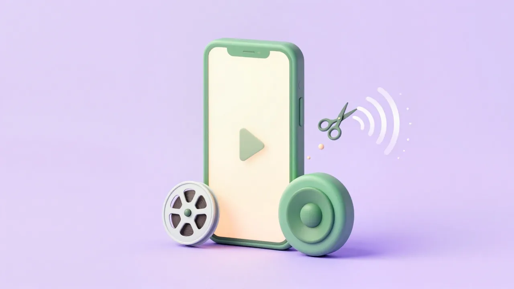
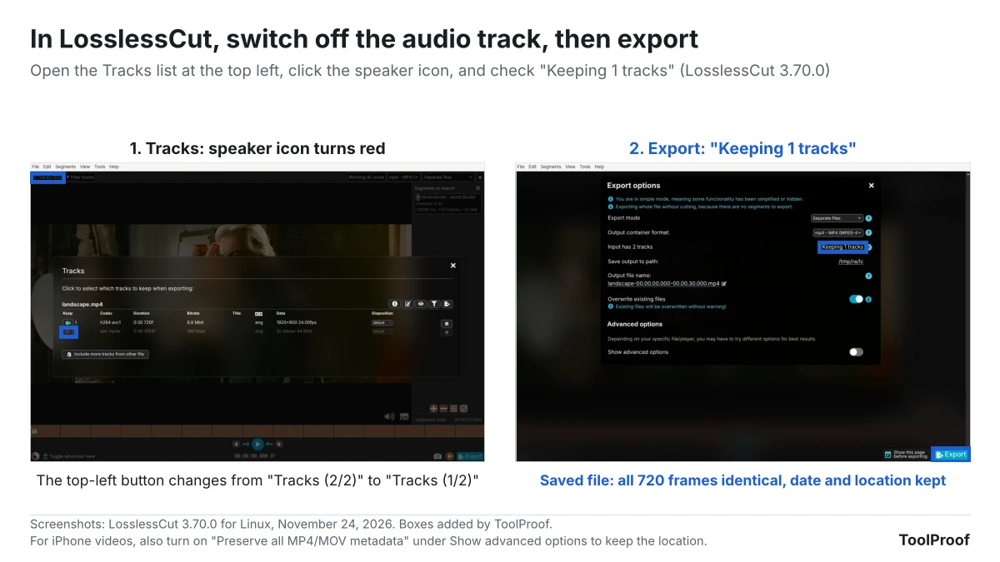
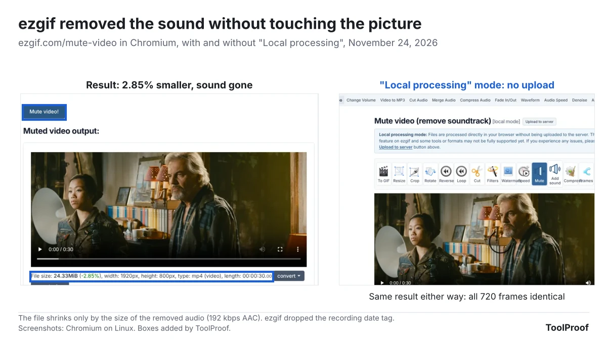
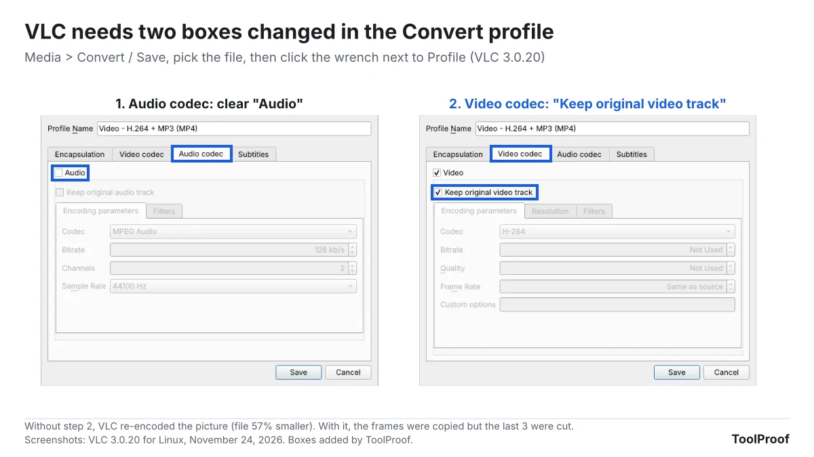
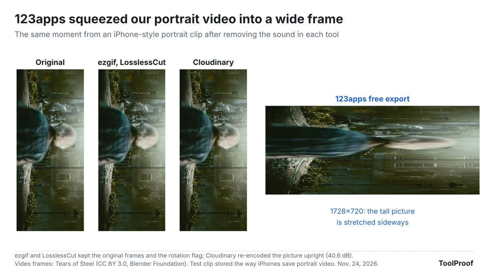

To remove audio from a video without lowering the picture quality, use a tool that deletes the audio track and copies the video as it is. Two free tools did that in our test on November 24, 2026: the desktop app **LosslessCut** and the **ezgif** website's Mute video tool. Both removed the sound from our 30-second test video and kept all 720 frames identical to the original. The file only got 2.85% smaller, which is exactly the space the sound took up.

We ran the same MP4, and an iPhone-style portrait clip, through six free tools and seven settings, then compared every frame of each result with the original along with the picture size, frame rate, sound track, recording date and location tags. HandBrake, Cloudinary, 123apps and VLC's usual profile all re-encoded the picture, meaning they decoded every frame and compressed it again. VLC's copy option kept the frames but cut the last few. The worst surprise came from 123apps, whose free export squeezed our portrait video into a wide 1728×720 frame.

| Method | Picture identical to the original? | Best for |
| --- | --- | --- |
| **LosslessCut** (Windows, Mac, Linux) | Yes, all 720 frames, with date and location kept | Any video you want silent with nothing else changed |
| **ezgif** (website) | Yes, all 720 frames, but the recording date tag is removed | A quick job on a file under 200 MB without installing anything |
| **VLC** (Windows, Mac, Linux) | Copied, but the last 3 frames were cut | Only if VLC is already all you have |
| **HandBrake** (Windows, Mac, Linux) | No, re-encoded at 42.2 dB | Removing sound and shrinking the file in one step |
| **Cloudinary** (website) | No, re-encoded at 39.9 dB and 75% smaller | A small silent copy for the web, not an archive |
| **123apps** (website) | No, 720p and 30 fps on the free export | Not recommended, especially for portrait video |

## Does removing audio from a video lower its quality?

Removing audio lowers video quality only when the app re-encodes the picture; deleting the audio track and copying the video stream leaves every frame untouched. A video file holds the picture and the sound as separate tracks. A tool that only drops the sound track can copy the picture data byte for byte, so the job takes seconds and nothing is lost.

Four of the seven settings we tried instead rebuilt the whole video on export, even though all we changed was the sound. That is like photocopying a photocopy: each re-encode throws away a little detail, and these tools also picked a lower bitrate, the amount of data per second, than our original. You can usually tell from the size. Our silent copies from LosslessCut and ezgif were 2.85% smaller, while the re-encoded ones were 49% to 75% smaller.

Every tool we tested deleted the audio track entirely rather than leaving a silent track behind, so the files had no sound at all.

## Which free tools remove audio without re-encoding?

Only LosslessCut and ezgif removed the sound and kept every frame identical in our test; VLC's "Keep original video track" copied the frames but cut the last three, and the other settings re-encoded the video. Our test file was a 30-second 1920×800 H.264 MP4 with AAC sound and a recording date and location tag, like a video from an Android phone.

| Tool and setting | Frames identical to the original | File size (original 26.3 MB) | Picture size, frame rate | Recording date and location |
| --- | --- | --- | --- | --- |
| LosslessCut 3.70.0, audio track off | All 720 | 25.5 MB | 1920×800, 24 fps | Both kept |
| ezgif Mute video | All 720 | 25.5 MB | 1920×800, 24 fps | Date removed, location kept |
| VLC 3.0.20, Keep original video track | 717, last 3 cut | 25.4 MB | 1920×800, 24 fps | Date reset, location removed |
| HandBrake 1.7.2, Fast 1080p30 | None (42.2 dB) | 13.4 MB | 1920×800, 24 fps | Date reset, location removed |
| VLC 3.0.20, default H.264 profile | None (42.1 dB), last 2 cut | 11.3 MB | 1920×800, 24 fps | Date reset, location removed |
| Cloudinary Remove Audio | None (39.9 dB) | 6.7 MB | 1920×800, 24 fps | Both removed |
| 123apps, volume 0% | None | 9.8 MB | 1728×720, 30 fps | Both removed |

The dB figures are brightness PSNR, a common score of how close each frame is to the original (higher is closer). Any score at all means the frames were rebuilt and lost some detail, and the loss adds up each time the same clip is re-encoded. "Date reset" means the app replaced the recording time with the time it saved the file, so photo apps may sort the clip as if you filmed it today.

## How to remove audio from a video in LosslessCut

LosslessCut removes the audio track and copies the video stream, so the picture, size and frame rate stay exactly as they were. In our test, LosslessCut 3.70.0 kept all 720 frames, the recording date and the location tag. The app is free and open source for Windows 10 and 11, macOS 13 or newer and Linux, according to the [LosslessCut website](https://losslesscut.app/). The Microsoft Store and Mac App Store versions cost money; the site says the paid store versions support the developer and add automatic updates, while the direct download stays free.

1. Download LosslessCut from [losslesscut.app](https://losslesscut.app/) and open your video with **File > Open**.
2. Click **Tracks (2/2)** at the top left. The list shows one video track and one audio track.
3. Click the speaker icon in the **Keep** column of the audio track. It turns red and the button at the top now reads **Tracks (1/2)**.
4. Close the list and click **Export** at the bottom right.
5. Check that the Export options say **Keeping 1 tracks**, then click **Export** again. LosslessCut saves the new file next to the original.

For iPhone videos, turn on one more switch. Our iPhone-style .mov kept its recording time with the default settings but lost the Apple date and location tags. With **Show advanced options** and then **Preserve all MP4/MOV metadata** turned on in the Export options, LosslessCut kept every tag and still copied all 480 frames. If you'd rather strip the location, our guide to [removing location data from photos](/posts/remove-metadata-from-photos) explains why it matters.

LosslessCut may warn that an iPhone HEVC file "is not natively supported" and show a low-quality preview. The warning is only about the preview: our exported file was identical to the original frame for frame.

## Remove audio from a video online with ezgif

ezgif's free Mute video tool removed the sound and kept every frame identical, with no account and no watermark. In our test, the result of both test files matched the original frame for frame, and ezgif kept the portrait video's rotation flag, so it still played upright. The tool accepts files up to 200 MB and deletes uploads after an hour, according to [ezgif's Mute video page](https://ezgif.com/mute-video).

1. Open [ezgif.com/mute-video](https://ezgif.com/mute-video), choose your file and click **Upload file!**
2. Click **Mute video!**
3. When the muted video appears under **Muted video output**, click **Save**.

To keep the video on your own computer, tick **Local processing** before you choose the file. The upload button then reads **Load file!**, and ezgif does the work in your browser. In our test, local processing gave the same frame-for-frame result, and the browser sent no upload request to ezgif, only requests to its ad servers.

One catch: ezgif removed the recording date tag from both files, and from the iPhone-style file it also removed the location. That's a plus if you're sharing the clip publicly, and a minus if you want your photo library to keep it in the right place on the timeline.

## How to remove audio from a video in VLC

VLC can save a copy without sound, but you have to change two settings, and even then our copy lost its final frames. In VLC 3.0.20, the default **Video - H.264 + MP3 (MP4)** profile re-encodes the picture, so turning off the audio alone made a file 57% smaller at 42.1 dB, missing its last 2 frames.

1. Choose **Media > Convert / Save**, click **Add** to pick your video, then click **Convert / Save**.
2. Click the wrench icon next to **Profile**.
3. On the **Audio codec** tab, clear the **Audio** box.
4. On the **Video codec** tab, tick **Keep original video track**, then click **Save**.
5. Click **Browse** to name the new file, then click **Start**.

With both settings, VLC copied the picture instead of re-encoding it, but the result had 717 of the 720 frames: the original's last three, about an eighth of a second, were missing. VLC also replaced the recording date with the time of the conversion and dropped the location. On our iPhone-style portrait clip, the copy lost three frames, VLC changed the video's rotation flag to one that also flips the picture, and it relabeled the HEVC video track from "hvc1" to "hev1". We saw the same mirrored rotation flag when we [rotated a video in VLC](/posts/rotate-video-without-losing-quality), where browsers played VLC's file as a mirror image.

## HandBrake, Cloudinary and 123apps re-encode the picture

HandBrake, Cloudinary and 123apps all made a new, smaller video instead of copying the original picture. That's fine when you also want a smaller file, but none of them is the right choice if you want the clip exactly as it was.

**HandBrake 1.7.2:** open the video, go to the **Audio** tab, click the **X** at the end of the audio track so the list is empty, and click **Start**. With the default **Fast 1080p30** preset, the silent file was 48.9% smaller at 42.2 dB, kept all 720 frames at 24 fps, and replaced the recording date while dropping the location. If you want a smaller file anyway, our [HandBrake settings for Discord and email](/posts/compress-video-for-discord-email) show how to aim for a size. This preset caps the picture at 1920×1080 whichever way it faces, which shrinks portrait phone video, as we found when we [converted iPhone video to MP4](/posts/convert-iphone-video-to-mp4).

**Cloudinary:** the free [Remove Audio from Video](https://cloudinary.com/tools/remove-audio-from-video) page needs no account and its page promises no watermarks. Our download had no watermark, but it was 74.7% smaller than the original, at a much lower bitrate of 1,772 kbps and 39.9 dB, and both tags were gone. Cloudinary turned the portrait clip's frames upright, so it played the right way without needing a rotation flag.

**123apps:** its Change Video Volume tool at online-video-cutter.com removed the sound when we set the volume to 0%, but the free export defaults to 720p, and the 1080p button carries a premium mark. Our landscape clip came back at 1728×720 and 30 frames per second, with repeated frames filling the gap from the original 24. Our portrait clip was worse:

123apps gave the project a wide frame, the shape of the clip's stored picture before rotation, and stretched the upright picture to fill it. The squashed look was already visible in the editor's preview before we exported. We didn't test real phone footage, but our clip stores its picture the way iPhones save portrait video, so check the preview carefully if you use 123apps.

## Remove audio from a video on iPhone, Mac, Windows or Android

Your phone or computer may already have a way to mute a video, but we couldn't run these apps in our test, so the steps below come from each company's help pages and we haven't measured what they do to quality.

- **Mac:** open the video in QuickTime Player and choose **Edit > Remove Audio**. Apple's [QuickTime Player guide](https://support.apple.com/guide/quicktime-player/remove-audio-or-video-qtp5a44f7279/mac) says the file is then video only.
- **iPhone:** in the free iMovie app, tap the clip in your project's timeline, tap the **Audio** button and tap **Mute**, according to Apple's [iMovie for iPhone guide](https://support.apple.com/guide/imovie-iphone/adjust-audio-knabf616edbf/ios). Apple's iPhone User Guide page on [editing video in Photos](https://support.apple.com/guide/iphone/trim-video-length-adjust-speed-and-edit-audio-iph1d1344a2d/ios) covers trimming, speed and Audio Mix but doesn't describe a mute control.
- **Android:** in Google Photos, open the video you want to edit and tap **Mute**. On a Pixel 8 or newer, tap **Audio**, then **Mute**, then **Save** at the top to keep a copy, according to [Google Photos Help](https://support.google.com/photos/answer/10729480).
- **Windows:** in Microsoft's Clipchamp video editor, click the speaker symbol on the clip, or detach the audio and delete it. The muted clip's sound then isn't heard in the exported video, according to [Microsoft's Clipchamp guide](https://support.microsoft.com/en-us/clipchamp/how-to-mute-separate-and-delete-audio-from-video).

## Other tools we looked at

- **Clideo** (clideo.com/mute-video): processed our clip without an account and showed a **Remove watermark** button next to **Download**, but the download returned a "403 Forbidden" error in our test browser, so we couldn't check the file.
- **AudioRemover** (audioremover.com): its page says the video stream is copied when possible and nothing is uploaded, but the site blocked our automated test browser, so we didn't test it.
- **Kapwing, VEED, Adobe Express, Canva and CapCut:** we didn't test these full online video editors this time.

## How we tested

We ran every tool on November 24, 2026, on a Linux computer: LosslessCut 3.70.0, VLC 3.0.20 and HandBrake 1.7.2 through their own windows and menus, and ezgif, Cloudinary, 123apps and Clideo in the Chromium browser without signing in. Two test files came from the open movie Tears of Steel (CC BY 3.0, Blender Foundation):

- a 30-second 1920×800 H.264 MP4 with AAC stereo sound, a recording date and a location tag
- a 20-second HEVC .mov with a portrait rotation flag and Apple's date, location and maker tags, built the way iPhones store portrait video

For each result, we compared a fingerprint of every decoded frame with the original to count identical frames, scored re-encoded frames with brightness PSNR after matching each one to its original frame, and checked the number of frames, picture size, frame rate, sound tracks, rotation flag and tags. Neither file was recorded on a real phone, and we used the Linux versions of the desktop apps; the Windows and Mac versions or newer releases (VLC 3.0.24 and HandBrake 1.11.2 were current) may behave differently.

## Which method should you use?

- **You want the video exactly as it was, just silent:** LosslessCut. It kept every frame and both tags, and it works offline. Turn on **Preserve all MP4/MOV metadata** for iPhone videos.
- **You have one clip under 200 MB and can't install anything:** ezgif's Mute video, with **Local processing** if you'd rather not upload it. Expect the recording date tag to be removed.
- **You also want a smaller file:** HandBrake. It re-encodes the picture, so set a size target with our [Discord and email settings](/posts/compress-video-for-discord-email).
- **You're on a phone or Mac:** iMovie's Mute button, Google Photos' Mute or QuickTime's Remove Audio are the built-in routes, though we couldn't measure them.
- **Skip** 123apps for portrait video and VLC's Convert for anything you want to keep complete.

For other everyday photo and video jobs, our [guide to free photo and video tools](/posts/free-image-converter-photo-tools) collects the tools that won each test, including [trimming a video without losing quality](/posts/trim-video-without-losing-quality).
