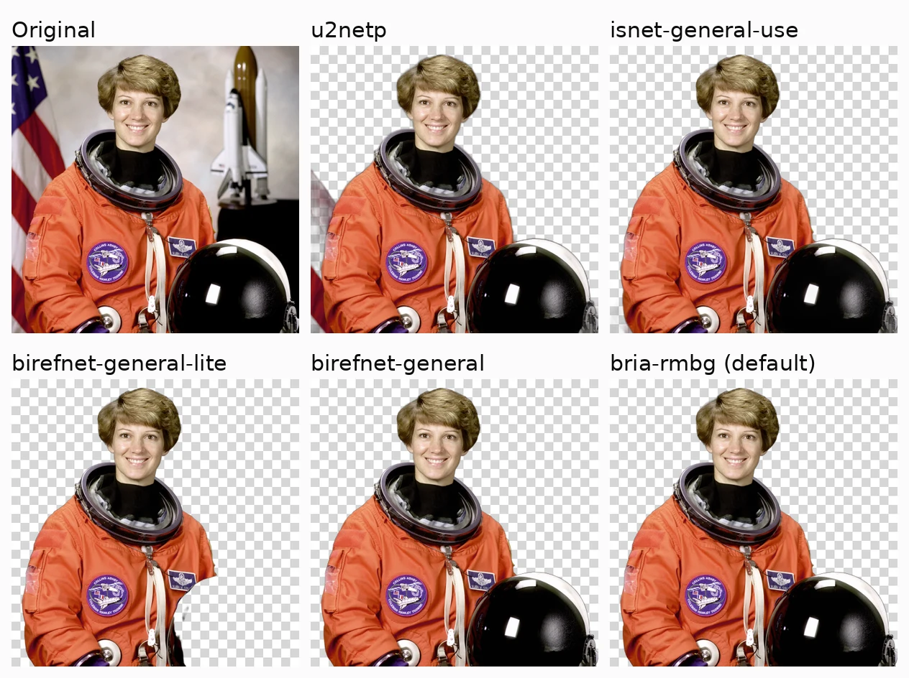
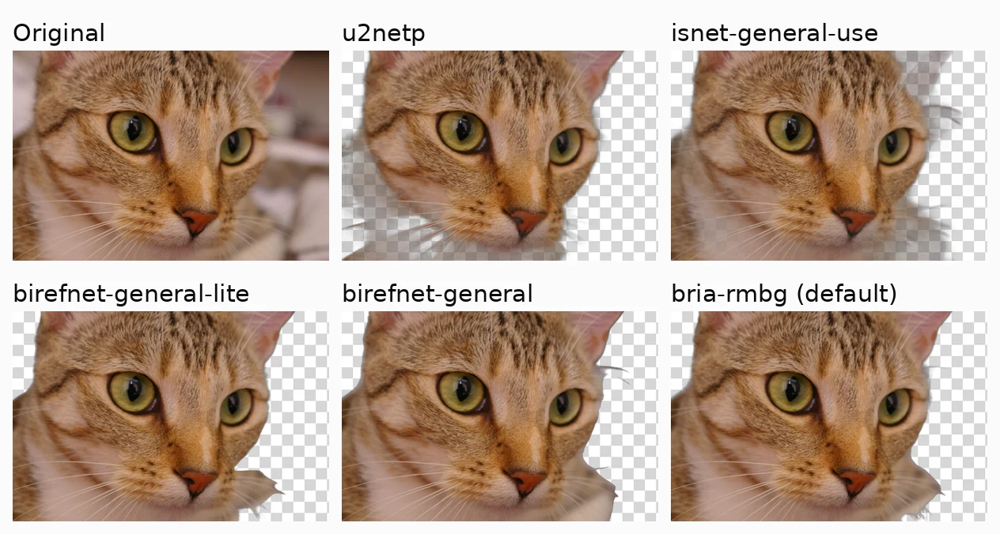
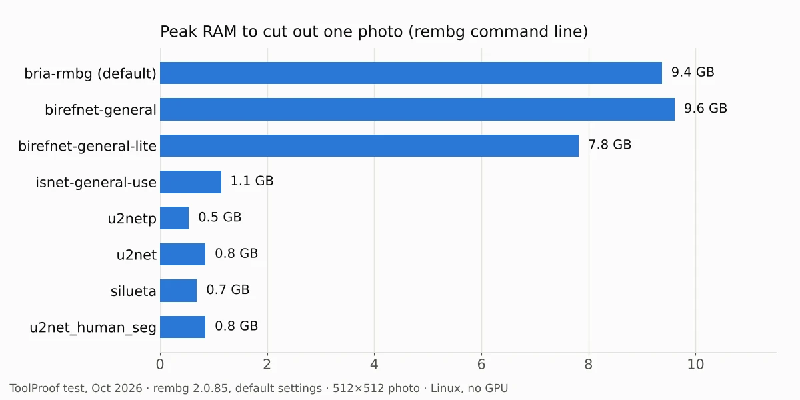
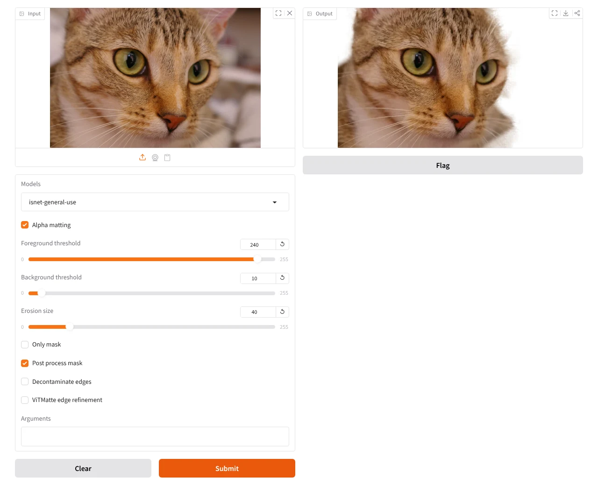

To remove the background from an image for free without uploading it anywhere, install the open-source tool **rembg** and pick the model by how patient your computer is. In our test of 8 rembg models on 50 photos with known correct cutouts, **BiRefNet** and **BRIA RMBG-2.0** produced clean results on about 9 in 10 photos, but each photo took 30 to 46 seconds on a 4-core CPU and needed 8 to 10 GB of RAM. **IS-Net** (`isnet-general-use`) took 1.5 seconds and about 1 GB, with clean results on 7 in 10.

Everything runs on your own computer after a one-time model download, so your photos never leave it, and there's no sign-up, watermark or daily limit. One catch we found: rembg's default model, BRIA RMBG-2.0, was the slowest in our test and its license doesn't allow commercial use without a paid agreement.

If you only need a quick cutout and already have a Mac or Windows 11, the built-in tools covered at the end may be enough.

## Which free offline model to use

| Model (rembg name)      | Best for                                             | Clean cutouts (44 photos) | Seconds per photo | Peak RAM | Commercial use          |
| ----------------------- | ---------------------------------------------------- | ------------------------- | ----------------- | -------- | ----------------------- |
| `birefnet-general`      | Best quality you can use anywhere                    | 39 (89%)                  | 41                | 9.6 GB   | Yes (MIT)               |
| `bria-rmbg` (default)   | Personal projects, same quality as BiRefNet          | 40 (91%)                  | 46                | 9.4 GB   | No, without a paid deal |
| `birefnet-general-lite` | Slightly faster BiRefNet                             | 38 (86%)                  | 30                | 7.8 GB   | Yes (MIT)               |
| `isnet-general-use`     | Older or low-memory computers, large batches         | 30 (68%)                  | 1.5               | 1.1 GB   | Yes (Apache 2.0)        |
| `u2netp`                | Quick previews, people and pets on plain backgrounds | 28 (64%)                  | 0.3               | 0.5 GB   | Yes (Apache 2.0)        |

"Clean" means the cutout matched the hand-made correct cutout with at least 95% overlap (IoU 0.95 or higher). Seconds are the median per photo once the model was loaded; RAM is the peak for cutting out one photo with the `rembg` command and default settings.

- **If quality matters most, use `birefnet-general`.** None of its 44 regular photos failed badly (below 80% overlap), it got all 10 portraits and all 15 animals clean, and the MIT license lets you use the results for anything. The 3-image gap between it, BRIA and the lite version is too small to call a winner on 44 photos.
- **If your computer has 8 GB of RAM or less, use `isnet-general-use`.** It was about 28 times faster than BiRefNet and fit in about 1 GB. Expect to fix about 1 in 10 photos by hand: 5 of its 44 failed badly.
- **Skip the default unless it's for personal use.** `bria-rmbg` matched BiRefNet but was the slowest model we tested, and its model card says commercial use needs an agreement with BRIA.

## Our results

The three large models were in a different league from the rest, and the gap showed most on cluttered scenes, plants and see-through objects.

| Model                   | Clean (44) | Failed (below 80%) | Portraits clean (10) | Animals clean (15) | See-through objects, avg. overlap (6) | Download size |
| ----------------------- | ---------- | ------------------ | -------------------- | ------------------ | ------------------------------------- | ------------- |
| `bria-rmbg`             | 40         | 0                  | 10                   | 15                 | 73%                                   | 1.0 GB        |
| `birefnet-general`      | 39         | 0                  | 10                   | 15                 | 74%                                   | 973 MB        |
| `birefnet-general-lite` | 38         | 0                  | 10                   | 15                 | 71%                                   | 224 MB        |
| `isnet-general-use`     | 30         | 5                  | 8                    | 11                 | 57%                                   | 179 MB        |
| `u2netp`                | 28         | 4                  | 10                   | 10                 | 23%                                   | 5 MB          |
| `u2net`                 | 27         | 8                  | 7                    | 12                 | 22%                                   | 176 MB        |
| `silueta`               | 27         | 8                  | 8                    | 11                 | 22%                                   | 44 MB         |
| `u2net_human_seg`       | 20         | 14                 | 8                    | 6                  | 17%                                   | 176 MB        |

Test conditions: rembg 2.0.85 with onnxruntime 1.31.0 on Linux, a 4-core Intel Xeon at 2.8 GHz, no graphics card, October 13, 2026. The 50 photos are a fixed random sample from the AIM-500 test set (15 animals, 10 portraits, 8 plants, 6 see-through objects such as glassware, 5 pieces of furniture, 4 toys and 2 fruit; all between 1.2 and 2.1 megapixels). The "clean" and "failed" counts leave out the 6 see-through objects, because no model got them right and they would hide the differences elsewhere.

A few things stood out:

- **Plants were the hardest regular category.** Even the best model cut out only 5 of 8 plant photos cleanly; thin stems and gaps between leaves are where every model lost detail.
- **The tiny `u2netp` beat its bigger sibling.** At 5 MB, it got all 10 portraits clean and failed fewer photos than the 176 MB `u2net`. `silueta`, a compressed copy of `u2net`, scored the same as `u2net`.
- **`u2net_human_seg` only looks for people.** It removed the subject entirely from most furniture photos, so use it only for portraits, and even there `u2netp` did better in our sample.
- **Glass and other see-through objects need manual work with any model.** The best average overlap was 74%.

### What the cutouts look like

We also ran the models on two copyright-free test photos that ship with the scikit-image library: a NASA portrait (public domain) and a cat photo (CC0). These are on a checkerboard so you can see what was removed.

On the astronaut photo, `birefnet-general` and `bria-rmbg` kept the person and the helmet and removed the flag and the model shuttle. `birefnet-general-lite` cut away most of the helmet, `u2netp` left a strip of the flag at the left edge, and `isnet-general-use` left faint bits of background near the bottom right.

On the cat close-up, the fast models left semi-transparent patches of the blurred background around the face. The three large models gave a clean edge, with small differences in how much of the whiskers they kept.

### Memory: the large models need a recent computer

Cutting out a single 512 × 512 photo with the `rembg` command used 9.4 to 9.6 GB of RAM for BRIA and BiRefNet, and 7.8 GB for the lite version. On a laptop with 8 GB of RAM that will either fail or slow the whole computer to a crawl, so start with `isnet-general-use` there. Counting the time to load the model, one photo took 57 seconds with `birefnet-general`, 65 seconds with the default `bria-rmbg`, and under 5 seconds with `isnet-general-use`.

The "lite" BiRefNet saves download size (224 MB instead of 973 MB) and some time, but on our CPU it still took about 30 seconds per photo, so it isn't a fix for slow computers.

## How to remove a background offline with rembg

rembg is a free, MIT-licensed Python tool. You install it once with an internet connection; each model downloads the first time you use it, and after that it works offline.

1. Install **Python 3.11, 3.12 or 3.13** from python.org (rembg 2.0.85 requires one of these versions).
2. Open **Terminal** (Mac) or **Command Prompt** (Windows) and run:
   `pip install "rembg[cpu,cli]"`
3. Remove the background from one photo, choosing the model with `-m`:
   `rembg i -m birefnet-general photo.jpg photo-cutout.png`
   Use `-m isnet-general-use` instead on a computer with 8 GB of RAM or less. If you leave out `-m`, rembg uses `bria-rmbg`.
4. For a whole folder, use `p` instead of `i`:
   `rembg p -m isnet-general-use photos cutouts`

The result is a PNG with a transparent background. If the edges show a colored rim from the old background (common with hair and fur against grass or a colored wall), add `-dc`, which rembg's documentation describes as removing "the background color fringing left on soft edges."

The output PNG also drops the photo's metadata: when we gave rembg a JPEG with camera details stored in it, the cutout had none. That's a plus for privacy, but it also removes any content credentials, which we covered in [our test of how everyday edits strip AI image labels](/posts/check-if-image-is-ai-generated).

### Prefer clicking to typing? Use rembg's built-in web page

rembg comes with a simple web page that runs on your own computer:

1. Run `rembg s --host 127.0.0.1 --port 7000`.
2. Open **http://127.0.0.1:7000** in your browser.
3. Drop a photo into **Input**, choose a model under **Models**, and click **Submit**. Use the download button above **Output** to save the PNG.

Using `127.0.0.1` keeps the page reachable only from your own computer. Note that the web page starts with **Alpha matting** and **Post process mask** turned on, unlike the `rembg` command, so the same model can give slightly different edges in the two. Our measurements above used the command-line defaults (both off). With `isnet-general-use`, the web page returned the cat cutout in 3.4 seconds.

## Built-in options on Mac, Windows and Office

You may not need to install anything for a one-off cutout. We couldn't test these in our Linux environment, and the vendors' pages we checked don't say whether the processing happens on your device, so check that yourself if privacy is the reason you're avoiding websites.

- **Mac (Preview):** open the image, click the **Remove Background** button in the toolbar, and choose whether to convert it to PNG or make a copy first (**File > Duplicate**), according to [Apple's Preview guide](https://support.apple.com/guide/preview/prvw15636/mac).
- **Windows 11 (Paint):** Microsoft added a one-click remove background button to Paint, which can also work on just a rectangle you select, as announced on the [Windows Insider blog](https://blogs.windows.com/windows-insider/2023/09/07/background-removal-in-paint-begins-rolling-out-to-windows-insiders/).
- **Word, PowerPoint and other Office apps:** select a picture, then **Picture Format > Remove Background**, and use **Mark Areas to Keep** or **Mark Areas to Remove** to fix mistakes, per [Microsoft's support page](https://support.microsoft.com/topic/c0819a62-6844-4190-8d67-6fb1713a12bf).

These are easier than rembg, but you can't pick the model or process a whole folder at once.

## Can you use the results commercially?

It depends on the model, not on rembg itself. rembg is MIT-licensed, but its documentation notes that "model weights carry their own licenses."

- **BiRefNet** (`birefnet-general`, `birefnet-general-lite`): [MIT license](https://github.com/ZhengPeng7/BiRefNet).
- **U²-Net** (`u2net`, `u2netp`, `u2net_human_seg`, `silueta`) and **IS-Net** (`isnet-general-use`): the [U²-Net](https://github.com/xuebinqin/U-2-Net) and [DIS](https://github.com/xuebinqin/DIS) projects are released under Apache 2.0.
- **BRIA RMBG-2.0** (`bria-rmbg`, the default): the [model card](https://huggingface.co/briaai/RMBG-2.0) says it's released under CC BY-NC 4.0 for non-commercial use, and commercial use "is subject to a commercial agreement with BRIA."

So for product photos, client work or anything you sell, pass `-m birefnet-general` or another non-BRIA model explicitly. (This is a summary of the licenses as of October 2026, not legal advice.)

## Other tools we looked at

- **`withoutbg`** appears in rembg's model list but isn't a local model: it sends your image to the withoutBG cloud service and needs an API key, so it isn't offline.
- **`birefnet-portrait`**, **`birefnet-massive`** and other specialist BiRefNet models are also available in rembg. We left them out because they're tuned for narrower jobs; `birefnet-portrait` is the same roughly 1 GB size as `birefnet-general`, so expect similar speed. rembg's documentation suggests `birefnet-portrait` with `-dc` as a starting point for portraits.
- **`sam`** (Segment Anything) needs you to point out the object you want (as coordinates on the command line), so it isn't automatic like the others.

## What we tested

- **Software:** rembg 2.0.85 (released September 20, 2026) with onnxruntime 1.31.0, Python 3.11, Linux. Models downloaded by rembg from its GitHub releases.
- **Hardware:** a 4-core Intel Xeon at 2.8 GHz with 16 GB of RAM and no graphics card. Speeds were measured with nothing else running. A recent laptop with a graphics card supported by rembg's GPU options will be faster.
- **Photos:** 50 images from AIM-500, a public test set of 500 photos with hand-made transparency masks (MIT license), picked at random within each category. We didn't use DIS5K, a popular set for this kind of test, because its terms allow only non-commercial use. The training data BiRefNet lists for its standard general-use models doesn't include AIM-500, though its newer 2048 × 2048 model does, and BRIA doesn't publish its training set.
- **Scoring:** we compared each model's cutout with the correct mask at the 50% transparency line and measured the overlap (intersection over union). Clean = at least 95% overlap; failed = below 80%. We also recorded the median time per photo after loading the model, and peak RAM for one photo with the `rembg` command.
- **Limits:** 50 photos is enough to separate the three large models from the rest, not to rank the three against each other. Different photos, especially product shots on plain backgrounds, will score higher across the board.

If you're building a private, offline toolkit, we ran the same kind of test for [free offline transcription models](/posts/transcribe-audio-offline-free) and [free offline text-to-speech voices](/posts/free-offline-text-to-speech) on the same CPU, and collected them with an offline chatbot test in our [guide to the best free offline AI tools](/posts/free-offline-ai-tools).

## FAQ

### Can I run rembg on Windows?

Yes. rembg is a Python package, so it runs anywhere Python 3.11 to 3.13 does, including Windows; install it with the same `pip install "rembg[cpu,cli]"` command in Command Prompt. We ran our test on Linux, so the Windows steps come from rembg's documentation rather than our own run.

### Does rembg need a graphics card?

No. Every result in this article was measured on a CPU with no graphics card. rembg also offers `rembg[gpu]` for NVIDIA cards and `rembg[rocm]` for AMD cards, which mainly helps the large BiRefNet and BRIA models.

### Where does rembg store the models?

In a `.rembg/models` folder in your home folder, one subfolder per model. Delete a model's folder to free the space; rembg downloads it again the next time you use that model.
