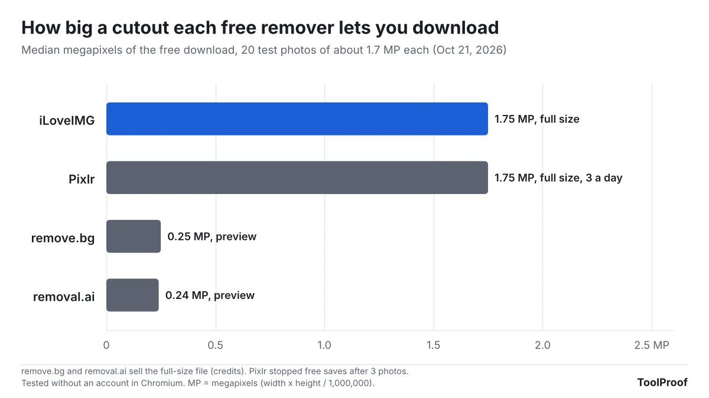
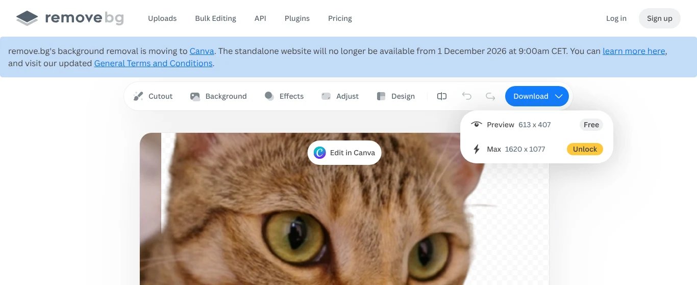
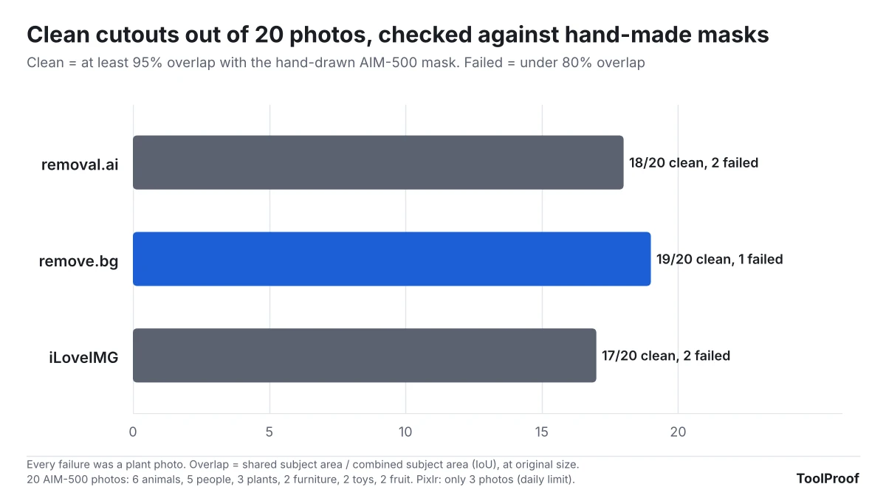
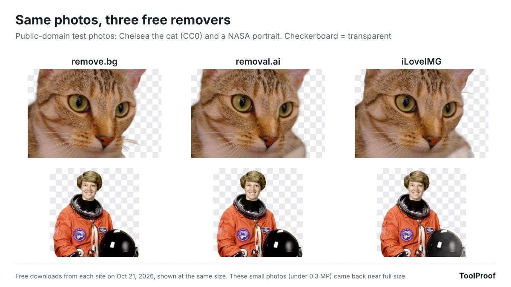
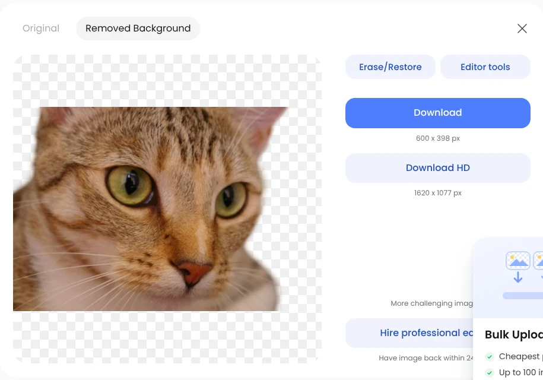
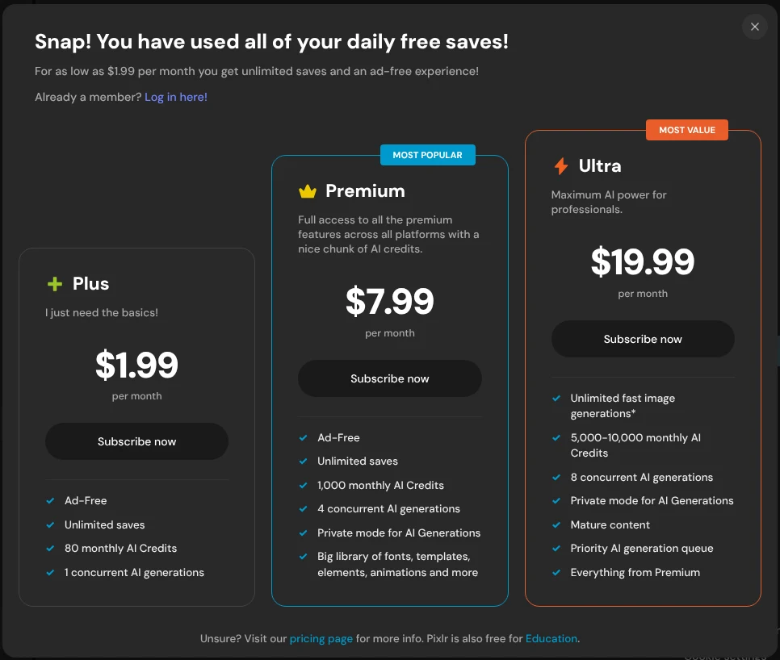

The best free remove.bg alternative we tested is iLoveIMG's **Remove background** page: it was the only website that let us download every cutout at full size for free, with no account. remove.bg's own website shuts down on December 1, 2026, and until then its free download is a small preview of about 0.25 megapixels (612 × 408 pixels for a typical phone-sized photo). If the photo is on your own device, the background remover already built into your Mac, iPhone or Windows 11 Paint is free and never uploads anything.

We tested this on October 21, 2026, with 20 photos that come with hand-drawn masks, the exact outline of the subject drawn by people. That let us score every cutout instead of eyeballing it. We ran all 20 through remove.bg, iLoveIMG and removal.ai without signing in, and Pixlr until it stopped us after 3 free saves. The three finished tools were close on accuracy: 17 to 19 of 20 cutouts were clean, and every failure was a plant. The real difference was what the free version lets you download.

## Free remove.bg alternatives at a glance

| Tool | Free download | Sign-up | Clean cutouts (of 20) | Best for |
| --- | --- | --- | --- | --- |
| **iLoveIMG** (website) | Full size | Not needed | 17 | Free full-size cutouts |
| **removal.ai** (website) | Preview, about 600 × 400 | Not needed | 18 | Small images for web or chat |
| **Pixlr** (website) | Full size, 3 saves a day | Not needed | 2 of 3 tried | One or two photos a day |
| **remove.bg** (website) | Preview, about 612 × 408 | Not needed | 19 | Until November 30 only |
| **Preview, Photos, Paint** (built in) | Full size | Not needed | Not tested | Photos already on your device |

The first four rows are what we measured on each site. The built-in tools come from Apple's and Microsoft's own pages, because our test computer runs Linux.

## What happens to remove.bg on December 1

According to [remove.bg's FAQ](https://www.remove.bg/faq), the standalone website "will no longer be available from 1 December 2026 at 9:00am CET" (3:00 a.m. Eastern). Background removal is moving into Canva, which has owned remove.bg since 2021, and the API for apps and developers is moving to Leonardo.ai. The same FAQ says:

- **Pay-as-you-go credits** expire on December 1, so use them before then.
- **Annual subscriptions** end automatically, with a pro-rata refund for unused time. **Monthly subscriptions** also end, and any final renewal on or after November 1 is free.
- **Your account** closes with the site. Export your credit usage report and invoices from your Account page before December 1, because you can't download them afterward.
- **The Photoshop plugin and other integrations** stop working on December 1.

The banner announcing all of this sits right above remove.bg's editor, and the free option in its download menu is still the small preview.

remove.bg points people to Canva's Background Remover, which its FAQ says "uses the same background-removal technology." Canva's pages blocked our test browser, so we couldn't check whether Canva's free plan includes it. Check [Canva's pricing page](https://www.canva.com/pricing/) before you count on it. For Affinity, Canva's free photo editor, remove.bg's FAQ says background removal needs a Canva Pro subscription.

## How we tested

We picked 20 photos at random from [AIM-500](https://huggingface.co/datasets/nobg/AIM-500), a public test set of 500 photos with hand-drawn transparency masks (MIT license): 6 animals, 5 people, 3 plants, 2 pieces of furniture, 2 toys and 2 pieces of fruit, each about 1,080 × 1,620 pixels (1.75 megapixels). We left out the set's glass and other see-through objects, which no background remover handles well.

Each photo went through the [remove.bg](https://www.remove.bg/upload), [iLoveIMG](https://www.iloveimg.com/remove-background), [removal.ai](https://removal.ai/upload/) and [Pixlr](https://pixlr.com/remove-background/) websites in a Chromium browser on Linux, without an account. We clicked each site's own buttons and saved the free download. Then we measured:

- **Free download size**: the width and height of the file the free option gives you.
- **Accuracy**: how much of the cutout overlaps the hand-drawn mask (shared area divided by the combined area of both). We scaled small preview files up to the original size first, so every tool was scored on the same grid. "Clean" means at least 95% overlap. "Failed" means under 80%, where a visible chunk of subject is missing or background is left in.
- **Edges**: the average error in a thin strip around the subject's outline, where hair, fur and leaves are.

The test photos themselves can't be shown here because their copyright stays with the photographers. The example images below use two public-domain photos instead.

## Results: accuracy is close, free file size is not

remove.bg made the most clean cutouts (19 of 20), removal.ai 18 and iLoveIMG 17. The median overlap was between 98.3% and 98.7% for all three, so on a typical photo of a person, pet or product you won't see much difference.

What we found in the details:

- **Plants were the weak spot for every tool.** One photo of a plant spread across the whole frame failed in all four tools (60% to 69% overlap). On a second plant photo, remove.bg scored 98% while removal.ai and iLoveIMG cut away most of the subject (32% and 49%).
- **iLoveIMG's edges are rougher.** Its edge error was 8.4%, against 5.5% for removal.ai and 6.2% for remove.bg. Its PNG files use fewer shades of see-through, so fine hair and fur look a little more cut out than soft. You notice it on dark backgrounds, less on white ones.
- **The free previews are small, not sloppy.** remove.bg and removal.ai scored well even after we scaled their 0.25 MP files up to full size, but blown up like that the cutouts look soft. They're fine for a profile picture or a chat message, not for print or a product listing.

## How to remove a background for free with iLoveIMG

iLoveIMG accepts JPG and PNG files. If your photo is HEIC (from an iPhone) or WebP, [convert the HEIC photo to JPG](/posts/convert-heic-to-jpg-free) first.

1. Open [iLoveIMG Remove background](https://www.iloveimg.com/remove-background).
2. Click **Select images** and choose your photo.
3. Click **Remove background**.
4. When the page says the task was processed, click **Download file**. You get a PNG with a transparent background, the same size as your photo.

We ran all 20 test photos one after another without hitting a limit. iLoveIMG's [pricing page](https://www.iloveimg.com/pricing) says the free plan has "limited document processing" without giving a number, and Premium is $5 a month billed yearly ($60 a year) as of October 2026. Your photo is uploaded to iLoveIMG's servers to be processed.

## removal.ai: good edges, small free file

removal.ai had the cleanest edges in our test, but its free **Download** button gives a file about 600 × 400 pixels. The full-size file is behind **Download HD**, which costs credits.

1. Open [removal.ai](https://removal.ai/upload/) and drop your photo on the upload box.
2. Wait for the **Removed Background** view.
3. Click **Download** for the free preview.

According to removal.ai's [pricing page](https://removal.ai/pricing/), previews are free and unlimited, and full-size files start at $1.89 for 3 credits (1 credit per image) as of October 2026. If you only need a small image, such as a profile photo or a picture for a chat or slide, the free preview is enough.

## Pixlr: full size, but only 3 a day

Pixlr's [Background Remover](https://pixlr.com/remove-background/) gave us full-size PNGs, and 2 of the 3 photos we got through were clean. On the fourth photo it showed "Snap! You have used all of your daily free saves!" and asked us to subscribe. Plans start at $2.49 a month ($1.99 a month billed yearly) according to its [pricing page](https://pixlr.com/pricing/). We didn't try to get around the limit, so Pixlr's accuracy is based on just 3 photos.

To use it, click **Browse** on the Background Remover page, pick a photo, then click **Save** on the result.

## Remove a background without uploading anything

If you don't want your photo on someone else's server, the tool you already have is the easiest choice. We couldn't run these on our Linux test computer, so the steps come from Apple's and Microsoft's own pages:

- **Mac (Preview):** open the image in Preview and click the **Remove Background** button in the toolbar. If Preview asks to convert the file to PNG, click **Cancel** and choose **File > Duplicate** to keep the original, or **Convert** to change it. **Edit > Undo** brings the background back ([Apple's Preview guide](https://support.apple.com/guide/preview/remove-a-background-prvw15636/mac)).
- **iPhone (Photos):** open the photo, then touch and hold the subject until an outline appears. Tap **Copy**, **Share** or **Add Sticker** to use the cutout ([Apple's iPhone guide](https://support.apple.com/guide/iphone/lift-a-subject-from-the-photo-background-iphfe4809658/ios)).
- **Windows 11 (Paint):** open the picture in Paint and click **Remove background** in the toolbar. To cut out only part of the picture, draw a rectangle with the select tool first. Microsoft introduced the button in 2023 ([Windows Insider Blog](https://blogs.windows.com/windows-insider/2023/09/07/background-removal-in-paint-begins-rolling-out-to-windows-insiders/)).

These keep your photo at full size and don't have daily limits.

## Which one should you use?

- **You used remove.bg for occasional photos:** switch to iLoveIMG. It was the only site that gave full-size cutouts free and without a limit we could hit, and its accuracy was within two photos of remove.bg's.
- **You need the cleanest hair or fur edges and a small image is enough:** use removal.ai's free preview.
- **The photo is on your Mac, iPhone or Windows 11 PC:** try the built-in tool first. Nothing is uploaded.
- **You still have remove.bg credits or a subscription:** use the credits before December 1 and download your invoices from your Account page. After that, remove.bg suggests Canva, where you'd need to check which plan includes the background remover.
- **Your photo is a plant, a tree or a busy scene:** expect to fix it by hand in any of these tools. The free [GIMP editor](https://www.gimp.org/) can do that, but it takes longer.

If the cutout is headed for a form or an email with a size limit, see our [test of shrinking an image to 100KB](/posts/compress-image-to-100kb). For other free tools we've tested on the same principle, see our [guide to the best free PDF tools](/posts/best-free-pdf-tools), which covers iLovePDF, iLoveIMG's sister site, and our [roundup of free offline AI tools](/posts/free-offline-ai-tools). Our [best free image converter and photo tools](/posts/free-image-converter-photo-tools) page puts this test next to five other photo and video jobs.

## FAQ

### Is remove.bg still free?

Until December 1, 2026, yes, at preview size. In our test, the free download was 612 × 408 pixels for a 1,620 × 1,080 photo, and the full-size file needed credits. After December 1 the website and accounts are gone.

### Is there a free background remover with no sign-up and HD download?

In our test, iLoveIMG was the one: full-size PNGs with no account for all 20 photos. Pixlr also gives full size without an account, but only 3 saves a day.

### Can I remove a background from an AI-generated image the same way?

Yes, these tools don't care where the image came from. Note that cutting out and re-saving an image usually strips the labels that mark it as AI-made, as we found when we [tested how to check if an image is AI-generated](/posts/check-if-image-is-ai-generated).
