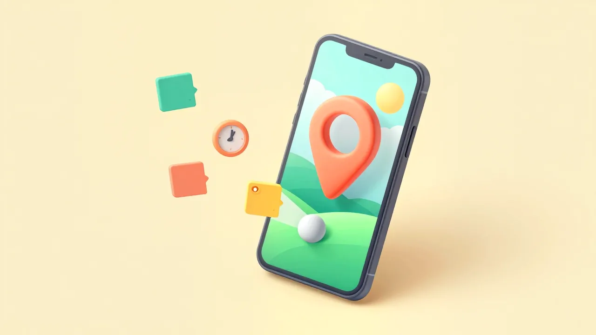
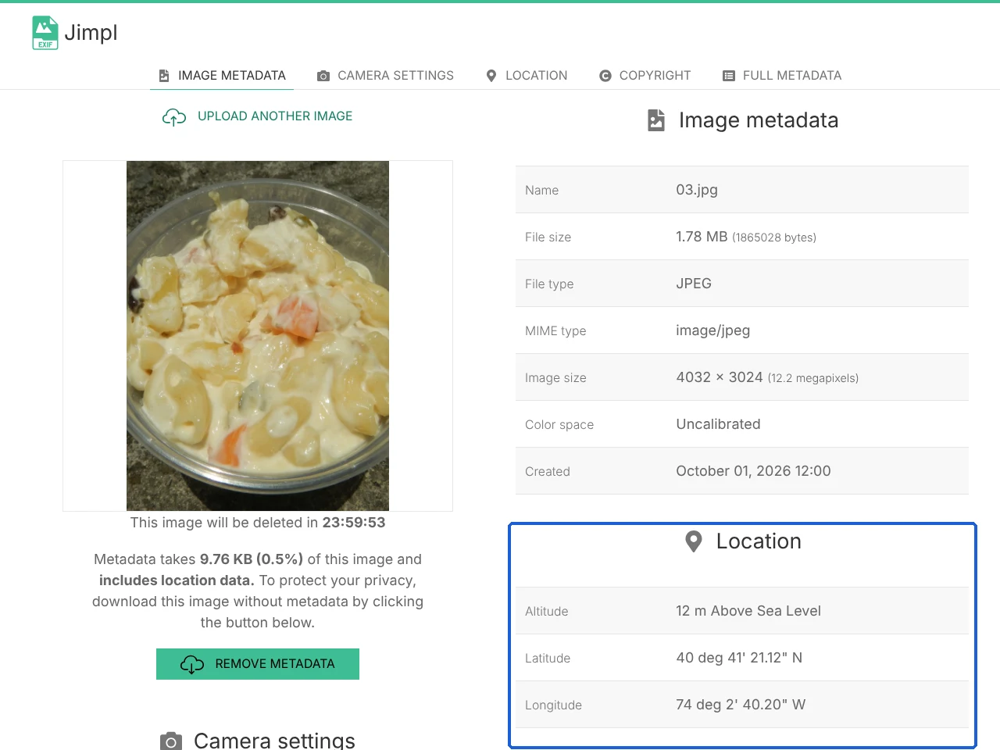
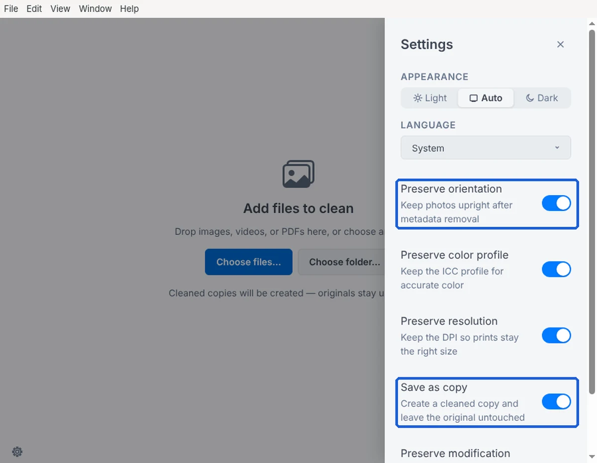
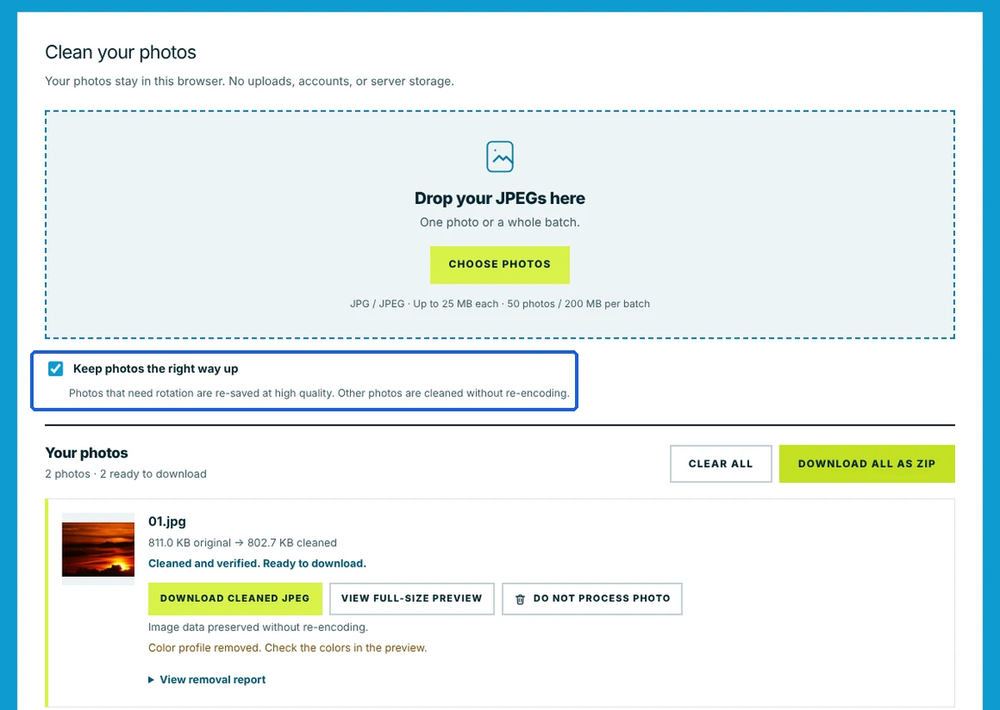
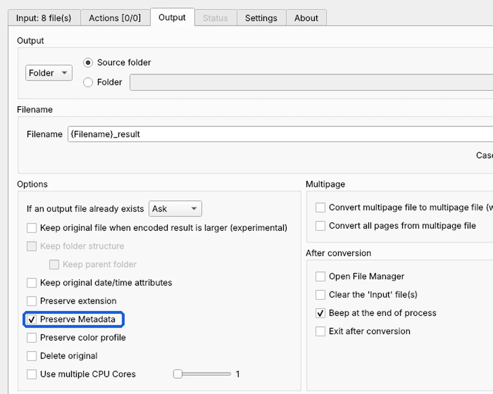
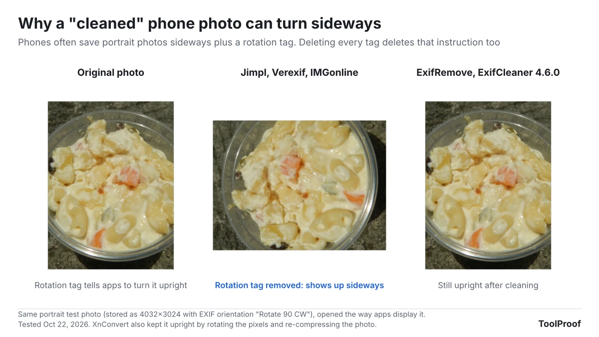

To remove metadata from a photo for free, use the photo's own share settings when you can (on an iPhone, tap **Share > Options** and turn off **Location**), or run the file through a free cleaner such as the ExifCleaner desktop app or the ExifRemove website. Both removed every piece of personal data we planted in our test photos, kept portrait photos upright, and never sent the photos anywhere.

We tested six free tools on October 22, 2026, with eight test photos that we tagged with a GPS location, camera make and model, a serial number, the date taken, an author name, a city name and a small preview image. Every tool removed all of it. The differences were elsewhere. Three popular websites (Jimpl, Verexif and IMGonline) uploaded each photo to their servers, and they also deleted the rotation tag that keeps a portrait photo upright, so both of our portrait photos came back sideways. XnConvert, a free batch converter, keeps all metadata unless you untick one box, and it re-compresses every photo when it saves.

## Free photo metadata removers at a glance

| Tool | Type | Removes location and camera data | Portrait photos stay upright | Photo uploaded | Best for |
| --- | --- | --- | --- | --- | --- |
| **ExifCleaner 4.6.0** | Desktop app (Windows, Mac, Linux) | Yes | Yes | No | Many photos, nothing leaves your computer |
| **ExifRemove** | Website (runs in your browser) | Yes | Yes | No | A few JPGs, no install, phone or computer |
| **XnConvert 1.118** | Desktop app (Windows, Mac, Linux) | Only with **Preserve Metadata** unticked | Yes | No | Resizing or converting photos at the same time |
| **Jimpl** | Website | Yes | No (2 of 2 sideways) | Yes, deleted after 24 hours per the site | Seeing what a photo reveals before you clean it |
| **Verexif** | Website | Yes | No (2 of 2 sideways) | Yes | Landscape photos only |
| **IMGonline** | Website | Yes | No (2 of 2 sideways) | Yes | Landscape photos only |

All six are free for personal use as of October 2026. XnConvert is free for private use; companies need a paid license, according to [XnSoft](https://www.xnview.com/en/xnconvert/).

## What photo metadata gives away

A photo file carries hidden details on top of the picture itself. The main block is called EXIF, a standard format that cameras and phones use to record how and where a photo was taken. Other blocks, called XMP and IPTC, can hold names, captions and place names. If location access is on for your camera, the GPS position goes in too, so anyone who gets the original file can see where the photo was taken. Apple's [personal safety guide](https://support.apple.com/guide/personal-safety/manage-location-metadata-in-photos-ips0d7a5df82/web) warns that people you share such photos with may be able to see where they were taken.

To show how much a free viewer reveals, we uploaded one of our test photos to Jimpl. Within seconds it listed the camera, lens, the author name we had written into the file, the date taken and the exact coordinates.

Removing metadata only deletes these hidden details. It does not hide anything visible in the picture, such as a street sign, a house number or a face.

## How we tested

We judged each tool on four things:

- **Is the personal data really gone?** We checked for GPS location, camera make and model, serial number, lens, date taken, author and copyright, city and place names, and the small preview image (thumbnail) that cameras embed in the file.
- **Do portrait photos stay upright?** Cameras and phones often store a portrait photo sideways and add a rotation tag that tells apps to turn it upright. Two of our eight photos were stored this way.
- **Is the picture itself left alone?** A cleaner only needs to cut out the hidden data. Saving the photo again re-compresses it and slightly lowers its quality.
- **Does the photo leave your device?** We recorded the network traffic of each website while it worked. If the browser sent a request at least half the size of the photo, we counted the photo as uploaded.

Test setup:

- **Test photos:** 8 public domain (CC0) photos from the [PD12M collection](https://huggingface.co/datasets/Spawning/PD12M), saved as 12-megapixel JPGs (4032 × 3024). We wrote made-up test values into every file: a GPS position in New York Harbor, the camera "ToolProof Metadata Test Phone," a serial number, a lens, an author called "Jane Example," a city, a place name and a thumbnail.
- **Desktop apps:** all 8 photos through ExifCleaner 4.6.0 and XnConvert 1.118.0 on Linux, operated through their normal windows.
- **Websites:** 4 photos each (2 landscape, 2 portrait) through ExifRemove, Jimpl, Verexif and IMGonline in Chromium, with default settings and no account.
- **Checking the results:** we read every output file with ExifTool 12.76, a metadata reader, and compared its pixels with the original.

## ExifCleaner: best desktop app

ExifCleaner removed every piece of personal data from all 8 photos and kept both portrait photos upright. It did this without re-compressing anything: the picture data in each cleaned file was identical to the original, and files got less than 1% smaller. ExifCleaner is free and open source (MIT License) for Windows, Mac and Linux, and handles images, videos and PDFs, according to [its website](https://exifcleaner.com/).

Version 4.6.0 has a settings panel (the gear icon at the bottom left) with four switches that are on by default. **Preserve orientation**, **Preserve color profile** and **Preserve resolution** keep only the rotation tag, the color profile and the print size (DPI). None of these identify you, and keeping them means the photo looks and prints the same. **Save as copy** writes cleaned copies and leaves your originals alone.

1. Download ExifCleaner from [exifcleaner.com](https://exifcleaner.com/) and install it.
2. Click **Choose files...** or **Choose folder...**, or drag photos onto the window.
3. Wait for the green check marks. The **Before** and **After** columns show how many metadata tags each file had.

One problem in our test: with **Save as copy** on (the default), all 8 photos failed with "Couldn't verify cleaned output," and no copies were saved. After we turned **Save as copy** off, all 8 were cleaned in about a second. With that switch off, ExifCleaner changes your original files, so copy the photos to a new folder first and clean the copies. We tested on Linux only, so the Windows and Mac versions may not have this problem.

We also tried the older version 3.6.0 first. It removed everything, including the rotation tag, and both portrait photos came out sideways. If you have an old copy installed, update it.

## ExifRemove: best website (photos never leave your browser)

ExifRemove removed every piece of personal data from our 4 photos, kept the portrait photos upright, and sent nothing to a server. While it worked, our browser sent no request even half the size of a photo. That matches the site's own statement that "your photos stay in this browser. No uploads, accounts, or server storage." It works on a phone browser as well as a computer.

1. Go to [exifremove.com](https://exifremove.com/).
2. Leave **Keep photos the right way up** ticked.
3. Click **CHOOSE PHOTOS** and pick one or more JPGs.
4. Click **REMOVE METADATA**, then **DOWNLOAD CLEANED JPEG** for each photo or **DOWNLOAD ALL AS ZIP**.

Landscape photos came out with their picture data untouched. The two portrait photos were re-saved at high quality so the picture itself could be turned upright, as the site explains next to the checkbox. They looked the same as before (a similarity score of 0.999 out of 1), but the files grew by about 20%. ExifRemove also removes the color profile, a small data block that tells apps how to show colors. Our test photos used standard colors, so nothing changed, but the site suggests checking the preview.

Limits as of October 2026: JPG files only, up to 25 MB each and 50 photos (200 MB) per batch. The site does not say who runs it.

## XnConvert: only if you untick Preserve Metadata

XnConvert keeps all metadata by default. With its settings untouched, our 8 converted photos still had the GPS location, camera, serial number, author and thumbnail. Untick **Preserve Metadata** and the same conversion removed all of it. XnConvert is most useful when you are already resizing or converting photos and want the metadata gone in the same step.

1. Download XnConvert from [xnview.com](https://www.xnview.com/en/xnconvert/) and install it.
2. On the **Input** tab, click **Add files...** and pick your photos.
3. Open the **Output** tab and untick **Preserve Metadata**.
4. Click **Convert**. By default the cleaned copies are saved next to the originals with "_result" added to the file name.

Portrait photos stayed upright because XnConvert turned the picture itself instead of relying on the rotation tag. The trade-off is that it re-compresses every photo when it saves. Our files came out 6% to 19% smaller, and the pictures stayed very close to the originals (similarity scores of 0.980 to 0.996 out of 1).

## Jimpl, Verexif and IMGonline: removed the data, but turned portraits sideways

Jimpl, Verexif and IMGonline removed every piece of personal data, and they did not re-compress the picture. But they also deleted the rotation tag, so both portrait photos came back lying on their side. You can turn a sideways photo upright again in most photo apps, but that is easy to miss before you post or send it.

All three also upload your photo. Our browser sent each full-size photo to the site's server.

- **Jimpl** shows every detail in a photo before you clean it, which is the useful part. It says uploads are private and that "all photos are deleted after 24 hours." The size limit is 50 MB.
- **Verexif** says "we don't store any copy of the image." The size limit is 20 MB.
- **IMGonline** says it removes metadata "without recompression and without loss in quality." In our test that held true: the picture data was unchanged.

If you only clean landscape photos, these sites work. For portrait photos, or anything you would rather not upload, use ExifRemove or ExifCleaner.

## How to remove location on iPhone, Mac, Android and Windows

Your phone or computer can often remove the location without any extra tool, though usually not the other details. We did not test these steps ourselves; they come from Apple, Google and Microsoft help pages.

### iPhone and iPad

According to [Apple](https://support.apple.com/guide/personal-safety/manage-location-metadata-in-photos-ips0d7a5df82/web), you can leave the location out of photos you share:

1. In **Photos**, select one or more photos and tap the **Share** button.
2. Tap **Options** and turn off **Location**. "Location Not Included" appears above the Options button.
3. Share as usual.

To remove the location from a photo in your library, open it, tap the **More** button, then **Adjust Info > Adjust Location > No Location**. To stop new photos from recording their location, go to **Settings > Privacy & Security > Location Services > Camera** and choose **Never**.

### Mac

In the **Photos** app, select the photos, then choose **Image > Location > Hide Location**, according to the same Apple guide.

### Android

Google Photos cannot strip a location that your camera saved. Its [help page](https://support.google.com/photos/answer/6153599?hl=en) says that "if the location of a photo or video was automatically added by your camera, you can't edit or remove the location," and downloaded copies keep the location your device saved. To stop new photos from saving a location, turn off the camera's location setting. Google lists the name for each brand: **Save location** on Google Pixel, **Location tags** on Samsung ([Google Photos Help](https://support.google.com/photos/answer/9921876?hl=en)). For photos you already took, ExifRemove works in Chrome on Android.

### Windows

Microsoft's [guide](https://learn.microsoft.com/en-us/previous-versions/technet-magazine/ee851674(v=msdn.10)) (an archived tip written for Windows 7) describes a built-in option: select the photos in File Explorer, right-click and choose **Properties**, open the **Details** tab and click **Remove Properties and Personal Information**. The default choice, **Create a copy with all possible properties removed**, saves a cleaned copy. Microsoft's own tip notes that it only clears the properties it can change, and we could not test it in our Linux setup, so check the copy with a viewer such as Jimpl before you share it.

## Which one should you use?

- **Sharing from an iPhone:** turn off **Location** under **Share > Options**. It is built in and takes one tap.
- **A few photos on any device, without installing anything:** ExifRemove. It kept portraits upright and sent nothing to a server in our test.
- **Many photos, or other file types:** ExifCleaner 4.6.0. It removed everything personal without touching the picture. Turn off **Save as copy** if it fails, and work on copies.
- **Resizing or converting at the same time:** XnConvert, with **Preserve Metadata** unticked.

If you are also converting iPhone photos, our [HEIC to JPG test](/posts/convert-heic-to-jpg-free) shows which converters keep the GPS location and which drop it. Our [WebP to JPG comparison](/posts/convert-webp-to-jpg-free) and [guide to compressing an image to 100 KB](/posts/compress-image-to-100kb) cover two other common changes before you upload a photo. Metadata can also say whether an image was made with AI, which we looked at in [how to check if an image is AI-generated](/posts/check-if-image-is-ai-generated). For our pick in each of those jobs, see the [best free photo tools we tested](/posts/free-image-converter-photo-tools).
