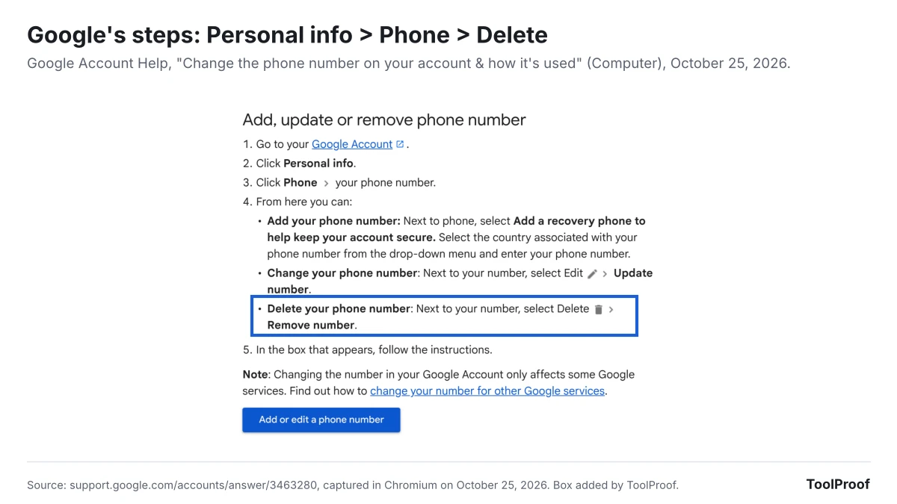
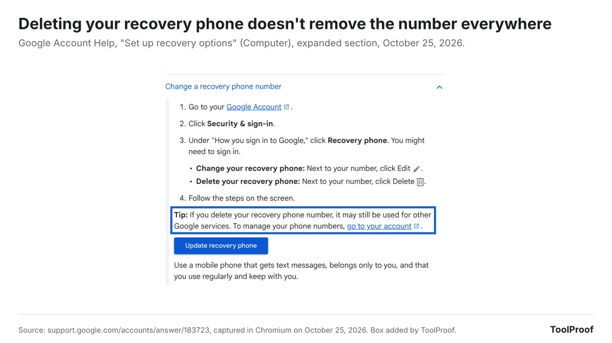

To remove a phone number from your Google account, open your Google Account, go to **Personal info > Phone**, select the number, and choose **Delete > Remove number**. That takes the number off the account. It can still sit in your recovery phone, your 2-Step Verification settings and other Google services, and on an Android phone, automatic verification can add it back.

On October 25, 2026, we read 11 Google help pages on phone numbers, recovery options, 2-Step Verification, Google Voice and Android phone number verification, including the sections Google folds behind expandable headings, and listed every place a number can sit. We don't have a Google account or an Android phone in our test setup, so the steps below come from Google's help pages, not from our own screens. The menu names are the ones Google's pages used on that date: the security tab is called **Security & sign-in**, where some older guides say **Security**.

| Where the number is | Where to remove it | What removing it does |
| --- | --- | --- |
| Your phone numbers | **Personal info > Phone** | Takes the number off the account |
| Recovery phone | **Security & sign-in > Recovery phone** | Stops recovery codes, but other Google services may still use the number |
| 2-Step Verification | **Security & sign-in > 2-Step Verification** | Stops sign-in codes to that number. Add another second step first |
| Ads ("Across Google") | **Personal info > Phone >** your number | Turning off **Better ads & Google services** keeps the number but stops ad use |
| Your Android phone | Phone **Settings > Google > All services** | Turning off **Phone number verification** stops Android adding it again |
| Google Voice | Google Voice **Settings > Account** | Deletes the Voice number. You can reclaim it for 90 days |

## Before you remove your phone number

Make sure you can still get into the account without that number. Google's [recovery options page](https://support.google.com/accounts/answer/183723?hl=en&co=GENIE.Platform%3DDesktop) says recovery info is how you get back in if you forget your password or get locked out, and you can't add it while you're locked out.

1. Add a recovery email under **Security & sign-in > How you sign in to Google > Recovery email**. Google says to pick an address you use regularly, not the one you sign in with.
2. If you use 2-Step Verification, set up a second step that isn't a text message. Google's [2-Step Verification page](https://support.google.com/accounts/answer/185839?hl=en&co=GENIE.Platform%3DDesktop) recommends **Google prompts**, which arrive as a notification on a signed-in phone, and also lists passkeys, security keys and authenticator apps.
3. Save a set of backup codes from the **2-Step Verification** section and keep them somewhere safe.

If you're replacing the number with a new one, don't use a Google Voice number. Google warns that if you can't sign in and need a code to get back in, a code sent to Google Voice won't reach you.

## How to remove a phone number on a computer

You remove a phone number on a computer from the **Phone** page under **Personal info** in your Google Account. These are the steps in Google's [phone number help page](https://support.google.com/accounts/answer/3463280?hl=en&co=GENIE.Platform%3DDesktop):

1. Go to [myaccount.google.com](https://myaccount.google.com) and sign in.
2. Click **Personal info**.
3. Click **Phone**, then click your phone number.
4. Next to the number, select **Delete**, then **Remove number**.
5. Follow the instructions in the box that appears.

Google adds a note under these steps: changing the number in your Google Account "only affects some Google services." The sections below cover the places it can stay.

## How to remove a phone number on Android

On Android, you reach the same Phone page from your phone's Settings app:

1. Open **Settings** and tap your name, then **Manage your Google Account**. You can also go to myaccount.google.com in a browser.
2. At the top, tap **Personal info**.
3. Tap **Phone**, then your phone number.
4. Next to the number, tap **Delete**, then **Remove number**.
5. Follow the steps on the screen.

Under each number, the Phone page shows a **Usage** line listing some of the services that use it. Tap a service to change it there.

## How to remove a phone number on iPhone or iPad

On an iPhone or iPad, Google's steps start in the Gmail app:

1. Open **Gmail**, tap your profile picture at the top right, then tap **Manage your Google Account**. If you don't use Gmail, go to myaccount.google.com in your browser.
2. Tap **Personal info**.
3. Tap **Phone**, then your phone number.
4. Next to the number, tap **Remove phone number**, then **Remove number**.

## How to remove a recovery phone number

You remove a recovery phone under **Security & sign-in**, not under Personal info:

1. Open your Google Account and click **Security & sign-in**.
2. Under **How you sign in to Google**, click **Recovery phone**. You might need to sign in again.
3. Next to your number, click **Delete** and follow the steps.

Deleting the recovery phone doesn't always take the number off the account. Google's page says that if you delete your recovery phone number, "it may still be used for other Google services." To remove it fully, also delete it on the **Personal info > Phone** page.

Google allows only one recovery phone per account, so if you're switching to a new number, choose **Edit** instead of **Delete**.

## How to remove a phone number used for 2-Step Verification

A number you use for 2-Step Verification codes is managed in the **2-Step Verification** section, which Google lists among the services that keep their own phone settings. Open your Google Account, click **Security & sign-in**, then **2-Step Verification**, and review the phone numbers listed as second steps.

Set up another second step before you take the number out. Google's [2-Step Verification troubleshooting page](https://support.google.com/accounts/answer/185834?hl=en) lists what works when your phone isn't available: another signed-in phone, another number added in the 2-Step Verification section, a backup code, a security key or a passkey on another device. Without one, Google says recovery can take 3 to 5 business days, because 2-Step Verification adds an extra step to prove the account is yours.

If you want to stop using 2-Step Verification altogether, Google's [page on turning it off](https://support.google.com/accounts/answer/1064203?hl=en&co=GENIE.Platform%3DDesktop) says to open **Security & sign-in > 2-Step Verification** and click **Turn off** twice. Google warns this removes a layer of security and recommends destroying your old backup codes. We don't recommend it just to get rid of a phone number. Switching your second step to Google prompts or a passkey keeps 2-Step Verification on without texts to your number, and Google says prompts also help protect against SIM swaps.

## How to keep your number but stop Google using it for ads

You can keep the number on your account and stop it being used for ads by turning off **Better ads & Google services** for that number. Google says this setting "lets your phone number to be used across Google services to show you ads more relevant to you."

1. Open your Google Account and click **Personal info > Phone**.
2. Select the number.
3. Under **Preferences**, turn off **Better ads and Google services**.

When the setting is on, **Across Google** appears next to **Usage** for that number. Google also documents a stricter option: delete the number on the Phone page, then add it back only as a **Recovery phone** under **Security & sign-in**. Then re-add it in any other Google service where you still want it.

If the number got onto a second account you didn't expect, our article on [Android phone number verification](/posts/google-phone-number-verification) explains why Android adds it to every Google account on the phone. Our look at [Google's privacy policy change on Gmail and Photos ads](/posts/google-gmail-photos-ads) covers the separate switch that keeps your inbox out of ads.

## How to stop Android from adding your number back

Android can add your phone's number back to your Google accounts because phone number verification is on by default. Google's [Android help page](https://support.google.com/android/answer/7521240?hl=en) says it adds verified numbers "to all Google Accounts that are signed in on the device," for current and future accounts, and Google and your carrier "will try to periodically reverify them."

1. Open your phone's **Settings** app.
2. Tap **Google > All services**.
3. Under **Privacy & security**, tap **Phone number verification**.
4. Choose not to verify your phone number.
5. Then delete the number from each account, as in the Android steps above.

Turning verification off only stops new links. Google's page lists features verification helps with, including signing in with your number, getting back into your account, emergency location, finding a lost phone, RCS messages and Quick Share, but doesn't say which ones stop when you turn it off.

## Why you can't remove a phone number from your Google account

You usually can't remove a phone number from your Google account for one of five reasons in Google's help pages: Google doesn't trust the current sign-in, an administrator manages the account, Android adds the number back, another Google service still uses it, or it's a Google Voice number. The graphic below matches each one to the fix Google gives.

- **Google won't let you change your recovery info.** Google's recovery page says that "if there's something different about how you're signing in," you might not get the option. Try again from a device you normally use, from a place where you normally sign in, or from the same device the following week.
- **It's a work or school account.** Google says these steps may not work for accounts from work, school or other groups. Your administrator controls them.
- **The number comes back.** On Android, phone number verification adds it again. Turn it off first, as in the section above.
- **Another Google service still has it.** Google says other services that use phone numbers "might not be listed" on your Phone page and names 2-Step Verification, Calendar, Chrome, Google Pay and Google My Business as places where you change the number in that service's settings.
- **It's a Google Voice number.** A Voice number isn't removed from the Phone page. Google's [Voice help page](https://support.google.com/voice/answer/150640?hl=en&co=GENIE.Platform%3DDesktop) says to open Google Voice, go to **Settings > Account**, find the number under **Google Voice number**, and click **Delete > Delete number**. You can reclaim it for 90 days.

If text codes don't arrive while you try, Google's 2-Step Verification troubleshooting page says that when "we notice something different about how you sign in, like your location," you might not get a code by text message.

## What happens after you remove the number

For 7 days after you remove or change a number, Google may keep sending security codes to it. Google's recovery page says that if you change your recovery info "or other authentication factors, Google may send codes to your previous info for 7 days," so you can secure your account if someone else made the change.

- **New numbers take time.** Google says a new recovery or 2-Step Verification number can take up to 7 days to be trusted, and it may take a week before a new number works for sensitive actions such as changing your password.
- **Signing in with the number stops working.** Google's [phone sign-in page](https://support.google.com/accounts/answer/7222352?hl=en&co=GENIE.Platform%3DDesktop) says you can sign in with a number you've added to your account, and that a "Couldn't find your Google Account" error means the number might not be connected. Sign in with your email address instead.

## FAQ

### Can I hide my phone number instead of deleting it?

Yes. Google's [page on what others see](https://support.google.com/accounts/answer/6304920?hl=en&co=GENIE.Platform%3DDesktop) says to open **Personal info**, click **Go to About me** under **Choose what others see**, and choose **Only you** for the info you want private. People finding you by your number is a separate setting, **Let people find you by phone number**, in your phone number settings.

### How do I remove my phone number from Gmail?

You remove it from your Google Account, which your Gmail address signs in to, so follow the steps above for your device. Google's iPhone steps even start in the Gmail app, at **Manage your Google Account**.

## Which option should you use?

- **You changed numbers or gave up an old phone:** use **Edit** on the Phone page and on Recovery phone to replace it rather than deleting, so you keep a way back into the account.
- **You don't want Google to have your number at all:** set up Google prompts or a passkey and a recovery email first, then delete the number on the Phone page, in Recovery phone and in 2-Step Verification. On Android, turn off phone number verification too.
- **You only mind the ads:** keep the number and turn off **Better ads & Google services**.
- **You only mind other people seeing it:** set it to **Only you** in About me.

Phone numbers are one of several Google defaults worth checking. Our [guide to turning off AI in Chrome, Gmail, Word and more](/posts/turn-off-ai-features) shows where Google's AI settings live, and our guide to [turning off Gemini in Gmail](/posts/turn-off-gemini-in-gmail) matches each Gmail AI feature to the setting that controls it.

## How we checked

- **Google pages** (opened October 25, 2026, rendered in Chromium with collapsed sections expanded): Google Account Help, [Change the phone number on your account & how it's used](https://support.google.com/accounts/answer/3463280?hl=en&co=GENIE.Platform%3DDesktop) (Computer, Android and iPhone versions), [Set up recovery options](https://support.google.com/accounts/answer/183723?hl=en&co=GENIE.Platform%3DDesktop), [Turn on 2-Step Verification](https://support.google.com/accounts/answer/185839?hl=en&co=GENIE.Platform%3DDesktop), [Fix common issues with 2-Step Verification](https://support.google.com/accounts/answer/185834?hl=en), [Turn off 2-Step Verification](https://support.google.com/accounts/answer/1064203?hl=en&co=GENIE.Platform%3DDesktop), [Sign in with your phone number instead of a username](https://support.google.com/accounts/answer/7222352?hl=en&co=GENIE.Platform%3DDesktop), [Control what others see about you](https://support.google.com/accounts/answer/6304920?hl=en&co=GENIE.Platform%3DDesktop) and two personal info overview pages; Android Help, [Manage phone number verification on your device](https://support.google.com/android/answer/7521240?hl=en); Google Voice Help, [Delete your Google Voice number](https://support.google.com/voice/answer/150640?hl=en&co=GENIE.Platform%3DDesktop)
- **Not checked**: we couldn't open the account screens without a Google account or an Android phone, so we couldn't confirm button labels inside the 2-Step Verification section or whether Google blocks removing a number that is your only second step. Google's pages don't say
