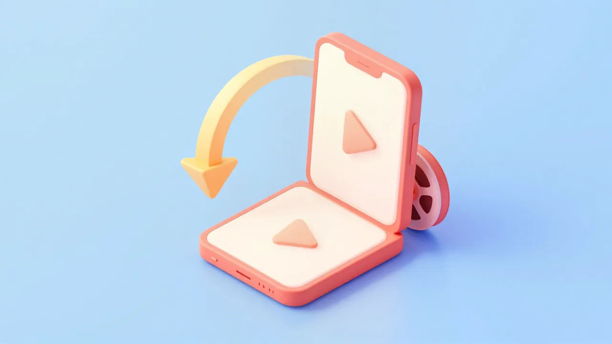
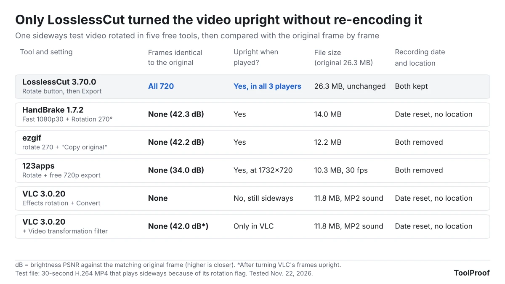
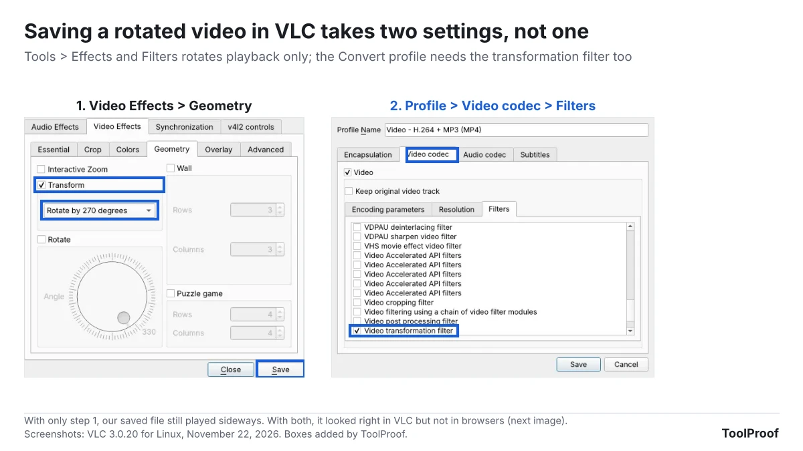
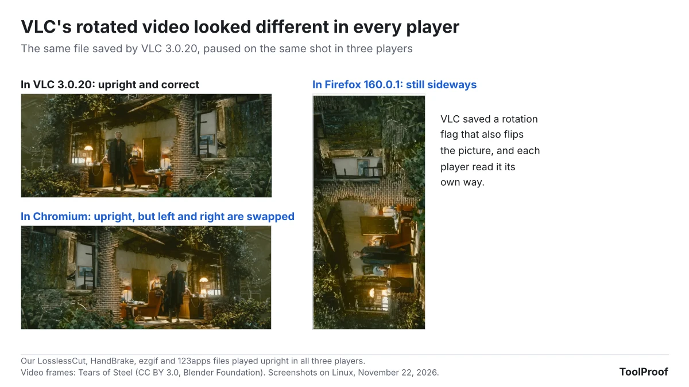
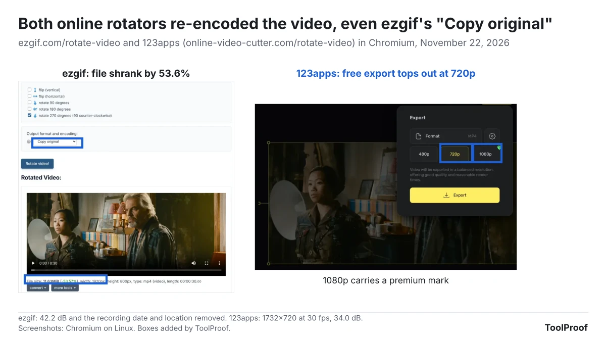

To rotate a video without losing quality, change its rotation setting instead of re-encoding the picture. The free desktop app LosslessCut does that with one button. On November 22, 2026, LosslessCut 3.70.0 turned our sideways 30-second test video upright, and all 720 frames stayed identical to the original, with the same file size, sound, recording date and location. The other four free tools we tried, HandBrake, ezgif, 123apps and VLC, re-encoded the video, which means they decoded every frame and compressed it again.

We rotated the same phone-style MP4 in five free tools and seven settings, compared every frame of each result with the original, and played the files in VLC, Chromium and Firefox. The surprise was VLC's well-known "rotate permanently" method. Its saved copy looked right in VLC, played as a mirror image in Chromium and stayed sideways in Firefox.

| Method | Keeps the original quality? | Played upright? | Best for |
| --- | --- | --- | --- |
| **LosslessCut** (Windows, Mac, Linux) | Yes, every frame identical | Yes, in all three players | Fixing a sideways phone video without changing anything else |
| **HandBrake** (Windows, Mac, Linux) | No, re-encoded at 42.3 dB | Yes | A new file with upright frames and no flag to misread, or a smaller one |
| **ezgif** (website) | No, even with "Copy original" (42.2 dB) | Yes | A quick fix for a file under 200 MB when you can't install an app |
| **123apps** (website) | No, 720p and 30 fps on the free export (34.0 dB) | Yes | Not recommended when quality matters |
| **VLC** (Windows, Mac, Linux) | No | Only in VLC | Not recommended for saving a rotated copy |

## Why rotating a video usually lowers its quality

Rotating a video lowers its quality only when an app redraws every frame and compresses it again; changing the video's rotation flag leaves the picture untouched. Phones typically record frames in the camera's own shape and add a small rotation flag that tells players which way up to show them. If the phone guesses the orientation wrong, for example when it's lying flat as you start recording, the flag is wrong and the video plays sideways.

There are two ways to fix that:

- **Change the flag.** The video data is copied as it is, so nothing is lost and the job takes seconds. This is what LosslessCut does.
- **Re-encode.** The app turns every frame and compresses it again, which is like photocopying a photocopy. HandBrake, the online rotators and VLC all work this way, and they also chose a lower bitrate, the amount of data per second, than our original.

The flag only works if the app you play the video in reads it. Chromium, Firefox 160.0.1 and VLC 3.0.20 all showed LosslessCut's corrected file upright in our test.

## Which free tools keep the original quality?

Only LosslessCut kept every frame identical in our test; HandBrake, ezgif, 123apps and VLC all re-encoded the video. Our test file was a 30-second H.264 MP4 with a rotation flag that makes it play sideways, the way a phone video does when the phone guessed the orientation wrong. It also carried a recording date and a GPS location tag.

| Tool and setting | Frames identical to the original | Brightness PSNR | File size (original 26.3 MB) | Sound | Recording date and location |
| --- | --- | --- | --- | --- | --- |
| LosslessCut 3.70.0, rotate button and Export | 720 of 720 | Identical | 26.3 MB | Copied | Both kept |
| HandBrake 1.7.2, Fast 1080p30 with Rotation 270° | 0 | 42.3 dB | 14.0 MB | AAC 162 kbps | Date reset, location removed |
| ezgif, rotate 270 with Copy original | 0 | 42.2 dB | 12.2 MB | AAC 129 kbps | Both removed |
| 123apps, rotate and free 720p export | 0 | 34.0 dB | 10.3 MB | AAC 130 kbps | Both removed |
| VLC 3.0.20, Effects rotation and Convert | 0 | Still sideways | 11.8 MB | MP2 128 kbps | Date reset, location removed |
| VLC 3.0.20, plus Video transformation filter | 0 | 42.0 dB, but mirrored in Chromium | 11.8 MB | MP2 128 kbps | Date reset, location removed |

PSNR is a standard score for how close a copy's pixels are to the original; higher is closer, and "identical" means the frames decode to exactly the same pixels. The three re-encodes at about 42 dB kept roughly half the original's video bitrate, between 3.0 and 3.6 Mbps instead of 6.8 Mbps. "Date reset" means the app replaced the recording date with the time we converted the file.

## How to rotate a video without losing quality in LosslessCut

In LosslessCut, open the video, click the rotate button until the preview stands upright, and export; the app changes the rotation flag and copies everything else. LosslessCut is free from [its website](https://losslesscut.app/) and GitHub for Windows 10 and 11, macOS 13 or newer and Linux. The same app is sold in the Microsoft Store and Mac App Store to support the developer, according to its website. We wrote about its trimming results in our test of [trimming video without losing quality](/posts/trim-video-without-losing-quality).

1. Open LosslessCut and drag your video into the window, or choose **File > Open**.
2. Click **Toggle advanced view** at the bottom left to show the extra buttons.
3. Click the rotate button next to the frame rate at the bottom left. Its tooltip reads "Set output rotation." Each click sets the next angle, **0°**, **90°**, **180°** or **270°**, and the preview switches to "Rotation preview." Stop when the picture is upright.
4. Click **Export**, check the Export options window, then click **Export** again.
5. LosslessCut saves a new file next to the original and leaves the original alone.

In our test, one click set 0° and fixed the video. The exported file was exactly 26,264,855 bytes, the same as the original, and all 720 frames, the sound, the recording date and the location tag matched it. The angle counts from the way the frames are stored rather than from what you see, so your video may need two or three clicks; the preview tells you when it's right.

LosslessCut also fixed a second test file whose frames had been turned sideways for good, with no flag, as can happen after another app re-encodes a video. Choosing 270° added a rotation flag to that file, and its 720 frames stayed identical.

If one app still shows a LosslessCut file sideways, that app is ignoring the rotation flag. In that case use HandBrake, below, to make a re-encoded copy whose frames are upright.

## How to rotate a video in VLC and save it

VLC can save a rotated copy only if you set the rotation in two places, and in our test the saved file still didn't play correctly in browsers. This is the method most "rotate video permanently in VLC" guides describe, and we followed it in VLC 3.0.20:

1. Open the video, then choose **Tools > Effects and Filters > Video Effects > Geometry**. Tick **Transform**, choose a rotation such as **Rotate by 270 degrees**, click **Save**, then **Close**. The video now plays upright, but this only changes playback.
2. Choose **Media > Convert / Save**, click **Add**, pick the same video, then click **Convert / Save**.
3. Next to the profile **Video - H.264 + MP3 (MP4)**, click the wrench icon, open **Video codec > Filters**, tick **Video transformation filter**, and click **Save**.
4. Click **Browse** to choose where to save the new file, then click **Start**.

With only step 1, the file VLC saved still played sideways. With both steps, VLC played the new file upright, but Chromium showed it with left and right swapped, and Firefox 160.0.1 showed it sideways. VLC had saved a rotation flag that also flips the picture, and each player read that flag differently. The same thing happened in our earlier test of [converting iPhone video to MP4](/posts/convert-iphone-video-to-mp4), where VLC's copy of a vertical video played mirrored in Chromium.

Both VLC copies were also re-encoded, lost the last 2 of 720 frames, and switched the sound to MP2, which Chromium played silently in our earlier MP4 conversion test. The **Transform** setting from step 1 also stays on for every video you open in VLC until you untick it and click **Save** again. We'd use VLC to watch a sideways video, not to save a rotated copy. We tested VLC 3.0.20 and didn't check whether later 3.0 releases save the flag differently.

## Rotate a video in HandBrake when you need a new file

HandBrake re-encodes, so it can't rotate a video without some loss, but it makes an ordinary upright file in one pass. That's the safest choice when an app or website ignores rotation flags, or when you also want a smaller file, which our guide to [compressing video for Discord and email](/posts/compress-video-for-discord-email) covers.

1. Open HandBrake, click **Open Source** and pick your video.
2. On the **Dimensions** tab, set **Rotation** to **90°**, **180°** or **270°**. In our test the angles turned the picture clockwise, so **270°** fixed a video that leaned to the right.
3. Check the preview on the **Summary** tab, choose a name next to **Save As**, and click **Start**.

In our test, HandBrake 1.7.2 with its default Fast 1080p30 preset kept all 720 frames at 24 fps and scored 42.3 dB. The file was 14.0 MB, about half the original, and the sound was re-encoded to AAC at 162 kbps. The recording date was replaced with the time of the encode even though **Passthru Common Metadata** was on, and the location tag was removed. We tested HandBrake 1.7.2; the current version on handbrake.fr is 1.11.2.

## Rotate a video online with ezgif or 123apps

Both free online rotators we tried re-encoded the video and removed its recording date and location, so use them only when you can't install an app.

- **ezgif** ([ezgif.com/rotate-video](https://ezgif.com/rotate-video)) takes files up to 200 MB. Upload the video, tick **rotate 90 degrees**, **rotate 180 degrees** or **rotate 270 degrees (90 counter-clockwise)**, leave **Output format and encoding** on **Copy original** or pick MP4, and click **Rotate video!** The site describes Copy original as copying the original encoding for faster processing. In our test, both choices produced a re-encoded file 53.6% smaller than the original, at 42.2 dB. The result page says the file is removed from ezgif's servers in 1 hour.
- **123apps** ([online-video-cutter.com/rotate-video](https://online-video-cutter.com/rotate-video)) opens a full video editor. Each click of the rotate button turns the video 90 degrees clockwise, and **Export** offers 480p, 720p and 1080p, with 720p selected and 1080p marked with the same diamond icon as the site's Upgrade button. The free 720p export shrank our 1920 × 800 video to 1732 × 720 and changed 24 fps to 30 fps by repeating frames, for 34.0 dB.

## Rotate a video on iPhone, Mac, Windows or Android without another app

The photo apps built into each system can rotate a video, but we couldn't run them in our test, so we don't know whether they keep the original quality. Their makers describe these steps:

- **iPhone and iPad:** open the video in the **Photos** app and tap **Edit**. Apple says you can rotate the video there, and **Cancel** undoes your changes ([Apple Support](https://support.apple.com/en-us/104968)).
- **Mac:** in **QuickTime Player**, open the movie, choose **View > Show Clips** and select the clip. Then choose **Edit** and rotate it left or right, and click **Done** ([QuickTime Player User Guide](https://support.apple.com/guide/quicktime-player/rotate-or-flip-a-clip-qtp5a6251741/mac)).
- **Windows 11:** the **Photos** app can only trim a video, so open the video and choose **Edit in Clipchamp video editor** ([Microsoft Support](https://support.microsoft.com/en-us/windows/apps/photos/edit-photos-and-videos-in-windows)). In Clipchamp, select the clip on the timeline, click the three dots on the floating toolbar, and use the rotate by 90 degrees button ([Clipchamp help](https://support.microsoft.com/en-us/clipchamp/how-to-rotate-videos-images-and-other-visual-elements-in-clipchamp)). Microsoft says Clipchamp exports an MP4 at 30 fps, so the result is a new encode rather than a flag change ([Clipchamp export guide](https://support.microsoft.com/en-us/clipchamp/exporting-and-saving-a-video-in-clipchamp)).
- **Android:** in **Google Photos**, open the video, tap **Crop**, tap **Rotate** to turn it 90 degrees, then tap **Save** to keep a copy with your edits ([Google Photos Help](https://support.google.com/photos/answer/10729480?hl=en)).

## Why won't my video rotate?

A video usually won't stay rotated because the app turned only the preview, or because the app you play it in ignores the rotation flag.

- **Playback rotation isn't saved.** VLC's **Effects and Filters** rotation changes how VLC shows the video. In our test, a copy saved without the extra profile filter still played sideways.
- **The player ignores the flag.** If a LosslessCut file plays upright in one app and sideways in another, the second app isn't reading the rotation flag. A HandBrake copy has upright frames and no flag to misread.
- **The copy plays mirrored.** That's what VLC's saved file did in Chromium. Start again from the original file in LosslessCut or HandBrake, because rotating the mirrored copy again re-encodes it a second time.

## How we tested

- **Test files:** a 30-second clip from *Tears of Steel* (CC BY 3.0, Blender Foundation), saved as an H.264 MP4 at 1920 × 800 and 24 fps with AAC sound, then given a rotation flag of −90 degrees so it plays sideways at 800 × 1920. We added a recording date and a GPS location tag in the format Android phones use. It is not real phone footage. A second file had its frames turned sideways for good with no flag; we used it only for LosslessCut.
- **Tools:** LosslessCut 3.70.0, VLC 3.0.20 and HandBrake 1.7.2 on Linux, run through their normal menus and buttons; ezgif and 123apps in Chromium, on November 22, 2026.
- **What we measured:** whether each result plays upright, how many frames decode to exactly the same pixels as the original, brightness PSNR against the matching original frame, frame count and rate, file size, sound format, and whether the recording date and location survived. We played every result in VLC 3.0.20, Chromium and Firefox 160.0.1.
- **What we didn't test:** the built-in apps on iPhone, Mac, Windows and Android, a HEVC .mov file as iPhone records by default, 123apps' 1080p export, and newer versions of VLC and HandBrake. For how LosslessCut copies HEVC files from an iPhone, see our [iPhone video to MP4 test](/posts/convert-iphone-video-to-mp4).

## Which method should you use?

- **A phone video plays sideways and you want it exactly as recorded:** use LosslessCut. It's the only tool we tested that didn't touch the picture, and it kept the date and location. If you share the video and want to remove the location first, see our guide to [removing metadata from photos](/posts/remove-metadata-from-photos), which explains what those tags reveal.
- **An app or website still shows the video sideways, or you also want it smaller:** use HandBrake and accept a small loss.
- **You can't install anything and the file is under 200 MB:** ezgif works, but it re-encodes and removes the date and location.
- **Skip** VLC's Convert / Save for rotating, and 123apps' free export if you care about resolution.

More free tools for photos and videos, all tested the same way, are in our [free image converter and photo tools roundup](/posts/free-image-converter-photo-tools).
