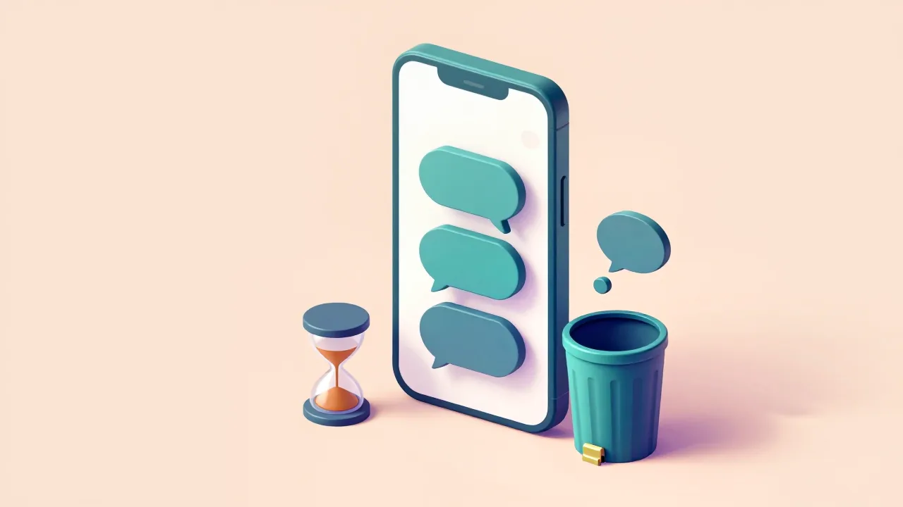
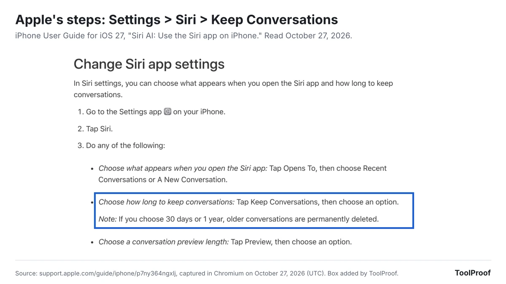

You can see your Siri history on iPhone only if you use Siri AI (Beta) in iOS 27: open the **Siri** app, and your past conversations are listed there. To delete one, touch and hold it and tap **Delete**. To clear old ones automatically, go to **Settings > Siri > Keep Conversations** and choose **30 days** or **1 year**. Classic Siri, the version every other iPhone uses, has no history screen in Apple's guides.

Apple keeps Siri records in two other places. Your iPhone stores transcripts of your Siri and Dictation requests, and Apple's revised privacy page now says you delete them by going to **Settings > Siri** and tapping **Turn Off Siri**. Apple's servers keep request data, such as the type of request and whether it worked, plus the query itself for search-type requests, under a random identifier for up to two years. None of Apple's iPhone pages describes a way to delete that server copy.

On October 27, 2026, we read 21 Apple pages, including the iOS 27 iPhone User Guide, the Mac User Guide for macOS 26 and macOS 27, and Apple's Siri privacy pages, and compared what each says about Siri history. Apple then rewrote its three Siri privacy pages, and on November 9 we reread them and updated this guide. We don't have an iPhone in our test setup, so the steps come from Apple's pages, not our own screens.

| What you want to do | Where to go | Works with |
| --- | --- | --- |
| See past Siri conversations | The **Siri** app | Siri AI only |
| Delete one or several conversations | **Siri** app: touch and hold **> Delete**, or **Select** | Siri AI only |
| Delete old conversations automatically | **Settings > Siri > Keep Conversations** | Siri AI only |
| Delete Siri transcripts stored on your iPhone | **Settings > Siri > Turn Off Siri**, per Apple's privacy page | Any Siri |
| Stop Apple from storing your Siri audio and text | **Settings > Privacy & Security > Analytics & Improvements** | Any Siri |
| Stop Apple from storing what you search for with Siri | **Settings > Search > Help Apple Improve Search** | Any Siri |
| See what went to Apple's AI servers | **Settings > Privacy & Security > Apple Intelligence Report** | iPhone 15 Pro and later |

![Table of the four places Siri history is kept on iPhone: the Siri app keeps Siri AI conversations synced end-to-end encrypted through iCloud, which you can see and delete; your iPhone keeps transcripts of Siri and Dictation requests with no list to browse, deleted by turning off Siri; Apple's servers keep request data and search queries under a random ID for up to two years, and audio and transcripts only if you opted in, with no delete step in Apple's iPhone pages; and ChatGPT keeps requests Siri passed to it if you're signed in](./images/siri-history-on-iphone/siri-history-where-it-is-kept.webp)

## Can you see your Siri history on iPhone?

Yes, but only in the Siri app, which appears when you turn on Siri AI (Beta) in iOS 27. Apple's [Siri app guide](https://support.apple.com/guide/iphone/siri-ai-use-the-siri-app-p7ny364ngxlj/ios) describes it as "a dedicated Siri app that brings all your conversations together in one place."

Siri AI isn't on every iPhone. According to Apple's guide, it needs:

- An iPhone 15 Pro, iPhone 15 Pro Max or any iPhone 16 model or later, on iOS 27
- Siri and the iPhone set to English, French, Japanese, Korean, Portuguese or Spanish
- A user aged 13 or older, outside the European Union and mainland China

To turn it on, Apple's [Siri AI guide](https://support.apple.com/guide/iphone/get-started-with-siri-ai-iphv6zwrg8jvfgr/ios) says to go to **Settings > Siri** and tap **Try Siri AI (Beta)**.

With classic Siri, there is nothing to open. Apple's [Siri, Dictation & Privacy page](https://www.apple.com/legal/privacy/data/en/ask-siri-dictation/), dated October 26, 2026, says "a history of your Siri and Dictation interactions is stored on your device" and may be used to personalize Siri, but none of the Apple pages we read describes a screen that lists those past requests.

## How to see Siri history in the Siri app

The Siri app shows your conversation history as soon as you open it, unless it's set to start a new conversation. Apple's guide gives these steps:

1. Open the **Siri** app.
2. If it opens to a new conversation, tap the history button to see your past conversations.
3. To switch the layout, tap the button in the top-right corner, then **Grid** or **List**.

From the same screen, you can search your conversations, pin one by touching and holding it and tapping **Pin**, or rename it with **Rename**. To have the app always open to your history, go to **Settings > Siri > Opens To** and choose **Recent Conversations**.

Your Siri app history isn't only on your iPhone. Apple's guide says it "syncs across platforms when you're signed in to the same Apple Account," and the [iOS 27 release notes](https://support.apple.com/en-us/149076) say the app "privately syncs conversations across your Apple products with iCloud." So the same list can show up on your iPad or Mac when they use the same Apple Account. Apple's privacy page adds that this sync uses end-to-end encryption, "which cannot be read by Apple."

## How to delete Siri conversations

You delete Siri conversations inside the Siri app, one at a time or several at once:

1. Open the **Siri** app.
2. To delete one conversation, touch and hold it, tap **Delete**, then tap **Delete** again to confirm.
3. To delete several, tap the button in the top-right corner, tap **Select**, choose the conversations, tap the trash button, then tap **Delete**.

Apple's guide doesn't mention a button that deletes every conversation at once, so for a full clear-out, use **Select** and choose them all.

## How to delete old Siri conversations automatically

**Keep Conversations** in Siri settings deletes old Siri app conversations for you. Go to **Settings > Siri > Keep Conversations** and pick an option. Apple's guide says: "If you choose 30 days or 1 year, older conversations are permanently deleted."

Apple's guide doesn't name the third option or say which one is the default, as of October 27, 2026, so check the setting yourself rather than assuming old chats already expire.

Deleting matters more since iOS 27.2. Apple's release notes for the October 26, 2026 update say "Siri AI can recall your past conversations," and Apple doesn't say whether deleting a conversation also removes what Siri retained from it. Our [look at iOS 27.2's Siri changes](/posts/ios-27-2-siri-ai-memory) covers the new data Siri AI reads and the Excluded Apps setting that limits it.

## How to delete Siri & Dictation History

Apple's current privacy page no longer points to a **Delete Siri & Dictation History** button. Its October 26, 2026 version says you can delete "the transcripts of your Siri and Dictation requests that are stored on your device by going to Settings > Siri and tapping Turn Off Siri." The September 14 version sent you to **Settings > Siri > Siri & Dictation History > Delete Siri & Dictation History** instead, and Apple's Improve Siri and Dictation page made the same switch.

To clear those transcripts the way Apple's pages now describe:

1. Turn off Siri: go to **Settings > Siri**, tap **Turn Off Siri** at the bottom, then tap **Turn Off Siri** again.
2. Turn off Dictation, the feature that types what you say: go to **Settings > General > Keyboard** and turn off **Enable Dictation**. The privacy page says "if you turn off both Siri and Dictation," the transcripts of your Siri and Dictation requests stored on your device "will be deleted."
3. Turn Siri back on later with **Settings > Siri > Turn On Siri**. On a Siri AI iPhone, Apple's guide says you can choose **Use Siri Classic** at that step.

Apple's pages don't say what turning Siri off does to Siri app conversations, so delete those in the Siri app first if you want them gone too.

If your iPhone still shows **Siri & Dictation History** under **Settings > Siri**, that's the button Apple described until September. No Apple page we read now confirms whether iOS 27 still has it, and Apple's pages have never agreed on what it removes:

- **Siri, Dictation & Privacy:** the September 14, 2026 version said the button deletes the transcripts stored on your device. The October 26 version doesn't mention it.
- **Mac User Guide for macOS Tahoe 26:** the same button on a Mac deletes request history, "both audio recordings and transcripts," that is tied to a random identifier and "less than six months old." It needs an internet connection.
- **Mac User Guide for macOS 27:** has no page for it. The old link opens the guide's front page, and that page's version list starts at macOS Tahoe 26.
- **iPhone User Guide, "Change Siri settings":** the iOS 27 page doesn't mention Siri & Dictation History, and neither do its iOS 26 and iOS 18 versions.

## The copy of your Siri history Apple keeps

Apple keeps its own record of your Siri requests on its servers, and its iPhone pages only describe deleting the transcripts on your device. In the default setup, Apple's October 26, 2026 privacy page lists three kinds of data:

- **Usage data**, "like whether a message was sent."
- **Request details**: the type of request and whether it worked, your device's specifications and settings, performance statistics and, if Location Services is on for Siri, your approximate location.
- **Search queries**: for search-type requests, such as playing an album or looking up facts, "the query will also be stored by Apple and used to improve Search, Siri, and related features."

This data is tied to "a random, device-generated identifier that rotates multiple times per hour and is not tied to your Apple Account or email address," and Apple "may retain and use this data for up to two years." The September 14 version opened with "Apple stores transcripts of your interactions with Siri and may review a subset of these transcripts." The new version drops that line and describes storing and reviewing transcripts only if you opt in to improving Siri, covered below.

None of the iPhone pages we read describes a way to delete that copy. The only Apple page that says its button reaches Apple's records is the macOS 26 Mac guide, and only for requests under six months old.

Two other kinds of Siri history sit outside these settings:

- **Requests Siri passed to ChatGPT.** Apple's [ChatGPT guide](https://support.apple.com/guide/iphone/turn-on-chatgpt-iph00fd3c8c2/ios) says that if you want requests saved to your ChatGPT chat history, you must be signed in to a ChatGPT account, and then OpenAI's privacy policies apply. Without an account, OpenAI must not store your request or its responses unless the law requires it. To stop handing requests over, go to **Settings > Siri > ChatGPT** and turn off **Use ChatGPT**, or with Siri AI, **Settings > Siri > Extensions > ChatGPT** and turn off **Use Extension**.
- **Siri settings saved in iCloud.** Your Siri settings sync through iCloud, and Apple's [iCloud guide](https://support.apple.com/guide/icloud/mm155e8d9577) puts the switch at **Settings >** your name **> iCloud > See All > Siri > Sync this iPhone**. Apple's [iCloud security overview](https://support.apple.com/en-us/102651) says this "Siri information" includes "Siri Settings and personalization and, if you have set up Hey Siri, a small sample of your requests," and is end-to-end encrypted. That page dates from January 5, 2026, before iOS 27, and doesn't mention Siri app conversations.

## How to stop Apple from keeping your Siri recordings

Turn off **Improve Siri & Dictation** under **Settings > Privacy & Security > Analytics & Improvements** to keep Apple from storing the audio and text of your Siri requests. Apple's revised pages also name a second opt-in, **Improve Siri & Apple Intelligence**, in the same place, so turn that off too if you see it.

Apple's [Improve Siri and Dictation page](https://www.apple.com/legal/privacy/data/en/improve-siri-dictation/) says that if you opt in, Apple "may store all of your interactions with Siri and Dictation," including the audio and transcripts of what you say and type to Siri, Siri's responses and the links you open from searches. The main privacy page adds your conversation history with Siri if you use the Siri app. Graders may review a subset, audio is reviewed only by Apple employees, and Apple keeps opt-in data for up to two years, longer for the reviewed subset. The September version of this page described the opt-in as storing and reviewing "a sample of audio interactions."

If you never opted in, the main privacy page says "your audio data is not stored by Apple." Turning these switches off doesn't stop the default record above: Apple still keeps request data for up to two years and stores search-type queries until you also turn off **Help Apple Improve Search**, as explained in the Siri search section below.

## How to see what Siri sent to Apple's servers

The **Apple Intelligence Report** lists the requests your iPhone sent to Private Cloud Compute, Apple's servers for its larger AI models. According to Apple's [Apple Intelligence privacy guide](https://support.apple.com/guide/iphone/apple-intelligence-and-privacy-iphe3f499e0e/ios):

1. Go to **Settings > Privacy & Security > Apple Intelligence Report**.
2. Choose the last 15 minutes, which is the default, or the last 7 days.
3. Tap **Export Activity**, choose where to save the file, then tap **Export**.

The file is called Apple_Intelligence_Report.json, and Apple says to open it with a text reader. It's a technical record rather than a list of conversations. Apple says data sent to Private Cloud Compute "is not stored or made accessible to Apple" after your request is answered.

## Is Siri search history something else?

Searches you ask Siri to make are part of your Siri history. The search history people usually mean on an iPhone is Safari's: to hide the recent searches that appear in Safari's search field, Apple's [Safari guide](https://support.apple.com/guide/iphone/hide-recent-searches-iph9c79f9786/ios) says to go to **Settings > Apps > Safari** and turn off **Show Recent Searches**.

With **Help Apple Improve Search** on, Apple stores the searches you make in Safari, in Spotlight and through Siri "in a way that is not linked to you," according to its [search privacy page](https://www.apple.com/legal/privacy/data/en/siri-suggestions-search/). Since Apple's October 26, 2026 revision, the main Siri privacy page also says this up front: Siri search-type requests, such as playing an album, are stored "and used to improve Search, Siri, and related features." To stop that, go to **Settings > Search** and turn off **Help Apple Improve Search**. The search page adds that searches made through Siri are still stored for Siri if **Improve Siri & Dictation** or **Improve Siri & Apple Intelligence** is on.

## FAQ

### Can someone else see my Siri history?

Anyone who can open your Siri app can see your Siri AI conversations, and because the history syncs, that can include your iPad or Mac signed in to the same Apple Account. Apple says the synced copy is end-to-end encrypted, so Apple itself can't read it. Classic Siri's history has no screen to look at. To limit what Siri can do on a shared or child's iPhone, our guide to [turning off Apple Intelligence on iPhone](/posts/turn-off-apple-intelligence-iphone) covers the Screen Time lock.

### Does deleting Siri history on iPhone delete it on my Mac?

Apple's guide says Siri app conversations sync across devices with the same Apple Account, but it doesn't say separately what happens on your other devices when you delete one. For Siri & Dictation History, Apple's macOS 26 Mac guide describes a separate **Delete Siri & Dictation History** button in **System Settings > Apple Intelligence & Siri**, so check each device.

## Which setting should you change?

- **You use Siri AI and don't want a long record:** set **Keep Conversations** to **30 days**, then delete anything older in the Siri app.
- **You want Siri's saved transcripts off your iPhone:** turn Siri and Dictation off, then turn Siri back on, as Apple's current privacy page describes.
- **You don't want Apple to keep recordings or transcripts of what you say:** turn off **Improve Siri & Dictation**, and **Improve Siri & Apple Intelligence** if you see it.
- **You don't want Apple to keep what you search for through Siri:** turn off **Help Apple Improve Search** in **Settings > Search**.
- **You'd rather not have Siri AI at all:** switch to Siri Classic. Our [guide to turning off AI in Chrome, Gmail, Word and more](/posts/turn-off-ai-features) covers iPhone alongside other apps, and if you also use Gemini, our guide to [turning off Gemini Apps Activity](/posts/turn-off-gemini-apps-activity) covers what Google keeps.

## How we checked

On October 27, 2026 (UTC), we opened 21 Apple pages in Chromium and saved their text: 10 pages of the iPhone User Guide for iOS 27 (the Siri app, Siri settings, Siri AI, turning Siri on, Dictation, Search, Apple Intelligence and privacy, ChatGPT and Safari recent searches), the iOS 26 and iOS 18 versions of the Siri settings page, the Mac User Guide's "Delete Siri and Dictation history" page for macOS Tahoe 26 and Sequoia 15 and its macOS 27 address, Apple's three Siri and search privacy pages (all dated September 14, 2026), the iCloud guide for Siri, Apple's iCloud security overview and the iOS 27 release notes (updated October 26, 2026). We searched every page for history, delete, recall and memory, and compared the privacy page with the copy we saved on October 26, 2026: it hadn't changed.

On November 7, 2026, our page-comparison check found that Apple had rewritten all three Siri and search privacy pages, now dated October 26, 2026. On November 9 we opened all 21 pages again: the three privacy pages matched the November 7 versions, and the only other change was the iOS 27.2.1 entry in the release notes, a bug-fix and security update. We compared the old and new privacy pages sentence by sentence and changed this guide where they differ: the delete route for on-device transcripts, what Apple keeps by default, what the opt-in collects, Siri search storage and end-to-end encrypted Siri app sync.

We don't have an iPhone in our test setup, so we couldn't open the Siri app or confirm where **Siri & Dictation History** sits in iOS 27's Settings. Where Apple's pages disagree, we've said so rather than picking one.
