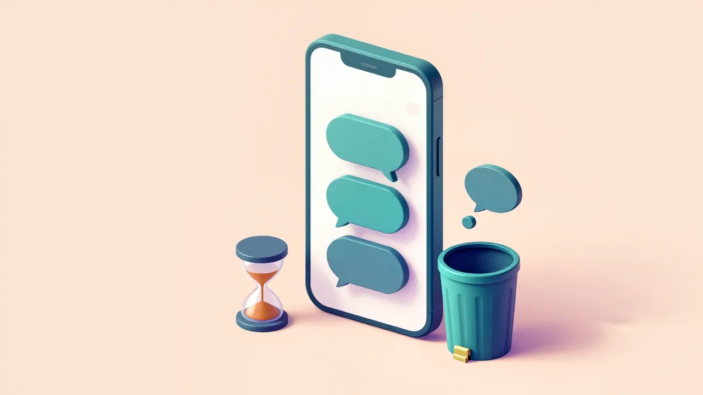
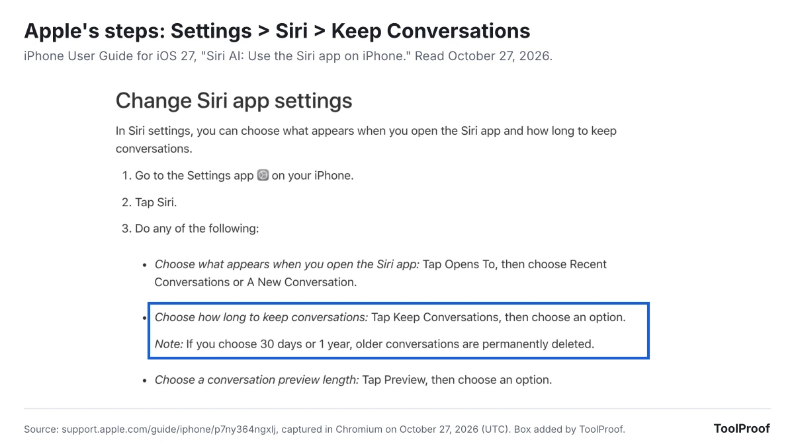

You can see your Siri history on iPhone only if you use Siri AI (Beta) in iOS 27: open the **Siri** app, and your past conversations are listed there. To delete one, touch and hold it and tap **Delete**. To clear old ones automatically, go to **Settings > Siri > Keep Conversations** and choose **30 days** or **1 year**. Classic Siri, the version every other iPhone uses, has no history screen in Apple's guides.

Apple still keeps transcripts of what you ask Siri in two other places: on your iPhone, where Apple's privacy page says **Settings > Siri > Siri & Dictation History > Delete Siri & Dictation History** removes them, and on Apple's servers, under a random identifier, for up to two years. Apple's own pages don't agree on what that delete button covers, and none of its iPhone pages describes a way to delete the server copy.

On October 27, 2026, we read 21 Apple pages, including the iOS 27 iPhone User Guide, the Mac User Guide for macOS 26 and macOS 27, and Apple's Siri privacy pages, and compared what each says about Siri history. We don't have an iPhone in our test setup, so the steps come from Apple's pages, not our own screens.

| What you want to do | Where to go | Works with |
| --- | --- | --- |
| See past Siri conversations | The **Siri** app | Siri AI only |
| Delete one or several conversations | **Siri** app: touch and hold **> Delete**, or **Select** | Siri AI only |
| Delete old conversations automatically | **Settings > Siri > Keep Conversations** | Siri AI only |
| Delete Siri transcripts stored on your iPhone | **Settings > Siri > Siri & Dictation History** | Any Siri, per Apple's privacy page |
| Stop Apple from storing your Siri audio | **Settings > Privacy & Security > Analytics & Improvements** | Any Siri |
| See what went to Apple's AI servers | **Settings > Privacy & Security > Apple Intelligence Report** | iPhone 15 Pro and later |

## Can you see your Siri history on iPhone?

Yes, but only in the Siri app, which appears when you turn on Siri AI (Beta) in iOS 27. Apple's [Siri app guide](https://support.apple.com/guide/iphone/siri-ai-use-the-siri-app-p7ny364ngxlj/ios) describes it as "a dedicated Siri app that brings all your conversations together in one place."

Siri AI isn't on every iPhone. According to Apple's guide, it needs:

- An iPhone 15 Pro, iPhone 15 Pro Max or any iPhone 16 model or later, on iOS 27
- Siri and the iPhone set to English, French, Japanese, Korean, Portuguese or Spanish
- A user aged 13 or older, outside the European Union and mainland China

To turn it on, Apple's [Siri AI guide](https://support.apple.com/guide/iphone/get-started-with-siri-ai-iphv6zwrg8jvfgr/ios) says to go to **Settings > Siri** and tap **Try Siri AI (Beta)**.

With classic Siri, there is nothing to open. Apple's [Siri, Dictation & Privacy page](https://www.apple.com/legal/privacy/data/en/ask-siri-dictation/), dated September 14, 2026, says "a history of your Siri and Dictation interactions is stored on your device" and may be used to personalize Siri, but none of the Apple pages we read describes a screen that lists those past requests.

## How to see Siri history in the Siri app

The Siri app shows your conversation history as soon as you open it, unless it's set to start a new conversation. Apple's guide gives these steps:

1. Open the **Siri** app.
2. If it opens to a new conversation, tap the history button to see your past conversations.
3. To switch the layout, tap the button in the top-right corner, then **Grid** or **List**.

From the same screen, you can search your conversations, pin one by touching and holding it and tapping **Pin**, or rename it with **Rename**. To have the app always open to your history, go to **Settings > Siri > Opens To** and choose **Recent Conversations**.

Your Siri app history isn't only on your iPhone. Apple's guide says it "syncs across platforms when you're signed in to the same Apple Account," and the [iOS 27 release notes](https://support.apple.com/en-us/149076) say the app "privately syncs conversations across your Apple products with iCloud." So the same list can show up on your iPad or Mac when they use the same Apple Account.

## How to delete Siri conversations

You delete Siri conversations inside the Siri app, one at a time or several at once:

1. Open the **Siri** app.
2. To delete one conversation, touch and hold it, tap **Delete**, then tap **Delete** again to confirm.
3. To delete several, tap the button in the top-right corner, tap **Select**, choose the conversations, tap the trash button, then tap **Delete**.

Apple's guide doesn't mention a button that deletes every conversation at once, so for a full clear-out, use **Select** and choose them all.

## How to delete old Siri conversations automatically

**Keep Conversations** in Siri settings deletes old Siri app conversations for you. Go to **Settings > Siri > Keep Conversations** and pick an option. Apple's guide says: "If you choose 30 days or 1 year, older conversations are permanently deleted."

Apple's guide doesn't name the third option or say which one is the default, as of October 27, 2026, so check the setting yourself rather than assuming old chats already expire.

Deleting matters more since iOS 27.2. Apple's release notes for the October 26, 2026 update say "Siri AI can recall your past conversations," and Apple doesn't say whether deleting a conversation also removes what Siri retained from it. Our [look at iOS 27.2's Siri changes](/posts/ios-27-2-siri-ai-memory) covers the new data Siri AI reads and the Excluded Apps setting that limits it.

## How to delete Siri & Dictation History

Apple's privacy page says **Delete Siri & Dictation History** removes "the transcripts of your Siri and Dictation requests that are stored on your device." The steps it gives:

1. Open **Settings** and tap **Siri**.
2. Tap **Siri & Dictation History**.
3. Tap **Delete Siri & Dictation History**.

Apple's privacy page doesn't tie this button to one version of Siri, and it also covers Dictation, the feature that types what you say. But Apple's pages describe the button in different ways:

- **Siri, Dictation & Privacy** (September 14, 2026): deletes the transcripts stored on your device.
- **Mac User Guide for macOS Tahoe 26:** the same button on a Mac deletes request history, "both audio recordings and transcripts," that is tied to a random identifier and "less than six months old." It needs an internet connection.
- **Mac User Guide for macOS 27:** has no page for it. The old link opens the guide's front page, and that page's version list starts at macOS Tahoe 26.
- **iPhone User Guide, "Change Siri settings":** the iOS 27 page doesn't mention Siri & Dictation History, and neither do its iOS 26 and iOS 18 versions.

The privacy page also uses older menu names in other places, such as **Talk to Siri**, which Apple's iOS 27 guide now calls **Requests**. So the button may sit somewhere slightly different on your iPhone, and we couldn't check a real screen.

If you can't find it, the same privacy page gives another way: "If you turn off both Siri and Dictation, the transcripts of your Siri and Dictation requests that are stored on your device … will be deleted." Apple's iOS 27 guides put those switches here:

1. Turn off Siri: go to **Settings > Siri**, tap **Turn Off Siri** at the bottom, then tap **Turn Off Siri** again.
2. Turn off Dictation: go to **Settings > General > Keyboard** and turn off **Enable Dictation**.
3. Turn Siri back on later with **Settings > Siri > Turn On Siri**. On a Siri AI iPhone, Apple's guide says you can choose **Use Siri Classic** at that step.

Apple's pages don't say what turning Siri off does to Siri app conversations, so delete those in the Siri app first if you want them gone too.

## The copy of your Siri history Apple keeps

Apple keeps its own copy of your Siri requests on its servers, and its iPhone pages only describe deleting the transcripts on your device. Apple's privacy page says your request history, meaning transcripts plus details such as the type of request, your device and, if Location Services is on for Siri, your approximate location, is tied to "a random, device-generated identifier that rotates multiple times per hour and is not tied to your Apple Account." Apple "may retain and use this data for up to two years," and the small subset of transcripts Apple reviews "may be kept beyond two years."

None of the iPhone pages we read describes a way to delete that copy. The only Apple page that says its button reaches Apple's records is the macOS 26 Mac guide, and only for requests under six months old.

Two other kinds of Siri history sit outside these settings:

- **Requests Siri passed to ChatGPT.** Apple's [ChatGPT guide](https://support.apple.com/guide/iphone/turn-on-chatgpt-iph00fd3c8c2/ios) says that if you want requests saved to your ChatGPT chat history, you must be signed in to a ChatGPT account, and then OpenAI's privacy policies apply. Without an account, OpenAI must not store your request or its responses unless the law requires it. To stop handing requests over, go to **Settings > Siri > ChatGPT** and turn off **Use ChatGPT**, or with Siri AI, **Settings > Siri > Extensions > ChatGPT** and turn off **Use Extension**.
- **Siri settings saved in iCloud.** Your Siri settings sync through iCloud, and Apple's [iCloud guide](https://support.apple.com/guide/icloud/mm155e8d9577) puts the switch at **Settings >** your name **> iCloud > See All > Siri > Sync this iPhone**. Apple's [iCloud security overview](https://support.apple.com/en-us/102651) says this "Siri information" includes "Siri Settings and personalization and, if you have set up Hey Siri, a small sample of your requests," and is end-to-end encrypted. That page dates from January 5, 2026, before iOS 27, and doesn't mention Siri app conversations.

## How to stop Apple from keeping your Siri recordings

Turn off **Improve Siri & Dictation** under **Settings > Privacy & Security > Analytics & Improvements** to keep Apple from storing the audio of your Siri requests. Apple's [Improve Siri and Dictation page](https://www.apple.com/legal/privacy/data/en/improve-siri-dictation/) says that if you opt in, Apple may store your audio and a subset may be reviewed, with audio reviewed only by Apple employees. If you never opted in, the main privacy page says "your audio data is not stored by Apple."

This switch covers audio. Apple's privacy page describes keeping transcripts for up to two years in its default setup too, so turning it off doesn't end that.

## How to see what Siri sent to Apple's servers

The **Apple Intelligence Report** lists the requests your iPhone sent to Private Cloud Compute, Apple's servers for its larger AI models. According to Apple's [Apple Intelligence privacy guide](https://support.apple.com/guide/iphone/apple-intelligence-and-privacy-iphe3f499e0e/ios):

1. Go to **Settings > Privacy & Security > Apple Intelligence Report**.
2. Choose the last 15 minutes, which is the default, or the last 7 days.
3. Tap **Export Activity**, choose where to save the file, then tap **Export**.

The file is called Apple_Intelligence_Report.json, and Apple says to open it with a text reader. It's a technical record rather than a list of conversations. Apple says data sent to Private Cloud Compute "is not stored or made accessible to Apple" after your request is answered.

## Is Siri search history something else?

Searches you ask Siri to make are part of your Siri history. The search history people usually mean on an iPhone is Safari's: to hide the recent searches that appear in Safari's search field, Apple's [Safari guide](https://support.apple.com/guide/iphone/hide-recent-searches-iph9c79f9786/ios) says to go to **Settings > Apps > Safari** and turn off **Show Recent Searches**.

With **Help Apple Improve Search** on, Apple stores the searches you make in Safari, in Spotlight and through Siri "in a way that is not linked to you," according to its [search privacy page](https://www.apple.com/legal/privacy/data/en/siri-suggestions-search/). To stop that, go to **Settings > Search** and turn it off. The page adds that searches made through Siri are still stored for Siri if **Improve Siri & Dictation** is on.

## FAQ

### Can someone else see my Siri history?

Anyone who can open your Siri app can see your Siri AI conversations, and because the history syncs, that can include your iPad or Mac signed in to the same Apple Account. Classic Siri's history has no screen to look at. To limit what Siri can do on a shared or child's iPhone, our guide to [turning off Apple Intelligence on iPhone](/posts/turn-off-apple-intelligence-iphone) covers the Screen Time lock.

### Does deleting Siri history on iPhone delete it on my Mac?

Apple's guide says Siri app conversations sync across devices with the same Apple Account, but it doesn't say separately what happens on your other devices when you delete one. For Siri & Dictation History, Apple's macOS 26 Mac guide describes a separate **Delete Siri & Dictation History** button in **System Settings > Apple Intelligence & Siri**, so check each device.

## Which setting should you change?

- **You use Siri AI and don't want a long record:** set **Keep Conversations** to **30 days**, then delete anything older in the Siri app.
- **You want Siri's saved transcripts off your iPhone:** use **Delete Siri & Dictation History**, or turn Siri and Dictation off and back on if you can't find it.
- **You don't want Apple to keep recordings of your voice:** turn off **Improve Siri & Dictation**.
- **You'd rather not have Siri AI at all:** switch to Siri Classic. Our [guide to turning off AI in Chrome, Gmail, Word and more](/posts/turn-off-ai-features) covers iPhone alongside other apps, and if you also use Gemini, our guide to [turning off Gemini Apps Activity](/posts/turn-off-gemini-apps-activity) covers what Google keeps.

## How we checked

On October 27, 2026 (UTC), we opened 21 Apple pages in Chromium and saved their text: 10 pages of the iPhone User Guide for iOS 27 (the Siri app, Siri settings, Siri AI, turning Siri on, Dictation, Search, Apple Intelligence and privacy, ChatGPT and Safari recent searches), the iOS 26 and iOS 18 versions of the Siri settings page, the Mac User Guide's "Delete Siri and Dictation history" page for macOS Tahoe 26 and Sequoia 15 and its macOS 27 address, Apple's three Siri and search privacy pages (all dated September 14, 2026), the iCloud guide for Siri, Apple's iCloud security overview and the iOS 27 release notes (updated October 26, 2026). We searched every page for history, delete, recall and memory, and compared the privacy page with the copy we saved on October 26, 2026: it hadn't changed.

We don't have an iPhone in our test setup, so we couldn't open the Siri app or confirm where **Siri & Dictation History** sits in iOS 27's Settings. Where Apple's pages disagree, we've said so rather than picking one.
