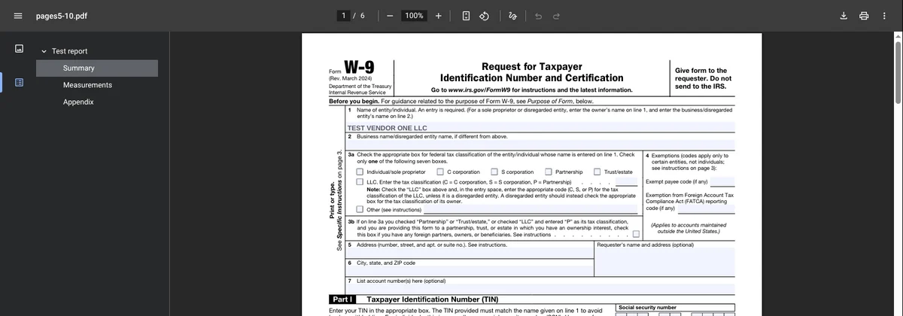
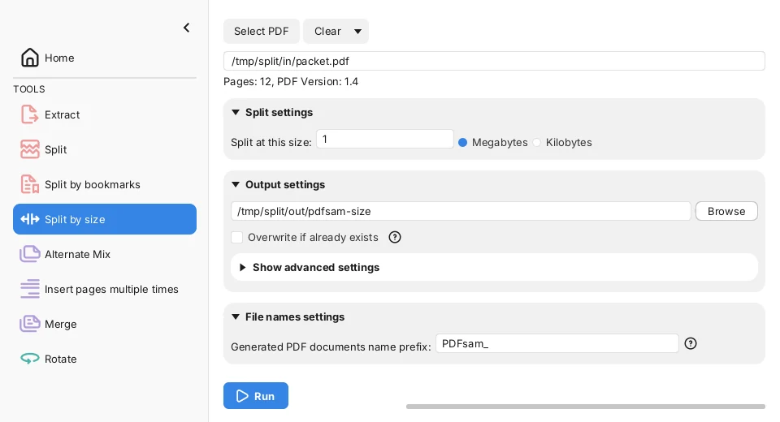
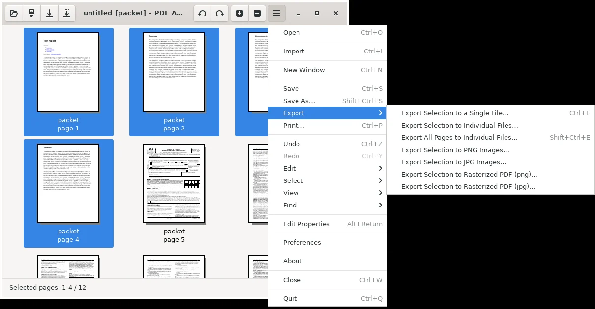
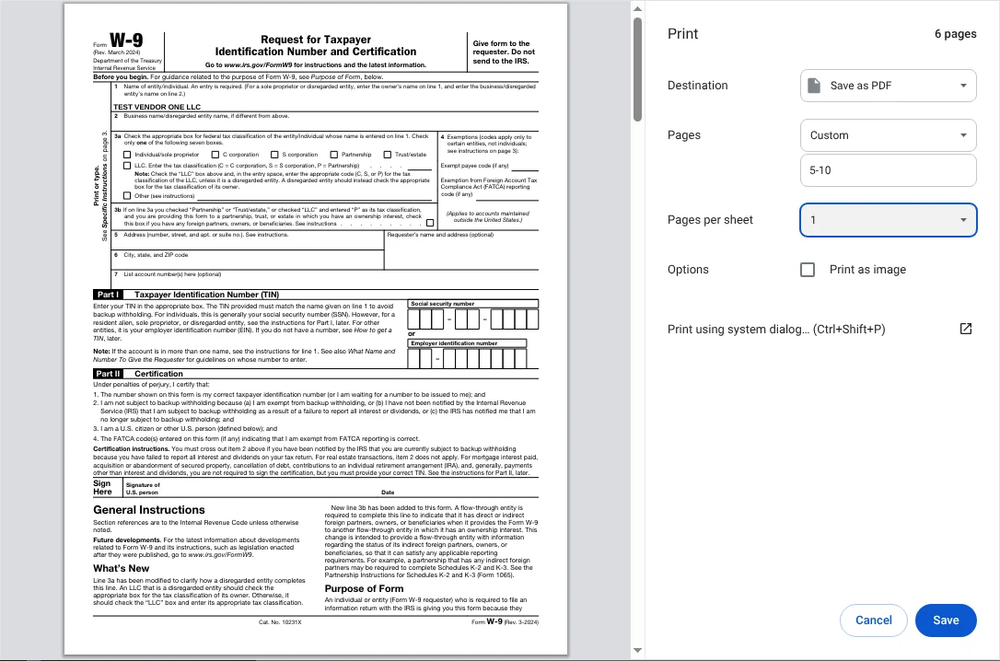

To split a PDF for free, use the free PDFsam Basic app if the file has fillable form fields, bookmarks or clickable links, and use Chrome's **Print > Save as PDF** only for plain pages you just need to read or print. In our test, both PDFsam Basic and PDF Arranger, another free app, kept every bookmark, every table-of-contents link and a fillable IRS form exactly as they were. Chrome kept the text and photos, but the form it saved could no longer be filled in, and the bookmarks and links were gone.

We tested this on October 17, 2026, by splitting the same 12-page PDF three ways: a 4-page report with bookmarks and a clickable table of contents, a 6-page IRS Form W-9 with the name line filled in, and two pages of photos. With each method we saved the report and the form as separate files, saved one photo page on its own, and (where the app could) split the whole file into one PDF per page. Then we opened every result in Chrome's PDF viewer and checked it page by page. Everything here runs on your own computer, so the file is never uploaded.

## Free ways to split a PDF at a glance

| Method | Works on | Keeps fillable forms | Keeps bookmarks and links | One file per page in one step |
| --- | --- | --- | --- | --- |
| **PDFsam Basic** (free app) | Windows, Mac, Linux | Yes | Yes | Yes, plus split by size or by bookmarks |
| **PDF Arranger** (free app) | Windows, Linux | Yes | Yes, but may add leftover bookmarks | Yes |
| **Chrome: Print > Save as PDF** | Any computer with Chrome | No (flattened) | No | No, one range per save |
| **Preview** (built into Mac) | Mac | Not tested | Not tested | Drag pages out one group at a time |

The first three rows are what we measured. The Preview row is based on Apple's documentation, because we couldn't run macOS in our test setup.

## How we tested

We built one 12-page test file so that each part of it checks something different:

- **Pages 1 to 4**: a report we made, with 4 bookmarks (the clickable outline in a PDF viewer's sidebar), a table of contents with 3 links that jump to later pages, and 1 link to a website
- **Pages 5 to 10**: the IRS [Form W-9](https://www.irs.gov/pub/irs-pdf/fw9.pdf) (Rev. March 2024), a public fillable form, with a test business name typed into line 1
- **Pages 11 and 12**: two public-domain photos, one per page, about 1.2 MB each

We split it with [PDFsam Basic](https://pdfsam.org/download-pdfsam-basic/) 6.0.6, [PDF Arranger](https://flathub.org/apps/details/com.github.jeromerobert.pdfarranger) 1.14.0 and the print preview of Chromium 141, the open-source browser that Chrome is built on. We clicked through each app's own screens on a Linux computer; PDFsam Basic 6.0.6 is also the current Windows and Mac version. For each output file we compared the text on every page with the original, checked that the photo was the identical image file and not re-compressed, counted the bookmarks and links and where they lead, and clicked into the W-9's name line in Chrome to see whether it could still be edited.

## Results: what each method keeps and drops

All three methods kept the text of every page word for word, and none of them re-compressed the photos: the photo page we saved on its own contained the original image data byte for byte, at about 1.19 MB with every method. The differences were in the parts of a PDF that do something when you click them.

| Split result | PDFsam Basic | PDF Arranger | Chrome Save as PDF |
| --- | --- | --- | --- |
| Report (pages 1 to 4): bookmarks | 4 of 4 | 4 of 4 | 0 of 4 |
| Report: contents links that jump to the right page | 3 of 3 | 3 of 3 | 0 of 3 |
| Report: website link still clickable | Yes | Yes | No |
| W-9 (pages 5 to 10): name line still editable | Yes | Yes | No |
| W-9: bookmarks from the report left inside | None | 4, leading nowhere | None |
| File size: report / W-9 | 29 KB / 59 KB | 33 KB / 77 KB | 31 KB / 78 KB |

### Chrome's Save as PDF flattens fillable forms

Chrome's print-to-PDF makes a new PDF that looks like a printout of the pages, so anything interactive is lost. The W-9 it saved still showed the business name we had typed, but as plain printed text: clicking line 1 and typing did nothing, and the empty boxes and checkboxes could not be filled in either. The same W-9 split with PDFsam Basic or PDF Arranger accepted typing right away.

This matters most when you pull a form out of a bigger packet to send it to someone else to fill in, such as a W-9, a rental application or a permission slip. If the pages only need to be read or printed, Chrome's result is fine.

### PDF Arranger can leave bookmarks that lead nowhere

When we saved only the W-9 pages with PDF Arranger, the new file still listed the report's bookmarks in Chrome's sidebar: **Test report**, **Summary**, **Measurements** and **Appendix**. Clicking them did nothing, because those pages weren't in the file. PDFsam Basic only kept bookmarks that point to pages inside each new file, so its W-9 had none.

PDF Arranger's [user manual](https://github.com/pdfarranger/pdfarranger/wiki/User-Manual) explains why: since version 1.14.0, a preference called **Preserve document information from the first file opened** copies the outline (bookmarks) and links from the file you opened. The leftovers are harmless, but they can confuse whoever receives the file. The same setting decides which bookmarks survive a merge, as our [test of free ways to merge PDF files](/posts/merge-pdf-files-free) shows.

## How to split a PDF with PDFsam Basic (Windows and Mac)

PDFsam Basic is free and open source, and it works offline. According to its [download page](https://pdfsam.org/download-pdfsam-basic/), it runs on Windows 10 or later (64-bit), macOS 11 Big Sur or later and Linux. The Windows downloader also offers to try PDFsam Enhanced, a separate product you don't need for splitting. When the app opens, it may show a notice about PDFsam Visual, another product; you can close it.

To pull certain pages out into new files:

1. Open PDFsam Basic and click **Extract**.
2. Drag your PDF into the box, or click **Add** and choose it.
3. In **Extract pages**, type the pages you want, such as **1-4,5-10**. Use commas to list several ranges.
4. To get one file per range instead of one combined file, check **A separate file for each set of pages**.
5. Under **Output settings**, pick the folder for the new files, then click **Run**.

Our run made two files named 1_PDFsam_packet.pdf and 5_PDFsam_packet.pdf. The number at the start is the first page of each range, and **PDFsam_** is a prefix you can change at the bottom of the screen.

To split every page into its own file, click **Split** in the left menu instead, choose the PDF with **Select PDF**, leave **Split after** set to **Every page**, and click **Run**. Our 12-page file became 12 PDFs, 2.69 MB in total against 2.57 MB for the original. Each single-page file kept the bookmark for its own page, and the contents links on page 1 were removed because the pages they pointed to were now in other files.

### Split a PDF by file size (for email limits)

PDFsam Basic's **Split by size** tool cuts a PDF into parts under a size you set, which helps when an email or upload form has a limit. Personal Gmail accounts, for example, can attach up to 25 MB, and [Gmail's help page](https://support.google.com/mail/answer/6584?hl=en) says larger attachments are replaced with a Google Drive link, as we covered in our guide to [compressing videos for Discord and email](/posts/compress-video-for-discord-email).

It never splits inside a page, so a single page that is bigger than your limit stays over it. When we split our 2.57 MB file at 1 MB, we got three files: pages 1 to 10 at 87 KB, and each photo page on its own at 1.19 MB and 1.28 MB. PDFsam describes this tool as splitting into files of the given size "(roughly)". If one page is too big, shrink its images first, for example with our [tested settings for compressing images to 100 KB](/posts/compress-image-to-100kb), and rebuild the PDF, or run the whole file through one of the [free PDF compressors we tested](/posts/compress-pdf-free).

## How to split a PDF with PDF Arranger (Windows)

PDF Arranger is a free, open-source app for rearranging PDF pages by dragging thumbnails. Its [list of packages](https://github.com/pdfarranger/pdfarranger/wiki/Binary-packages) includes an official Windows installer and Linux versions, but no Mac version.

1. Open your PDF in PDF Arranger. You'll see a thumbnail of every page.
2. Click the first page you want, then hold **Shift** and click the last one. The bottom bar shows the selection, such as **Selected pages: 1-4 / 12**.
3. Click the menu button (three lines) at the top right, then **Export > Export Selection to a Single File**. The shortcut is **Ctrl+E**.
4. Type a file name and click **Save**.

To make one file per page, choose **Export All Pages to Individual Files** (**Shift+Ctrl+E**) instead. Our 12 pages became 12 PDFs, 2.73 MB in total. The W-9 page in that set still accepted typing in Chrome.

## How to split a PDF in Chrome with Save as PDF

If you can't install an app, Chrome can save a range of pages as a new PDF. Use it for pages that only need to be read, not filled in or clicked through.

1. Open the PDF in Chrome.
2. Press **Ctrl+P** on Windows or **Command+P** on a Mac to open print preview.
3. Set **Destination** to **Save as PDF**.
4. Set **Pages** to **Custom** and type the range, such as **5-10**.
5. Click **Save** and choose where to save the new file.

Google's [Print from Chrome help page](https://support.google.com/chrome/answer/1069693) covers the same print preview. Each save makes one file, so splitting a file into many parts means repeating these steps for every range. We left **Print as image** unchecked, which kept the text selectable.

## How to split a PDF on a Mac with Preview

Preview, the PDF viewer built into every Mac, can make a new PDF from some of a document's pages. We couldn't run macOS in our test setup, so these steps come from Apple's [Preview user guide](https://support.apple.com/guide/preview/add-delete-or-move-pdf-pages-prvw11793/mac), and we haven't checked what Preview keeps of forms, bookmarks or links.

1. Open the PDF in Preview.
2. Choose **View > Thumbnails** to show the page thumbnails in the sidebar.
3. Select the pages you want. Hold **Command** and click to pick pages that aren't next to each other.
4. Drag the selected thumbnails from the sidebar to your desktop. Preview creates a new PDF with just those pages.

Apple warns that Preview saves changes automatically. If you plan to delete pages from a PDF instead of dragging them out, choose **File > Duplicate** first so the original stays intact. For a file with fillable forms, PDFsam Basic for Mac is the method we confirmed.

## Other tools we looked at

- **Online splitters** such as iLovePDF, Smallpdf and Sejda show up in most searches for "split pdf." They need you to upload the file to their servers, so we left them out of this offline test. Think twice before uploading tax forms or anything with personal details.
- If your split pages are scans and you need to copy their text, see our guide to [copying text from images and scans for free](/posts/image-to-text-offline-free).

## Which one should you use?

- **The PDF has a fillable form, bookmarks or links:** PDFsam Basic. It kept all three and added nothing extra.
- **You want to pick pages visually and you're on Windows:** PDF Arranger. It kept forms and links too, but check the sidebar for leftover bookmarks before you send the file.
- **You need one quick range and can't install anything:** Chrome's **Save as PDF**, for pages that will only be read or printed.
- **You're on a Mac without extra apps:** Preview's drag-out method, per Apple's guide.

If you're working with photos from an iPhone before putting them into a PDF, our test of [free HEIC to JPG converters](/posts/convert-heic-to-jpg-free) shows which settings keep their colors and dates.

For the free tool we'd pick for merging, compressing and converting PDFs too, see our [roundup of the best free PDF tools](/posts/best-free-pdf-tools).
