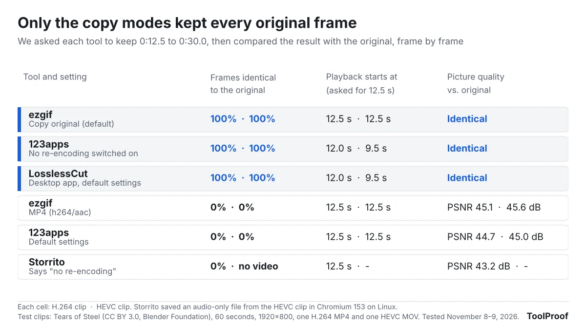
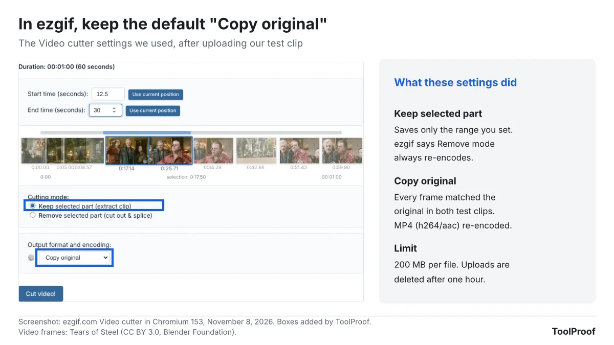
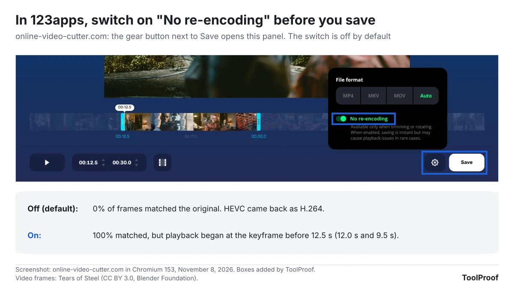
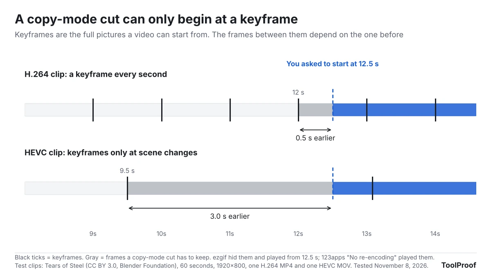

To trim a video without losing quality, use a tool that copies the original video data instead of re-encoding it. In our test, ezgif's free Video cutter did that by default with its **Copy original** setting, and 123apps' Video Trimmer did it only after we switched on **No re-encoding**, which is off by default. The catch with any copy-mode cut is the start point: it can only begin at a keyframe, so your clip may start a little before the moment you picked.

On November 8, 2026, we trimmed the same 17.5 seconds out of two 60-second test clips, an H.264 MP4 and an HEVC MOV, in three free online trimmers and five settings. Then we compared every frame of each result with the original. The two copy modes returned 100% identical frames. Every other setting re-encoded the video, including Storrito's trimmer, which advertises "no re-encoding".

| Tool and setting | Kept the original frames? | Starts where you asked? | Free limit |
| --- | --- | --- | --- |
| **ezgif**, Copy original (default) | Yes, 100% | Yes, in our playback check | 200 MB per file |
| **123apps**, No re-encoding on | Yes, 100% | No, at the keyframe before it | Up to 4 GB, per its site |
| ezgif, MP4 (h264/aac) | No, re-encoded | Yes | 200 MB per file |
| 123apps, default settings | No, re-encoded | Yes | Up to 4 GB, per its site |
| Storrito | No, re-encoded, and no video from our HEVC clip | Yes | Runs in your browser |

## What does "without losing quality" mean for a trimmed video?

A trim is lossless when the new file holds the same compressed picture data as the original, so every frame decodes to exactly the same pixels. Most editors instead re-encode: they decode each frame and compress it again, which is like photocopying a photocopy. The website of LosslessCut, a desktop trimmer built around copying, describes the same problem: with a normal editor, you "gradually lose quality every time a file is processed."

To check which tools really copy, we gave each output frame a digital fingerprint (an MD5 checksum of the decoded picture) and looked for the same fingerprint in the original. A copied frame matches exactly. A re-encoded frame never does. For those files we measured how close the picture stayed with PSNR, a standard score where higher means closer to the original.

The re-encoded files in our test were close: 43.2 to 45.6 dB. In the frames we compared side by side, we couldn't reliably tell them apart from the original by eye. The loss still adds up if you trim, edit and export the same video again, and the tools that re-encoded also cut the sound from 192 kbps to about 130 kbps.

## Which free online video trimmers keep the original quality?

Only ezgif's Copy original and 123apps' No re-encoding kept every frame identical in our test, with both the H.264 and the HEVC clip. The other three settings re-encoded the video, and ezgif's MP4 option and 123apps' default both turned our HEVC clip into H.264.

| Tool and setting | Identical frames (H.264, HEVC) | Picture vs. original | File size (H.264, HEVC) | Video in the result |
| --- | --- | --- | --- | --- |
| ezgif, Copy original | 100%, 100% | Identical | 15.7 MB, 9.6 MB | Original H.264 and HEVC |
| 123apps, No re-encoding | 100%, 100% | Identical | 15.7 MB, 9.6 MB | Original H.264 and HEVC |
| ezgif, MP4 (h264/aac) | 0%, 0% | PSNR 45.1 dB, 45.6 dB | 7.1 MB, 6.4 MB | New H.264 for both |
| 123apps, default (MP4) | 0%, 0% | PSNR 44.7 dB, 45.0 dB | 14.8 MB, 12.3 MB | New H.264 for both |
| Storrito | 0%, no video | PSNR 43.2 dB | 8.1 MB, 0.3 MB | New H.264, audio only from HEVC |

The copy-mode files are larger because they keep the original's compression, and they also carry a few frames from before the start point. The keyframe section below explains where those frames come from.

## How to trim a video in ezgif without losing quality

ezgif keeps the original video and sound as long as you leave two settings at their defaults: **Keep selected part** and **Copy original**. ezgif's page says the same, and adds that its Remove mode, which cuts a section out of the middle, always re-encodes.

1. Go to [ezgif.com/cut-video](https://ezgif.com/cut-video), click **Choose file**, pick your video and click **Upload video!** The limit is 200 MB per file.
2. Type the **Start time (seconds)** and **End time (seconds)**, or play the video and click **Use current position** at each point.
3. Leave **Cutting mode** on **Keep selected part (extract clip)**.
4. Leave **Output format and encoding** on **Copy original**.
5. Click **Cut video!**, then click **Save** under the result.

Copy original finished in about a second for each clip, while the MP4 (h264/aac) option took about 9 seconds and produced the re-encoded files in our table. ezgif uploads your video to its servers and says it deletes uploads after one hour.

## How to turn on No re-encoding in 123apps Video Trimmer

123apps' trimmer at online-video-cutter.com re-encodes unless you switch on **No re-encoding** in its settings panel before you save. With the switch on, both of our clips came back with every frame identical to the original.

1. Go to [online-video-cutter.com](https://online-video-cutter.com/) and open your video.
2. Set the start and end in the two time boxes under the video, or drag the handles on the timeline.
3. Click the gear button next to **Save**.
4. Turn on **No re-encoding**. The **File format** choice switches to **Auto**, because the tool keeps your original format.
5. Click **Save**, wait for the file and download it.

The panel itself warns that No re-encoding "may cause playback issues in rare cases." Our H.264 file played normally in Chromium. 123apps says on its page that it supports files up to 4 GB and deletes them from its servers a few hours after you finish. Its Premium plan lists "Save videos without length limits", which suggests the free version has a length cap. Our 60-second clip didn't hit one.

## Why does a lossless trim start a little early?

A copy-mode trim can only start at a keyframe, a complete picture that the frames after it are built from, so the cut begins at the last keyframe before the point you chose. LosslessCut's website puts the gap at "a fraction of a second up to several seconds earlier depending on the encoding."

That's what we measured. We asked for a start at 12.5 seconds. Our H.264 clip had a keyframe every second, so the nearest one before our start was at 12.0 seconds. Our HEVC clip only had keyframes where the scene changed, and the nearest one was at 9.5 seconds.

The two copy modes dealt with those extra frames differently:

- **ezgif** kept the frames from the keyframe onward in the file but marked them to be skipped, so playback in Chromium started exactly at 12.5 seconds. The file still carries 0.5 seconds of hidden video from the H.264 clip and 3.0 seconds from the HEVC clip. We only played the results in Chromium, so we can't say every player and editor skips them the same way.
- **123apps** with No re-encoding started the clip at the keyframe itself, so our H.264 clip played from 12.0 seconds and the HEVC clip from 9.5 seconds.

Both copy modes ended two frames (0.08 seconds) after the end point we asked for. If a few extra seconds at the start matter, move your start point later, or accept a re-encoded copy, which started on the exact frame in every test.

## Did Storrito's "no quality loss" trimmer keep the original?

No, not in our test. Storrito's free trimmer at storrito.com/tools/video-trim says that "there is no re-encoding - the original codec is preserved - so quality is identical to the source," and that your video isn't uploaded. The file it saved from our H.264 clip had 0% of frames identical to the original, a PSNR of 43.2 dB and half the original's video bitrate, and its sound had changed from AAC to Opus.

We repeated the trim starting exactly on a keyframe, at 12.0 seconds, in case that let it copy the video. The result was still re-encoded, at 43.3 dB. From our HEVC clip, Storrito saved a 285 KB file with sound and no video, and its status line still read "Saved clip-hevc-trimmed.mp4."

We ran Storrito in Chromium 153 on Linux, which couldn't display our HEVC video at all, and the tool relies on the browser to read and write the video. Chrome on Windows or a Mac may behave differently. We didn't test that, so treat our result as one browser's.

## Can you trim a video without re-encoding on iPhone, Android, Windows or Mac?

The trim tools built into phones and computers save a new file, but Apple's, Google's and Microsoft's instructions don't say whether that file is re-encoded. We don't have those devices in our test setup, so we couldn't measure them.

- **iPhone, iPad and Mac Photos:** Apple's [video editing guide](https://support.apple.com/104968) has you drag the sliders, tap **Done**, then choose **Save Video** (keeps only the trimmed version) or **Save Video as New Clip** (keeps the original and adds the trimmed copy).
- **Mac QuickTime Player:** choose **Edit > Trim**, drag the yellow handles and click **Trim**, according to Apple's [QuickTime Player guide](https://support.apple.com/guide/quicktime-player/qtpf2115f6fd/mac). Holding a handle shows individual frames for a precise cut.
- **Windows Photos:** Microsoft's [Photos help page](https://support.microsoft.com/en-us/windows/apps/photos/edit-photos-and-videos-in-windows) has you open the video, select **Trim (Ctrl + E)**, then choose **Save as Copy**, or the option in the drop-down that overwrites the original.
- **Google Photos on Android:** drag the trim handles and tap **Save**, which saves a copy with your edits, per [Google Photos Help](https://support.google.com/photos/answer/10729480?hl=en).

If you want a desktop app made for copy-mode trimming, [LosslessCut](https://losslesscut.app/) is free from its website and GitHub, and paid in the Microsoft Store and Mac App Store to support the developer. It runs on Windows 10 and 11, macOS 13 or newer, and Linux. We couldn't run desktop apps in this test, so this comes from its website, which also warns about unofficial download sites. The keyframe rule above applies to LosslessCut too.

## Which method should you use?

- **A short clip under 200 MB that isn't private:** ezgif with **Copy original**. It kept every frame and started where we asked.
- **A bigger file:** 123apps with **No re-encoding** switched on, and expect the clip to start at the keyframe before your start point.
- **A private video:** a desktop app keeps the file on your computer. Online trimmers upload it, apart from browser-based ones like Storrito, which didn't keep the original quality in our test.
- **The exact first frame matters more than a perfect copy:** a re-encoded trim, such as ezgif's **MP4 (h264/aac)**, starts on the frame you pick and stayed close to the original in our test.

If the clip is still too big to send after trimming, our test of how to [compress a video for Discord and email](/posts/compress-video-for-discord-email) shows which settings hit a size limit with the least loss. For an iPhone, Apple's [HEIF and HEVC guide](https://support.apple.com/en-us/116944) says **Settings > Camera > Formats > Most Compatible** records new videos as H.264 instead of HEVC, the same trade-off we covered for [converting HEIC photos to JPG](/posts/convert-heic-to-jpg-free). More free tools we've tested are in our [guide to free image converter and photo tools](/posts/free-image-converter-photo-tools).

## FAQ

### Does trimming a video reduce its quality?

Only if the tool re-encodes it. A copy-mode trim, like ezgif's Copy original, kept every frame of our test clips identical to the original. Re-encoding tools scored 43.2 to 45.6 dB PSNR against the original: close, but not the same file.

### Can I trim a video for free without a watermark?

Yes. We didn't see a watermark in any file from ezgif or 123apps, and ezgif's page says it adds none. Clideo, another popular trimmer, showed a **Remove watermark** button on its result page, but its download didn't work in our test browser, so we couldn't check the file.

### Is it safe to upload a video to an online trimmer?

ezgif and 123apps both upload your video to their servers and say they delete it afterward: after one hour on ezgif, a few hours after you finish on 123apps. For videos you wouldn't post publicly, use an app on your own device. If you also share photos, check our guide to [removing location data from photos](/posts/remove-metadata-from-photos) first.

## How we tested

- **Test clips:** 60 seconds from [Tears of Steel](https://mango.blender.org/) (CC BY 3.0, Blender Foundation), 1920×800 at 24 frames per second, saved as two files: an H.264 MP4 with a keyframe every second (61.2 MB) and an HEVC MOV with keyframes at scene changes (40.8 MB), both with 192 kbps AAC sound
- **The trim:** keep 0:12.5 to 0:30.0 (17.5 seconds, 420 frames) in each tool, on November 8, 2026, in Chromium 153 on Linux. Storrito has no time boxes, so we dragged its handles until its display read 12.50 and 30.00
- **Tools and settings:** ezgif Video cutter with Copy original and with MP4 (h264/aac); 123apps Video Trimmer with default settings (MP4) and with No re-encoding; Storrito Trim a video. Clideo reached its result page, but the download link returned an error in our browser, so it isn't in the results
- **Comparison:** we decoded every frame of each result and of the original and compared MD5 checksums of the pictures. For re-encoded files, we matched each result to the original frame by frame and measured PSNR and SSIM (another closeness score, 1.0 = identical; ours were 0.980 to 0.990). Start points come from that matching, and we also opened the H.264 copy-mode files in Chromium to see the first frame it shows
- **Not tested:** the iPhone, Android, Windows and Mac apps and LosslessCut, which come from the official pages linked above; Storrito in Chrome on Windows or a Mac; files longer than 60 seconds or larger than 61.2 MB
