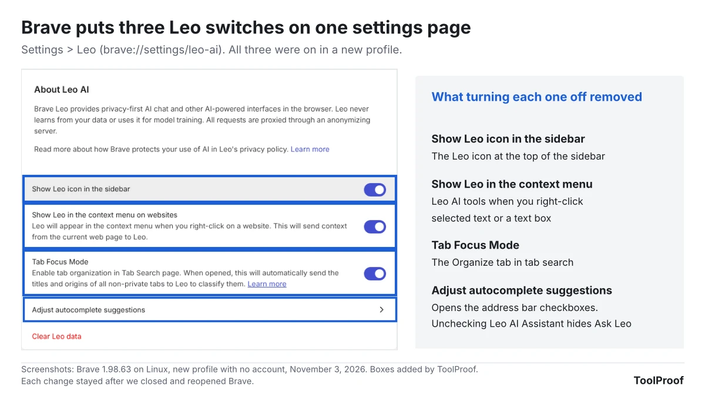
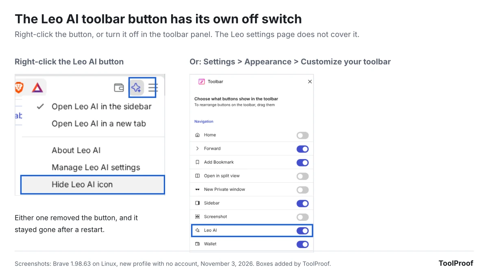
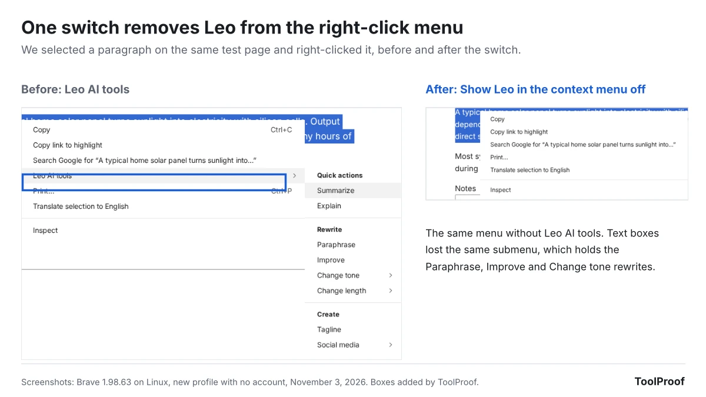
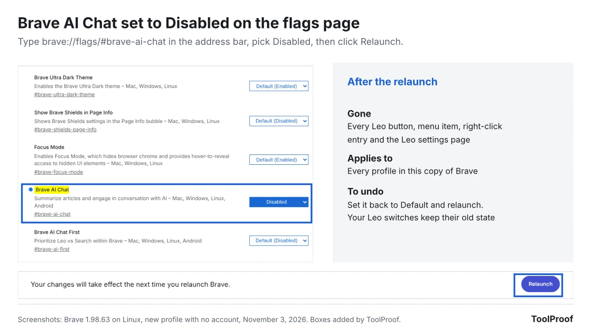
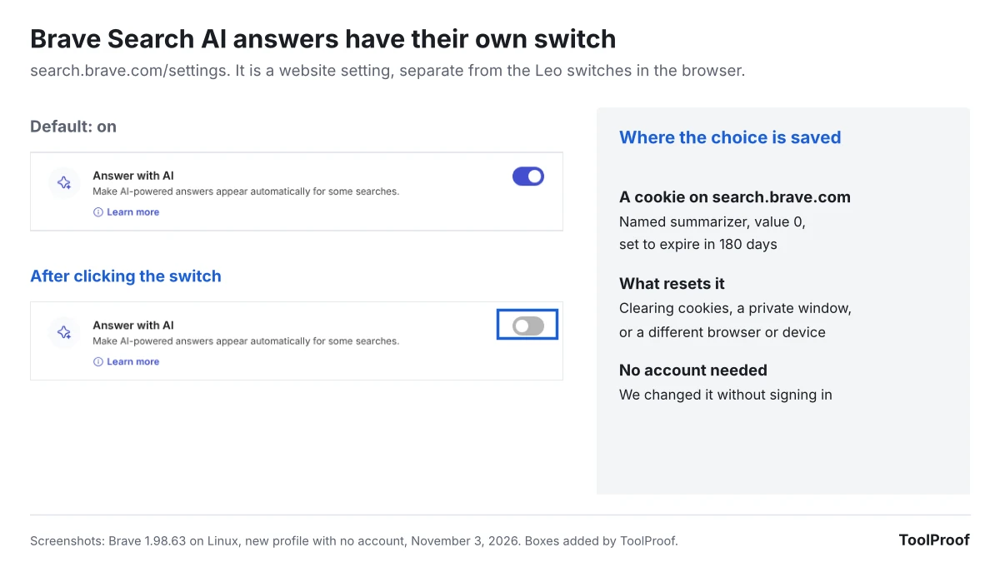

To turn off AI in Brave, right-click the **Leo AI** button on the toolbar and choose **Hide Leo AI icon**, then open **Settings > Leo** and turn off **Show Leo icon in the sidebar**, **Show Leo in the context menu on websites** and **Tab Focus Mode**. Finally, go to **Settings > Appearance** and uncheck **Leo AI Assistant** so the address bar stops offering Ask Leo. Those five switches hide Leo, but they don't remove it. To remove Leo AI completely for free, type **brave://flags/#brave-ai-chat** in the address bar, set **Brave AI Chat** to **Disabled**, and click **Relaunch**.

We tested Brave 1.98.63, the version Brave released on October 30, 2026, on a new profile with no account on November 3, 2026. On November 7, we repeated every step with Brave 1.99.55, released November 5. We turned the switches off one at a time on the same test page and restarted Brave after each change. In both versions, the five switches removed Leo from the toolbar, the sidebar, right-click menus, the address bar and tab search, but **Leo AI** stayed in the main menu and the full Leo chat page still opened. The flag removed all of it. Our test computer ran Linux. Brave publishes one set of desktop release notes for Windows, Mac and Linux, and its flags page lists the Brave AI Chat setting for Mac, Windows, Linux and Android.

| What you want | Where | What happened in our test |
| --- | --- | --- |
| Hide the Leo AI toolbar button | Right-click the button > **Hide Leo AI icon** | The button disappeared |
| Hide the sidebar icon | **Settings > Leo > Show Leo icon in the sidebar** | The Leo icon left the sidebar |
| Remove Leo from right-click menus | **Settings > Leo > Show Leo in the context menu on websites** | **Leo AI tools** disappeared |
| Remove Ask Leo from the address bar | **Settings > Appearance >** uncheck **Leo AI Assistant** | The Ask Leo row disappeared |
| Stop Tab Focus | **Settings > Leo > Tab Focus Mode** | The **Organize** tab left tab search |
| Remove Leo completely | **brave://flags > Brave AI Chat > Disabled** | Every Leo button, menu, setting and the chat page were gone |
| Turn off AI answers in Brave Search | **search.brave.com/settings > Answer with AI** | Saved as a cookie that lasts 180 days |

## How to hide Leo AI in Brave's settings

Hiding Leo AI in Brave takes one right-click on the toolbar and four switches on two settings pages.

1. Right-click the **Leo AI** button (the sparkle star) to the left of the menu button in the top-right corner, and choose **Hide Leo AI icon**. You can also turn off **Leo AI** in **Settings > Appearance > Customize your toolbar**.
2. Click the menu button (three lines), choose **Settings**, and select **Leo** in the left menu. You can also type **brave://settings/leo-ai** in the address bar and press **Enter**.
3. Turn off **Show Leo icon in the sidebar**.
4. Turn off **Show Leo in the context menu on websites**.
5. Turn off **Tab Focus Mode**.
6. Click **Adjust autocomplete suggestions** on the same page. It opens **Settings > Appearance**, where you uncheck **Leo AI Assistant** under **Show autocomplete suggestions in address bar**.

The toolbar button is the step most people miss, because the Leo settings page has no switch for it. In our test, each change was still in place after we closed and reopened Brave.

## What each Leo switch removes

Each Leo switch in Brave 1.98 and 1.99 controls one place where Leo appears, so turning off only the sidebar icon leaves the right-click menu, the toolbar button and the address bar untouched. We checked seven places on the same test page after every change:

- **Toolbar button**: only **Hide Leo AI icon** removed it. Turning off the **Leo AI** switch in the toolbar panel did the same on a second new profile.
- **Sidebar icon**: **Show Leo icon in the sidebar** removed the Leo icon at the top of the sidebar.
- **Right-click menu**: **Show Leo in the context menu on websites** removed **Leo AI tools**, the submenu that appears when you right-click selected text or a text box. It holds **Summarize** and **Explain**, rewrite options such as **Paraphrase** and **Change tone**, and **Tagline** and **Social media** writing. Right-clicking a paragraph without selecting any text didn't show Leo, even before the change.
- **Address bar**: unchecking **Leo AI Assistant** removed the row that offers to send what you typed to Leo, such as "how do solar panels work - Ask Leo".
- **Tab search**: turning off **Tab Focus Mode** removed the **Organize** tab from the tab search box (**Ctrl+Shift+A**).

These switches matter for privacy as well as clutter. Brave's own description of the right-click switch says it "will send context from the current web page to Leo," and Brave's [browser privacy notice](https://brave.com/privacy/browser/) says Leo sends the content of the page you're viewing when you ask for a summary, and the titles and URLs of your open non-private tabs for tab management. In our copy, opening the Organize tab showed an **Enable** button with a notice that Tab Focus would send the titles and origins of all non-private tabs to Leo.

## What stays after you turn every switch off

Leo AI is still one click away after all five switches are off: the main menu keeps a **Leo AI** item, and typing **brave://leo-ai** opens Leo's full chat page with a working message box. The **Leo** section in Settings also stays. That is why the switches hide Leo but don't remove it.

Brave doesn't assign a keyboard shortcut to Leo by default. In **Settings > System > Shortcuts**, our copy listed **Toggle Leo AI** and **Open AI Chat** with no keys, so Leo won't open from a stray key press unless you set one yourself.

## How to remove Leo completely with brave://flags

Setting **Brave AI Chat** to **Disabled** on Brave's experiments page removed every part of Leo we checked, and it took one change instead of five. The flags page is built into Brave and works with a few clicks, but Brave marks everything on it as experimental.

1. Type **brave://flags/#brave-ai-chat** in the address bar and press **Enter**. The **Brave AI Chat** row is highlighted.
2. Open the menu on the right of that row (it says **Default (Enabled)**) and choose **Disabled**.
3. Click **Relaunch** at the bottom of the page. Brave closes and reopens your windows.

We ran this on a separate new profile without touching any Leo switch. After the relaunch, the toolbar button, sidebar icon, **Leo AI tools**, Ask Leo, the Organize tab and the main menu item were all gone. The **Leo** section disappeared from Settings, and **brave://leo-ai** no longer opened at all; Brave treated it as an invalid address.

Know three things before you use it:

- **It covers every profile.** The flag is saved for the whole browser, not one profile, and the flags page warns that "Enabled features apply to all users of this browser."
- **It's undoable.** Set **Brave AI Chat** back to **Default** and relaunch. In our test, Leo came back, and the switches we had turned off earlier were still off.
- **It may not last forever.** The page opens with "Warning: Experimental features ahead!" Brave can rename or remove a flag in a later version, so check this row again after a big update.

On a work computer, your organization can turn Leo off for you with a management policy called **BraveAIChatEnabled**. When we set that policy to off, the **Leo** section disappeared from Settings and **brave://leo-ai** stopped opening, as they did with the flag. Type **brave://policy** in the address bar to see which policies your organization has set.

## Did Brave 1.99 change the Leo switches?

Brave 1.99 didn't change how you turn off Leo. In our November 7, 2026 retest, Brave 1.99.55 showed the same three switches on the **Settings > Leo** page, all on in a new profile. Each of the five switches removed the same place it did in Brave 1.98.63. With all five off, the main menu item, the **brave://leo-ai** chat page and the Leo settings section were still there, as before. On separate new profiles, the **Brave AI Chat** flag and the **BraveAIChatEnabled** policy each still removed every part of Leo we checked.

Brave's [release notes](https://brave.com/latest/) for 1.99.55 list four Leo changes. Leo now shows a list of choices when it needs clarification on a task, its suggested follow-up prompts are improved, and its AI models are updated. The fourth fixes a security issue that could let AI Chat tool requests be approved without a direct user action. None of them adds or renames a switch. The only Leo difference we saw on screen was in the model list under **Settings > Leo**, where three names had changed, such as Grok 4.6 becoming Grok 4.7. The same notes say the Brave Search icon in the address bar is now a magnifying glass, which has nothing to do with Leo.

## Do you need Brave Origin to remove Leo?

You don't need Brave Origin to remove Leo: the free Brave browser removed it with one flag in our test. Brave Origin is a paid version that lets you manage or remove built-in features, Leo among them. It costs a one-time $59.99 in the US on Windows, Mac, Android and iPhone and is free on Linux, according to Brave's [Brave Origin page](https://brave.com/origin/). The same page says that on other platforms, Brave users "are still able to hide or disable unwanted features for free in the non-Origin version of Brave."

Origin makes more sense if you want to switch off a long list of features at once. Brave lists News, Rewards and Brave Ads, VPN, Wallet, Talk and more alongside Leo, and says Origin also removes the daily usage ping, crash logs and product analytics. We didn't buy or test Origin.

## How to turn off AI answers in Brave Search

AI answers in Brave Search are a website setting, separate from Leo, so turning off Leo in the browser doesn't change them. Brave Search is the search engine at search.brave.com, and you can use it in any browser.

1. Go to **search.brave.com/settings**.
2. Turn off **Answer with AI** ("Make AI-powered answers appear automatically for some searches").

With the setting on, our test search for "how do solar panels work" opened with an AI answer labeled "AI-generated answer. Please verify critical facts." Turning the switch off saved a cookie on search.brave.com named **summarizer** with the value 0, set to expire in 180 days. Brave's [anonymous cookies page](https://search.brave.com/help/anonymous-cookies) says every Brave Search setting is remembered this way. So clearing cookies, using a private window, or searching from another browser brings the AI answers back until you switch them off again. We couldn't confirm the results page with the switch off: our second search hit Brave Search's "Verifying you're not a bot" check, and we didn't try to get around it.

Brave's [AI in Brave Search help page](https://search.brave.com/help/ai) also describes **Ask Brave**, a separate chat-style mode with longer answers and follow-up questions. It's the **Ask** tab at the top of the results page.

If your copy of Brave searches with Google instead (ours did in normal windows, and used Brave Search only in private windows), the AI answers come from Google. Our [guide to turning off AI in Chrome, Gmail, Word and more](/posts/turn-off-ai-features) covers what you can and can't switch off in Google Search. For a search engine with no AI answers at all, our guide to [using DuckDuckGo with no AI](/posts/duckduckgo-no-ai) shows how to make its AI-free version your default.

## Can you delete your Leo chat history?

Yes. Brave keeps Leo conversation history on your device, and the [browser privacy notice](https://brave.com/privacy/browser/) says you can turn history off entirely or delete conversations at **brave://settings/leo-ai**. In our copy, **Store my conversation history** was on by default under **Personalization** on that page, and the **Clear Leo data** button was at the bottom of the first box, under the three Leo switches.

Brave's privacy notice also says that Brave doesn't keep your prompts or Leo's answers on its servers, that Leo conversations in private windows are never saved to history, and that clearing your browsing history also removes page content saved in past conversations. If you turn on Brave Sync, your Leo history can be included in it.

## FAQ

### Can you turn off Leo in Brave on Android or iPhone?

We didn't test Brave's phone apps. Brave's flags page lists the Brave AI Chat setting for Android but not for iPhone, and Brave Origin, which can remove Leo, is sold for both Android and iPhone.

### Is Brave Leo free?

Yes, with limits. Brave's privacy notice says Leo "is free to use with limited access," and that Leo Premium adds more models and higher usage limits. You don't need a Brave account for the free version.

### What AI does Brave Search use?

Brave says its search AI is "built in-house and powered by our own models and algorithms," and that parts of AI Answers are built with open-source large language models, according to its [AI in Brave Search help page](https://search.brave.com/help/ai). It's separate from Leo, which lets you pick from a list of models in **Settings > Leo**.

## Which option should you use?

- **You want Leo out of sight**: hide the toolbar button and turn off the four switches in the steps above. You can turn Leo back on any time from **Settings > Leo**.
- **You never want Leo to run**: set **Brave AI Chat** to **Disabled** in **brave://flags**. It removes Leo for every profile on that computer, and you can undo it by choosing **Default**.
- **You also use Brave Search**: turn off **Answer with AI** on **search.brave.com/settings** in each browser you use, because it's saved as a cookie.
- **You switch between browsers**: our guides to [turning off AI in Chrome](/posts/turn-off-ai-in-chrome), [turning off Copilot in Microsoft Edge](/posts/turn-off-copilot-in-edge) and [turning off AI in Firefox](/posts/turn-off-ai-in-firefox) cover the same steps for those browsers. Brave is built on the same open-source base as Chrome, but its Leo switches are its own.

## How we tested

- **Browser**: Brave 1.98.63 (Chromium 156.0.8078.80) for Linux, downloaded from Brave's official Linux package server on November 3, 2026 and checked against the file's published checksum. Brave's [release notes](https://brave.com/latest/) list 1.98.63 as the October 30, 2026 desktop release.
- **Retest**: Brave 1.99.55 (Chromium 157.0.8103.39) for Linux, the November 5, 2026 desktop release, from the same package server on November 7, 2026, checksum checked. We repeated the switch-by-switch run, the flag run and the policy run with the same test page and steps on new profiles. We didn't repeat the Brave Search test, because Answer with AI is a website setting.
- **Profiles**: a new profile with no account and no Brave Rewards for each run, English (US) interface, 1280×900 window.
- **Method**: on the same local test page (a heading, two paragraphs and a text box), we checked the toolbar, the sidebar, a plain right-click, a right-click on selected text, a right-click in a text box with text selected, a question typed in the address bar, and the tab search box. We turned off one switch at a time, closed and reopened Brave, and checked again. We then disabled the Brave AI Chat flag on a second new profile, and set the BraveAIChatEnabled policy to off on a third.
- **Brave Search**: we opened search.brave.com in the same Brave build with a new profile, ran one search with Answer with AI on, turned it off, and read the cookies the site saved. A second search was stopped by a bot check, so we don't show results with the setting off.
- **Not tested**: Brave on Android or iPhone, Brave Origin, and Leo Premium. Brave's help center blocked our test browser with a security check, so this article relies on what we saw in Brave and on Brave's privacy notice, Brave Origin page and Brave Search help pages.
